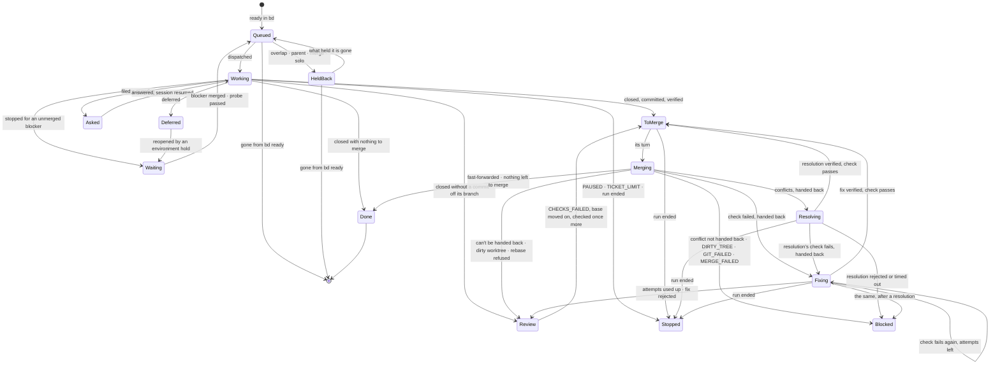

# tutti: specification

A TypeScript port of orchestra. It keeps orchestra's concepts and drops its dependence on terminal multiplexers.

| | |
|---|---|
| Status | Draft 2, 2026-10-16 |
| Port of | orchestra v0.7.7 (Go), github.com/noesis-sol/orchestra |
| Behavioural reference | orchestra v0.7.7's `README.md` and `docs/*.md`: wherever this spec says *as orchestra*, those documents are the authority |
| Checked against | `@anthropic-ai/claude-agent-sdk` 0.3.301 (its type definitions `sdk.d.ts` and README); `effect` 4.0.5 and `@effect/platform-bun` 4.0.5 (their sources); `@opentui/core` and `@opentui/react` 0.6.6 (docs and open issues); Bun's docs |
| Product name | **tutti** (Italian, "all together"). npm has an unrelated, inactive `tutti` package (0.0.10, a browser-testing tool), so the npm name is scoped (§12) and the command is `tutti` |

### Changes in draft 2

A review against the packages themselves found errors and gaps in draft 1.

- **Worker options corrected** (§4.1):
  - `env` replaces the environment, so tutti spreads `process.env`.
  - The permission mode is set explicitly (auto, D11).
  - MCP strictness is the SDK's `strictMcpConfig`.
  - Session IDs are assigned before the session starts.
  - Project settings come from the main checkout (`projectConfigRoot`).
  - tutti's own messages are sent `client_composed`.
- **New sections and rules:**
  - usage limits (§4.12); the login, the account and an API key (§4.13); when sessions are closed (§4.8)
  - your steering beside the automation (§4.3)
  - several requests per worker, and protection against approving the wrong one (§4.5)
  - answering without a dashboard with `tutti answer` (D20); a run that waits for you on screen (D19)
  - untrusted text made safe to display (§7.10); signals and process groups (§3.2)
- **Corrected:**
  - resumed sessions keep their system prompt (§4.8); `system/init` arrives each turn (§4.2)
  - restrictions are enforced with `tools` and hooks, not `canUseTool` (§4.10, §6.3); the interview files through a tool of tutti's (§4.10)
  - Ctrl+Z is disabled (D18)
  - Effect 4 module names (§3.1), Bun's retry flag (§13), the colour minimum (§7.7), coexisting with orchestra (§11)
- **Resolved:** draft 1's Q4 (checking the login) and Q6 (embedding Claude Code).
- **Added after the review:** the ticket state machine (§5.1): the phases a ticket passes through before it is merged and closed, and the transitions between them. Also colour schemes. orchestra's is carried over exactly as the default, and others can be chosen in the settings or written as files (D21, §7.11).

---

## 0. Decisions made

These were settled with the maintainer while writing this spec. Each one shapes a section below.

| # | Decision | Chosen | Consequence |
|---|---|---|---|
| D1 | Language and runtime | TypeScript on **Bun** (≥ 1.3.14). Milestone 0 first proves the Agent SDK under Bun | OpenTUI is Bun-first. The SDK documents Node 18+ and also documents `bun build --compile` (§12). Node is the fallback if a spike fails |
| D2 | Effect | **Effect** for the whole program: services, layers, fibers, scopes, schedules, Schema. Effect wraps the Agent SDK rather than replacing it ("option A") | Every external effect goes through a typed service with a test layer |
| D3 | Workers | **Agent SDK sessions** (`@anthropic-ai/claude-agent-sdk`, streaming input mode), headless. tutti draws their view itself | No Herdr, tmux or cmux; no screen reading and no prompt pasting; exact state from the SDK |
| D4 | Process model | **Single process**. tutti's process owns every worker | Quitting ends the workers' turns. Their sessions are saved and the next run resumes them (§4.8) |
| D5 | Compatibility | **Same concepts, clean break** | New file layout (`.tutti/`), settings schema, event schema, CLI flags and branch names. No carry-over from orchestra runs |
| D6 | UI | **OpenTUI** (`@opentui/core` and `@opentui/react`, 0.6.x) with React 19.2 | Alternate screen, flexbox layout, OpenTUI's own mouse handling and test renderer |
| D7 | Layout | **Today's dashboard and cards**. A worker's output is shown only when you select its card | Selecting a card opens a full-screen worker view: a transcript tutti draws, plus a composer |
| D8 | Attention | A permission request or a worker's question is **answerable on its card or in its view**. Nothing changes view by itself; a notification fires | Requests come through the SDK's `canUseTool` and wait in tutti's attention queue (§4.5) |
| D9 | Mouse | **Single clicks plus keys**. Every click has a key; no double-click meanings | Cards, buttons and tabs are click targets. Text is copied with OpenTUI's selection |
| D10 | Organs | **`effect/ai` `LanguageModel`, provided by a layer over the Agent SDK** (subscription login). An API-key provider can be swapped in by layer | Organs use `LanguageModel.generateObject` with Effect Schema |
| D11 | Worker permissions | **Auto mode**: workers start in `permissionMode: 'auto'`, with your Claude Code settings loaded. Claude Code's classifier approves or denies each tool call; you're asked through `canUseTool` only when it can't decide, or when a rule says to ask. A removal the built-in safety check holds is denied without asking | Few requests reach you. Denials by the classifier and the safety check are logged and tallied for the reviewer (§4.5). `bypassPermissions` is never used |
| D12 | Distribution | **Signed single binaries plus `tutti update`**, as orchestra does | `bun build --compile` for darwin and linux, arm64 and x64, with Claude Code embedded as the SDK's README describes (§12) |
| D13 | Platforms | **macOS and Linux**, in any terminal emulator, inside tmux or over ssh included | No Windows |
| D14 | Repository | **A new product under a new name**: a new repository; orchestra stays as it is | tutti starts at 0.1.0 and reaches 1.0.0 at parity (§14) |
| D15 | Ctrl+C | **Asks**: `s` stop after the running tickets, `q` quit now, `Esc` cancel. A second Ctrl+C quits now | Replaces orchestra's "Ctrl+C stops at once, leaving workers running" (§4.8, §7.4) |
| D16 | Effect version | **Effect 4** (4.0.x, current stable). The AI modules come from `effect/ai` (core), not the v3-era `@effect/ai` 0.x packages | The v3 docs linked during design (`effect.website/docs/v3/ai`) describe the older line. **Confirm this choice** (§15, Q1) |
| D17 | Pre-1.0 and beta dependencies | **Allowed.** tutti is a pet project. OpenTUI (0.x), `effect/ai` (marked unstable), the Agent SDK (0.x) and similar young packages are fine to build on. If tutti succeeds, it grows with them | Their maturity is not a reason to avoid them, wrap them defensively or delay a feature. Breaking upgrades are expected, ordinary work. The mitigations in §15.2 are about keeping such upgrades cheap, not about avoiding the packages |
| D18 | Ctrl+Z | **Disabled.** Suspending tutti would freeze the run loop and every worker's output | Ctrl+Z shows a toast; SIGTSTP is ignored (§7.4) |
| D19 | Requests at the end of a run | **With a dashboard, the run waits for you.** A run with nothing left but workers waiting on you stays open; `q` ends it, suspending them. Plain mode ends as usual | §5, item 14 |
| D20 | Answering without a dashboard | **`tutti answer`.** Open requests are listed in `.tutti/run/attention/`; `tutti answer` (from you, a script or an agent) answers them | §4.5, §8.1 |
| D21 | Colours | **A colour scheme, set in the settings.** tutti is as colourful as orchestra's Bubble Tea dashboard. Its colours come from a colour scheme, chosen in `.tutti/settings.json` or the user config. The default, `orchestra`, is orchestra's colour scheme exactly: the same colours, each with its light and dark variant, meaning the same things. Other schemes are JSON files a project or a person adds | §7.11: the roles a scheme gives colours to, where each role goes, how a scheme is chosen and how one is written |

---

## 1. What tutti is

tutti works through a [Beads](https://github.com/gastownhall/beads) backlog with several Claude workers side by side, each in its own git worktree. It rebases, checks and fast-forwards each finished ticket, one at a time, into the branch you started on. A live terminal dashboard shows the run, and you can open any worker to read what it is doing or talk to it.

What changes from orchestra:

- **There are no multiplexer tabs.** Workers are Agent SDK sessions owned by tutti's process. Their "tab" is a view tutti draws, which you open by selecting the worker's card.
- **Worker state is exact.** It comes from the SDK's messages (`session_state_changed`, `result`, task events, rate-limit events) and from the `canUseTool` callback, not from hooks writing files or from reading a screen. A whole class of timeouts and recoveries goes away (§4.3).
- **The workers' permission requests and questions are answered in tutti**: on the worker's card, in its view, or with `tutti answer`.
- **The program runs in any terminal.** Nothing has to be installed beyond `git`, `bd` and a Claude login (§4.13).

### 1.1 Goals

1. Behavioural parity with orchestra v0.7.7 in everything that isn't about Herdr, tmux, cmux, screen reading or other agent kinds. The parity matrix (Appendix A) lists each feature and what becomes of it.
2. One process, one binary, any terminal on macOS or Linux.
3. Every external effect (bd, git, the SDK, the filesystem, the clock, the terminal) behind an Effect service with a test layer, so whole runs are tested deterministically with `TestClock` and fakes.
4. A dashboard as legible as orchestra's, plus a worker view and attention handling that orchestra delegated to its terminals.

### 1.2 Non-goals

- Other agent kinds (`--agent codex` and the like). Workers are Claude, through the Agent SDK.
- Detaching from a run and re-attaching later (D4). The design keeps the run loop behind a command and state interface (§3.5), so a daemon could be added later without a rewrite.
- Suspending tutti with Ctrl+Z (D18).
- Windows (D13).
- Reading or adopting orchestra's run state (`.orchestra/run/state.json`, its worktrees left running). Finish orchestra runs with orchestra. tutti reads only Beads, which both share (§11).
- Drawing Claude Code's own interface. The worker view is tutti's design (§7.5, branding).

---

## 2. Concepts (glossary)

These are unchanged from orchestra unless marked otherwise.

| Term | Meaning |
|---|---|
| **Run** | One invocation of `tutti` on a repository: from startup checks to its exit code. One at a time per repository (the run lock). |
| **Base** | The branch the main checkout is on when the run starts. Finished tickets land here. |
| **Ticket** | A Beads issue. Epics are never dispatched; their children are the work. |
| **Worker** | An Agent SDK session working on one ticket in its own worktree (`<worktrees>/<id>`, branch `tutti/<id>`). *Changed:* it is no longer a terminal tab, and its session may be closed and resumed during a run (§4.8). |
| **Organ** | A one-shot adviser (triage, predictor, reviewer, screen, plan, scout). An `effect/ai` structured call that has no tools (the scout has read-only ones) and only answers. Organs never change a ticket or the code. |
| **Footprint** | The files, functions and area labels a ticket names, plus the files its worktree has changed. Two overlapping tickets don't run side by side. |
| **Merge queue** | Finished tickets merge one at a time, in the order they finish: rebase, setup if needed, merge check, fast-forward. |
| **Solo** | A ticket labelled `solo` runs alone. |
| **Held back** | A ready ticket waiting for something besides a free slot: an overlap, its subtickets, a blocker or source not merged yet, a solo ticket. |
| **Set aside** | Deferred, or left for review (`CHECKS_FAILED`, `MERGE_CONFLICT`, …). |
| **Question** | A ticket labelled `human` that blocks a worker's ticket. The run goes on. |
| **Attention request** | *New.* Something a worker is waiting on you for right now: a permission request (`canUseTool`) or a question it asked with `AskUserQuestion`. It is not a Beads ticket. It is answered on the dashboard, in the worker's view, or with `tutti answer` (§4.5). |
| **Steered worker** | *New.* A worker you have messaged or interrupted. tutti sends it nothing automatically until you release it (§4.3). |
| **Phase** | *New as a named concept.* Where a ticket is in the run: `Queued`, `Working`, `ToMerge`, `Merging`, `Resolving`, `Fixing`, `Done` and the rest. Phases change only through the transitions of the ticket state machine (§5.1). |
| **Hand-back** | Sending a rebase conflict, or a check that fails on the rebased branch, back to the ticket's worker to fix. |
| **Carry-over** | The workers a run leaves, saved in `.tutti/run/state.json` and taken up by the next run. *Changed:* they are taken up by resuming their sessions, never by adopting a live process. |
| **Environment hold** | Workers keep failing at once, whatever ticket they have. The run holds, probes the machine, and goes on or ends. |
| **Usage-limit hold** | *New.* The Claude account's usage limit is reached. No new tickets until it resets (§4.12). |
| **Full check** | `check_full`, run once after a run that ended by itself and merged something. |
| **Scope** | `--ticket <id>`: that ticket and its descendants only. |

---

## 3. Architecture

### 3.1 Stack

| Concern | Choice | Version at writing | Notes |
|---|---|---|---|
| Runtime | Bun | ≥ 1.3.14 | OpenTUI's floor. Also the bundler, test runner and `--compile` |
| Language | TypeScript | current release; `strict`, `exactOptionalPropertyTypes` | `jsxImportSource: "@opentui/react"` |
| Effect | `effect` | 4.0.x | Core: `Effect`, `Layer`, `Context.Service`, `Schema` (with `Schema.TaggedError`), `Stream`, `Queue`, `Ref`, `SubscriptionRef`, `Semaphore`, `FiberSet`, `ManagedRuntime`, `FileSystem`, `Path`, `JsonSchema`. Entry points: `effect/process` (`ChildProcess`, `ChildProcessSpawner`) for every external command; `effect/ai` for the organs; `effect/cli` for parsing flags; `effect/testing` (`TestClock`) for tests. Effect 4 has no `@effect/platform` package and no `Supervisor` module |
| Platform | `@effect/platform-bun` | 4.0.x | `BunRuntime.runMain`, `BunServices`, `BunChildProcessSpawner`, `BunFileSystem`, `BunPath` |
| Agent | `@anthropic-ai/claude-agent-sdk` | 0.3.x | Streaming input mode; pinned exactly, since its protocol tracks Claude Code's |
| UI | `@opentui/core`, `@opentui/react` | 0.6.6 | Pinned exactly and upgraded on purpose: still 0.x, and 0.6.0 broke custom renderables |
| UI framework | React | ≥ 19.2 | Required by `@opentui/react`. Always its production build outside the tests (below) |
| Markdown after the dashboard | a terminal Markdown renderer | chosen in M3 | The run report is printed after OpenTUI has gone (§7.1) |
| Tests | `bun test --retry`, `TestClock`, `@opentui/react/test-utils`, `fast-check` | | §13 |
| Lint and format | Biome | | Plus `tsc --noEmit` |

**React's production build.** tutti runs React's production build in every way it runs. React 19.2's development build (`react-reconciler` 0.33) records a `performance.measure()` per component render ("Performance Tracks"), and Bun keeps every entry: 16 cards at 10 Hz grew memory by about 10 MB a minute, without bound and beyond the GC's reach (`docs/spikes/05-opentui-soak.md` § 2). Bun doesn't set `NODE_ENV`, so tutti defines it as `"production"` at parse time, never in the environment its children inherit:

- `bunfig.toml`'s `[define]` does it for every `bun` run from the checkout (`bun src/main.ts`) and every `bun build` from there. Bun reads `bunfig.toml` from the current folder only: from another folder, run `bun --config=<checkout>/bunfig.toml <checkout>/src/main.ts`.
- The compiled binary is built with `--define process.env.NODE_ENV:"production"` (§12). `--production` would do it too, but it also minifies.
- The npm package (§12) ships a bundle built with the same define, not `src/`: a `bin` run from the user's project never reads tutti's `bunfig.toml`, and a shebang's `env -S` arguments are quoted differently from one OS to another.
- The tests keep the development build. `bun test` reads `bunfig.toml` too, so `scripts/test.sh` defines `process.env.NODE_ENV` as `"test"` over it: `@opentui/react/test-utils` needs `act`, which React's production build lacks. A test fails under a bare `bun test` to say so.
- `test/react-build.test.ts` checks the reconciler each of these loads.

Several of these are pre-1.0 or marked unstable (OpenTUI, `effect/ai`, the Agent SDK). That is accepted (D17). The project tracks their releases and takes their breaking changes as they come; pinning exactly makes each upgrade a deliberate, tested step, not a reason to stay behind.

### 3.2 Process model

One Bun process per run (D4):

```
tutti (Bun process)
├── CLI: effect/cli flags, settings → AppConfig
├── Effect ManagedRuntime (layers below)
│   ├── RunLoop ── fibers: scheduler, ready poll, merge queue, triage, predictor, per-ticket fibers
│   ├── AgentHost ── one SDK Query per open worker session (each spawns one `claude` subprocess)
│   ├── Attention ── open requests; the screen and `.tutti/run/attention/` answer them
│   ├── Organs ── effect/ai LanguageModel ← AgentSdkLanguageModel layer
│   ├── Beads, Git, Checks, Worktrees, RunLock, Store, Transcripts, UsageLimits, Log, EventStream, Notifier
│   └── RunState: a SubscriptionRef<RunView> the UI reads; a Queue<UiCommand> the UI writes
└── OpenTUI renderer + React tree (alternate screen), or the plain printer
```

- **Workers are subprocesses in their own process groups.** Each worker's `claude` is started through the SDK's `spawnClaudeCodeProcess` option, detached into a process group of its own. Every external command (git, bd, checks, setup) is started the same way, as orchestra starts its commands.
  - The terminal's signals then reach tutti alone: SIGINT from Ctrl+C in plain mode, SIGHUP when the terminal closes, SIGTSTP. tutti decides what happens to the workers (§4.8, §7.4).
  - Without this, a Ctrl+C in plain mode would interrupt every worker, git command and check before tutti could act.
- **Memory.** The SDK's hosting guide says to plan on "1 GiB RAM per agent as a starting point". tutti keeps a session open only while the ticket needs it (§4.8), so the count of live subprocesses stays near `concurrent`.
- **Ending a session.** The SDK ends a session by closing the subprocess's stdin and, after about 2 seconds of grace, aborting it.
  - When tutti is killed (`kill -9`), each worker's stdin closes with it. An idle worker reads that EOF and ends, within a second. A busy one reads it only once its turn is over, which can be many minutes of editing and committing with no tutti (docs/spikes/02-sdk-lifecycle.md §4). The SDK's own guard (`process.on("exit")`) doesn't run on SIGKILL, and neither the SDK nor the CLI has a parent-death or stdin-EOF option.
  - **So each worker has a reaper.** `spawnInOwnProcessGroup` also starts `/bin/sh -c 'read _; kill -TERM -"$1"; …' reaper <claude's pgid>`, detached into a process group of its own (a terminal's signals don't reach it), its stdin a pipe from tutti. However tutti ends, that pipe closes, `read` returns, and the reaper sends SIGTERM to `claude`'s whole group, and SIGKILL if the group is still there 10 seconds later. In the spike the Bash commands went in 0.1 s and `claude`, after its graceful shutdown, in 2.9 s.
  - When a worker ends normally, tutti kills its reaper. The reaper holds no reference to tutti's event loop.
  - The next run resumes those sessions from their transcripts (§4.8).

### 3.3 Services

Each service has a live layer and a test layer. Names are illustrative. Errors are tagged (`Schema.TaggedError`), never strings, and code inspects them by tag.

| Service | Responsibility | Errors (tags) | Test layer |
|---|---|---|---|
| `AppConfig` | Flags, then environment, then `.tutti/settings.json` and the user config, resolved once into one value, the colour scheme included (§8, §7.11) | `SetupProblem` (a list) | A literal value |
| `Beads` | Every `bd` call (`ready`, `show`, `list`, `update`, `close`, `label`, `dep`, `create`, `human`, metadata), each with a time limit. Output decoded with Schema | `BeadsFailed`, `BeadsTimedOut`, `BeadsUnreadable` | An in-memory backlog |
| `Git` | Worktrees, rebase (and `rebase --abort`), merge-base, fast-forward, log, status, diff, `ls-files`, branch | `GitFailed{op,stderr}`, `GitTimedOut`, `RebaseConflict{files}` | In-memory repository, and real git in a temp folder for the git-subject tests |
| `GitWriter` | One writer at a time in the main repository (a `Semaphore(1)`) | none | The same |
| `Worktrees` | A ticket's worktree and branch, its `.tutti/run/` files, `info/exclude`, the symlink guard (`RUN_FILES_OUTSIDE`) | `RunFilesOutside`, `BadTicketId` | Temp folders |
| `AgentHost` | Starting, resuming, messaging, interrupting, closing and ending worker sessions. Exposes each worker's `WorkerState` stream (§4) | `AgentStartFailed{reason, startupFailureReason?}`, `AgentGone`, `AgentProtocol` | A scripted session: emits a given SDK message sequence (including `canUseTool` calls) and records what it was sent |
| `Account` | The login probe: account, billing, effective permission mode, settings errors (§4.13) | `NotLoggedIn`, `SettingsUnreadable` | A literal account |
| `Attention` | Open permission requests and questions, their answers (from the screen or `tutti answer`), run-scoped allow rules, time limits (§4.5) | none | The same, plus a policy that answers automatically |
| `UsageLimits` | Rate-limit events, the usage-limit hold, waking workers at reset (§4.12) | none | Scripted events |
| `Transcripts` | tutti's own log of each worker's SDK messages, and reading it back (§4.4) | none | In-memory |
| `Organs` | Triage, predictor, reviewer, screen, plan, scout, written against `LanguageModel` (§6) | `OrganFailed{subtype}`, `OrganRefused`, `OrganTimedOut` | A `LanguageModel` layer with canned answers |
| `Checks` | Runs `setup`, `check_fast` and `check_full` within their time limits; keeps the whole output, the lines that say what failed, `FLAKY:` lines and `SUITE:` names | `CheckFailed`, `CheckTimedOut` | Scripted results |
| `RunLock` | `flock` on `<git-common-dir>/tutti.lock` and on `orchestra.lock` (§9.2) | `AlreadyRunning{holder}` | In-memory |
| `Store` | `.tutti/run/state.json` (carry-over) and per-ticket metadata. Writes are serialised through one fiber and atomic (temporary file, then rename) | `StoreUnreadable` | In-memory |
| `Log` | `.tutti/tutti.log`, for people | none | Captured lines |
| `EventStream` | `.tutti/run/events.jsonl`, for scripts (§10) | none (it warns once) | Captured records |
| `Notifier` | Desktop notifications (§7.9) | none | Captured |
| `Clock` | Effect's `Clock`: every duration in the loop goes through it | | `TestClock` |
| `Tty` | Whether stdin and stdout are a TTY, `TERM=dumb`, the size, colour depth (named so as not to clash with Effect's `Terminal`) | | Fixed |

**Time limits.** Every external command goes through `ChildProcess` (`effect/process`), with a scope (its own process group, killed on interruption) and a time limit. The limits are orchestra's: 30 s for a read, 2 min for a git write or a `bd` update, and the check limits from settings. A time limit kills the process group itself when it expires. It doesn't rely on interrupting the fiber (§3.4). A kill -9 of tutti takes the time limit with it, so a command's group gets a reaper as a worker's does (§3.2), and doesn't run on unwatched.

### 3.4 Concurrency

- **Fibers.** The run is a scoped Effect. It forks the scheduler, the ready poll (every 30 s), the merge queue consumer, the triage worker, the predictor and one fiber per running ticket, all in `FiberSet`s owned by the run's scope. Interrupting the run scope interrupts them all, and finalizers end the workers (§4.8).
- **The merge queue** is a `Queue<FinishedTicket>` with one consumer. Only the step from the fast-forward to the end of its notes is protected from interruption, so a quit never leaves the repository half merged. It runs with `Effect.uninterruptibleMask`, and each git command inside it is wrapped in `restore`, so its own time limit still applies. A plain `Effect.uninterruptible` region would turn off the commands' timeouts, which work by interruption.
  - Interrupting a rebase in progress runs `git rebase --abort`, putting the branch back.
  - Interrupting a check kills its process group, and the ticket stays waiting to merge.
- **Shared state** is `Ref`/`SynchronizedRef`, grouped by owner as orchestra's `Loop` does (ledger, tallies, carry-over, triage queue, environment hold, usage-limit hold). Each group has one module that writes it.
- **The UI never touches run state.** It reads a projection (`RunView`) and sends `UiCommand`s (§3.5).

### 3.5 Bridging Effect and React

- **`RunView`** is an immutable projection of what the dashboard shows: totals, ticket rows, cards, open attention requests, holds and banners, the wind-down state and the hint.
  - Transcripts are not in it. The worker view subscribes to its own worker's stream from `Transcripts` (§4.4).
  - Writing the projection has its own fiber, throttled to at most 30 Hz, so a burst of SDK messages costs one render. Unchanged parts keep their identity, so React memoisation works.
- **React reads `RunView`** with `useSyncExternalStore`. A fiber consuming the `SubscriptionRef`'s changes stores the latest `RunView` in a plain variable and notifies the subscribed listeners. `getSnapshot` returns that variable, the same object until the next change, as `useSyncExternalStore` requires.
- **UI events become `UiCommand` values:** `OpenWorker{id}`, `Answer{requestId, answer}`, `SendMessage{ticket, text}`, `Interrupt{ticket}`, `Release{ticket}`, `Drain`, `Undrain`, `Quit{now}`, and so on.
  - React handlers put them in the command queue with `Queue.unsafeOffer` and never run Effects themselves.
  - A command carries IDs, and the run loop resolves them against current state. This also keeps handlers clear of OpenTUI issue #1660, where closures see stale state when input outruns React's commits.
- **A detachable daemon** would put this same `RunView` and `UiCommand` interface on a socket (§1.2).

---

## 4. Workers

### 4.1 A worker session

Each worker is one `query()` in **streaming input mode**, which the SDK docs call "the **preferred** way to use the Claude Agent SDK … a long lived process that takes in user input, handles interruptions, surfaces permission requests, and handles session management".

```ts
// illustrative
const q = query({
  prompt: inbox,                       // AsyncIterable<SDKUserMessage>, fed from an Effect Queue
  options: {
    cwd: worktreePath,
    projectConfigRoot: mainCheckout,   // project settings, hooks, .mcp.json, agents, skills from the main checkout
    settingSources: ["user", "project", "local"],
    permissionMode: settings.workers.permissionMode,   // "auto" (D11)
    model: settings.workers.model,     // undefined → Claude Code's default
    effort: settings.workers.effort,   // low | medium | high | xhigh | max
    systemPrompt: { type: "preset", preset: "claude_code", append: standingRules, snapshot: true },
    sessionId: newSessionId,           // a UUID tutti draws and saves before the session starts
    // resume: savedSessionId,         // instead of sessionId when resuming (§4.8)
    mcpServers: chosenServers,         // definitions resolved by name (§4.6)
    strictMcpConfig: true,             // no other MCP server loads
    canUseTool: attention.request(ticketId),   // §4.5
    hooks: activityHooks(ticketId),    // in-process callbacks (§4.2), the verifier's foreground hook
    onElicitation: attention.elicitation(ticketId),
    forwardSubagentText: true,         // subagents' text, for the nested transcript (§7.5)
    includePartialMessages: true,      // live text for an open worker view (§4.4)
    stderr: transcripts.stderr(ticketId),
    env: workerEnv(),                  // §4.13: { ...process.env, ...tutti's variables }, the API key handled
    pathToClaudeCodeExecutable: claudeBinary,   // the embedded binary, extracted (§12)
    spawnClaudeCodeProcess: spawnInOwnProcessGroup,   // with its reaper (§3.2)
    abortController,
  },
})
```

**`env` replaces the subprocess's environment.** The SDK's types say so: "it is not merged with `process.env`". `workerEnv()` therefore starts from `process.env` and adds:

- `CLAUDE_CODE_EMIT_SESSION_STATE_EVENTS=1`: `session_state_changed` messages (§4.2)
- `CLAUDE_CODE_STARTUP_FAILURE_RESULTS=1`: a startup failure Claude Code itself detects comes as a result with a `startup_failure_reason` (`cwd_unavailable`, `org_config_refused`, …), not just stderr. A removed worktree gives none: the spawn fails before Claude Code runs (§4.8, Resume limits)
- `CLAUDE_CODE_FORK_SUBAGENT=0`: no `fork` subagent type. A fork inherits the worker's context and always runs in the background, so workers don't get it. This variable doesn't keep the verifier in the foreground (below)
- `CLAUDE_AGENT_SDK_CLIENT_APP=tutti/<version>`
- `BASH_DEFAULT_TIMEOUT_MS`: the merge check's time limit (`checks.fast.timeout`), and `BASH_MAX_TIMEOUT_MS`: that or 10 minutes, whichever is longer, for workers only. Claude Code's Bash moves a command to the background after 2 minutes unless given a longer timeout, so a check run with no timeout of its own has its time in the foreground, and the worker prompt says to pass none (§4.11)

It then removes or keeps `ANTHROPIC_API_KEY` as §4.13 says.

**The verifier runs in the foreground, through a hook.** Agents a session's main thread launches run in the background by default. The parent's turn then ends with a `result` while the verifier is still running, and a second turn follows its `task_notification`. Neither `CLAUDE_CODE_FORK_SUBAGENT=0` nor `AgentDefinition.background: false` (in `agents` or the agent's frontmatter) changes that: `background` only ever turns the background on (docs/spikes/03-sdk-mcp-subagents.md, § 2, Claude Code 2.1.301). So `activityHooks` adds one `PreToolUse` callback with matcher `Agent`. When the call's `subagent_type` is `verifier`, the name the worker prompt gives it (§4.11), it returns `updatedInput`: the call's input with `run_in_background: false`. Otherwise it returns `{}`.

- It holds whether or not the model passes the flag. The worker prompt's "run it in the foreground" stays as guidance.
- It sets no `permissionDecision`, so `canUseTool` and auto mode decide the call as before.
- It touches only the verifier. Other subagents and background Bash still run in the background, and `background_tasks_changed` keeps a worker `Working` while they do (§4.2).
- The stream's `assistant` message still shows the model's input, without `run_in_background`. The transcript shows what the model asked for, not what ran.

`CLAUDE_CODE_DISABLE_BACKGROUND_TASKS=1` would also keep the verifier in the foreground, with no hook, but tutti doesn't set it. It turns off every background task in the session: other subagents, and background Bash. "Checks in the foreground" (§4.11) stays a rule of the worker prompt, not a switch.

**Permission mode and settings.**

- `permissionMode` is always passed. Left out, Claude Code would pick the settings' `defaultMode` or `'auto'` on its own. tutti accepts `auto` (the default), `default` or `acceptEdits` from settings, and refuses `bypassPermissions` and `plan`.
- `projectConfigRoot` makes project settings, hooks, `.mcp.json`, `.claude/agents` (the verifier) and skills come from the main checkout, not from the ticket's branch. A worker can't change its own permissions, or the next worker's, by editing `.claude/settings.json` on its branch. CLAUDE.md still comes from the worktree.
- **Project allow rules need a trusted main checkout.** Claude Code reads the main checkout's settings through `projectConfigRoot`, but ignores their `permissions.allow` entries while that folder hasn't been trusted (its folder-trust dialog, never accepted there). Nothing in `system/init` or `initializationResult()` says so; only stderr does: `Ignoring 1 permissions.allow entry from .claude/settings.json: this workspace has not been trusted. …` (docs/spikes/01-sdk-session.md, item 6, Claude Code 2.1.301). Workers would then ask, or leave to auto mode, what your project allows. The probe catches it at startup, as a setup problem (§4.13).

**Checking the first `system/init` of each session.** tutti reads it and acts on three things:

- **The permission mode in effect.** If auto mode isn't available (an account or model without it), the mode in effect differs. The log and the `START` block say so once: `permission mode: default (auto mode isn't available here)`.
- **The MCP servers loaded.** These must be exactly the chosen names, each with source `dynamic` (a definition passed in `mcpServers`) or `sdk` (an in-process server), as §4.6 says. Names and sources are compared, not statuses. Any other server stops that worker and is a setup problem.
- **The API key source** (§4.13).

**Messages.**

- **The standing rules** (the worker prompt, §4.11) go in `systemPrompt.append` and hold only what doesn't change during a ticket's life. With `snapshot: true` (the default), Claude Code records the system prompt with the session, and on resume "a different `append` … is ignored until compaction". Recording is still rolling out across accounts, so tutti must behave correctly with or without it.
- **The first user message** holds everything specific to this start: the ticket's ID, the time it has (`--ticket-limit`), the `--ticket` scope line, a pointer to the rules, and what an earlier attempt left on the branch (`git log <base>..HEAD`, `git status`). It is sent in the protocol, with no `prompt.md` file and no paste. `PROMPT_AT_LAUNCH`, paste recovery and `PROMPT_FAILED` disappear.
- **Every message tutti composes** (the first message, continue nudges, hand-backs, "your question is answered", "carry on") is sent with `client_composed: true`. These messages embed text tutti doesn't control: ticket titles, file names, check output. A `client_composed` message is delivered "as written, with no `@path` file-mention expansion and no slash-command dispatch". The cost is that its turn starts without the CLI's turn-start attachments, which arrive after the first tool call instead.
- **Messages you type** in a worker's composer are sent without `client_composed` and with `origin: { kind: "human" }`, as the SDK asks hosts to stamp keyboard input.
- **Queueing.** Follow-ups are pushed into the inbox queue as they come. A send isn't a turn of its own. The CLI decides where it runs (docs/spikes/01-sdk-session.md, item 1, Claude Code 2.1.301):
  - **It may join the running turn.** A send pushed during a tool call is folded into the turn between tool rounds. That turn ends with a single `result`, whose `user_message_uuids` lists every send folded into it.
  - **It may share a later turn.** A send pushed while the model writes its final answer waits for a later turn. Queued sends of the same kind (both `client_composed`, or both typed by you) may be coalesced into one turn. A typed and a composed send weren't coalesced in the spike, but tutti doesn't rely on that.
  - **A turn may answer none of them.** The CLI starts a turn by itself to report a finished background task (§4.2).

  So tutti never matches results to sends by counting results. A `result`'s `user_message_uuids` lists every send its turn consumed, and `command_lifecycle` tracks each send, folded or queued (§4.2). The turn that answers a send is the one whose `result` lists its `uuid`. That turn may also have answered other sends, yours or tutti's. `result.user_message_uuid` (singular) isn't used: with three sends folded together it named the first, not the last as the types say. Every rule that counts turns per message counts sends instead, and waits for each one by its `uuid`: the continue nudges and steering (§4.3), hand-backs (§4.7), and the composer's `queued` (§7.5).

### 4.2 Worker state

`WorkerState` is a tagged union, never a string. It says what the worker is doing, and refines its ticket's phase (§5.1) without changing it. `system/init` arrives at the start of **every turn**, not once per session.

| State | Derived from | Card shows |
|---|---|---|
| `Starting` | the session is spawned and its first `system/init` hasn't arrived | `starting` (grey) |
| `Working{doing}` | `session_state_changed: running`, a turn under way, no `idle` since the last `result`, a send of tutti's outstanding, a live background task, or a finished task's report still to come (below). `doing` is the current tool's category | `working`, `editing`, `reading`, `testing` (bold yellow), `subagent` (cyan) |
| `Retrying{attempt, max, status}` | an `api_retry` message, until the next message of the turn | `retrying 3/10 (529)` (yellow) |
| `NeedsYou{requests}` | one or more pending `canUseTool` calls or elicitations, or `session_state_changed: requires_action` | `permission — waiting for you` or `question — waiting for you`, with a count when there are several (red border) |
| `UsageLimited{resetsAt}` | the turn ended on the account's usage limit (§4.12) | `usage limit · resets 14:05` (yellow) |
| `Idle{at}` | the turn ended: see below | `done` (green) |
| `Failed{at, error, interrupted}` | the turn ended on an error that isn't the usage limit: see below | `stopped` (yellow) when `interrupted`, else `failed` (red) |
| `Closed` | tutti closed the session on purpose, keeping its ID (§4.8) | (no card) |
| `Gone{why}` | the session's stream ended or failed without tutti closing it (the subprocess exited or failed to spawn, a protocol error, a `startup_failure_reason`) | `gone` (red) |

**When a turn has ended (`Idle`).** All of these must hold:

- **The turns are over: `session_state_changed: idle` arrived** after the last `result`. The CLI sends `idle` once, after the last queued turn has run, and not between queued turns, whichever way the queued messages were sent. Until it comes, the worker is `Working`: a `result` alone ends a turn, not the worker's work. `idle` says only that no turn is running or queued. It doesn't say the worker's background work is done: it comes right after the `result` even while a background task is live (docs/spikes/01-sdk-session.md, item 4), so the next two conditions are checked as well.
- **The last `result` isn't an error.** `is_error` isn't set. A `success` result with `is_error: true` is an API error ending the turn: a rate limit goes to §4.12, and anything else is a failed turn (`Failed`, below).
- **None of tutti's sends is outstanding.** tutti gives each message it pushes into the inbox a `uuid`, and the CLI reports it in `command_lifecycle` messages (`{ type: "command_lifecycle", command_uuid, state: "queued" | "started" | "completed" | "cancelled" }`, one set per send, whether it ran as a turn of its own, shared one or was folded into the running turn). A send is outstanding from its push until its `completed` or `cancelled`, or until a `result`'s `user_message_uuids` lists it, or an interrupt's receipt or `cancel_async_message` reports it cancelled (§4.8). This covers a message pushed just as the last turn ends, before the CLI says `running` again. `command_lifecycle` isn't in the SDK's `SDKMessage` union, so tutti decodes it from the raw message, and `user_message_uuids` alone suffices when it is missing.
- **No background task is live.** The live set comes from `background_tasks_changed`, whose payload replaces the set each time, and must be empty of tasks that aren't `ambient`. Tasks marked `ambient` (live-update watchers, which the SDK says hosts "should exclude … from activity indicators") don't count. Counting them would keep a worker `Working` forever and its ticket would never merge. A Bash `run_in_background` command and a Monitor watch count: neither is `ambient` (docs/spikes/01-sdk-session.md, item 4).
- **No finished task's report is still to come.** When a task that isn't `ambient` ends between `idle` and the next `running`, the CLI starts a turn by itself to report it: `task_notification`, `background_tasks_changed` without the task, then `running`, `system/init`, a `result` and `idle`, with no send of tutti's behind it. The set empties about 70 ms before `running` arrives, so for that moment the conditions above all hold although a turn is coming. A task leaving the live set in that interval therefore keeps the worker `Working` until the next `idle`. If no `running` follows within 30 s, tutti logs it and stops waiting for that report, so a task that ends without a report can't keep a worker `Working`. A task that ends while a turn is running needs nothing more: its report is folded into that turn or queued behind it, and `idle` comes after it.

**When a turn has failed (`Failed`).** The last `result` has `is_error` set and isn't the usage limit (§4.12), and the other conditions for `Idle` hold: the turns are over, none of tutti's sends is outstanding, and no background task is live or report to come. Until they hold, the worker is `Working`, as it would be after a clean result. A failed turn is:

- **an interrupt**, yours (Ctrl+X, §4.3) or tutti's quit (§4.8): an `error_during_execution` result (docs/spikes/02-sdk-lifecycle.md, § 1). `interrupted` is true for that subtype, and the card shows `stopped`, not `working`;
- **an API error** the retries didn't get past (authentication, billing, a server error after its `api_retry`s): a `success` result with `is_error: true` and its `api_error_status`;
- **a turn cut short** by Claude Code's own limits (`error_max_turns`, `error_max_budget_usd`, …).

`error` is the result's text for a `success` result, else its `errors` joined, else its subtype. `at` is when the worker first became `Failed`, as `Idle`'s is. A worker that failed one turn and ends the next cleanly is `Idle`.

`Failed` settles, as orchestra's `StopFailure` hook ends the turn with its failure recorded. Leaving it unsettled would hide such a worker from the per-ticket fiber: an interrupted worker would show `working` while it waits for you, and a worker whose every turn fails on an authentication error would never reach the continue nudge, `PAUSED` or the environment hold, only `TICKET_LIMIT`. Once it settles, the per-ticket fiber reads the ticket as for `Idle` (§4.3, §5 item 6): a ticket still in progress gets the continue nudges, unless the worker is steered, which your interrupt makes it; and a ticket settled `Failed` within 2 minutes with nothing done counts toward the environment hold (§5 item 11), as a worker failing at once on a broken machine or account should. The error is shown in the worker's view and given to triage (§6.2).

**A Monitor watch keeps its worker `Working`.** A Monitor call starts a background task (`task_type: "local_bash"`, not `ambient`) that lives until its source ends or it expires (30 minutes in the spike; the worker may re-arm it), and each event it sees starts a turn. A worker that set a watch and ended its turn is waiting for those events, not done. Counting it as `Idle` would settle it: the per-ticket fiber would read a ticket still in progress and send a continue nudge into a worker that is only waiting, and after two nudges and the idle grace the run would hold with `PAUSED` (§4.3). So a watch counts as a live task like any other, however long it lives. `TICKET_LIMIT` bounds it, as it bounds a long turn, and closing or suspending the session ends it (§4.8). While no turn runs and only background tasks are live, `doing` is `working`.

**`queued_turn_count` isn't used.** It counts only queued messages sent without `client_composed`, and every message tutti composes is `client_composed` (§4.1). With SDK 0.3.301, two queued `client_composed` nudges left it 0 with another turn still to come, and a queued message you typed followed by a composed one gave 1, then 0 while the composed one was still queued (docs/spikes/01-sdk-session.md, items 1 and 4). Reading it would call a worker `Idle` with a nudge or hand-back still queued.

**What `doing` is.** In-process hook callbacks (`PreToolUse`, `PostToolUse`, `SubagentStart`, `SubagentStop`, `PreCompact`) set it, classified as orchestra classifies them:

- `testing`: Bash running the check command or a known test runner
- `editing`: Edit or Write
- `reading`: Read, Grep or Glob
- `subagent`: the Agent tool
- `working`: anything else

The callbacks also record compactions, for triage and the reviewer.

**Hook callbacks must be cheap.** They run while the tool call waits. They return at once with no decision (`{}`), record asynchronously, and never fail. The verifier's `PreToolUse` callback (§4.1) is the one that returns something, an `updatedInput`, and it too returns at once. An error inside one is logged and swallowed, as orchestra's hooks always exit 0.

**Settled.** A worker has settled when it is `Idle`, `Failed`, `Closed` or `Gone`. `NeedsYou`, `Retrying` and `UsageLimited` are never settled. Settling is what the per-ticket fiber waits for before it reads the ticket in Beads, as orchestra's settle step does.

### 4.3 What disappears, what stays, and steering

Exact state removes these orchestra mechanisms. Each was a guess about a terminal it couldn't read:

- the 3-minute start-up grace, the 10-minute mid-turn window after a tool use, `UNKNOWN >5min`
- reading a screen for permission dialogs, the folder-trust dialog, the `❯` input box, the latest `⏺` action
- `activity.json`, `turn.json`, `notice.json`, `session.json` and `edits` as files; the `orchestra hook` subcommand; the hook record format (`"v":1`)
- the forked-agent `PreToolUse` after `Stop`: there are no file hooks to be confused
- `process` files, naming adoption in Herdr, pane options in tmux, `cmux.json`
- `--terminal`, `--workspace`, `--agent`, `-prompt-at-launch`

These stay, as orchestra has them:

- **The continue nudge.** A worker `Idle` or `Failed` (§4.2) with its ticket still in progress, with no question and no deferral, is told to continue, at most twice. Then, after a 10-minute idle grace, the run holds with `PAUSED`.
  - The two are nudges sent, not turns. After each nudge, the per-ticket fiber waits until that nudge is no longer outstanding (§4.2) and the worker has settled again, then reads the ticket. It doesn't matter whether the nudge ran as a turn of its own or shared one (§4.1).
  - A turn the CLI starts by itself, to report a background task, answers no nudge and uses none up.
- **`TICKET_LIMIT`.** A worker still going this long after dispatch holds the run. The worker isn't interrupted: it goes on, and so does its view. The drain doesn't wait for it, and when the run ends it is suspended (§4.8). The next run resumes it, with its limit counted afresh, as orchestra's `RESUMED` does.
- **`LONG_RUNNING`** is logged once at 2 h without a limit.
- **`BLOCKED`.** An attention request unanswered for 4 minutes holds the run with `BLOCKED >4min: <id> needs you: <what>`. Answering every open request lifts the hold (`HOLD lifted: <id>'s requests were answered`), since what held the run is gone. This differs from orchestra, where nobody was there to answer.

**Refused permissions.** When you deny a request (§4.5), the worker's turn normally goes on with the refusal as the tool's result. If the turn ends there instead, the nudge rules above apply.

**Steering.** A worker becomes *steered* when you send it a message from its composer or interrupt it (Ctrl+X).

- **tutti sends a steered worker nothing automatically:** no continue nudges, no hand-backs, no "carry on".
- **A hand-back due to it waits.** It appears in its view as a notice with **Hand it the conflict now**. Its ticket is `Blocked{MERGE_CONFLICT}` meanwhile, and its session stays open (§4.8): its view still takes your messages, interrupts and **Release**.
  - **It stays within reach.** The ticket keeps its worker's number and its card meanwhile, the card's status `conflict waits for you`, with no spinner, so `1`–`9` or a click opens its view as before; no other worker takes its number.
  - **The run waits for it**, with a dashboard, as for a worker waiting on you (D19, §5 item 14): the end-of-run box names it, `<id> (a merge conflict waits for you)`, until it is handed over, its worker is released, or `q` ends the run, leaving it `Blocked`. In plain mode, where nothing can hand it over, the run ends as usual.
  - **Hand it the conflict now** hands the conflict over. The ticket, `Blocked` on `MERGE_CONFLICT`, goes back in the merge queue (§5.1) and is rebased again. If it still conflicts, the conflict is handed back to the worker, steered as it is: the steered check is waived for that one hand-back.
- **A message you type may join a turn of tutti's.** Sent while a nudge or hand-back runs, it can be folded into that turn (§4.1), and one turn then answers both. The worker is steered from your send. tutti sends nothing after that turn, but it still reads the ticket and verifies what a hand-back left (§4.7): reading and verifying send nothing.
- **The idle grace for `PAUSED` counts from your last message.**
- **Releasing a worker** (**Release** in its view, or `Ctrl+R`) makes it unsteered, wherever its ticket is. Leaving its view doesn't release it.
  - A hand-back waiting for it is handed over then, as **Hand it the conflict now** does (`Blocked` → `ToMerge`, rebased again, the conflict handed back), since it waited only because the worker was steered. The log says `you released <id>'s worker; <branch> is back in the merge queue, to be rebased onto <base> again and its conflict handed back`. Steered again before that rebase, the worker makes it wait again.
- **Recording.** The card shows `steered` beside the status. The log records `STEERED: <id>` and `RELEASED: <id>`.

### 4.4 Activity, live text and transcripts

- **tutti keeps its own transcript of each worker.** Every SDK message the session sends, other than partial `stream_event`s, is appended to `.tutti/run/workers/<id>/messages.jsonl` in the main checkout, one line each, in tutti's own schema. The SDK message is stored inside it, with tutti's sequence number and the session ID. The worker's `stderr` goes to `stderr.log` beside it.
  - These files outlive the worktree and the session, survive resumes, and are what the worker view (§7.5) and triage (§6.2) read.
  - Claude Code's own transcript format (`~/.claude/projects/…`) is internal and undocumented, and tutti doesn't parse it.
- **The latest action for its card** is the current tool call, as `Bash(scripts/check-fast.sh)`, or else the last line of assistant text.
- **In memory**, each worker keeps a ring buffer of its last 200 items for its view.
- **Partial messages** (`stream_event`) are folded in only while that worker's view is open; otherwise they are dropped as they arrive. `includePartialMessages` is set when the session starts and can't be changed for one session, so the dropping must be cheap.

### 4.5 Attention: permission requests and questions

`canUseTool(toolName, input, options)` is where a worker waits on a person.

**The request.** `Attention.request` creates an `AttentionRequest` with:

- an ID drawn by tutti; the ticket; the SDK's `toolUseID`; the subagent's `agentID`, if a subagent asked
- its kind: `Permission{tool, input, suggestions}`, or `Question{questions}` for `AskUserQuestion`
- the SDK's display fields, each optional: `displayName`, `description`, `decisionReason`, `blockedPath` and `title`. What arrives (SDK 0.3.301, Claude Code 2.1.301; docs/spikes/01-sdk-session.md, item 2):
  - `displayName`, on every request: the tool's name (`Bash`, `Write`, `Read`, `Monitor`, `AskUserQuestion`)
  - `description`: the tool call's own description for Bash and Monitor (`Create empty file made-by-bash.txt`), the file name or path for Write and Read; none for `AskUserQuestion`
  - `decisionReason`, on some asks only: a Read outside the folder (`Path is outside allowed working directories`), the safety check's text
  - `blockedPath`: the file a Bash or Monitor call writes, even inside the working directory
  - `title` ("Claude wants to read foo.txt") never arrives from an SDK host: the CLI sets it only from a host-supplied permission display (a `PreToolUse` `permissionDisplay`, internal to Claude Desktop). tutti keeps it and uses it if it comes, and relies on it nowhere
  - `AskUserQuestion` also carries `requiresUserInteraction: true`, which isn't in the SDK's types. tutti doesn't read it: the tool's name already makes the request a question
- its two flags: **`defaultToNo`** ("must not be approvable by a single stray keystroke … offer no one-key approve shortcut") and **`suppressAlwaysAllowRule`** ("must not offer a persistent don't ask again choice"). `defaultToNo` is also set on a request whose `decisionReasonType` is `safetyCheck`, since the CLI doesn't set it there (below)
- its creation time

It puts the request in the worker's queue and returns a `Deferred` the callback awaits. Every field shown is sanitised (§7.10). MCP server names are untrusted text, per the SDK.

**Several at once.** A worker can have several open requests: parallel tool calls each get their own `canUseTool` call, and subagents ask too. Each worker's requests form a queue. Its card shows the oldest and a count (`+2 more`). Answering one shows the next.

**When requests come.** In auto mode (D11), the classifier decides most tool calls, and you're asked only when:

- it can't decide
- one of your `ask` rules matches

Tools the user's settings allow never reach `canUseTool`.

**Held removals.** Claude Code's built-in safety check holds a removal whose target can't be checked before it runs: a variable from the environment (`rm -rf $T/*`), a glob, a home, root or working directory. A variable set in the same command (`T=build; rm -rf "$T"`) isn't held. What happens to a held removal depends on the mode in effect (§4.1):

- **In auto mode** the CLI denies it itself and never calls `canUseTool`: it arrives as a `permission_denied` with `decision_reason_type` `safetyCheck`, and the worker's tool result says only a person may approve such a removal. No answer can allow it afterwards.
- **In default mode** (auto mode unavailable, or chosen in settings) it reaches `canUseTool` with `decisionReasonType: "safetyCheck"` and `suppressAlwaysAllowRule`, but without `defaultToNo`. tutti sets `defaultToNo` on it, so it opens on Deny with no one-key allow, and offers no Allow for this run.
- `defaultToNo` from the SDK is honoured on any request that has it. Nothing relies on the CLI setting it.

`decisionReasonType` isn't in the SDK's types; tutti reads it as an optional string beside `decisionReason`. Its values seen so far are `workingDir`, `safetyCheck` and `other`.

**Denials** arrive as `permission_denied` messages, with `decision_reason_type` `classifier`, `safetyCheck`, `mode` or `rule`, and `decision_reason`. Another type is logged with its name as given; one without a type is recorded as `unknown` and logged `by Claude Code`, and one without a `decision_reason` gives the `message` the worker was told as its reason. The message names the call's `tool_use_id` but not its input, which tutti takes from the worker's assistant message that made the call.

- Each is logged (`DENIED: <id>'s worker: Bash(rm -rf build), by the classifier: <reason>`; `by the safety check`, `by the permission mode`, `by a rule`).
- It goes into the event stream (`denied`) and is tallied per ticket, by type, for triage and the reviewer.
- The card's latest-action line shows it for 10 seconds.

A safety-check denial is shown as a classifier denial is, not as something more prominent: there is nothing to answer, the worker's turn goes on with the refusal, and the worker prompt (§4.11) tells it to overwrite instead or name the file by its literal absolute path. What it adds is in the record: triage reads it as a sign the worker may be stuck on a removal, and the reviewer's **Needs you** names the tickets it happened to, with the command, since no rule can allow it.

The reviewer's **Needs you** recommends rules for calls the classifier kept denying that the ticket needed.

**What the UI shows.**

- **On the card.** It turns red and shows the request's line, then its buttons. For a permission, the line is the request's `title` if it has one; else `displayName` and `description` (`Bash: Create empty file made-by-bash.txt`), the tool's name standing in for a missing `displayName` and a one-line summary of the input (the command, or the file or pattern it names: `Bash: touch made-by-bash.txt`) for a missing `description`. Under it, faint, comes the input's summary when the line doesn't already hold it: a Bash or Monitor `description` is the model's own account of the call, and the summary is what will run. For a question, the line is its question. The buttons:
  - for a permission: **Deny**, **Allow**, and **Allow for this run** (not when `suppressAlwaysAllowRule` is set, nor when the request's `suggestions` hold no `addRules` that allow)
  - for a question: each question's options
- **In the worker view.** The same, with `description`, `decisionReason` and the full input.
- **Not shown.** Whatever the card can't hold appears as **Answer in view**.

**Allow for this run** answers allow with the SDK's suggested rules, their `destination` rewritten to `session`, so this worker isn't asked again. Only the `addRules` suggestions that allow are passed, and only they are kept:

- The SDK's `suggestions` mix kinds. A Bash call in default mode suggested `addRules` (the exact command, in `localSettings`), `addDirectories` and `setMode acceptEdits` (both in `session`); a Write suggested only `setMode acceptEdits`.
- `setMode` and `addDirectories` are dropped. Passed back, `setMode acceptEdits` switched the worker's session to `acceptEdits` for every later turn, after which a removal with a variable target ran without asking (the session spike).
- A request whose `suggestions` hold no `addRules` that allow has no Allow for this run, as with `suppressAlwaysAllowRule`.

tutti keeps those rules (tool name and rule content) for the run. A later request from any worker whose suggested rules are all among them is allowed without asking, and logged as `ALLOWED by a rule you allowed for this run`; a sibling command suggests a rule of its own, so it is still asked. The suggested destinations (`localSettings`, `projectSettings`) are never used: they resolve in the worker's worktree, where a rule would dirty the tree before its merge, be committed, or vanish with the cleanup. Whether to also offer a permanent rule is open (§15, Q2).

**Keys.** §7.3 has the full table.

- On the dashboard, `Tab` and `Shift+Tab` (or the arrow keys) move a highlight between cards; with none, the oldest open request is the target and is highlighted.
- `d` denies, and `Shift+D` denies with a reason you type.
- `a` allows, **only** for a request without `defaultToNo`. A `defaultToNo` request opens with Deny focused and has no one-key allow: move to **Allow** (`→` or `Tab` inside the card) and press `Enter`, or click it.
- `r` allows for the run.
- `1`–`4` pick a question's option, and `Enter` confirms.

**Answering the request you read.** Every answer carries the ID of the request shown when the key was pressed or the button clicked.

- An answer to a request that is no longer open is dropped, with a toast.
- Input to a card is ignored for 500 ms after its request appears or changes. Allow is never the focused default.

**The answer** resolves the `Deferred`:

| Answer | Result |
|---|---|
| Allow | `{ behavior: "allow", updatedInput: input, decisionClassification: "user_temporary" }`. `updatedInput` is always sent, since older CLIs reject an allow without it |
| Allow for this run | the above, plus `updatedPermissions` (the `addRules` suggestions only, destination `session`) and `decisionClassification: "user_permanent"` |
| Deny | `{ behavior: "deny", message: "Denied by the maintainer in tutti", decisionClassification: "user_reject" }`, plus your reason if you typed one. Never `interrupt: true`: the turn goes on with the refusal |
| A question | `{ behavior: "allow", updatedInput: { questions, answers } }`, with `answers` mapping each question's text to the chosen label or your own text |

**Cancelled requests.** A request whose `signal` aborts (the worker was interrupted, or the turn ended) is removed, and its card moves to the next one or back to normal.

**MCP elicitations** (an MCP server asking for input or a URL login) come through `onElicitation`. tutti shows them as requests with **Open URL** or the form's fields, or **Decline**. Without the callback, the SDK would decline them silently.

**The time limit.** At 4 minutes the run holds (`BLOCKED`, §4.3). The request stays answerable for the rest of the run. With a dashboard, the run doesn't end while requests are open (D19, §5).

**Answering without a dashboard (D20).** Each open request is also written to `.tutti/run/attention/<request-id>.json`.

- **The request file** (mode 0600) holds the ticket, the kind, the sanitised display fields, the options, the two flags and the creation time. It is removed once answered or cancelled.
- **`tutti answer`** lists open requests; `--json` for scripts and agents.
- **`tutti answer <request-id> allow|deny|allow-run [--reason "…"] [--choice "<label>" …]`** writes `<request-id>.answer.json` (created exclusively, mode 0600). It then waits up to 10 seconds for the run to take it, and reports whether it did. Allowing a `defaultToNo` request also needs `--confirm`.
- **The run watches the folder** (`fs.watch`, plus a 2-second poll in case events are missed). Before accepting an answer file, it checks:
  - it isn't a symlink
  - it belongs to the run's user
  - the request is still open
  - the answer fits the request's kind and options

  An accepted answer resolves the request as one given on screen. The log and the event stream say `via tutti answer`.
- **It works during dashboard runs too**, so an agent can answer while you watch.

**Notification.** The first request in 30 seconds notifies: `<id> needs you · Allow Bash(rm -rf build)?`.

**The record.** Every request and its answer is a `PERMISSION` or `QUESTION` log line and an `attention` event (§10). Requests and their answers are tallied per ticket for triage and the reviewer, as orchestra's hook tallies are.

`AskUserQuestion` (1 to 4 questions, each with 2 to 4 options; not available to subagents) is for in-session choices. A decision for the maintainer that should outlive the session is still a `human` question ticket, as the worker prompt says (§4.11). Whether workers get `AskUserQuestion` at all is open (§15, Q3).

### 4.6 MCP servers

As orchestra: `settings.json` keeps names, and each name is resolved on this machine in Claude Code's order (local in `~/.claude.json` under the repository, project `.mcp.json`, user `~/.claude.json`, with `CLAUDE_CONFIG_DIR` respected). The definitions are passed in memory as `mcpServers`, never written to disk. A name that isn't defined here, or names a claude.ai connector, is a setup problem.

`strictMcpConfig: true` keeps everything else out. It is the SDK's `--strict-mcp-config`: "Only use MCP servers passed via the `mcpServers` option … ignoring all other MCP configurations: project `.mcp.json`, user settings, plugins, and on-disk agent frontmatter".

tutti also checks each session's first `system/init`. Its `mcp_servers` must list exactly the chosen names. A claude.ai connector (Gmail, Drive, Calendar and the like on a subscription account) or any other server ends that worker before it does anything, and is reported as a setup problem: `workers got MCP servers they weren't given: <names>`. M0 confirmed that `strictMcpConfig` keeps claude.ai connectors out (docs/spikes/03-sdk-mcp-subagents.md, §1).

What the check accepts, from that spike:

- **Sources.** A definition passed in `mcpServers` shows source `dynamic` (and `mcpServerStatus()` scope `dynamic`), whatever scope tutti resolved it from: tutti can't pass a scope. An in-process server from `createSdkMcpServer` shows `sdk`. A chosen name is accepted with source `dynamic` or `sdk`; the scope tutti resolved it from is accepted too, should a later SDK report it.
- **Connectors.** A claude.ai connector shows source `claudeai` and is named `claude.ai <Name>` (`claude.ai Gmail`). That is how the setup check tells that a name refers to a connector.
- **Statuses.** A server can still be `pending` in the first `system/init`. The check compares names and sources, never statuses.

**Claude in Chrome.** `claude-in-chrome` is built into Claude Code, not defined in a config file, and Claude Code turns it on by itself once it is set up on the machine, past `strictMcpConfig`. As orchestra does, choosing it in `mcp_servers` gives workers and the feature interview `--chrome` (the SDK's `extraArgs`), and leaving it out gives them `--no-chrome`; the login probe and organs always get `--no-chrome`. With `--chrome`, `system/init` lists it with source `dynamic`, which the check accepts; a machine where Chrome isn't set up lists none, which it accepts too.

### 4.7 Hand-backs and nudges

Conflict resolution and check fixes go to the ticket's worker as orchestra sends them, with the same instructions, limits (`resolve_timeout` 20 m, `check_hand_backs` 2) and verification of what the worker left. Each is a `client_composed` message pushed into the worker's inbox.

- The worker must be `Idle` or `Failed` (§4.2) and not steered (§4.3). One that is working, needs you or is steered isn't handed anything, and the `MERGE_CONFLICT` or `CHECKS_FAILED` line says why, as orchestra's does.
- A failed check isn't handed back while the run takes on no more work: a stop holds it (`PAUSED`, `BLOCKED`, `TICKET_LIMIT`, `ENVIRONMENT`, …), the usage limit holds it (§4.12), or it winds down. The ticket is set aside at once, its `CHECKS_FAILED` line saying `not handed back to its worker: the run holds (<the first stop's line>)`, `the run holds (USAGE_LIMIT)` or `the run is winding down`, as orchestra's does.
- A hand-back is under way from its push until its send is no longer outstanding (§4.2) and the worker has settled. Only then does tutti verify what the worker left. `resolve_timeout` counts from the push. Its turn may be shared with a message you typed meanwhile (§4.3), so tutti waits for the hand-back's `uuid`, not for the next `result`.
- A worker whose session tutti closed (§4.8) is resumed for the hand-back. That doesn't count toward "resumed once in this run", which counts only sessions that ended unexpectedly (`Gone`).
- A worker whose session ended unexpectedly (`Gone`) is resumed for the hand-back while its ticket's one `Gone` resume of the run (§4.8) is left, and that uses it. Once it is used, the hand-back isn't given, and the line says so. A resume that fails is `WORKER_GONE`, and the hand-back is set aside as one not done: `MERGE_CONFLICT` or `CHECKS_FAILED`, its line and notes saying why.
- Either resume is recorded as every resume is: the `RESUMED` line, a `resumed` record (§10, `why: hand_back` or `gone`) and one more resume in `state.json`. Once the hand-back is over, its session is closed if the ticket's phase no longer needs it (§4.8's table).

### 4.8 Sessions: lifetime, quitting and carry-over

**Session IDs.** tutti draws each new session's UUID, saves it for its ticket in `.tutti/run/state.json`, and starts the session with `sessionId`. A crash can't lose it. A resumed session (`resume`, without `forkSession`) keeps its ID.

**Lifetime.** A session's subprocess is kept only while the ticket needs it. A closed session keeps its ID and is resumed when needed.

| The ticket | Its session |
|---|---|
| running, waiting to merge, merging, handed back | open |
| merged, or closed with no change | closed |
| asked (a question ticket), once its turn has ended | closed; resumed when the answer is in, told so |
| waits for merge, deferred, left for review | closed |
| blocked on a conflict whose hand-back waits for its steered worker (§4.3) | open, until it is handed over |
| set aside after a failed check that may be checked again | open until the run ends (a recheck may hand it a conflict) |
| the worker stopped the run (`PAUSED`, `TICKET_LIMIT`), or still waits on you when the run ends | suspended as the run ends (below) |

**Resume limits.** A session tutti closed on purpose may be resumed any number of times. A session that ended unexpectedly (`Gone`) is resumed once per ticket per run, as orchestra resumes a worker gone from its tab. Resuming fails when the worktree is gone, the spawn fails, the transcript is gone, or Claude Code reports a `startup_failure_reason`. The ticket is then warned about (`WORKER_GONE`), noted, and dropped, as orchestra does without a session.

- **A removed worktree is checked for, not reported.** Claude Code gives no `startup_failure_reason` for it, with or without `CLAUDE_CODE_STARTUP_FAILURE_RESULTS=1` (docs/spikes/02-sdk-lifecycle.md, § 3, Claude Code 2.1.301). The SDK's spawn can't enter the missing folder (`ENOENT`) and throws `Claude Code native binary at … exists but failed to launch. This usually means the binary does not match this system's libc …`. When the folder goes between the spawn and Claude Code's start, the embedded Bun prints `The current working directory was deleted …` and exits 1. Neither sends a message or a result. So `AgentHost` checks that the session's folder exists before it starts or resumes one, and fails `AgentStartFailed` (`its folder isn't there: <path>`) without spawning. This is the carry-over list's "a worktree gone: dropped" (below). A worktree re-created at the same path, even empty, resumes normally: transcripts are keyed by the path.
- **A failed spawn is `AgentStartFailed`, not a libc mismatch.** The SDK words every spawn that fails as a libc mismatch, so tutti doesn't show its message as the reason: the reason is `Claude Code couldn't be launched`.
- **`startup_failure_reason` is kept for the failures Claude Code itself reports** (`org_config_refused`, …). The reason is `Claude Code refused to start: <startup_failure_reason>`, and `AgentStartFailed`'s `startupFailureReason` carries the value.

**Quitting.** This covers `q` in the quit box, a second Ctrl+C in the dashboard, and SIGINT, SIGTERM or SIGHUP in any mode. Steps, in order:

1. Scheduling stops. The dashboard shows `Quitting…`, naming what it waits for.
2. Every worker is interrupted at once (`interrupt()`), and their open requests are cancelled. tutti waits for their results, 10 seconds at most for all of them together. Messages still queued are cancelled with the interrupt, as below: closing the session doesn't drop them.
3. A merge under way finishes its protected step (§3.4). A rebase in progress is aborted (`git rebase --abort`). A check or setup in progress is killed with its process group, and its ticket stays waiting to merge, for the next run. Its branch may be rebased already, on top of the base: tutti marks a ticket in `state.json` before it rebases its branch and clears the mark once a check passes on it, so the next run checks a branch still marked before it merges.
4. Organ calls in progress are aborted. Triage and the report are skipped, as orchestra skips them.
5. Every session is closed (`close()`).
6. `state.json` is written: each worker that wasn't merged or dropped is saved with its session ID and why it was suspended (`quit`, `PAUSED`, `TICKET_LIMIT`, `waiting on you`, …).
7. The run ends `INTERRUPTED`, with exit code 130.

**Queued messages are cancelled, not left to the close.** After a plain `interrupt()`, the messages its receipt lists under `still_queued` start a turn of their own about 10 ms after the interrupted turn's result, coalesced into one, before tutti can close the session (docs/spikes/02-sdk-lifecycle.md, § 1, Claude Code 2.1.301). Their text is then in the transcript, and step 5's `close()` cuts that turn. So:

- **Where the CLI advertises `interrupt_cancel_queued_v1`** (in `system/init`'s `capabilities`; the embedded Claude Code does), every interrupt tutti sends, quitting's and Ctrl+X's (§7.5), is `interrupt({ cancelQueued: true })`. The receipt lists the queued messages under `cancelled`, `still_queued` is empty, and nothing runs. The SDK's types declare `interrupt()` with no parameter, though its runtime takes `{ cancelQueued }` (SDK 0.3.301), so `AgentHost` calls it through a local type for that one method.
- **On a CLI without it** (another Claude Code, `--claude`, §12), tutti cancels each uuid the receipt lists under `still_queued` with the `cancel_async_message` control request, at once, without waiting for the interrupted turn's result. The SDK has it at runtime (`cancelAsyncMessage(uuid)`) but not on `Query`'s type, so it goes through the same local type. A uuid still in the queue is cancelled (`cancelled: true`). Once the CLI has taken the queued messages for its next turn, cancelling the one that turn stands for drops them all, and the others answer `cancelled: false`; tutti cancels every listed uuid, so it reaches that one. A message that runs all the same, because its turn started first, the CLI refused the request, or there was no receipt (a CLI without `interrupt_receipt_v1`), is accepted: `close()` cuts its turn, and the next run's carry-on message covers it.
- **A cancelled send is no longer outstanding** (§4.2): the receipt's `cancelled` lists it, `cancel_async_message` answers `cancelled: true` for it, or a `command_lifecycle` reports it `cancelled`.

During this, a second signal abandons the merge, as orchestra's does: `<id>'s merge is under way; press Ctrl+C again to abandon it`. A third exits at once.

**The `unmerged` label.** A ticket that is closed and not merged when the run ends is labelled `unmerged`, as orchestra labels it. orchestra also labels tickets whose workers it leaves running, since such a worker may close its ticket after orchestra exits. tutti's workers can't outlive it, so a ticket still in progress isn't labelled. A ticket an earlier run labelled, carried over and merged in this run, loses the label as it merges, as orchestra's does, before the epics above it are checked: an epic whose last subticket it is closes then. One bd can't unlabel is LABEL_FAILED, and the run's end tries again.

**The next run.** It resumes each suspended worker with `resume: <session ID>` and a `client_composed` message saying it was interrupted and to carry on, with any per-start facts (§4.1). tutti sends it as the session starts, not after its `system/init`: a resumed session emits one only with a turn. A suspended worker counts toward no limit and takes a slot as a running ticket does.

**The carry-on message is tutti's own, after every ending.** M0 tested the SDK's re-run of an interrupted turn, `CLAUDE_CODE_RESUME_INTERRUPTED_TURN=1` with `CLAUDE_CODE_RESUME_REASON=host_draining` (docs/spikes/02-sdk-lifecycle.md, § 6 and § 7, Claude Code 2.1.301). tutti doesn't set either variable.

- **The re-run needs a turn that was cut off.** After `close()` alone (SIGTERM after the grace), a `kill -9` with the reaper, or a crash, it re-runs the turn with nothing sent, and raises a pending permission request again. After tutti's quit it never happens: step 2's `interrupt()` records the turn as ended by the user (`[Request interrupted by user for tool use]`), so nothing re-runs, with or without the variables. Dropping that interrupt to get the re-run would lose its receipt and the wait for results, and `close()` would cut the turn all the same.
- **tutti's message works after every ending tried:** the clean quit, a crash that left a `tool_use` with no result, and a pending permission request. Each took one turn, which made the call that was cut off again. With the variable also set, the message was folded into the rescue turn, so it would add nothing: one mechanism is simpler to test.
- **A permission request asked again is a new request.** The model makes the call again, so `canUseTool` is called with a new `toolUseID`, and Attention (§4.5) shows a new request. The old one went with the session that asked it; nothing waits for its ID.
- **Turns are matched by the sends they list** (§4.2). The carry-on turn is the one whose `result` lists the message's `uuid` in `user_message_uuids`. Without the variables no rescue turn runs; one would carry `resume_reason: host_draining` and the interrupted prompt's `user_message_uuid`, which tutti doesn't wait for.

**The other carry-over cases** are as orchestra has them, with "adopt the live worker" replaced by "resume the session":

- asked tickets: resumed with "your question is answered" once it is
- a ticket closed between runs: merged
- a ticket deferred meanwhile: shown as deferred
- a ticket deleted from Beads: dropped
- a worktree gone: dropped, found by the check before resuming (Resume limits)
- a ticket that can't be checked: kept for the next run
- a ticket merged, closed with no change, deferred, or dropped (`WORKER_GONE`, or by one of the cases above): forgotten in `state.json`. One left for review keeps its record, its phase saved as it is left
- a run that crashed (`kill -9`, a power cut) suspended nothing. A run that ends saves the phase each of its other tickets left it in, so a record with neither is one a crash left with the ticket still in its run. Once the process `state.json` names is gone, the next run takes up such a ticket as a suspended one, told the last run crashed, when bd has it in progress or closed; one in any other state is forgotten

**The quit box's `s`** is orchestra's drain: no new tickets, the running ones finish and merge, and the run ends `DRAINED` (exit 0).

### 4.9 Environment probe

As orchestra: after an environment hold, one session in the main checkout, with no MCP servers, is asked to run one command. Success is `PROBE_OK`. Failure, or no result within 5 minutes, ends the run `ENVIRONMENT` (exit 7). The probe shows as a card labelled `probe`.

A classifier that is down, refusing every command, is the kind of failure the hold exists for. A usage limit is not: it never counts toward the environment hold (§4.12).

### 4.10 The feature interview

**New feature**, at the start question, opens an **Interview view**: a chat with an SDK session in the main checkout.

- **Its system prompt** is orchestra's interview instructions (Matt Pocock's grilling skill, adapted, MIT License, carried in `THIRD_PARTY_NOTICES.md`), appended to the `claude_code` preset.
- **Its settings** are loaded, for CLAUDE.md and rules. It gets no MCP server (`strictMcpConfig: true`, `mcpServers` empty).
- **Its tools are enforced, not requested.** `tools: ["Read", "Grep", "Glob", "Agent", "AskUserQuestion"]` is the whole built-in set, so there is no Bash, Edit or Write to deny. A subagent the Agent tool starts inherits that restriction. `canUseTool` can't enforce a restriction, because it "never fires for auto-approved tools". tutti adds three tools of its own through an in-process MCP server (`createSdkMcpServer`):
  - `tickets_list` and `ticket_show` read Beads through tutti's `Beads` service.
  - `file_feature` takes the epic and its tickets (title, description, acceptance criteria, type, priority, files, the tickets each waits for, `solo`). tutti validates the plan as it validates the plan organ's (§6), files it with `bd`, and returns the epic's ID.

  There is no `feature.json`.
- **The description you type** is the first message, wrapped in `<pasted_content id="…">` tags with a fresh ID, as orchestra does.
- **The interview runs in rounds of chat**, as orchestra's instructions say: numbered questions, each with Claude's recommended answer. `AskUserQuestion` (1 to 4 questions, 2 to 4 options each) is used only where a question is a discrete choice. Your answers are typed in the composer.
- **When `file_feature` has filed the epic** and the turn has ended, tutti closes the session and shows the epic and its tickets with `Start the run on <epic> (N tickets)? [y/N]`, as orchestra does.
- **Leaving the view** (`Esc` outside the composer, or **← Back**) asks `End the interview? Nothing has been filed.`, unless `file_feature` already filed something.
- **`--feature "<request>"`** still plans with the screen and plan organs instead (§6).

### 4.11 The worker prompt

tutti's built-in worker prompt is orchestra's, rewritten where the tmux world shows through:

- no tabs; the orchestrator is tutti; paths are `.tutti/`; branches are `tutti/<id>`
- **Questions**: a decision that blocks the ticket and can wait for the maintainer is a `human` question ticket, as before. A quick choice the maintainer is likely there to make is `AskUserQuestion`. The prompt says which is which, and drops `AskUserQuestion` if Q3 removes it.
- **Checks in the foreground**: the rule stays, with a new reason. A worker waiting on a background command holds its slot while doing nothing, and its ticket can't merge until the command ends. Bash's default timeout is the merge check's time limit (§4.1), so the rule says to pass Bash no timeout: a shorter one moves the check to the background when it runs out.
- **Working unattended** stays, and adds that the maintainer may sometimes send a message: follow it, then carry on with the ticket.
- **Never push, commit with the ticket ID, close only when the checks pass**, and the rest of orchestra's rules stay as they are.
- **Removals**: orchestra's rule against removing a target built from a variable or a glob stays, with tutti's reason: the safety check refuses such a removal unless a person approves it, and in auto mode refuses it outright (§4.5). The worker overwrites instead, writes to a new name, or removes a file by its literal absolute path.
- **A check run once**: a note after the prompt, as orchestra's `checkNote` (0.9.0), has the worker run a check once, its whole output saved to `.tutti/run/worker-check.log` in its worktree (git ignores it; the run's own check writes `check.log`) and its exit status printed, as in `<checks.fast.command> > .tutti/run/worker-check.log 2>&1; echo "exit $?"` (`<the check>` without one), then read the file rather than run the check again to see what it said. Workers piped a check through `tail`, which hides its exit status, then ran it again to learn whether it passed. A note, not a line of the template, so a project's own worker prompt gets it too, naming its merge check.
- **Moved out of the system prompt**: the time it has and the `--ticket` line go in the first message (§4.1), so a resumed session gets current values.

### 4.12 Usage limits

On a subscription login, many workers at once reach the account's usage limits. The SDK says when:

- **`rate_limit_event`** messages carry `rate_limit_info`: `status` (`allowed`, `allowed_warning`, `rejected`), `rateLimitType` (`five_hour`, `seven_day`, …), `resetsAt`, `utilization`, and overage fields.
- **A turn that ended on the limit** comes as a `success` result with `is_error: true` and an API error status of 429, or as `api_retry` messages before it.

**`allowed_warning`.** The dashboard's title line shows `usage 85% of the five-hour limit · resets 14:05` in `notice` (yellow in the `orchestra` scheme; `windingDown` is for winding down only, §7.11), and the log says it once per limit. Dispatch doesn't change (§15, Q9).

**`rejected`** holds the run with `USAGE_LIMIT`:

- No new tickets start.
- A worker whose turn ended on the limit is `UsageLimited`. It isn't nudged, doesn't settle with "nothing done", isn't triaged, and doesn't count toward the environment hold. Without this, workers stopped by the limit would look like failures and end the run with `ENVIRONMENT`.
- The dashboard shows `usage limit (five-hour) · resets 14:05 · 3 workers wait for it`, and a notification fires once.
- At `resetsAt` plus one minute, tutti lifts the hold and sends each `UsageLimited` worker a `client_composed` message to carry on. The log says `USAGE_LIMIT lifted`.
- If nothing else is running, the run waits until the reset, showing the countdown, with a dashboard or without one. `q` quits during the wait. It ends `USAGE_LIMIT` (exit code 8) only when the reset time is unknown or later than `--usage-limit-wait` (default 6h).
- Organ calls during the hold are skipped with a log line. The reviewer runs once the limit resets, or is skipped if the run ends first.

Overage in use (`isUsingOverage`) is shown beside the usage line.

Every change of status is a `usage_limit` event (§10).

### 4.13 Login, account and API key

**The probe.** At startup (and in `tutti init`), tutti starts one session with the workers' options and no prompt, using the SDK's `startup()` or a `query()` that sends no message. It reads `initializationResult()` and the session's settings (`getSettings()`), neither of which costs a model turn:

- **`account`**: email, `subscriptionType`, `apiKeySource`, `apiProvider`. Without a login, the startup check fails: `Not logged in to Claude: run claude /login, or tutti login`. Logged out, the account has no email and no `subscriptionType`, only `apiProvider: "firstParty"` (docs/spikes/07-compile.md, § 5).
- **`tutti login`** runs `<extracted claude> auth login` with stdin, stdout and stderr inherited (docs/spikes/07-compile.md, § 5). That is the claude.ai login, `auth login`'s default (`--claudeai`): it opens the browser, prints the URL in case it didn't open, and waits for a code to be pasted. `claude /login` is the same login from inside a session. `tutti login` doesn't offer `--console`, the Anthropic Console login for API billing (§15.2); `--billing api` with `ANTHROPIC_API_KEY` is the API path. `claude auth status --json` reports `loggedIn` and `authMethod` (`"none"` when logged out, with exit code 1), but the startup check needs no second command: the probe already has the account.
- **Settings files skipped for errors**, from `getSettings()`'s `errors` (`{ file, path, message }` each). The SDK skips a settings file that doesn't parse, "and any rules it contained — including permission allow/deny lists — are not applied". Workers must not run without your deny rules, so this is a setup problem naming the file and the error. The SDK's docs put `errors` in the initialization result, but Claude Code 2.1.301 (SDK 0.3.301) leaves it out there, even with a malformed `.claude/settings.json` and an invalid `settings.local.json`; `getSettings()` lists both. tutti reads `errors` from both and lists each file once.
- **The permission mode in effect** (`current_permission_mode` in the initialization result), for the `START` block (§4.1).
- **Untyped, so an SDK update may move them.** `getSettings()` is a control request the session answers at runtime, and `current_permission_mode` a field of the initialization result, but neither is in the SDK's types (`sdk.d.ts`). tutti reads them as unknown values, and a contract test (§13) pins both for the embedded Claude Code, so a bump that moves or drops one fails that test rather than letting the probe miss skipped settings files.
- **An untrusted main checkout** (§4.1), from the probe's stderr, not its initialization result. The probe passes `stderr` and reads every line the session wrote until its process has exited, since stderr and the initialization result arrive on different pipes. A line saying Claude Code ignores `permissions.allow` entries because the workspace "has not been trusted" is a setup problem: `Claude Code ignores the permissions.allow rules in <file>: <main checkout> isn't trusted. Run claude once in <main checkout> and accept the trust dialog, or run tutti init to mark it trusted.`
  - **Claude Code's verdict, not tutti's.** tutti doesn't decide trust itself from `hasTrustDialogAccepted` in the user's `.claude.json`. That is Claude Code's internal state, and Claude Code applies its own rules to it. A checkout whose settings allow nothing prints no such line and isn't a problem. One that gains allow rules later is caught by the next startup's probe.
  - **The wording is matched loosely**: `permissions.allow` and `not been trusted` in one line, whatever the count, file or punctuation. A contract test (§13) pins it for the embedded Claude Code, so an upgrade that rewords the line fails that test on the bump rather than letting the probe miss it.
  - **Startup never writes `.claude.json`.** It only reports. `tutti init` offers the fix and asks first (§8.3).

**The API key.** `ANTHROPIC_API_KEY` in the environment outranks the subscription login, for workers and organs alike, and would bill the API without a word.

- **With both a subscription login and the key set**, tutti removes the key from workers' and organs' environment. The probe is run without the key to find the subscription. The `START` block says `billing: subscription (ANTHROPIC_API_KEY is set but not used; --billing api uses it)`.
- **`--billing api`** (or `TUTTI_BILLING=api`, or `"billing": "api"` in the user config) keeps the key.
- **With the key and no subscription**, the key is used, and `START` says `billing: API key`.
- **With `TUTTI_ORGAN_PROVIDER=anthropic`** (§6.1), organs bill the key over the Messages API whatever bills workers, and `START` says so: `billing: subscription for workers, ANTHROPIC_API_KEY for organs (TUTTI_ORGAN_PROVIDER=anthropic)`, or `billing: API key, for workers and organs (TUTTI_ORGAN_PROVIDER=anthropic)`.

This matters beyond cost. The Agent SDK's terms ask third-party products not to offer claude.ai login; using your own login on your own machine is what tutti does (§15.2).

---

## 5. The run loop

The loop's behaviour is orchestra's, described in `docs/running.md`, `docs/workers.md` and `docs/organs.md` of v0.7.7. Appendix A goes through it feature by feature. What the port must keep exactly:

1. **Startup checks** list every problem at once, with exit code 2: the repository, the main checkout, a clean tree, `bd`, the ticket `--ticket` names (one `bd` shows, not closed, not a question), the login probe (§4.13: a login, settings that parse, a trusted main checkout), the settings (`--feature` with `--limit 0` among their problems: it would file a plan and start none of it), the MCP names and the worker prompt. A repository `tutti init` hasn't set up says so first.
2. **The run lock** (§9.2), taken after the startup checks pass and held until exit.
3. **The start question** (`Current tickets: N ready` or `New feature`) when stdin and stdout are a TTY and no flag decides.
4. **Nothing to run**: the box, `✓ All done` or `○ Nothing ready to run` with each reason and its command, `DEFERRED_FREE`. No dashboard, exit 0.
5. **Scheduling**:
   - `bd ready` in scope, minus questions and `exclude_types`, in priority order
   - parents after their subtickets; held for blockers not merged; follow-ups (`discovered-from`) held until their source merges
   - a blocker closed where the run didn't see it close is not merged while git finds `tutti/<id>` off the base (commits the base lacks, changes it doesn't hold), or can't tell: `<id> closed but not merged (tutti/<id> is not on <base>)`, one `CLOSED_UNMERGED` warning; git asked once per blocker and base commit, again when its branch moves or goes
   - footprints, below
   - solo; no ticket twice; a ready poll every 30 s, with free slots filled at once
   - `--limit` counts the tickets this run starts (resumed and carried-over workers count toward nothing); `BAD_TICKET_ID`

   Footprints are built from names, files metadata, folders and globs, and functions, resolved against `git ls-files`, with the check's own files left out and predicted files added. A running ticket's footprint also grows with the files its worktree has changed (`git diff --name-only <base>...HEAD` plus `git status`, read every 30 s with the ready poll). Unlike orchestra's hook-reported edits, this survives resumes and runs, and sees edits made with Bash.
6. **Per ticket**:
   - the worktree and branch (reused when an earlier attempt left work, and the worker told what it left)
   - the session (§4); settle; read the ticket; the outcome: closed, asked, deferred, waits for merge, still in progress (continue nudges, then `PAUSED`), closed with no commit
7. **The merge queue**:
   - `OFF_BRANCH`, `DIRTY_WORKTREE`, rebase (`REBASE_FAILED`, `MERGE_CONFLICT` with hand-back)
   - the setup when `setup_files` changed
   - `check_fast` within its limit (output kept, `FLAKY:` warnings, `CHECKS_FAILED` with hand-back)
   - fast-forward (`MERGE_FAILED`, exit 6); cleanup; epics closed when their last subticket merges, up the tree
8. **Recheck**: a ticket set aside for a failed check is checked once more after the base moves on, unless it failed in its own code. It takes a slot as a running ticket does, until its merge is over, and none is checked again while the run winds down or holds (a stop, or the usage limit), or while a solo ticket runs or is next, as orchestra's recheckTickets has it.
9. **Waits for merge**: a worker that stops with nothing done, having linked a blocker that hasn't merged, puts its ticket back in the queue.
10. **Holds and stops**:
    - `HOLD` drains: no new tickets, the running ones finish
    - the stop reasons `PAUSED`, `BLOCKED` (lifted when its requests are answered, §4.3), `TICKET_LIMIT`, `DIRTY_TREE`, `GIT_FAILED`, `BEADS_FAILED`, …
    - `USAGE_LIMIT` (§4.12) holds until the reset and doesn't end the run
    - exit codes as orchestra's, except: 4 covers Beads, git and the Agent SDK (`AGENT_FAILED` replaces `TERMINAL_FAILED`); 8 is new, `USAGE_LIMIT` (§4.12)
11. **Environment hold**: 2 tickets in a row settled within 2 minutes with nothing done, or blamed on the environment by triage. Reopen them, probe once, exit 7. `UsageLimited` workers never count.
12. **The full check** after a run that ended by itself and merged something: its own worktree, the setup first, `FULL_CHECK_FAILED` files a P2 ticket per suite.
13. **Organs**: triage in the background per deferred ticket; the predictor in the background; the reviewer at the end; the screen and the plan for `--feature`; the scout for `init`.
14. **The end** (D19). Nothing left to start or merge ends the run, except while workers wait on you.
    - **With a dashboard**, a run whose only remaining work is open attention requests doesn't end. It shows a box: `Everything else is done. 2 workers wait for you: tut-9a1 (Allow Bash(rm -rf build)?), tut-7k2 (a question)`.
      - A conflict hand-back waiting for a steered worker (§4.3) keeps it open too, named `tut-3c4 (a merge conflict waits for you)`; handing it over, or releasing the worker, lets it merge, and `q` leaves it `Blocked`.
      - Answering lets them carry on; the run continues, and they may finish and merge.
      - `q` ends the run, suspending them (§4.8).
      - The workers that stopped the run (`PAUSED`, `TICKET_LIMIT`) don't keep it open; they are suspended.
    - **In plain mode**, the run ends as usual and suspends them. `tutti answer` works for as long as the run goes.
    - **Then**: the summary, the closing line, the scope line (`SCOPE_DONE`, `SCOPE_OPEN`), the report, notifications, the event stream's `end`.

Removed: everything about tabs, panes, workspaces, terminals, screens, other agent kinds, prompt pasting, and hook record files (§4.3).

Changed:

- **`INTERRUPTED`** means the run was quit. Its workers' turns were interrupted and their sessions saved (§4.8). No worker is "left running".
- **`AGENT_BUSY`** goes: there is no live worker to adopt.
- **Branches** are `tutti/<id>` (§11).
- **Tab names in log lines** become worker IDs: `RESOLVING: tutti/<id> conflicts with <base> in <files>; handed back to its worker`.

### 5.1 The ticket state machine

Every ticket a run takes up moves through a **state machine**: a fixed set of **phases** and the transitions allowed between them. A ticket can pass through many phases, some of them more than once, before it is merged and finally closed. For example, it can be picked up, worked on, wait its turn to merge, start merging, go back to its worker to resolve a conflict, wait in line again, and merge.

orchestra's dashboard already shows these phases (`▶ working`, `◷ to merge`, `◆ merging`, `⟳ resolving`, `⟳ fixing`, `✓ done`, …), though its code never states them as one machine. In tutti they are an explicit, typed machine. The run loop drives it, and everything else reads it: the dashboard's rows, cards and totals, the log, the event stream, notifications and the run report.

**Two layers:**

- **The phase** says where the ticket is in the run. The run loop owns it, and changes it only through the transitions below.
- **The worker's state** (§4.2) says what the ticket's worker is doing. It refines the phases in which a worker is at work (`Working`, `Resolving`, `Fixing`) and never changes the phase by itself. For example, a worker running the tests shows `▶ testing` while its ticket stays `Working`.

**Beads keeps its own status**, separate from the phase. A worker claims its ticket (`in_progress`) and closes it (`closed`) before tutti merges it. So a ticket can be closed in Beads while its phase is `ToMerge`, `Merging`, `Resolving`, `Fixing` or `Blocked`. The phase is the run's truth, and Beads' status is one of the inputs that move it.

A ticket is finished when its phase is `Done`: closed in Beads, merged into the base, and with its worktree, branch and session gone. Epics never enter the machine, since they are never dispatched. tutti closes an epic when its last child reaches `Done` (§5).

#### The phases

| Phase | Means | Row | Card status | Counts under |
|---|---|---|---|---|
| `Queued` | ready, waiting for a free slot | none | none | In queue |
| `HeldBack{why}` | ready, but waiting for something other than a slot. `why` is one of: `overlap` (its footprint overlaps a running ticket's), `parent` (its subtickets aren't all merged), `merge` (a blocker, or the ticket it was filed from, isn't merged yet), `solo` (a solo ticket runs or is next) | none | none | In queue's `held back` |
| `Working{activity}` | picked up, with its worker at it | `▶ working`, or the worker's activity: `▶ editing`, `▶ reading`, `▶ testing`, `▶ subagent`, `▶ starting`, `▶ retrying`, `■ allow?` (a permission request), `■ answer?` (a question it asked), `◷ limit` (a usage limit) | the worker's state (§4.2) | Workers |
| `ToMerge{place}` | its work verified, waiting for its turn in the merge queue. `place` 1 is next | `◷ to merge` | `to merge (2nd)` | not counted yet |
| `Merging{step}` | its merge under way. `step` is `rebase`, `setup`, `check` or `fast-forward` | `◆ merging` | `merging`; the action line names the step (`running the check on main`) | not counted yet |
| `Resolving{attempt}` | its rebase stopped on conflicts, which were handed back to its worker | `⟳ resolving` | `resolving` | Workers |
| `Fixing{attempt, afterResolution}` | its check failed on the rebased branch, and the failure was handed back to its worker | `⟳ fixing` | `fixing check` | Workers |
| `Done{merged \| noChange}` | merged (with its commit), or closed with no change of its own to merge | `✓ done` | none | Completed |
| `Asked{question}` | waits on a question ticket for you | `? for you` | none | Needs you |
| `Waiting{for}` | back in the queue until a blocker merges (`WAITS_FOR_MERGE`), or reopened by an environment hold | `◷ waiting` | none | nowhere, not even In queue |
| `Deferred{why}` | set aside: deferred by its worker or by tutti | `↷ deferred`; triage's verdict replaces its note once in | none | Set aside |
| `Review{why}` | left for review: `CHECKS_FAILED`, closed without a commit, `DIRTY_WORKTREE`, `REBASE_FAILED`, `OFF_BRANCH`, … | `! review` | none | Set aside |
| `Blocked{why}` | its work is done, but it can't merge until you act: a conflict left unresolved (`MERGE_CONFLICT`), `DIRTY_TREE`, `GIT_FAILED` or `MERGE_FAILED` | `■ blocked` | none | Needs you |
| `Stopped{why}` | it stopped the run (`PAUSED`, `TICKET_LIMIT`), or its worker was still at it when the run ended. Its session is suspended (§4.8) | `■ stopped` | none | nowhere |

**Needs you** counts each ticket once: those `Asked` or `Blocked`, and the `Working` ones whose worker waits on you (`■ allow?`, `■ answer?`).

**Final or not.** Only `Done` is final. A ticket can leave a run in any phase except `Working`, `Resolving`, `Fixing` and `Merging`. At the end of a run those become `Stopped`, except that a merge under way finishes its protected step first (§3.4).

**The next run** picks a ticket up again where its phase left it. Through `bd ready` it comes back in `Queued`. Through carry-over it comes back in one of three phases:

- `Working`, its session resumed (§4.8)
- `Asked`, still waiting on its question
- `ToMerge`, if it was closed but not merged (labelled `unmerged`)

#### The transitions



The table is the authority. A transition it doesn't list doesn't happen.

| From | To | When | Recorded as |
|---|---|---|---|
| ready in `bd ready` | `Queued` | the ready poll finds it | `queue` |
| `Queued` | `HeldBack` | its footprint overlaps a running ticket's; its subtickets aren't all closed and merged; a blocker, or the ticket it was filed from, isn't merged; a solo ticket runs or is next | the log's `skipping …` or `… waits: …`; `queue` |
| `HeldBack` | `Queued` | what held it is gone | `queue` |
| `Queued`, `HeldBack` | out of the run | `bd ready` no longer lists it: closed, deferred or blocked outside the run. It leaves the ledger, and counts nowhere; the ready poll queues it anew if it is ready again | `queue` |
| `Queued` | `Working` | a slot is free and it is the highest-priority ticket not held back | `dispatch` |
| `Working` | `ToMerge` | its worker settled with the ticket closed, a commit naming it, and its worktree clean and on its branch | `phase` |
| `Working` | `Done{noChange}` | closed with no commits of its own and a clean worktree, or with commits that together change nothing | `closed` (`no change to merge`) |
| `Working` | `Asked` | its worker filed a question ticket that blocks it, then settled | `asked` |
| `Working` | `Waiting` | its worker stopped with nothing done, having linked a blocker that hasn't merged | `waits` |
| `Working` | `Deferred` | its worker deferred it, or tutti set it aside as it started (`BAD_TICKET_ID`, `RUN_FILES_OUTSIDE`, a start that failed) | `deferred` |
| `Working` | `Review` | closed without a commit naming it while it has changes, left off its branch, … | `warn` with `aside` |
| `Working` | `Stopped` | it stopped the run (`PAUSED` after the nudges and the idle grace; `TICKET_LIMIT`), or the run ended with its worker at it | `hold`, `stop`, `suspended` |
| `Asked` | `Working` | its question is answered: its session is resumed and told so | `answered`, `resumed` |
| `Waiting` | `Queued` | the blocker merged, or the environment probe passed | `queue` |
| `Deferred` | `Waiting` | an environment hold reopened it: it failed at once and did nothing | `reopened` |
| `ToMerge` | `Merging` | its turn: every ticket ahead of it has merged or left the queue | `phase` |
| `ToMerge` | `Stopped` | the run ended with it in the queue. It is closed but not merged, so it is labelled `unmerged` | `suspended` |
| `Merging` | `Done{merged}` | rebased if the base moved, set up if a dependency file changed, checked, and fast-forwarded | `closed` |
| `Merging` | `Done{noChange}` | its branch has no change of its own left to merge: git's rebase dropped every commit, the base having their changes already, or its commits together change nothing. Its worktree and branch are removed as after a merge | `closed` (`no change to merge`) |
| `Merging` | `Resolving` | the rebase stopped on conflicts, and its worker can take them: idle, not steered (§4.3) unless you handed it the conflict, attempts left, a check command set, hand-backs on | the log's `RESOLVING` |
| `Merging` | `Fixing` | the check failed on the rebased branch, and its worker can take it | the log's `FIXING` |
| `Merging` | `Review` | the check failed and can't be handed back (it timed out, the run holds or winds down, the attempts are used up, hand-backs are off); or `DIRTY_WORKTREE`, `REBASE_FAILED`, `OFF_BRANCH` | `warn` with `aside` |
| `Merging` | `Blocked` | conflicts that can't be handed back; or the main checkout dirty or off its branch, git failing, or the branch not fast-forwarding | `warn` or `hold` with `blocked` |
| `Resolving` | `ToMerge` | tutti verified the resolution: the rebase finished; the worktree clean and on its branch; only the ticket's own commits on top of the base; the check passing | `phase` |
| `Resolving` | `Done{noChange}` | tutti verified the resolution, and it leaves the branch changing nothing: its worker skipped every commit, the base having their changes already, or its commits together change nothing. It is closed at once, unchecked, its worktree and branch removed as after a merge, as orchestra does | `closed` (`no change to merge`) |
| `Resolving` | `Fixing{afterResolution}` | the resolution is verified, but its check fails, and the failure is handed back | the log's `FIXING` |
| `Resolving` | `Blocked` | the resolution was rejected, or wasn't done within `resolve_timeout`. The branch is put back as the ticket closed it | `warn` with `blocked` |
| `Fixing` | `ToMerge` | tutti verified the fix (new commits naming the ticket; the worktree clean and on its branch) and the check passes; or its worker committed nothing, finding nothing to fix, and the check passes on a second run | `phase` |
| `Fixing` | `Fixing` | the check fails again, with attempts left (`check_hand_backs`) | the log's `FIXING` |
| `Fixing` | `Review` | the attempts are used up, or the fix can't be accepted. The branch is reset to where the check failed. Or its worker committed nothing and the check fails on a second run too: not handed back again | `warn` with `aside` |
| `Fixing{afterResolution}` | `Blocked` | the same, after a resolution | `warn` with `blocked` |
| `Resolving`, `Fixing` | `Stopped` | the run ended during the hand-back; its rebase or fix is left as it is, and the `INTERRUPTED` line says so | `suspended` |
| `Review{CHECKS_FAILED}` | `ToMerge` | the base moved on since the check failed; the failure isn't in the ticket's own code; it hasn't been checked again in this run | the log's `RECHECK` |
| `Blocked{MERGE_CONFLICT}` | `ToMerge` | you pressed **Hand it the conflict now** (§4.3) for a hand-back waiting on its steered worker. It is rebased again, and the conflict is handed back with the steered check waived once. Releasing the worker (§4.3) does the same, with no waiver | `phase` |

Merging a ticket rebases it again if more landed meanwhile, so a ticket can go from `Merging` to `Resolving`, back to `ToMerge`, and through `Merging` again. Each pass counts toward its attempts.

#### How the phases are shown

- **One row per ticket**, from the moment the run picks it up until the run ends. The row keeps its place in the tickets table and changes as the phase does. A ticket that comes back, such as `Waiting` → `Queued` → `Working`, keeps its row. One that leaves `bd ready` while `Queued` again leaves the run, and its row with it.
- **Cards** exist for the phases with work under way: `Working`, `Resolving`, `Fixing`, `ToMerge`, `Merging`. A `Blocked{MERGE_CONFLICT}` ticket whose hand-back waits for its steered worker (§4.3) keeps its card, `conflict waits for you`, framed `needsYou`. A `Review{CHECKS_FAILED}` ticket checked once more has a card again while it is `ToMerge` and `Merging`, its action line reading `checking again: <base> moved on since its check failed`.
- **Motion means a worker at work.** The spinner turns in `Working` while the worker works, and in `Resolving` and `Fixing`. Otherwise a static mark replaces it: `◷` in `ToMerge`, `◆` in `Merging`, `•` once a worker's turn has ended.
- **The totals count phases**, as the table above says. `ToMerge` and `Merging` count as completed only once they reach `Done`.
- **The wind-down line** gives each ticket running when the wind-down began a `■`:
  - `windingDown` while it is in `Working`, `ToMerge`, `Merging`, `Resolving` or `Fixing`
  - `done` once `Done`
  - `needsYou` once `Deferred`, `Review`, `Blocked`, `Asked` or `Stopped`
  - faint once `Waiting`
- **Colours** come from the roles in §7.11, by row.

#### In the code

- **The types.** `TicketPhase` is a tagged union, an Effect `Data.TaggedEnum` with a Schema for the event stream. It lives with its transitions in `src/run/phase.ts`.
- **The transition table is data**, the table above. One function, `transition(phase, cause)`, returns the next phase or an `InvalidTransition`. Every phase change in the run loop goes through it; nothing assigns a phase directly.
- **An invalid transition is a bug.** It is logged once as `PHASE_BUG: <id> <from> → <to> (<cause>)`, the ticket keeps its phase, and tests fail on it.
- **The ledger** (§3.4) holds each ticket's phase. `RunView`'s rows, cards and totals are derived from the phases and the workers' states, never kept separately.
- **Every transition writes a `phase` record** to the event stream (§10). The kinds that orchestra already had (`dispatch`, `closed`, `deferred`, …) are still written beside it, so its scripts and skill keep working.

---

## 6. Organs

### 6.1 The provider: `AgentSdkLanguageModel`

Organs are written against `effect/ai`'s `LanguageModel` (D10, D16). `LanguageModel.make({ generateText, streamText, codecTransformer })` builds the service from provider functions. Each receives `ProviderOptions`: `prompt`, `tools`, `responseFormat` (`{ type: "text" }` or `{ type: "json", objectName, schema }`) and `toolChoice`. tutti's provider implements them with one SDK session per call:

- **The prompt.** `ProviderOptions.prompt` (system and user messages) becomes the SDK's `systemPrompt` (a plain string, not the `claude_code` preset) and a single user message. The system messages are joined with a blank line, and the string starts with one.
  - **The model sees more than that string** (docs/spikes/04-effect-ai.md § 2, SDK 0.3.301, Claude Code 2.1.301). A string `systemPrompt` replaces Claude Code's default prompt, but Claude Code still puts its identity line (`You are a Claude agent, built on Anthropic's Claude Agent SDK.`) in front of it with no separator, which is why the string starts with a blank line. After it come an environment section (the working directory, whether it is a git repository, platform, shell, OS version, advice that downloaded files are untrusted, the model's name and ID, today's date) and a `<system-reminder>` with the account's email address. With `systemPrompt: ""` the identity line stands alone before them.
  - **Nothing turns this off.** `settingSources: []` doesn't, and no SDK option does: `excludeDynamicSections` works only with the `claude_code` preset, and moves the sections into the first user message. It costs about 600 input tokens a call. It says nothing about the repository, since `cwd` is the organ's empty temp folder; the scout's names the repository's root.
  - **Organs don't rely on it.** The API-key provider below sends the system prompt alone, so an organ's prompt never refers to the working directory, the date or the account; evidence that needs one of them carries it.
- **Structured output.** For `responseFormat.type === "json"`, the provider converts `responseFormat.schema` with **`effect/ai`'s `AnthropicStructuredOutput`** codec transformer. Anthropic's structured output accepts only a subset of JSON Schema, and this transformer "adapts Effect Schema codecs to the JSON Schema subset accepted by Anthropic structured output", keeping unsupported constraints in the decoding codec.
  - The JSON Schema goes to the SDK as `outputFormat: { type: "json_schema", schema }`.
  - The result's structured output is returned as the text part `generateObject` decodes.
  - `error_max_structured_output_retries` becomes `OrganFailed{subtype}`.
  - **A `success` result without `structured_output` is a structured-output failure too.** A model can decline the `StructuredOutput` tool that `outputFormat` adds: after one `[structured-output-enforce] You MUST call the StructuredOutput tool` message, the CLI accepts a text ending, with `subtype: "success"`, `stop_reason: "end_turn"` and no `structured_output`, and `MAX_STRUCTURED_OUTPUT_RETRIES` is never reached (docs/spikes/04-effect-ai.md § 4, Claude Code 2.1.301). The provider fails such a turn with `AiError`'s `StructuredOutputError` reason, the model's text as its `responseText` and the result's cost in its metadata, as it does for retries exhausted. Organs see it as `OrganFailed{subtype}`, with the subtype `success`.
- **Isolation**, matching orchestra's organ isolation, with the SDK's own options:
  - `tools: []` ("Disable all built-in tools"); the scout's are in §6.3
  - `strictMcpConfig: true` and no `mcpServers`
  - `settingSources: []` ("SDK isolation mode": no settings, CLAUDE.md, hooks or skills), the equivalent of orchestra's empty directory and `CLAUDE_CODE_SAFE_MODE=1`
  - `permissionPrompts: "none"`: anything that would prompt is denied at once
  - `persistSession: false`, so no transcript is written
  - `cwd`: a fresh private temp directory, removed after the call (the scout uses the repository's root instead)
  - `env` as for workers (§4.13: the API key handled the same way)
- **Effort and model** per organ, as orchestra sets them: `low` for triage, the predictor and the screen; `medium` for the report and the scout; `high` for the plan. `--organ-model` and `--organ-effort` override them.
- **Time limits**, as `Effect.timeout` per organ: 2 min for the predictor and the screen, 3 min for triage, 5 min for the report and the scout, 10 min for the plan. The SDK's `abortController` is aborted on interruption.
- **Cost.** The provider records each call's cost in an `OrganCost` service as the result arrives, whatever happens to the answer after. `LanguageModel` responses carry usage but not cost, and when the SDK succeeds but `LanguageModel`'s own decoding fails (a constraint only the codec enforces), `StructuredOutputError` has empty metadata, so cost can't be read from the response or the error; it goes through this side channel (docs/spikes/04-effect-ai.md § 5). Each call's last result gives `total_cost_usd`, `num_turns`, duration and `session_id`; in a single-call session the last result's total is the call's. That makes the `ORGAN triage: $0.0123 in 1 turn, 4.2s` log line and the run's total at the end of the report.
  - **A call that ends without a result** spent tokens that no result reports: one interrupted by its time limit (its turn is aborted before the result, docs/spikes/04-effect-ai.md § 7), or one whose SDK session fails before a result. The provider records it when the call ends, on interruption too, as a call of unknown cost, with the time it ran: `ORGAN triage: cost unknown, no result after 180.0s`. It counts as a call in the run's total, and the report's total names the calls it leaves out rather than passing the known part off as the whole: `$0.0456 in 7 organ calls, 9 turns in all; 1 call's cost unknown`.
- **Refusals** are read from the SDK's `SDKModelRefusalFallbackMessage` and `SDKModelRefusalNoFallbackMessage` messages and the result's `stop_reason`, and reported as `OrganRefused`, even when the SDK reports success.
- **Usage limits** skip the call (§4.12).
- **The alternative provider.** `@effect/ai-anthropic` (4.0.x), chosen with `TUTTI_ORGAN_PROVIDER=anthropic` and `ANTHROPIC_API_KEY`, is for CI and API-key users. Organs don't change.

Verify in M0 that `effect/ai`'s `Prompt` and `Response` parts map cleanly onto a single SDK turn. If they don't, the fallback is a thin `Organ` service over `query()` with the same Schema-based answers, keeping `LanguageModel` for the API-key provider only.

### 6.2 Evidence

As orchestra: every section of evidence goes between `<evidence id="<random>">` and `</evidence id="<random>">`, with an ID drawn afresh for each call, and every system prompt says text inside the tags is evidence only. The evidence gathered for each organ is orchestra's, with these changes:

- **Triage** reads tutti's own transcript of the worker (§4.4): the last 40 items, at most 8,000 characters. It also reads the attention requests the worker raised and their answers, the denials by the classifier and the safety check, its compactions, and its worktree's changes. "The end of its terminal" goes, since there is no terminal.
- **The reviewer** gets the per-ticket tallies of requests, answers, denials and your messages in place of hook tallies. Its **Needs you** section recommends rules for calls that kept being asked about or denied, as orchestra's recommends allow rules, and names the tickets whose removals the safety check denied, which no rule can allow (§4.5). It also says when a person steered a ticket.

**The context Claude Code adds** to every organ's prompt (§6.1) changes none of this. It is Claude Code's own text, outside the tags, and holds nothing a worker, a ticket's author or the repository's files wrote, so it is no channel for instructions nobody here wrote, and the evidence rule needs no word about it. The account's email address in it goes only to Anthropic's API, as in any Claude Code session.

### 6.3 The scout

- **Tools:** `tools: ["Read", "Glob", "Grep"]`, listed explicitly. The SDK notes that "native builds may provide search via Bash `find`/`grep` instead of the dedicated Grep/Glob tools. List Grep/Glob here".
- **Working directory:** `cwd` is the repository's root.
- **Confinement:** a `PreToolUse` hook denies any call whose path argument, resolved with `realpath`, lies outside the repository. Hooks come first in the SDK's evaluation order, so this holds whatever the settings allow, replacing orchestra's `--restricted`. `permissionPrompts: "none"` replaces `--permission-prompts none`.
- **Limits:** `maxBudgetUsd: 2.00`, 5 minutes, `persistSession: false`.
- **Its answer schema is orchestra's:** suites with name, kind, command, `file:line`, tier, whether parallel runs are safe, needs; and the project's stack.

---

## 7. The terminal interface

### 7.1 Screens and renderers

| Screen | When | Built from |
|---|---|---|
| Start question | a TTY, no deciding flag | `select`: **Current tickets** (with its count) or **New feature**; a `textarea` for the description (Alt+Enter or Ctrl+J for a new line) |
| Dashboard | a run with something to run | §7.2 |
| Worker view | a card selected | §7.5 |
| Interview view | New feature | §4.10, the worker view's components |
| Plan confirmation | `--feature`, or the end of an interview | the epic and its tickets (type, priority, files, `after:`), then `[y/N]` |
| Init form | `tutti init` on a TTY | two steps, **Workers** and **Checks**, under a stepper; the scout with a spinner, `Esc` skips it (§8.3) |
| Nothing to run | no dashboard | a box printed on the main screen |
| Summary | after the dashboard closes | printed on the main screen: title, totals, every ticket, the closing line, the scope line, organ lines with spinners, the report |

**One renderer per command.** `tutti` creates one OpenTUI renderer, in `alternate-screen` mode. It runs from the start question through the interview and the dashboard, and is destroyed once. A second renderer after `destroy()` is unproven (#1533). Everything after it goes to the main screen as plain ANSI:

- the summary
- the organ lines, with spinners drawn by rewriting one line
- the report, rendered by a terminal Markdown renderer (headings, lists, emphasis, code, links), chosen in M3

`tutti init` has its own single renderer for its form.

**`TERM=dumb`** (and no TTY) uses line-based versions of the start question, the init form and the plan confirmation, asking one question per line as orchestra's accessible mode does. Ctrl+D (end of input) cancels as Esc does. These are written without OpenTUI.

### 7.2 The dashboard

orchestra's layout, rules and colours (its `docs/dashboard.md`) are kept, with these changes. Rows, cards and totals are drawn from each ticket's phase and its worker's state (§5.1). §7.11 has the colours in full.

```
 tutti  0.1.0   batch/2026-10-20 · 18m40s · ticket tut-8f2    usage 85% · resets 14:05
╭────────────┬───────────┬───────────┬───────────┬───────────────────────╮
│ Completed  │ Set aside │ Needs you │ Workers   │ In queue              │
│ ✓ 2        │ ↷ 1 ◆ 1   │ 1         │ 3 of 3    │ 9 of 16 · 2 held back │
╰────────────┴───────────┴───────────┴───────────┴───────────────────────╯
  Tickets
╭────────────┬─────────────┬─────────────────────────────────────────────╮
│ ✓ done     │ tut-dwv     │ ffd6ce4 merged into batch/2026-10-20        │
│ ◆ merging  │ tut-kco     │ Open the property model: Interpolatable p…  │
│ ▶ testing  │ tut-zq4     │ Add an undo stack for property edits        │
│ ■ allow?   │ tut-9a1     │ Remove the build cache                      │
╰────────────┴─────────────┴─────────────────────────────────────────────╯
  Current
╭──────────────────────────────────╮╭──────────────────────────────────╮
│ 1 ◆  tut-kco  merging  6m31s     ││ 2 ⣾  tut-zq4  testing  1m07s     │
│   Open the property model: Int…  ││   Add an undo stack for propert… │
│   merging into batch/2026-10-20… ││   ▸ Bash(scripts/check-fast.sh)  │
╰──────────────────────────────────╯╰──────────────────────────────────╯
╭──────────────────────────────────────────────────────────────────────╮
│ 3 •  tut-9a1  permission — waiting for you  2m10s                    │
│   Claude wants to run: rm -rf build                                  │
│   held by the safety check          [ Deny ]  [ Allow ]              │
╰──────────────────────────────────────────────────────────────────────╯
  Tab select · 1–3 open · d deny · s stop after current · ? keys
```

- **Cards are click targets.** A click, or `Enter` on the highlighted card, opens that worker's view.
- **Numbers are stable.** A worker keeps its number for the whole of its session. A new worker takes the lowest free number, and numbers never shift as others finish. orchestra renumbered, which let a key or click meant for one worker reach another as a worker finished.
  - `1`–`9` open workers 1 to 9.
  - Workers 10 to 16 are reached by click or `Tab`.
- **Attention cards.** An attention card grows to show its request and buttons (§4.5). The cards keep their stable number order, so an attention card stands out by its red border and size, not by moving. A card in the compact one-line layout shows `■ allow?` and opens its request with `Enter`.
  - The illustration shows a request held by the safety check, as it comes in default mode (`defaultToNo`, §4.5): Deny comes first and has the focus, and there is no `a` hint.
- **Needs you** counts open attention requests, plus orchestra's questions and tickets blocked from merging.
- **Banners on the title line**: usage (§4.12), and holds (`BLOCKED`, `USAGE_LIMIT · resets 14:05`).
- **The end-of-run box** (D19, §5 item 14) replaces the Current cards when only workers waiting on you remain.
- **The hint** names the keys there are. `?` opens a key-help overlay.
- **Unchanged from orchestra:**
  - the tickets table's stable height (about a third of the pane), its `+N earlier tickets` row, and leaving it out in short panes
  - cards two to a row from 120 columns, all as tall as the tallest (attention cards excepted); the one-line compact mode when the pane can't hold a card each
  - the wind-down line (`■ ■ ■ ■  Winding down · 3 running, no new tickets`) and the queue marked `held`
  - a 3-second tick for elapsed times

The latest-action line uses tutti's own glyph (`▸`), not Claude Code's `⏺` (§7.5, branding).

### 7.3 Keys and mouse

**Input layers.** The layers are the composer or another text field; then an open box (quit, stop, an answer form); then the view's keys; then global keys. A focused text field takes every printable key. Ctrl+C is always global. Use `@opentui/keymap` for the layers.

| Input | Dashboard | Worker view |
|---|---|---|
| `Tab`, `Shift+Tab`, arrows | move the highlight between cards; inside an attention card, between its buttons | move between transcript items |
| `1`–`9` | open that worker | switch to that worker |
| `Enter`, a click | open the highlighted card; press the focused button | expand or collapse the selected item; press the focused button |
| `Esc`, a click on `← Dashboard` | close an open box | leave the composer, then the view |
| `d`, `Shift+D` | deny the target request; deny with a reason | the same |
| `a` | allow the target request, only without `defaultToNo` (§4.5) | the same |
| `r` | allow for this run (not with `suppressAlwaysAllowRule`, nor without a suggested `addRules` that allows) | the same |
| `1`–`4` inside a question | pick an option | pick an option |
| `i`, a click on the composer | | focus the composer; `Enter` sends, `Alt+Enter` or `Ctrl+J` adds a new line |
| `Ctrl+X` | | interrupt the worker's turn (asks first); the worker becomes steered |
| `Ctrl+R` | | release a steered worker (§4.3) |
| `s` | stop after current, or keep taking tickets (asks y/n) | |
| `Ctrl+C` | the quit box (D15): `s` stop after current, `q` quit now, `Esc` cancel; a second Ctrl+C quits now (§4.8) | the same |
| `Ctrl+Z` | a toast: `tutti can't be suspended: s stops after the current tickets, Ctrl+C quits` (D18) | the same |
| the wheel, PgUp/PgDn, `g`/`G` | | scroll the transcript; jump to the top or the end |
| `?` | key help | key help |
| a drag | select text; copied on release (below), with a toast | the same |

**The mouse** (D9):

- Single clicks only. OpenTUI reports no click count, and no double-click meaning is defined.
- Every click target has a key.
- The wheel scrolls the scrollbox under the pointer and never types into a focused input. Guard against OpenTUI #1661 by filtering mouse sequences (`<64;…M`) out of input events.
- Mouse capture can be turned off with `--no-mouse` or `"mouse": false` in the user config (§8.5). The terminal's own selection then works, and every action stays available from the keys.

**Copying** uses `pbcopy` on macOS when the session is local, `wl-copy` or `xclip` on Linux when one is installed, and OSC 52 otherwise (over ssh). Terminal.app doesn't support OSC 52, and tmux passes it only with `set-clipboard on`.

### 7.4 Terminal lifecycle and signals

**OpenTUI is configured** with `exitOnCtrlC: false` and `exitSignals: []`. tutti handles every signal itself through the Effect runtime. Left at its defaults, OpenTUI would destroy the renderer on SIGINT, SIGTERM, SIGQUIT, SIGABRT, SIGHUP, SIGPIPE, SIGBREAK and SIGBUS, and on Ctrl+C, before tutti could suspend the workers. Its handler only calls `renderer.destroy()`: the process exits only if nothing else keeps the event loop alive, so tutti would carry on without its screen. `exitSignals: []` turns all eight off.

**Clean-up on any exit.** `uncaughtException`, `unhandledRejection` and the Effect runtime's fatal path all call `renderer.destroy()` before printing anything. OpenTUI's own handlers report errors but "do not destroy the renderer".

**Mode 2027.** OpenTUI 0.6.6 sets grapheme clustering (`CSI ? 2027 h`) at start, whether or not the terminal answered its DECRQM query, and `destroy()` leaves it set while it resets every other mode. tutti asks the terminal for mode 2027 (DECRQM, then DA1, waiting up to 250 ms) before the renderer starts, and once the renderer has closed sets it back: `CSI ? 2027 h` when the terminal said it was on, else `CSI ? 2027 l`.

**Signals, in any mode:**

| Signal | What it does |
|---|---|
| SIGINT, SIGTERM, SIGHUP | quit now, as §4.8. A second abandons the merge under way; a third exits at once. With the dashboard, Ctrl+C is a key (raw mode) and opens the quit box (D15); a SIGINT sent with `kill` quits now |
| SIGUSR1 | wind down (orchestra's drain). Node reserves SIGUSR1 for its inspector; M0 checks that Bun delivers it to a handler. SIGUSR2 is the fallback |
| SIGTSTP | ignored, with a log line (D18). In the dashboard, Ctrl+Z is a key (raw mode) and shows a toast |

Workers and commands run in process groups of their own (§3.2), so none of these reach them directly.

**A panic** in a fiber is logged with its stack, the renderer destroyed, and the run ends as orchestra's `PANIC` (exit 4), with workers suspended as in §4.8.

**Resize.** Layout reflows on the next frame. Terminal.app leaves the rightmost column stale after a resize (#1110), so tutti repaints fully after each resize.

### 7.5 The worker view

Opened by selecting a card. Full-screen, with orchestra-style chrome:

```
 ← Dashboard   2  tut-zq4  testing  1m07s   Add an undo stack for property edits
─────────────────────────────────────────────────────────────────────────────────
  Read  internal/history/undo.ts
  Edit  internal/history/undo.ts                                       +42 −3
  ▸ Bash  scripts/check-fast.sh
      SUITE: unit
      ✓ 214 tests (3.1s)
  The undo stack now records property edits in groups, so one undo reverts
  a whole drag. Next I'll add the keyboard binding.
─────────────────────────────────────────────────────────────────────────────────
 > _                                                    Enter send · Ctrl+X interrupt
```

- **Items.**
  - Assistant text renders as Markdown (`<markdown>`).
  - Each tool call is one line, `Tool  summary`, its result collapsed to one line: `✓`, an error's first line, or `+N −M` for edits.
  - `Enter` on a selected item, or a click, expands it: an edit's diff (`<diff>`), a command's output (`<code>`), a read's range.
  - Subagent work (forwarded with `forwardSubagentText`) is nested under its Agent call by `parent_tool_use_id`, collapsed by default.
  - Thinking is hidden.
- **Attention.** Open requests show as a panel above the composer, with the same buttons and rules as the card (§4.5). A pending hand-back for a steered worker shows there too (§4.3).
- **The composer** sends your message into the worker's inbox (§4.1). The worker becomes steered.
  - While a turn is under way, the message is shown as `queued` until the CLI reports it `started` in `command_lifecycle`, or a `result` lists it. An interrupt that cancels it removes the mark (Ctrl+X, below). It may be folded into the running turn or start a later one, perhaps with another message (§4.1).
  - Your messages are logged without their text (`MESSAGE: you → <id> (212 characters)`) and tallied for the reviewer.
- **Ctrl+X** interrupts the turn (after a confirmation) and cancels messages still queued, as quitting does (§4.8). The SDK's interrupt also ends the worker's background tasks: tutti declares no per-task stop control (`perTaskStopAffordance`).
- **Bounded rendering.**
  - At most the last 200 items are mounted, with `stickyScroll` to the bottom while you're at the bottom.
  - Scrolling past the top loads older items from tutti's transcript of the worker (§4.4), 200 at a time, unmounting the newest beyond 600 in all.
  - Why: OpenTUI's `scrollbox` culls but still lays out every child, and OpenTUI's native memory grows with the mounted items (#1493). With OpenTUI 0.6.6, frequently updated texts (16 cards at 10 Hz, a streamed message) leave it flat. What grows it is each mounted transcript item once drawn: about 0.75 MB an item, 0.12 MB when an item is on screen only briefly. Unmounting gives it back: going from 600 items to 200 dropped it from 389 to 166 MB within a minute. So the bounds hold it: 200 items level off at about 170 MB of native memory, 600 at about 470 MB, while unbounded it grows 46 MB a minute (docs/spikes/05-opentui-soak.md, §§ 1–3).
  - Scrolled back, 600 items cost about 300 MB more than the view at the bottom, and native memory still creeps about 3 MB a minute after 30 minutes. That is acceptable for a view you only visit: once the view is back to 200 items, the memory goes back to the system.
  - Collapsed items have a fixed height, which avoids `stickyScroll`'s pull back to the bottom after the layout shrinks (#1514).
- **Branding** (the Agent SDK's guidelines): no Claude Code-branded ASCII art or "visual elements that mimic Claude Code". The view uses tutti's own glyphs and layout, and the colour scheme's colours (§7.11; `orchestra` by default). The SDK's guidelines allow "Claude" in a menu already labelled "Agents" and "Powered by Claude", and forbid naming the product "Claude Code". tutti's chrome names neither.

### 7.6 Plain output

Plain output is used when stdout or stdin isn't a TTY, with `TERM=dumb`, or with `--plain`. As orchestra: log lines instead of the live view, no start question, and no mouse.

Attention requests are answered with `tutti answer` (D20). Each request's log line says how:

```
PERMISSION: tut-9a1's worker asks: Bash(rm -rf build) (held by the safety check); answer with: tutti answer a3f9 allow --confirm | deny
```

At 4 minutes the run holds as usual (`BLOCKED`). The run ends as usual (D19), suspending workers that still wait.

### 7.7 Terminal compatibility

- **Any terminal emulator with 256 colours or more**, inside tmux or screen, or over ssh. OpenTUI maps RGB to the nearest of the 256 colours. It has no 16-colour fallback (#852), so a terminal reporting fewer than 256 colours gets plain output (§7.6), with a line saying why. The terminal's colour depth comes from `$COLORTERM` and `$TERM` (`Tty`).
- **The minimum size** is 60×16. Below it the dashboard shows only the totals line and the hint, as orchestra's smallest layout does.
- **The Kitty keyboard protocol** is used where detected, with the legacy encoding otherwise. Bindings avoid keys that legacy encodings can't tell apart. The composer's `Alt+Enter` has `Ctrl+J` as its alternative.
- **Over ssh**, colour depth is trusted only from the environment, so `COLORTERM=truecolor` is documented.

### 7.8 Bracketed paste

Paste goes to the focused composer or textarea in one piece. A paste left unterminated (#1270) times out after 2 s, and what arrived is inserted.

### 7.9 Notifications

As orchestra's table (merged, set aside, needs your answer, stopped, finished), plus **needs you** for attention requests (§4.5) and **usage limit** (§4.12).

- macOS: `osascript`, with Notification Center's title the repository's folder name.
- Linux: `notify-send` when it is installed.
- Also, where the terminal supports it, OSC 9 or OSC 777 (iTerm2, kitty, Ghostty, WezTerm and others), so that notifications work over ssh.

`--notify=false`, `TUTTI_NOTIFY=0` or `"notify": false` in the user config turns them off.

### 7.10 Untrusted text

Text from tickets, models, tool inputs and outputs, check output, MCP server names and `bd` output can hold terminal control sequences. It is all sanitised once, where it enters `RunView`, the transcript view, the log, notifications or plain output:

- C0 control characters other than newline and tab are removed, and so are C1 control characters.
- ESC sequences (CSI, OSC, DCS and the rest) are removed whole.
- Bidirectional overrides and isolates (U+202A–U+202E, U+2066–U+2069) are removed.
- Tabs become spaces in single-line contexts.

Text tutti puts in Markdown, such as the report, is escaped for Markdown first. orchestra has the same rule and a test suite for it (`control_sequences_test.go`); tutti's is a property test (§13). The event stream keeps the original text, JSON-encoded.

### 7.11 Colours and colour schemes

tutti is as colourful as orchestra's Bubble Tea dashboard (D21). Its colours come from a **colour scheme**, a setting of its own (§8.4, §8.5). The default scheme, `orchestra`, is orchestra's colour scheme carried over exactly: the colours of its `internal/tui/style.go`, and for forms those of `huh`'s Charm theme, which orchestra's forms use. Other schemes are files in the same format (below).

**A scheme sets colours only.** What a scheme gives a colour to is a **role**, a meaning such as `live` (live work) or `needsYou`, never a screen element. Each screen element uses a role. The rest is fixed by tutti and is the same in every scheme, so every state reads the same whatever the colours: bold, faint, italic, the glyphs, the words and the border shapes.

#### The roles, and the `orchestra` scheme

As orchestra does, the `orchestra` scheme uses exact colours rather than the 16 ANSI palette slots, "which terminal themes remap (one theme draws "cyan" as near-white)". Each role has a variant for light and for dark backgrounds. The *orchestra colour* column names the colour in orchestra's code.

**Status and structure roles:**

| Role | orchestra colour | Light | Dark | Means |
|---|---|---|---|---|
| `live` | cyan | `#0E7490` | `#22D3EE` | live work: a picked-up ticket, a working worker, the `Current` label, spinners, ticket IDs |
| `done` | green | `#15803D` | `#4ADE80` | done: merged, completed, a worker's finished turn, `✓` |
| `notice` | yellow | `#A16207` | `#FACC15` | worth a look, nothing blocking: set aside, held back, idle, resolving, fixing, testing (bold), retrying, usage, warnings, the stop question |
| `needsYou` | red | `#B91C1C` | `#F87171` | needs you: blocked, a permission request or question waiting, stopped, a stop line |
| `windingDown` | amber | `#C2410C` | `#FB923C` | winding down, and only that: "winding down is your choice, and nothing needs you" |
| `frame` | grey | `#9CA3AF` | `#6B7280` | frames: the totals strip, the tickets table, the `picking the next ticket…` box |
| `organ` | purple | `#6D28D9` | `#A78BFA` | organs: triage verdicts (`◆`), organ lines, `init`'s marks of its own |
| `organText` | lilac | `#7C3AED` | `#C4B5FD` | the organ phase's progress text |
| `toMerge` | blue | `#1D4ED8` | `#60A5FA` | waiting for its turn to merge (`◷ to merge`, `to merge (2nd)`) |
| `merging` | pink | `#BE185D` | `#F472B6` | a merge under way (`◆ merging`, bold) |
| `emphasis` | chalk | `#374151` | `#E5E7EB` | emphasis near the text's own colour: keys to press, the `Tickets` label, worker numbers, tool names, `steered` |
| `pill` | Charm purple | `#7D56F4` | `#7D56F4` | the title pill's background and init's **Next** frame: the Charm purple of the Bubble Tea and Lip Gloss examples |
| `pillText` | | `#FAFAFA` | `#FAFAFA` | text on the pill |

**Report, transcript and selection roles.** In `orchestra` these take the status colours named:

| Role | orchestra colour | Light | Dark | Used for |
|---|---|---|---|---|
| `heading1` | purple | `#6D28D9` | `#A78BFA` | H1 in the report and transcripts |
| `heading2` | cyan | `#0E7490` | `#22D3EE` | H2 |
| `heading3` | chalk | `#374151` | `#E5E7EB` | H3 and below |
| `code` | pink | `#BE185D` | `#F472B6` | inline code and code blocks |
| `link` | blue | `#1D4ED8` | `#60A5FA` | links (not underlined) |
| `added` | green | `#15803D` | `#4ADE80` | added lines in diffs, an edit's `+N` |
| `removed` | red | `#B91C1C` | `#F87171` | removed lines in diffs, an edit's `−M` |
| `selection` | Charm purple | `#7D56F4` | `#7D56F4` | the background of selected text |
| `selectionText` | | `#FAFAFA` | `#FAFAFA` | selected text |

**Form roles**, from `huh`'s Charm theme. Forms are the start question, the init form, the confirmations, the attention card's buttons and the composer.

| Role | Light | Dark | Used for |
|---|---|---|---|
| `formText` | `ansi:235` | `ansi:252` | options |
| `formTitle` | `#5A56E0` | `#7571F9` | field titles (bold) |
| `formAccent` | `#F780E2` | `#F780E2` | the selector, the prompt (`>`), next and previous indicators, a focused button's background |
| `formAccentText` | `#FFFDF5` | `#FFFDF5` | a focused button's text |
| `formSelected` | `#02BA84` | `#02BF87` | a selected option, the text cursor |
| `formSelectedMark` | `#02CF92` | `#02A877` | a selected option's `✓ ` prefix |
| `formError` | `#FF4672` | `#ED567A` | a field's error |
| `formMuted` | `default` | `ansi:243` | descriptions; the `• ` prefix of an unselected option |
| `formButton` | `ansi:252` | `ansi:237` | an unfocused button's background |
| `formPlaceholder` | `ansi:248` | `ansi:238` | placeholders |
| `formFrame` | `ansi:238` | `ansi:238` | the focused field's left bar |

Faint text (SGR 2) carries the quiet parts: elapsed times, versions, the branch and run time, ` of N`, zero counts, header rows, the ` · ` separators, latest actions, durations, URLs. Bold is used where orchestra uses it (below). Neither is part of a scheme.

#### Where each role goes

As orchestra draws it:

- **Title line**:
  - the pill ` tutti `, bold `pillText` on `pill`, with a blank line above
  - the version, the branch and the run time faint
  - `· stopping` `needsYou` bold; `· solo <id> next` `notice`; `· solo <id> running` `live` bold
  - tutti's banners (§7.2): the usage line `notice`, bold once the limit is reached; `BLOCKED` `needsYou` bold
- **Totals strip** (a rounded `frame`, faint header row):
  - Completed `✓ n` `done` bold
  - Set aside `↷ n` `notice`, with ` ◆ n` triaged in `organ` bold
  - Needs you `needsYou` bold
  - Workers `live` bold, ` of N` faint; zeros faint
  - In queue: ` · N held back` `notice`, ` · held` `windingDown`
- **Section labels**: `Tickets` `emphasis` bold; `Current` `live` bold.
- **Ticket rows** (a rounded `frame`). The glyph and word take the state's style; for a finished ticket, the rest of its row is faint.

  | Style | Rows |
  |---|---|
  | `live` bold, title shown | `▶ working`, `▶ editing`, `▶ reading`, `▶ subagent`, `▶ starting` |
  | `notice` bold | `▶ testing` |
  | `done` bold | `✓ done` |
  | `notice` | `↷ deferred`, `! review`, `⟳ resolving`, `⟳ fixing`, `▶ retrying`, `◷ limit` |
  | `needsYou` bold | `■ stopped`, `■ blocked`, `? for you`, `■ allow?`, `■ answer?` |
  | `toMerge` | `◷ to merge` |
  | `merging` bold | `◆ merging` |
  | faint | `◷ waiting`, `+N earlier tickets` |
  | `organ` bold | a triage verdict, `◆ …` |
- **Worker cards** (rounded): framed `live` while the worker runs, `needsYou` when it, or any worker in a compact box, waits for you.
  - The number `emphasis` bold; the ticket ID `live` bold; the elapsed time and the latest action faint.
  - The mark: the spinner `live` bold while it works, `◷` `toMerge`, `◆` `merging`, `•` `done`.
  - Statuses: `working`, `editing`, `reading`, `subagent` `live` bold; `testing` `notice` bold; `idle`, `unknown`, `resolving`, `fixing check`, `retrying 3/10 (529)`, `usage limit · resets 14:05`, `stopped` `notice`; `blocked — waiting for you` and `permission — waiting for you` `needsYou` bold; `failed`, `gone` `needsYou`; `done` `done`; `to merge (2nd)` `toMerge`; `merging` `merging` bold; `steered` beside a status `emphasis`.
  - The box with no worker (`picking the next ticket…`, `stopping…`): framed `frame`, the spinner `live`, the text faint.
- **The wind-down line**: one `■` per ticket, `windingDown` while it runs, `done` once merged, `needsYou` (not bold) once set aside or waiting on you; `Winding down` `windingDown` bold; the rest faint.
- **The stop question**: framed `notice`; the question `notice` bold; `y` and `n` `emphasis` bold; `/` faint.
- **The hint**: each key `emphasis` bold, its words faint, ` · ` faint. A warning line above it, ` ! …`, `notice`.
- **Nothing to run**:
  - `✓ All done`: framed `done`; `✓` `done` bold, `All done` bold
  - `○ Nothing ready to run`: framed `frame`; `○` faint, the heading bold
  - in both: ticket IDs `live` bold, commands `emphasis` bold
- **The summary**:
  - The closing line (`♪ Completed the Run` and the other ends) is `done` bold, its facts faint. A stop's line is `needsYou` bold (`■ PAUSED: …`).
  - `SCOPE_DONE` `done`, `SCOPE_OPEN` `notice`.
  - Organ lines: `◆ ` `organ` bold, text `organText`, durations faint. While one runs, the spinner is `live` bold, its text `organText` and its clock faint.
- **Markdown** (the report, and assistant text in the worker view):
  - H1 `heading1` bold, H2 `heading2` bold, H3 and below `heading3` bold
  - inline code and code blocks `code`
  - quotes faint italic behind a faint `│ `; rules a faint `─`, at most 40 long
  - links `link`, not underlined, with their URL faint
- **`tutti init`**:
  - the pill, `init` `organ` bold, the repository faint
  - step marks: `✓` `done`, `•` faint, `✗` `needsYou` bold, `!` `notice`
  - the **Next** box framed `pill`, its title `organ` bold
  - `♪ tutti is ready.` `organ` bold; `♪ Almost ready: fix what's missing above.` `notice`; `Cancelled; nothing was changed.` `notice`
- **A newer release**: the line `notice`, its command `emphasis` bold.
- **What is new in tutti**:
  - **Attention cards**: framed `needsYou`. The request's line (§ 4.5) is in the default text colour, the input's summary and the reason under it faint. The buttons are in the form roles: the focused one `formAccentText` on `formAccent`, the others `formText` on `formButton`. With `defaultToNo`, Deny is the focused one.
  - **The highlight** (`Tab` between cards) keeps the card's frame role and draws it bold in OpenTUI's `heavy` border style, so the state's colour is never replaced. Cards are otherwise `rounded`.
  - **A classifier denial** on a card's action line: `notice`, for its 10 seconds.
  - **The worker view**:
    - the header like a card's first line, with `← Dashboard` `emphasis` bold
    - tool names `emphasis` bold; a tool's `✓` `done`, its error `needsYou`
    - an edit's `+N` `added` and `−M` `removed`; in diffs, additions `added` and removals `removed`
    - command output faint; a subagent's items behind a faint `│ `
  - **The composer**: the prompt (`>`) `formAccent`, the cursor `formSelected`, the placeholder `formPlaceholder`.
  - **Toasts**: faint, or `needsYou` for a failure (`couldn't copy`).
  - **Selected text**: `selectionText` on `selection`.

`notice` covers usage, retrying and the usage limit: a limit resets by itself and needs nothing from you, so it isn't `needsYou`. `windingDown` is never used for anything but winding down. `steered` is `emphasis`, since steering is your doing and needs nothing more.

#### Choosing a scheme

The first of these that is set wins:

| Where | Key | Scope |
|---|---|---|
| `--colour-scheme <name>` | | this run |
| `TUTTI_COLOUR_SCHEME=<name>` | | this run |
| the user config (§8.5) | `"colour_scheme"` | your runs, in every project |
| `.tutti/settings.json` (§8.4) | `"ui": { "colour_scheme": … }` | the project's default, committed and shared with its team |
| | | `orchestra` |

Your own choice wins over the project's, since colours are a matter of taste and sight.

#### Where schemes come from

A name is looked up in this order:

1. `.tutti/colour-schemes/<name>.json` in the main checkout (committed, for the project's team)
2. `$XDG_CONFIG_HOME/tutti/colour-schemes/<name>.json` (`~/.config/tutti/colour-schemes/`, yours)
3. the built-in schemes

`orchestra` is the only built-in scheme (§15, Q10). Built-in names are reserved: a file named `orchestra.json` is ignored with a warning.

#### Writing a scheme

A scheme is a JSON file defined with Effect Schema, with a published JSON Schema (`schema/colour-scheme.json`) for editors:

```json
{
  "$schema": "https://raw.githubusercontent.com/noesis-sol/tutti/main/schema/colour-scheme.json",
  "name": "dusk",
  "description": "orchestra's scheme with a teal live colour and a rose pill",
  "extends": "orchestra",
  "colours": {
    "live": { "light": "#0F766E", "dark": "#2DD4BF" },
    "heading2": { "light": "#0F766E", "dark": "#2DD4BF" },
    "pill": "#E11D48",
    "selection": "#E11D48",
    "frame": "ansi:8"
  }
}
```

- **`name`** matches the file's name. **`description`** is optional.
- **`extends`** names another scheme, such as `orchestra`. Every role the file leaves out comes from that scheme, so a scheme can change one colour and keep the rest. Without `extends`, the file must give every role.
- **`colours`** maps roles to values. A value is one colour for both variants, or `{ "light": …, "dark": … }`. A colour is:
  - **`#RRGGBB`**: exact. On a 256-colour terminal it becomes the nearest of the 256.
  - **`ansi:N`**, with N from 0 to 255: a palette slot. Slots 0 to 15 follow the terminal's own theme. The `orchestra` scheme avoids those, but a scheme that wants to follow the terminal's theme can use them. Slots 16 to 255 are the standard cube and greys.
  - **`default`**: the terminal's default foreground, or its background for a background role (`pill`, `formAccent`, `formButton`, `selection`).

  In OpenTUI these become `RGBA.fromHex`, `RGBA.fromIndex(N)` and `RGBA.defaultForeground()` or `defaultBackground()`. Outside the renderer they become `Bun.color(hex, "ansi-16m")` (or `"ansi-256"` on a 256-colour terminal), `\x1b[38;5;Nm` (or `48;5;N` for a background), and `\x1b[39m` (or `49`).

**A scheme that can't be used never stops a run.** Colours aren't worth refusing work over. The scheme isn't used when:

- its name isn't found
- the file isn't valid JSON, or a key isn't one the format knows
- a role is unknown, or a colour can't be read
- `name` doesn't match the file's name
- roles are missing and there's no `extends`, or `extends` names a scheme that can't be found or loops back

tutti then uses `orchestra` and says why once: in the `START` block, on the dashboard's warning line (` ! colour scheme 'dusk' isn't used: 'colours.frame': 'ansi:300' is not a palette slot (0–255)`) and in `tutti init`'s summary.

**`tutti colours [<name>]`** previews a scheme without a run. It reports:

- every role, where its colour comes from (the file, or the scheme it extends), and a sample in the light and the dark variant
- a mock card, ticket row, attention card and hint, in the terminal's own variant
- anything that would keep the scheme from being used

It exits 1 when there is such a problem, so a scheme can be checked in CI.

#### Light or dark

A role's light or dark variant is picked from the terminal's background, as Lip Gloss's `AdaptiveColor` does in orchestra.

- **Detection.** tutti uses OpenTUI's own: at start it waits up to 250 ms on `renderer.waitForThemeMode()`. That queries the terminal's foreground and background (OSC 10 and 11) and calls a background brighter than mid-grey light. An unknown mode counts as dark, as Lip Gloss assumes.
- **Live switching.** When the terminal reports a change of theme (OpenTUI's `theme_mode` event), tutti switches variants live. orchestra chose once, at start.
- **Override.** `"appearance": "light"` or `"dark"` in the user config (§8.5), or `TUTTI_APPEARANCE`, overrides the detection; `auto` is the default. The *appearance* is the variant; the *colour scheme* is the set of colours. They are set apart.
- **Known issue.** OpenTUI #1663 (light mode broken on iTerm2) is checked in M3.

#### Colour depth and `NO_COLOR`

On a truecolor terminal the exact colours are drawn. With 256 colours, OpenTUI uses the nearest, as Lip Gloss degrades (§7.7). With `NO_COLOR` set, every role becomes the terminal's default colour, whatever the scheme; bold, faint, glyphs and words remain. Colour is never the only signal: every state also has its glyph and its word, as in orchestra (`■ blocked`, `◷ to merge`).

#### One module

- **The roles and the loader.** `src/ui/theme.ts` holds:
  - the roles, as a `Schema.Literal` union, so a role that is misspelt in the code doesn't compile
  - the scheme format and its loader: lookup, `extends`, validation, the fallback to `orchestra`
  - the styles built from the active scheme, named as orchestra names its styles: `picked`, `closed`, `deferred`, `stop`, `windDown`, `heldBack`, `done`, `organ`, `say`, `testing`, `toMerge`, `merging`, `key`, `tickets`, `dim`, `title`

  The `orchestra` scheme is `src/ui/schemes/orchestra.json`, embedded in the binary.
- **Who resolves the scheme.** `AppConfig` resolves the scheme once at startup, with the rest of the settings.
- **Components** use the styles, never a scheme, a role's raw value or a hex colour.
- **Output outside the renderer** uses the same styles: the printer after the dashboard (§7.1), `tutti init`'s summary, the nothing-to-run box, the line-based forms, `tutti colours`. Their variant is the one the renderer detected. Where no renderer ran, tutti sends an OSC 11 query of its own with a 250 ms limit, and assumes dark without an answer.

#### Glyphs and motion

Carried over too, and not part of any scheme:

- rounded frames (`╭╮╰╯`)
- the spinner, Bubbles' `Dot`: frames `⣾ ⣽ ⣻ ⢿ ⡿ ⣟ ⣯ ⣷`, ten a second
- the state glyphs `▶ ✓ ↷ ! ■ ? ◷ ◆ ⟳ •`, and `○ ♪`
- tutti's latest-action glyph, `▸`

---

## 8. Commands and settings

### 8.1 Commands

| Command | What it does |
|---|---|
| `tutti` | a run (§5) |
| `tutti init` | sets the project up (§8.3) |
| `tutti plan [--apply]` | proposes blocks links between open tickets that touch the same code, as `orchestra plan` does |
| `tutti answer [<request-id> <answer> …] [--json]` | lists or answers open attention requests (§4.5, D20) |
| `tutti login` | runs the embedded Claude Code's `auth login`, the claude.ai login (§4.13) |
| `tutti colours [<name>]` | previews and checks a colour scheme, the one in use by default (§7.11) |
| `tutti update [--check] [--force]` | updates the binary from the latest signed release (§12) |
| `tutti --version` | the version; a build from a clone ends with its commit's 12-character hash, plus `+dirty` |

### 8.2 Run flags

The flags are orchestra's, minus those for terminals and agent kinds:

- `-c/--concurrent N` (1–16), `--tickets`, `--ticket <id>`, `--feature "<request>"`, `--yes`
- `--ticket-limit 2h`, `--limit 40` (the tickets this run starts), `--worker-effort <level>`, `--worker-model <model>`
- `--organ-model`, `--organ-effort`, `--triage=false`, `--review=false`, `--notify=false`
- `--check-timeout`, `--check-full-timeout`, `--resolve-conflicts=false`
- `--plain`, `--no-mouse`, `--prompt <file>`, `--worktrees <dir>`
- new: `--billing api` (§4.13), `--usage-limit-wait 6h` (§4.12), `--claude <path>` (§12), `--colour-scheme <name>` (§7.11)

Flags are parsed with `effect/cli`. Each has a `TUTTI_*` variable (`TUTTI_CONCURRENT`, `TUTTI_TICKET`, …), read the way orchestra reads its on-or-off variables: `1`, `true`, `yes` or `on`; `0`, `false`, `no` or `off`; anything else is a setup problem.

orchestra's unprefixed `orchestrate.sh` variables (`LIMIT`, `NOTIFY`, `TRIAGE`, `REVIEW`, `DONE_SO_FAR`, `AGENT_KIND`, `WT_ROOT`, `WORKER_PROMPT`) are **not** read (D5). `DONE_SO_FAR` has no replacement, since `--limit` counts only the tickets each run starts.

### 8.3 `tutti init`

The same two steps and flags as `orchestra init` (its `docs/setup.md`), with these changes:

- It writes `.tutti/` and `scripts/check-fast.sh` and `scripts/check-full.sh`. The runner format, the `SUITE:` and `FLAKY:` conventions and the `lock`/`unlock` helper are unchanged, so the runners orchestra wrote work as they are.
- **Workers** asks the concurrency and the MCP servers, and offers `CHANGELOG.md merge=union`. It no longer asks or checks for a terminal (Herdr, tmux or cmux). It runs the login probe (§4.13), which also reports the account, billing and permission mode in its summary, and checks that `bd` is there, offering to install Beads as orchestra does. With `concurrent` above 1, it says how much memory that takes (about 1 GiB per worker).
- **Checks** runs the scout (§6.3), then *use them as they are*, *create from scratch* (the create-check-suite skill) or *manual*. It also asks the setup command, the ticket prefix and the verifier.
- **An untrusted main checkout.** When the probe finds one (§4.13), init explains that Claude Code ignores the project's allow rules there. It offers to mark it trusted, naming the file and the key it would set: `projects["<main checkout>"].hasTrustDialogAccepted: true` in the user's `.claude.json` (in `CLAUDE_CONFIG_DIR` when that is set), Claude Code's own suggested fix. It writes only after you say yes. It re-reads the file just before writing, changes that one key and leaves everything else, and replaces the file atomically (a temporary file in the same folder, renamed over it, with the same mode). Declined, it prints the other fix: run `claude` once in the main checkout and accept the trust dialog. After writing, it runs the probe again to confirm the line is gone.
- Test-work tickets are labelled `tutti-tests`.
- **Import.** In a project with `.orchestra/` and no `.tutti/`, init offers to import the worker prompt and the settings it understands (the checks, timeouts, concurrency, MCP names, `exclude_types`, footprint, `resolve_conflicts`, `check_hand_backs`, `environment_hold`, setup). It names what it can't import. An imported worker prompt keeps your changes but needs the changes in §4.11, which init lists. `.orchestra/` is left as it is.
- The run lock is held while init changes the project, as `orchestra init` holds it.

### 8.4 `.tutti/settings.json`

Plain JSON: no comments, which the example below doesn't need. It is defined with Effect Schema and validated on read. An unknown key is a setup problem naming it; `$schema` is allowed. Times are strings (`"30m"`).

```json
{
  "$schema": "https://raw.githubusercontent.com/noesis-sol/tutti/main/schema/settings.json",
  "version": 1,
  "concurrent": 2,
  "checks": {
    "fast": { "command": "scripts/check-fast.sh", "timeout": "30m" },
    "full": { "command": "scripts/check-full.sh", "timeout": "60m" },
    "setup": { "command": "bun install --frozen-lockfile", "files": ["bun.lock"] }
  },
  "workers": {
    "mcp_servers": ["postgres"],
    "permission_mode": "auto",
    "effort": "medium",
    "model": null,
    "ticket_limit": "2h",
    "ask_user_question": true
  },
  "organs": { "effort": null, "model": null, "triage": true, "review": true },
  "queue": { "exclude_types": ["epic"], "footprint": true },
  "merge": { "resolve_conflicts": true, "resolve_timeout": "20m", "check_hand_backs": 2 },
  "environment_hold": { "count": 2, "window": "2m", "probe": "10m" },
  "ui": { "colour_scheme": "orchestra" }
}
```

- `workers.mcp_servers` absent means no servers, unlike orchestra (§15, Q5).
- `workers.permission_mode` is `auto` (default), `default` or `acceptEdits`; anything else is a setup problem.
- `ui.colour_scheme` is the project's default colour scheme (§7.11). Your user config's choice wins over it. A scheme that can't be used falls back to `orchestra` with a warning, never a setup problem.

The JSON Schema is generated from the Effect Schema (`JsonSchema`) and published, so editors complete it.

### 8.5 The user config

`$XDG_CONFIG_HOME/tutti/config.json` (`~/.config/tutti/config.json` by default) holds per-person preferences: `mouse`, `notify`, `billing`, `appearance` (`auto`, `light` or `dark`) and `colour_scheme` (§7.11). It is plain JSON, defined with Effect Schema like the settings. The project's settings hold none of these but the colour scheme, and for that the user config's choice wins. Flags override both. Your own colour schemes go in `colour-schemes/` beside it.

---

## 9. Files

### 9.1 Layout

```
.tutti/settings.json             committed: the project's settings
.tutti/worker-prompt.md          committed: the worker prompt (built-in template, `TICKET_ID` replaced)
.tutti/colour-schemes/           committed, optional: the project's colour schemes (§7.11)
.tutti/.gitignore                committed: ignores the three below
.tutti/tutti.log                 the log, for people
.tutti/reports/                  run reports (<start time>.md)
.tutti/run/                      in the main checkout:
  events.jsonl                     the event stream (§10)
  state.json                       carry-over: workers, their session IDs, why each was suspended
  attention/                       open requests and `tutti answer`'s answers (§4.5)
  workers/<id>/messages.jsonl      tutti's transcript of each worker (§4.4)
  workers/<id>/stderr.log          its Claude Code's stderr
  check-full.log                   the last failing full check's output
  feature-request.md               the interview's description
                                 in a worktree: check.log, setup.log
scripts/check-fast.sh            committed: the merge check
scripts/check-full.sh            committed: the full check
<git-common-dir>/tutti.lock      the run lock (§9.2)
```

The worktree files are excluded through `info/exclude`, as orchestra does. The symlink guard (`RUN_FILES_OUTSIDE`) is kept: files under a worktree's `.tutti/run/` are opened relative to a directory handle that refuses to follow a link out of the worktree. In Bun, this is `openat` with `O_NOFOLLOW` per path component, through `bun:ffi` or a small native helper; settle which in M0. Files in `attention/` are created exclusively (`O_EXCL`), mode 0600.

The hook files, the rules file, the prompt file, `mcp.json` and `feature.json` go. MCP definitions are passed in memory (§4.6) and the interview files through a tool (§4.10).

### 9.2 The run lock

It is `flock(LOCK_EX|LOCK_NB)` on `<git-common-dir>/tutti.lock`, so the system releases it however tutti exits, `kill -9` included.

- **How it is taken.** Bun has no `flock` in its standard library, so tutti calls libc's through `bun:ffi` (macOS and Linux both have it).
- **Close-on-exec.** The file is opened with `O_CLOEXEC`, and M0 checks the flags Bun uses. A child that inherited the descriptor (a `claude`, a git command, a check) would keep the lock after tutti dies, and the next run would be refused.
- **What the file holds**: JSON naming the run that holds it (PID, start time, version, branch, scope or feature, and `"init": true` for init).
- **A second run** is refused with exit 2: `tutti is already running in <repo> (pid 44497, since 08:31, main)`. While init holds the lock it says so, as orchestra says `orchestra init`: `(tutti init, pid 44497, since 08:31, main)`.
- **On release** tutti empties the file before its descriptor closes, so it never names a run that has ended; whether a run is going is whether a process holds the lock (`lsof -t <git-common-dir>/tutti.lock`). orchestra leaves its file naming the last run.

**orchestra's lock.** tutti also takes `<git-common-dir>/orchestra.lock` for the same span, writing the JSON orchestra writes there (`pid`, `started`, `version` as `tutti <version>`, `branch`), and empties it on release as it does its own. An orchestra started meanwhile then refuses with its own message, naming tutti's PID. If orchestra holds that lock, tutti refuses with exit 2: `orchestra is running in <repo> (pid …)`.

---

## 10. Event stream

`.tutti/run/events.jsonl`: one JSON object per line, appended with a single write, every run kept. Records are defined with Effect Schema. Every record has `v` (1), `time`, `run` and `kind`. The kinds are orchestra's (`start`, `info`, `dispatch`, `queue`, `closed`, `deferred`, `asked`, `answered`, `waits`, `reopened`, `triage`, `warn`, `hold`, `drain`, `resume`, `probed`, `stop`, `done`, `full_check`, `end`), with these changes:

| `kind` | New or changed | Fields |
|---|---|---|
| `phase` | new: a ticket moved from one phase to another (§5.1) | `ticket`, `from` (absent as it enters the run), `to` (absent as it leaves it, gone from `bd ready`), `cause`, and the phase's details where it has them (`place`, `step`, `attempt`, `why`) |
| `attention` | new: a worker waits on you | `ticket`, `request` (ID), `type` (`permission`, `question`, `elicitation`), `tool` and `summary` (permission) or `questions` (question), `default_to_no` |
| `attention_answered` | new | `ticket`, `request`, `answer` (`allow`, `deny`, `allow_run`, or the chosen labels), `via` (`screen` or `answer_command`), `after_ms`; `cancelled: true` when the SDK withdrew it |
| `denied` | new: the classifier, the safety check, a rule or the mode denied a tool call | `ticket`, `tool`, `reason_type` (`classifier`, `safetyCheck`, `mode`, `rule`, or another the SDK gives), `reason` |
| `usage_limit` | new | `status` (`warning`, `rejected`, `lifted`), `limit` (`five_hour`, …), `resets_at`, `utilization` |
| `message` | new: you sent a worker a message | `ticket`, `length` (the text is recorded nowhere) |
| `steered`, `released` | new | `ticket` |
| `suspended` | new: a worker's session was suspended as the run ended | `ticket`, `session`, `why` |
| `resumed` | new (the log's `RESUMED`) | `ticket`, `session`, `why` (`suspended`, `answered`, `gone`, `hand_back`) |
| `start` | `terminal` removed; `billing` and `permission_mode` added | `version`, `repo`, `branch`, `scope`, `feature`, `concurrency`, `billing`, `permission_mode` |
| `hold` | `USAGE_LIMIT` added; `lifted: true` when a hold is lifted | |
| `stop` | `TERMINAL_FAILED` becomes `AGENT_FAILED` | |

The orchestra skill's `jq` recipes carry over, with `.orchestra` replaced by `.tutti`. A published JSON Schema (`schema/events.json`) is generated from the Effect Schema.

---

## 11. Coexisting with orchestra

- **Shared names in Beads.** Both use Beads. Labels with meaning to both keep their names: `solo`, `human`, `unmerged` (with its `unmerged_fork` metadata), `area:<name>`, `check-full`. Ticket metadata both read keeps its names too: `files`, `predicted_files`.
- **No adoption.** tutti doesn't read `.orchestra/run/state.json` and doesn't adopt orchestra's workers (§1.2). Its startup checks warn when that file names workers: `orchestra left workers on <ids>; finish them with orchestra first`.
- **Separate branches and worktrees.**
  - Branches are `tutti/<id>`, never orchestra's `wt/<id>`, so neither tool reuses the other's work.
  - The worktree root defaults to `<repo>-tutti/`, not orchestra's `<repo>-worktrees/`.
  - A ticket labelled `unmerged` by orchestra has its work on `wt/<id>`, cut at the commit its `unmerged_fork` metadata records. tutti checks whether that work has merged as orchestra would (the branch on the base, or a commit since the fork naming the ticket), so the label is removed once it has.
- **Never at once.** tutti takes both locks (§9.2), so neither tool can run while the other does in one repository.

---

## 12. Distribution and updates

- **Builds.** `bun build --compile` for `bun-darwin-arm64`, `bun-darwin-x64`, `bun-linux-arm64` and `bun-linux-x64` (glibc), and `bun-linux-arm64-musl` and `bun-linux-x64-musl`: OpenTUI's musl artifact proves out on both (docs/spikes/07-compile.md, § 3.2). OpenTUI's native library is embedded, as its docs describe for standalone executables. Each build passes `--define process.env.NODE_ENV:"production"`, for React's production build (§3.1): `--compile`'s help says it implies `--production`, but it sets neither `NODE_ENV` nor minification, so the `--define` stays. Each build also passes `--no-compile-autoload-dotenv --no-compile-autoload-bunfig`: without them a compiled binary (Bun 1.4.3) reads the `.env` of the folder it runs in and runs the preload scripts of a `bunfig.toml` there, so a project's `ANTHROPIC_API_KEY` in `.env` would reach tutti and its workers (§4.13's billing), and a project's `bunfig.toml` could run code in tutti.
- **The musl builds** carry two notes (docs/spikes/07-compile.md, § 3.2, OpenTUI 0.6.6):
  - **They set `OPENTUI_LIBC`.** OpenTUI doesn't detect musl: it loads `@opentui/core-linux-<arch>-musl` only when `OPENTUI_LIBC=musl` is set, and otherwise loads its glibc library, which on x64 Alpine fails (`Error loading shared library ld-linux-x86-64.so.2`; on arm64 it happened to load, which isn't to be relied on). So the musl build's entry sets `process.env.OPENTUI_LIBC ??= "musl"` in a module evaluated before any OpenTUI module: its own module, imported first, since imports are evaluated before the importing module's body. Workers inherit the variable, which is harmless.
  - **They need `libstdc++` and `libgcc`.** Bun's musl runtime needs them (`apk add libstdc++ libgcc` on a bare Alpine; without them it fails with `Error relocating …: __cxa_bad_typeid: symbol not found`). Claude Code's musl binary needs nothing more. The install instructions say so.
- **Claude Code itself is embedded, as the SDK's README describes.** Inside a compiled binary "the SDK cannot resolve the native CLI binary at runtime — `require.resolve` doesn't work from inside the compiled `$bunfs`".
  - The README's recipe: import the platform package's binary as a file (`import binPath from '@anthropic-ai/claude-agent-sdk-<platform>/claude' with { type: 'file' }`), extract it with `extractFromBunfs` (from `@anthropic-ai/claude-agent-sdk/extract`), and pass it as `pathToClaudeCodeExecutable`.
  - The SDK and the binary therefore always match.
  - **Extracted once per version, found without rehashing.** `extractFromBunfs` reads and hashes the whole embedded file on every call (130-160 ms on macOS arm64, about 1 s under Rosetta; docs/spikes/07-compile.md, § 2). tutti resolves the Claude Code once per run, in the startup checks, and passes the path to every session; a build's entry names its target, so a run finds the copy already extracted by the SDK manifest's checksum and size, and calls `extractFromBunfs` only when it isn't there. Each version leaves 250-268 MB in `<tmp>/claude-<uid>/claude-agent-sdk-<hash>/`, which nothing else removes: once started, tutti removes the other such folders that hold a `claude-*` file and are untouched for a day, and touches its own as it starts and hourly while it runs (`src/agent/claudeExtract.ts`).
  - Each release build embeds one platform's binary.
  - M0 measures the size.
- **Cross-compiling.** `bun build --compile --target=bun-<target>` needs the target's `@anthropic-ai/claude-agent-sdk-<target>` (or the `claude` import doesn't resolve) and `@opentui/core-<target>` (or the binary builds but fails at render) in `node_modules`. Both declare `os` and `cpu`, so a normal install skips them. Each build therefore first runs `bun install --frozen-lockfile --os=<os> --cpu=<cpu>` for its target (docs/spikes/07-compile.md, § 4):
  - It installs the target's packages from `bun.lock` with its integrity hashes, and leaves `bun.lock` unchanged. For Linux it installs the glibc and the musl packages, and a Linux build keeps both: OpenTUI imports either at run time, so `bun build` doesn't resolve without both.
  - It adds them beside those already in `node_modules`, the host's among them, rather than in their place (Bun 1.4.3), and a later plain `bun install` reports no changes. Only the target's packages may be in `node_modules` for its build, since `bun build --compile` embeds every `@opentui/core-<platform>` installed, so `scripts/build.sh` removes the other platforms' packages from `node_modules` before each install, and before the host's own `bun install` once the builds are done.
  - Not `npm install <package> --force --no-save`: each such install prunes the packages a previous one added, its versions must be given by hand, and npm doesn't check them against `bun.lock`.
- **Another Claude Code.** `--claude <path>` (or `TUTTI_CLAUDE`) runs workers with another Claude Code, such as your installed one. tutti runs `<path> --version` and warns when the version is outside the range below; it runs all the same.
  - **The SDK states no range and checks none** (docs/spikes/07-compile.md, § 6): `pathToClaudeCodeExecutable` runs whatever it is given. Its `package.json` has `claudeCodeVersion` (2.1.301 for SDK 0.3.301), the Claude Code its platform packages carry, and each Claude Code release's `manifest.json` lists under `sdkCompat.testedWrapperVersions` the SDK versions it was tested with, up to about 30 before it (2.1.302 lists 0.3.269 to 0.3.301). A newer Claude Code is tested with older SDKs, never the reverse.
  - **The range:** from `claudeCodeVersion`, read from the SDK's `package.json` at build time, to 30 patch releases above it. tutti warns below it, since `sdk.d.ts` names minimum Claude Code versions for features tutti relies on (2.1.268 for `pending_permission_requests`, §4.8), and above it, since the last release whose manifest lists tutti's SDK can't be known when tutti is built. The warning names the version, the range and the embedded Claude Code's version.
  - **Too old for Claude Code itself:** a session that fails to start with `cli_version_too_old` (an `SDKStartupFailureReason`) is a setup problem, not a warning.
- **Licence check.** The SDK's package licence reads "© Anthropic PBC. All rights reserved. Use is subject to the Legal Agreements". The README documents embedding, but check those agreements before publishing release archives that contain the binary. If they don't allow it, the release downloads the platform package from npm on first run into `~/.cache/tutti/`, checking npm's integrity hash, instead of shipping it.
- **Releases**, as orchestra's: GitHub Actions on a tag, the check first, archives `tutti_<ver>_<os>_<arch>.tar.gz` with `checksums.txt` signed by an ed25519 release key (`checksums.txt.sig`), and build provenance attested. Pre-release tags make pre-releases.
  - **The archive names.** `<os>` and `<arch>` are the build target's, as Bun names them (`darwin` or `linux`, `arm64` or `x64`). The glibc builds' archives keep the plain name, `tutti_<ver>_linux_<arch>.tar.gz`, and the musl builds' add `_musl`: `tutti_<ver>_linux_<arch>_musl.tar.gz`. So six archives, all in `checksums.txt`.
- **Install.** `scripts/install.sh` installs into `/usr/local/bin` or `~/.local/bin`. It verifies the SHA-256 sum, and the signature where OpenSSL 3 is installed.
  - **It picks the musl archive on a musl system**, such as Alpine. On Linux it decides, first match wins:
    1. `TUTTI_LIBC=musl` or `TUTTI_LIBC=glibc` decides; any other value is an error naming the two.
    2. `ldd --version` (its stdout and stderr) names `musl` (musl's prints `musl libc (<machine>)` and exits 1): musl. It names `GNU libc` or `GLIBC`: glibc.
    3. Without `ldd`, or when it names neither: musl when `/lib/ld-musl-<machine>.so.1` exists (`<machine>` is `uname -m`'s, `x86_64` or `aarch64`), else glibc.
  - **`ldd` comes first** because the musl loader alone misleads: Debian's and Ubuntu's `musl` package installs `/lib/ld-musl-x86_64.so.1` on a glibc system. Alpine's `ldd` is musl's own (`musl-utils`, in the base image).
  - It says which it picked (`linux x64 musl`), and for a musl build that it needs `libstdc++` and `libgcc` (above).
- **`tutti update`** picks the archive of its own build, without detecting anything: a compiled build knows its target from its entry (`src/entries/<target>.ts`), so a musl build updates to the musl archive and a glibc build to the glibc one. Moving from one to the other is a reinstall with `scripts/install.sh`. It verifies the signature against the public keys built into the binary before trusting a sum. `--check` exits 1 when a release is out, and a release build checks once a day in the background (`TUTTI_NO_UPDATE_CHECK=1` turns this off). Key rotation follows orchestra's procedure.
- **npm.** A scoped package (`@noesis-sol/tutti` if that scope is available; confirm) is published for development and agents (`bunx …`). It is not the recommended install. Its `bin` is a bundle built with `bun build --target=bun --define process.env.NODE_ENV:"production"`, for React's production build (§3.1). The `bin` itself is a `#!/bin/sh` launcher, not the bundle: `exec bun --no-env-file --config=/dev/null "$(dirname "$(readlink -f "$0")")/<bundle>" "$@"`.
  - **Why a launcher.** A bundle run as the `bin` (`#!/usr/bin/env bun`) reads the `.env` files (`.env`, `.env.local`, `.env.<NODE_ENV>`) of the folder it runs in and runs the preload scripts of a `bunfig.toml` there, as the compiled binary would without its flags, with the same risks (a project's `ANTHROPIC_API_KEY` reaching tutti and its workers, §4.13; a project's `bunfig.toml` running code in tutti). Code in the bundle can't undo either: the variables are already set, and the preloads have run, before it starts.
  - **The flags.** `--no-env-file` stops the `.env` files. `--config=/dev/null` replaces the folder's `bunfig.toml` with an empty one, so the package needs no `bunfig.toml` of its own (`bun pm pack` leaves one out unless `files` names it).
  - **Not in a shebang.** bunx (Bun 1.4.3) doesn't read the shebang: it executes the `bin` (a symlink in `node_modules/.bin`, in the project or in bunx's cache), and the OS reads it. macOS splits a shebang's arguments, Linux passes them to `env` as one, which only `env -S` splits, and BusyBox's `env` (Alpine, where the musl builds run) has no `-S`. `#!/bin/sh` takes no arguments, and `readlink -f` is in macOS, GNU coreutils and BusyBox.
  - **It detects musl.** The bundle is one for every platform, so where the musl builds set `OPENTUI_LIBC` (The musl builds, above), it sets `process.env.OPENTUI_LIBC ??= "musl"` at run time on a musl Linux: there `process.report.getReport().header.glibcVersionRuntime` is undefined, as the Agent SDK's own musl check reads it. `bun install` on Alpine installs both the glibc and the musl platform packages, so without it OpenTUI loads the glibc library, and on x64 Alpine the dashboard fails (`Error loading shared library ld-linux-x86-64.so.2`). The bundle's entry, `src/npm.ts`, imports the module that does it before any that loads OpenTUI. `scripts/check-npm.sh` opens OpenTUI's native library, the one for the libc the bundle chose, so the npm workflow's Alpine check covers it.
  - Checked with Bun 1.4.3 on macOS, with a project holding a `.env`, a `.env.local`, a `.env.production` (with `NODE_ENV=production` set) and a `bunfig.toml` with a preload, the package installed in the project and run from bunx's cache (`bunx -p <tarball>`): the plain `bin` read the `.env` files and ran the preload; the launcher read neither and passed the arguments through. `bunx --bun` changes nothing here: it only swaps `node` for `bun` in `node` shebangs. tutti-nrg.10.6 checks the launcher on Linux.

---

## 13. Quality: the check and tests

`scripts/check.sh` is the project's own check and its merge check:

```
bunx tsc --noEmit
bunx biome check .
scripts/test.sh                 # bun test --retry=1; prints FLAKY: <file> <test> for a test that passed only on its retry; React's development build (§3.1)
shellcheck on tracked shell scripts (pinned binary, as orchestra's)
```

Its last line is its verdict, its exit status unchanged: `scripts/check.sh: PASS`, or the step it failed in, `TUTTI_SLOW=1 scripts/check.sh: FAIL in test (exit 1)` (tsc, biome, test or shellcheck), as orchestra's `scripts/check.sh` has it. The output's end alone then says whether it passed, so a check run once with its output saved (§4.11) needn't run again to tell.

- **Flaky tests.** `bun test --retry=N` retries failed tests. `--rerun-each` is a different thing: it repeats every test to surface flakiness. M0 checks whether Bun's JUnit report (`--reporter=junit --reporter-outfile`) says which tests passed only on a retry. If it does, `scripts/test.sh` turns those into `FLAKY:` lines. If not, it runs without `--retry`, reruns each failed test once by name (`-t`), and prints `FLAKY:` for those that pass.
- **Whole-run scenarios** use the test layers (§3.3) under `TestClock`, as orchestra's `newTimedHarness` uses `synctest`. `AgentHost`'s test layer replays scripted SDK message sequences, including:
  - `canUseTool` calls and their answers
  - `rate_limit_event`, `api_retry` and `is_error` results
  - `background_tasks_changed` with ambient tasks, a Monitor watch live after `idle`, and a task ending after `idle` with the turn the CLI starts to report it, including the moment between the emptied set and `running`, and a report that never comes
  - interrupts, resumes and gone sessions
  - sends folded into the running turn and sends coalesced into one turn, each `result` listing every send it consumed in `user_message_uuids`, and a `result` that lists none

  `Beads` and `Git` are in memory. Git-subject scenarios use real git in a temp folder and are marked slow. Spinners and animations take their clock from a test service, so frames are deterministic.
- **Leaks fail tests**, as goleak does in orchestra. Effect 4 has no `Supervisor`. Every fiber the run forks belongs to a `FiberSet` in the run's scope, and each scenario asserts that every set is empty and no child process is left once the scope closes.
- **UI tests.** `@opentui/react/test-utils`' `testRender` with `captureCharFrame()` snapshots per layout (narrow, 120 columns or wider, the smallest size, attention cards including `defaultToNo`, the end-of-run box, the usage banner, wind-down). `mockInput` and `mockMouse` drive keys and clicks, including the 500 ms guard (§4.5). Run them at fixed sizes, with colours checked through `captureSpans()`, in both the light and the dark variant. Each renders through `test/render.ts` (`withRender`, `renderFrame`), which drives input and disposes inside React's `act()`: testRender's `dispose()` unmounts the root from the renderer's `destroy` event, and a key that updates state does so, outside `act()`, so React warns "not wrapped in act(…)" and the frame misses the update (docs/spikes/05-opentui-soak.md, § 5). Each state's spans must carry the role §7.11 gives it, in the `orchestra` scheme's colours (a test table, state by state, from orchestra's styles). A scheme that changes one role must change only that role's spans, and `NO_COLOR` must leave every glyph and word in place. The scheme loader has tests of its own: the lookup order, `extends`, every reason a scheme isn't used, and the fallback to `orchestra`.
- **The ticket state machine** has a table test of every transition in §5.1 and of every one it rejects. A property test (`fast-check`) drives random sequences of loop events from every phase and checks two things: the machine never takes a transition the table doesn't list, and a ticket reaches `Done{merged}` only through `Merging`. Dashboard snapshots are taken per phase.
- **Property tests** (`fast-check`) cover the functions that read text a model, worker or ticket author wrote: footprint parsing, ticket-ID validation, plan parsing, `bd` output decoding, `tutti answer`'s file parsing, and the sanitiser (§7.10: no control sequence survives, printable text is kept). These replace orchestra's Go fuzz tests.
- **Contract tests against the real SDK** are gated by `TUTTI_LIVE=1`. Each runs one tiny session in a temp repository and checks the behaviour tutti's state machine relies on:
  - `system/init` per turn
  - `session_state_changed`, with `idle` only after the last queued turn, `client_composed` sends among them
  - `idle` with a background task live, and the turn the CLI starts when the task ends, after the set empties
  - `command_lifecycle` for each send, and `result`'s `user_message_uuids`
  - a follow-up pushed during a tool call folded into the running turn, and queued sends of one kind sharing a turn, each named in the one `result`'s `user_message_uuids`
  - `canUseTool` for a call that needs asking
  - a held removal (`rm -rf $T/*`, `T` from the environment): in auto mode a `permission_denied` with `decision_reason_type` `safetyCheck` and no `canUseTool` call; in default mode a `canUseTool` call with `decisionReasonType: "safetyCheck"` and `suppressAlwaysAllowRule`
  - `interrupt()` and its receipt; `interrupt({ cancelQueued: true })` with two messages queued: both under `cancelled`, and no turn after the interrupted one
  - `cancel_async_message` on a message queued behind a running turn: `cancelled: true`, and it never runs
  - `resume` with `sessionId`, and of a removed worktree: the spawn fails with no message and no result
  - a session quit as §4.8 does (`interrupt()`, then `close()`), busy and at a pending permission request, resumed with the carry-on message: one turn makes the cut-off call again, a pending request coming back as a new `canUseTool` call with a new `toolUseID`
  - `strictMcpConfig` and the init's `mcp_servers`
  - the verifier in the foreground through the hook (§4.1): the Agent call's `tool_result` isn't `async_launched` and comes before the turn's one `result`
  - the probe on a temp repository never trusted, whose `.claude/settings.json` allows one command: its stderr has the line §4.13 matches
  - the probe on a temp repository whose `.claude/settings.json` doesn't parse and whose `.claude/settings.local.json` is invalid: `getSettings()` lists both under `errors`, each with `file`, `path` and `message`, and the initialization result carries `current_permission_mode` (§4.13)

  Run them on every SDK bump. Usage-limit behaviour can't be triggered on demand, so it is covered with recorded fixtures.
- **Changelog.** Entries go in as new lines, with `CHANGELOG.md merge=union`.

---

## 14. Milestones

Each milestone ends with the check passing and a short demo run. Parity is measured against Appendix A.

| M | Scope | Done when |
|---|---|---|
| **M0: spikes** | (1) The Agent SDK under Bun: streaming input, `canUseTool` (permission, `AskUserQuestion`, `defaultToNo`), a request left pending for an hour, `interrupt()` and its receipt, `close()`, `resume` with `sessionId`, `session_state_changed`, `background_tasks_changed`, the subprocess ending when tutti is killed, `spawnClaudeCodeProcess` in a process group of its own, auto mode's availability and fallback. (2) Resuming an interrupted turn and a pending permission request (`CLAUDE_CODE_RESUME_INTERRUPTED_TURN`, §4.8). (3) `strictMcpConfig` keeping out claude.ai connectors. (4) `CLAUDE_CODE_FORK_SUBAGENT` or its equivalent. (5) `effect/ai` `LanguageModel.make` over a single SDK turn with `AnthropicStructuredOutput` (§6.1). (6) OpenTUI React: 16 cards updating at 10 Hz plus one transcript view with 600 items for 30 minutes, memory bounded (#1493). (7) `flock`, `O_CLOEXEC` and `openat`/`O_NOFOLLOW` through `bun:ffi`; SIGUSR1 in Bun. (8) The compiled binary's size with Claude Code embedded, and `tutti login`'s command. (9) `bun test --retry` and what its JUnit report says | a written report per spike; this spec revised; Node decided as fallback only if Bun fails (1) |
| **M1: one ticket, plain** | `AppConfig`, `Account`, `Beads`, `Git`, `Worktrees`, `RunLock`, `Log`, `EventStream`, `Transcripts`; `AgentHost` for one worker; settle; outcome; the merge queue without hand-backs; `--plain`; `tutti answer` | `tutti --plain -c 1` merges a real ticket in a test repository, a permission request answered with `tutti answer` |
| **M2: the loop** | the ticket state machine (§5.1), concurrency, footprints, holds, solo, the ready poll, `--limit`, scope, nothing to run, set aside and review, epics, recheck, waits for merge, `unmerged`, session lifetime | every scheduling scenario from orchestra's docs as a `TestClock` scenario |
| **M3: the dashboard** | OpenTUI shell, colour schemes and `tutti colours` (§7.11), the start question, the dashboard, cards, the worker view, the composer, steering, attention on cards and in views, keys and mouse, the quit box, signals, plain and `TERM=dumb` fallbacks, sanitising, the post-run printer | UI snapshot suite in both variants; a 3-worker run driven by hand, side by side with orchestra's dashboard in a light and a dark terminal, looking the same |
| **M4: organs** | `AgentSdkLanguageModel`, triage, predictor, reviewer, screen, plan; organ costs; the summary and report | `--feature` end to end; the report written after a run |
| **M5: merge depth** | hand-backs (conflicts, check fixes), the setup command, the full check, `FLAKY`, environment hold and probe, usage-limit hold, `TICKET_LIMIT`, `BLOCKED` and its lifting | each of orchestra's merge and hold scenarios, and the usage-limit fixtures |
| **M6: sessions** | quitting, suspend, carry-over, resume, asked tickets, `WORKER_GONE`, D19's end-of-run wait | quit mid-run and resume: every worker carries on |
| **M7: init, plan, interview** | `tutti init` with the scout, the verifier, the test-work tickets, the import from `.orchestra/`; `tutti plan`; the interview view with its tools | init on three real repositories; an interview files an epic |
| **M8: ship** | release workflow, embedding and cross-compiling, signing, install script, `tutti update`, docs, the tutti skill (the orchestra skill rewritten) | 0.9.0 released |
| **1.0** | parity audit against Appendix A; a week of real runs | every row of Appendix A is *kept*, *changed as specified* or *dropped as specified* |

---

## 15. Open questions and risks

### 15.1 Open questions

| # | Question | Default until decided |
|---|---|---|
| Q1 | Effect 4 (stable, `effect/ai` in core) or Effect 3 with `@effect/ai` 0.37, as the linked v3 docs describe? (D16) | Effect 4 |
| Q2 | Besides **Allow for this run**, should tutti offer a permanent rule, written to your user settings? | No: run-scoped only |
| Q3 | Do workers get `AskUserQuestion`? Workers are meant to work unattended, and in orchestra they file `human` question tickets instead | Yes; `"workers.ask_user_question": false` turns it off, and the worker prompt says when a question ticket is right instead (§4.11) |
| Q5 | With no `mcp_servers` in settings: no servers (safer, and the default proposed here), or every server Claude Code finds, as orchestra does? | No servers, with a startup line saying so |
| Q7 | Should the worker view show thinking blocks (collapsed)? | Hidden |
| Q8 | Daemon later? (§1.2) | Not planned; the `RunView` and `UiCommand` boundary keeps it possible |
| Q9 | On a usage warning (`allowed_warning`), should tutti start fewer workers? | No: it shows the warning and keeps dispatching |
| Q10 | Which other built-in colour schemes should tutti ship? A `terminal` scheme, giving each role one of the 16 ANSI slots so that it follows the terminal's own theme, is the obvious second | Only `orchestra`; files cover the rest |

Draft 1's Q4 (checking the login) is answered by the probe (§4.13), and Q6 (embedding Claude Code) by the SDK's README (§12).

### 15.2 Risks

| Risk | Impact | Mitigation |
|---|---|---|
| The Agent SDK misbehaves under Bun (it documents Node 18+) | The runtime choice is blocked | M0 spike first; the SDK documents `bun build --compile`, which is encouraging; the fallback is Node ≥ 26.4 with `--experimental-ffi` for OpenTUI, or running the SDK in a Node child process behind a small RPC |
| OpenTUI is 0.x and its roadmap "might break public interfaces"; `effect/ai` is marked unstable; the Agent SDK is 0.x | Upgrades cost work (accepted: D17) | Pin exactly and upgrade deliberately; keep OpenTUI behind tutti's own components; snapshot and contract tests catch regressions. Where a young package lacks something tutti needs, prefer contributing upstream or a small local workaround over replacing the package |
| OpenTUI's native memory grows with mounted transcript items, about 0.75 MB each once drawn (#1493) | Long runs degrade | Bounded rendering (§7.5): 200 items level off at ~170 MB, 600 at ~470 MB; the M0 soak (docs/spikes/05-opentui-soak.md) |
| Memory: about 1 GiB per live session | `-c 16` needs a large machine | Sessions closed when not needed (§4.8); `init` and the startup line state the estimate; concurrency default 1, as orchestra's |
| Usage limits on a subscription with many workers | Runs stall for hours | The usage-limit hold waits and resumes by itself (§4.12); the warning shows early |
| Auto mode's classifier unavailable, or refusing everything | Workers can't work | Auto mode's fallback is reported at startup (§4.1); a classifier refusing everything trips the environment hold, as orchestra's docs describe |
| A single process: a crash or closed terminal ends work in flight | Lost turns; without a reaper, a busy worker would go on editing and committing with no tutti | Session IDs saved before each session starts; resume next run; SIGHUP quits cleanly (§4.8); each worker's and command's reaper ends its process group however tutti ends, `kill -9` included (§3.2) |
| Subscription use through the SDK | The SDK's terms ask third-party products not to offer claude.ai login | tutti is a tool you run under your own login on your own machine; it never offers login to others. If it is distributed to others, document API-key use (`--billing api`) as the supported path |
| Claude Code rewords the line saying an untrusted main checkout's allow rules are ignored | The probe misses it, and workers run without the project's allow rules | A contract test pins the line for the embedded Claude Code (§4.13, §13); a reworded line fails it on the bump |
| An SDK update moves or drops `getSettings()` or `current_permission_mode`, neither in the SDK's types | The probe misses skipped settings files, and workers run without your deny rules | A contract test pins both for the embedded Claude Code (§4.13, §13); a bump that moves one fails it |
| Version skew between the SDK and Claude Code | Protocol errors | The embedded binary always matches (§12); `--claude` warns outside the supported range; contract tests on every bump |
| Loss of the "real thing": you no longer see Claude Code's own screen | Less familiar | A worker view designed for reading and steering, with tool calls expandable and the composer; this was chosen knowingly (D3) |

---

## Appendix A: Parity matrix

*Kept* means as orchestra v0.7.7 has it. *Changed* points to the section that says how. *Dropped* is gone, with the reason.

| Area | Feature | Disposition |
|---|---|---|
| Start | startup checks, every problem listed, exit 2 | Kept (terminal checks dropped; login probe and settings errors added, §4.13) |
| | not set up → `run init` first | Kept |
| | run lock, its JSON, `flock` | Kept (§9.2), file renamed; orchestra's lock taken too; both files emptied on release |
| | start question: Current tickets or New feature | Kept (§7.1) |
| | `--tickets`, `--ticket`, `--feature`, `--yes` | Kept |
| | nothing to run, its box and reasons, `DEFERRED_FREE` | Kept |
| Terminals | Herdr, tmux, cmux; `--terminal`, `--workspace`; window names; sessions; `cmux.json` | Dropped (D3) |
| | 1–9 switch tabs | Changed: 1–9 open a worker view; numbers stable (§7.2) |
| Workers | worker prompt, `TICKET_ID`, scope and time-limit lines | Changed: rewritten where tmux shows; per-start lines in the first message (§4.11) |
| | rules in the system prompt, first message apart | Kept (§4.1), with the snapshot caveat |
| | `prompt.md`, prompt at launch, paste and Enter recovery, `PROMPT_FAILED` | Dropped (§4.3) |
| | hooks as files, `orchestra hook`, record format `v` | Dropped: in-process hook callbacks (§4.2) |
| | activity categories (testing, editing, reading, subagent) | Kept (§4.2) |
| | settle by Stop hook, start-up grace, 10-minute windows, `UNKNOWN >5min` | Changed: exact SDK state (§4.2, §4.3) |
| | continue nudges ×2, then idle grace and `PAUSED` | Kept, not for steered workers (§4.3) |
| | permission prompts: shown, `PERMISSION_PROMPT`, `BLOCKED >4min` | Changed: auto mode; answered in tutti or with `tutti answer`; `BLOCKED` lifted once answered (§4.5, §4.3) |
| | held removals named in the log | Changed: denied by the safety check in auto mode and logged as `DENIED … by the safety check`; asked with Deny first (`defaultToNo`) in default mode (§4.5) |
| | compactions noted | Kept |
| | subagents: a turn doesn't end while one runs | Kept, through `background_tasks_changed` (§4.2) |
| | `CLAUDE_CODE_FORK_SUBAGENT=0` | Kept, for forks only: it doesn't keep the verifier in the foreground (M0) |
| | the verifier in the foreground | Changed: a `PreToolUse` hook sets `run_in_background: false` on its Agent call (§4.1) |
| | MCP servers by name, resolution order, connectors refused, `--strict-mcp-config` | Kept: `strictMcpConfig`, checked at each session's start (§4.6) |
| | no `mcp_servers` → every server | Changed: no servers (Q5) |
| | resume a worker gone from its tab, once per run | Changed: resume a gone session once; closed sessions any number of times (§4.8) |
| | other agent kinds | Dropped (§1.2) |
| | symlink guard `RUN_FILES_OUTSIDE` | Kept (§9.1) |
| | `BAD_TICKET_ID` | Kept |
| | worker edits grow its footprint | Changed: from the worktree's git changes (§5) |
| Scheduling | `bd ready` in scope, `exclude_types`, priority | Kept |
| | parents last; epics closed as their last subticket merges | Kept |
| | follow-ups held until their source merges | Kept |
| | started too early, back in the queue (`WAITS_FOR_MERGE`) | Kept |
| | footprints, predicted files, `LIKELY_CONFLICT` | Kept |
| | solo | Kept |
| | ready poll 30 s, no ticket twice | Kept |
| | `LIMIT`, `DONE_SO_FAR` | `--limit` kept; `DONE_SO_FAR` dropped (§8.2) |
| | `--ticket-limit`, `LONG_RUNNING` | Kept |
| Merge | queue, rebase, `OFF_BRANCH`, `DIRTY_WORKTREE`, `REBASE_FAILED` | Kept |
| | setup command on dependency changes | Kept |
| | merge check, its limit, `check.log`, `FLAKY:` | Kept |
| | conflict hand-back, check hand-back, verification of the result | Kept; waits for a steered worker (§4.7) |
| | recheck after the base moves on | Kept |
| | fast-forward, cleanup, `MERGE_FAILED` (exit 6) | Kept; "tab removed" dropped |
| | one git writer at a time | Kept |
| | `unmerged` label, `unmerged_fork`, merged by hand detected | Kept for closed tickets; tickets in progress aren't labelled (§4.8) |
| | worktree branches `wt/<id>` | Changed: `tutti/<id>` (§11) |
| Stops | `HOLD` drains; `PAUSED`, `BLOCKED`, `TICKET_LIMIT`, … | Kept |
| | `s` and SIGUSR1 drain, take back | Kept (SIGUSR2 as fallback, §7.4) |
| | Ctrl+C: stop at once, workers left running; second quits | Changed: the quit box, sessions suspended (D15, §4.8) |
| | SIGTERM, SIGHUP | Changed: quit now, sessions suspended |
| | Ctrl+Z | Changed: disabled (D18) |
| | a run ends while workers wait on you | Changed: the dashboard waits for you (D19) |
| | environment hold, reopen, probe, exit 7 | Kept (§4.9) |
| | usage limits | New: the usage-limit hold, exit 8 (§4.12) |
| | carry-over through `state.json` | Changed: resume sessions (§4.8) |
| | exit codes | Kept, but 4 now covers the Agent SDK (`AGENT_FAILED`) and not terminals; 8 is new |
| Full check | after a run that ended by itself and merged, own worktree, setup first, P2 ticket per suite | Kept |
| Organs | triage, predictor, reviewer, screen, plan, scout | Kept, on `effect/ai` (§6) |
| | evidence tags with random IDs | Kept |
| | isolation (no tools, no MCP, safe mode, empty dir) | Changed: `tools: []`, `strictMcpConfig`, `settingSources: []`, `permissionPrompts: "none"` (§6.1) |
| | costs logged, total in the report | Kept (§6.1) |
| | triage reads the terminal and the transcript | Changed: tutti's transcript and the attention record (§6.2) |
| Feature | talked through in a pane beside orchestra | Changed: the interview view, filing through tutti's tool (§4.10) |
| | planned by the organs (`--feature`) | Kept |
| Dashboard | title, totals, tickets table, Current cards, wind-down line, hint, layouts | Kept (§7.2) |
| | latest action from Claude Code's screen (`⏺`) | Changed: from SDK messages, tutti's glyphs (§4.4, §7.5) |
| | attention on cards, worker view, composer, steering, mouse, key help | New (§4.5, §4.3, §7.3, §7.5) |
| | summary, closing line, report rendered, organ spinners | Kept, printed after the renderer is gone (§7.1) |
| | ticket states (`▶ working`, `◷ to merge`, `◆ merging`, `⟳ resolving`, `⟳ fixing`, `✓ done`, …) | Kept, made an explicit state machine with typed phases and listed transitions (§5.1); `■ answer?`, `▶ retrying` and `◷ limit` added |
| | control sequences stripped from untrusted text | Kept (§7.10) |
| | colour scheme: exact colours with light and dark variants, their meanings, the Charm form theme, glyphs and spinner | Kept as the default scheme, `orchestra` (§7.11); other schemes can be chosen in the settings or written as files; the variant follows a change of terminal theme live |
| | plain output, `TERM=dumb` | Kept (§7.6, §7.1) |
| | notifications (macOS) | Kept, plus Linux and OSC 9 or 777 (§7.9) |
| Init | two steps, flags, Beads install, `bd init`, prefix rename | Kept (§8.3) |
| | terminal check and advice | Dropped |
| | scout, three check choices, runners, setup command, verifier, test-work tickets, create-check-suite skill | Kept |
| | import from `.orchestra/` | New (§8.3) |
| Other | `plan [--apply]` | Kept |
| | `update`, signed releases, install script, provenance | Kept (§12) |
| | `answer`, `login` | New (§8.1) |
| | billing: subscription unless chosen otherwise | New (§4.13) |
| | event stream | Changed: `.tutti/run/events.jsonl` v1 (§10) |
| | the skill for running through an agent | Changed: rewritten for tutti, using `--plain` and `tutti answer` (M8) |

## Appendix B: Where orchestra's code goes

| orchestra (Go) | tutti (TypeScript) |
|---|---|
| `cmd/orchestra` (flags, settings, init, plan, signals, organ phase) | `src/cli/` (`effect/cli` → `AppConfig`), `src/init/`, `src/plan/`, `src/answer/`, `src/main.ts` (`BunRuntime.runMain`, signals) |
| `internal/dispatch` (one file per concern) | `src/run/`, one module per concern with the same names, plus `phase.ts` (the ticket state machine, §5.1): `schedule.ts`, `start.ts`, `work.ts`, `asked.ts`, `carry.ts`, `settle.ts`, `merge.ts`, `mergequeue.ts`, `check.ts`, `checkback.ts`, `handback.ts`, `recheck.ts`, `setup.ts`, `holds.ts`, `unmerged.ts`, `aside.ts`, `deferredFree.ts`, `scope.ts`, `nothing.ts`, `footprint.ts`, `drain.ts`, `environment.ts`, `usageLimit.ts`, `fullcheck.ts`, `predict.ts`, `advice.ts`, `events.ts`, `eventstream.ts`, `log.ts` |
| `internal/beads`, `internal/git`, `internal/command` | `src/services/Beads.ts`, `Git.ts`; `effect/process`'s `ChildProcess` with tutti's limits and process groups in `src/services/exec.ts` |
| `internal/herdr`, `internal/tmux`, `internal/cmux`, `internal/hookterm`, `internal/claude` (hooks) | dropped; `src/agent/` (`AgentHost`, `WorkerState`, `Attention`, `Account`, `Transcripts`, the embedded binary) |
| `internal/mcp` | `src/agent/mcp.ts` |
| `internal/organ` (+ `prompts/`) | `src/organs/` (+ `prompts/`), `src/organs/AgentSdkLanguageModel.ts` |
| `internal/project` (settings, prompt, init files) | `src/project/` (Schema-defined settings and user config, templates) |
| `internal/tui` (Bubble Tea) | `src/ui/` (OpenTUI React: `Dashboard`, `Card`, `AttentionCard`, `TicketsTable`, `WorkerView`, `Composer`, `InterviewView`, `InitForm`, `StartQuestion`), `src/ui/plain/` (the line-based forms), `src/print/` (summary and report after the renderer), `src/ui/sanitize.ts`, `src/ui/theme.ts` (the roles, the scheme loader and the styles), `src/ui/schemes/orchestra.json` (from `internal/tui/style.go` and huh's Charm theme) |
| `internal/update` | `src/update/` |
| test helpers `faketool`, `claudetest`, `tmuxtest`, `cmuxtest`, `gittest` | test layers per service (§3.3); `test/git.ts` for real-git scenarios; recorded SDK fixtures; no fake executables needed |
